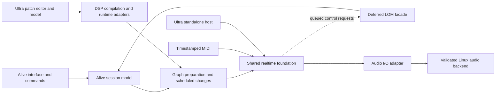

# Alive / Ultra Plan

Updated: 2026-10-20.

Status: documentation-led architecture research with runnable offline experiments. There is still no production DAW engine/editor or Live/Max compatibility implementation. Experiment build and execution evidence is listed below; physical Linux audio/MIDI latency, concurrent live editing, and browser execution remain unvalidated. This plan makes no delivery-date or broad compatibility claim.

## Current Recommendation

1. Keep **one host timeline and a small shared processing contract**, with distinct Alive session and Ultra patch authoring models. Begin with a minimal host and ahead-of-time Faust DSP, not a new general-purpose synthesis engine or a replacement Pd scheduler.
2. Treat **libpd as a separate Pd execution profile**, not the sample-accurate native Ultra foundation. Its real adapter is useful evidence about instance isolation, tick placement, and buffering; it does not establish safe concurrent patch editing or equivalence to Max.
3. Shortlist **direct JACK-on-PipeWire first, native PipeWire `pw_filter` second** for the local audio+MIDI comparison. Use identical DSP and routing; these are two client APIs into the same server, not an assumed latency contest between audio servers. CPAL remains a portability option after its separate MIDI/clock/lifecycle costs are tested.
4. Keep **Clockwork as the broader host-reuse alternative** and **Supersonic/scsynth as a deliberate SC ecosystem choice**, not default foundations. Require timestamp-preserving native ingress, independently controlled devices inside the singleton engine, and bounded heavy-command behavior before adoption. Do not confuse no heap growth with bounded callback time.
5. Leave product licensing open. Audited Faust-generated DSP plus a thin host offers the least coupling for a permissive/proprietary direction; Pd externals, Faust function/architecture notices, SC GPL, and Clockwork/Supersonic AGPL/commercial terms require separate decisions. A process boundary or a commercial Clockwork license does not relicense the other components.

The research conclusion is provisional for product implementation, not merely a list of candidates: pursue the minimal Faust host and first JACK probe; retain Pd compatibility as optional. Change this recommendation only on the explicit counter-evidence gates below. The two offline experiments answer narrow correctness/integration questions, not controller-to-analog latency.

## Product Goal

Build a clean-room DAW in the Ableton Live product category, with its own session model, audio and MIDI engine, launcher, arrangement editing, routing, automation, persistence, user interface, and device system. Preserve a path toward Live set compatibility, the selected Live edition's built-in device catalog, and Max for Live-style patch compatibility.

Alive is the DAW. Ultra is a patch authoring environment, execution integration layer, and object library built on a shared realtime foundation. It can appear as an editor inside Alive and eventually as a standalone application. Reuse existing DSP compilers and patch/synthesis runtimes where they meet the requirements; neither product requires a new general-purpose synthesis engine. Product names and historical Live/Max boundaries do not determine engine, process, clock, or repository boundaries.

Linux is the primary platform, with low and predictable latency as an architectural requirement. The first performance workload is playing instruments from MIDI. Design choices must be evaluated against event timing, audible response, sustained processing deadlines, and behavior under editing and system load.

Implement compatibility through documented behavior, independent implementations, and reproducible reference fixtures. Ableton and Cycling '74 binaries or internal source code are not shipping dependencies. Installed software may serve as a licensed reference environment; proprietary-runtime redistribution or optional adapters require a separate decision.

## First Useful Workflow

The first performance milestone is a small native instrument played from a MIDI controller on Linux. Use deterministic oscillator/envelope/gain DSP with preallocated voices so that instrument complexity does not obscure backend and scheduling behavior. Cover note-on/off, velocity, sustain, voice exhaustion, and all-notes-off. Timestamp MIDI at the earliest reliable ingress point, map it onto the audio timeline, and apply events at defined sample offsets.

The first product milestone adds a minimal interface, a MIDI clip, parameter automation, and native save/reopen around that instrument. A command interface reproduces the same operations. Audio-loop launching is the next workflow expansion. Existing Live project import and Max compatibility remain separate research tracks unless they become explicit first-release requirements.

| Area | Initial Scope | Expansion Path |
| --- | --- | --- |
| Projects | Native projects with stable identity and reliable save/reopen | Version migration, recovery, broader editing |
| Audio and MIDI | Timestamped live MIDI driving a small native instrument and physical output | Audio-loop loading, streaming, resampling, warping, recording |
| Timing | Audio-clock mapping, sample-offset events, transport, deterministic MIDI clip playback | Beat-grid launching, tempo maps, arrangement interaction |
| Devices | One native instrument with bounded voices, state, and automation | Patch-authored devices, stock-device families, external plugin hosting |
| Live sets | Early read-only import experiment | Useful playback, then guarded export for specific supported edits |
| Ultra | Equivalent native and patch-authored instrument on the shared foundation | Max-compatible execution profile, embedded editor, standalone authoring |

Select the initial Linux audio/MIDI integration and pin its dependencies through the research and benchmark gates below. Also select the target Live version and edition for compatibility. Live 12.4.6 with Max 9.1.5 is the available investigation reference, not an automatic compatibility promise.

## Architecture and Ownership

The recommended architecture is a shared realtime foundation with separate session and patch authoring models. "Shared" describes ownership and timing, not a requirement to implement the foundation ourselves. The source comparison below selects the minimal Faust host provisionally. Validate the native production boundary locally; the two cloud experiments intentionally retain distinct native/Faust and Pd execution semantics, so they do not establish cross-runtime waveform equivalence.

| Component | Responsibility |
| --- | --- |
| Shared realtime foundation | Device processing contract, frame clock, timestamped events, parameter application, buffer management, graph activation/retirement, latency metadata, reusable DSP primitives |
| Alive session layer | Tracks, clips, scenes, arrangement, routing intent, transport commands, automation authoring, undo, persistence, application interface |
| Ultra authoring and execution layer | Patch model/editor, object definitions, DSP compilation or runtime adapters, patch-specific execution semantics, bounded native message execution where reuse does not suffice |
| Compatibility adapters | `.als` and `.amxd` translation, selected Max object behavior, LOM paths and control semantics |
| Linux host | Physical audio/MIDI integration, stream lifecycle, device clock mapping, backend observability |

Alive sessions and Ultra patches produce executable devices/subgraphs for the same processing contract. Native devices and patch-authored devices share DSP implementations where their semantics match. They use one active host timeline, parameter identity scheme, and graph lifetime protocol. Embedded Ultra introduces no additional hardware stream or independently advancing audio clock. Evaluate any additional buffering explicitly rather than accepting it as a consequence of the product boundary.

Keep session editing and patch editing as distinct models; neither needs to become the other's storage schema. Keep compatibility-specific message order, vector behavior, and deferred work inside a defined execution profile. A shared clock does not require every object to have the same scheduling semantics. Initially preserve patch subgraphs as execution units where that helps correctness; flatten or fuse them only when equivalence and performance justify it.

The standalone Ultra application is a smaller host of the same foundation. Its host supplies physical I/O and reports DAW-specific services as unavailable. Alive remains useful without Ultra, and the shared foundation must not depend on Alive session types, either UI, or the LOM facade.

Compare this approach with separate DAW/patch engines behind a host bridge and a fully unified session/patch model. Separate engines can preserve independent execution semantics but increase integration and maintenance obligations; a fully unified model can simplify some transformations but couples two different authoring domains. The shared foundation is the leading choice because it centralizes timing and device lifecycle while preserving focused models. Validate this choice before building a general graph framework.



A single repository with focused modules is the recommended starting organization. Rust is a candidate for new host/model code; C/C++ libraries, their build systems, and a narrow audited FFI are acceptable when reuse wins. Compare Faust's generated Rust and C++ paths rather than choosing an engine by language. Keep the initial shared contracts small and extract reusable machinery from the instrument/patch experiment. Separate processes are a separate fault-isolation decision, especially for external plugins; they do not inherently imply an extra audio block, but their scheduling, buffering, and recovery costs require measurement. Separate repositories, release cycles, dynamic loading, or a stable ABI need demonstrated consumers. An internal Rust trait is not a stable plugin ABI.

### Repository Setup

Start with one GitHub repository, provisionally `alive`, containing both applications and the shared foundation. Keeping changes to the host, patch execution, and benchmark in one commit lets the first experiments revise their interfaces together. Alive and Ultra remain distinct products/modules with independent build targets where practical. Repository placement does not require either application to depend on the other's UI or session model.

The initial repository can contain this `PLAN.md` and research experiments. As implementation earns its structure, group Alive and Ultra application code under `apps/alive` and `apps/ultra`, shared libraries under `packages`, reusable validation inputs under `fixtures`, and disposable investigations under `experiments`. These are logical ownership boundaries, not a request to scaffold empty packages or choose a build system before the reuse comparison. Put experiment run instructions and conclusions in this plan so it remains the single planning document.

Use the existing `venetanji/alive` repository. Preserve its current ownership and visibility while product licensing remains undecided; do not change repository sharing as a research side effect. An `ultra` repository can be reserved later if useful for naming, but do not duplicate the runtime, plan, or source between two active repositories. Split a module only when its API, versioning, standalone consumers, and release needs justify the coordination cost. If a split is later chosen, define one canonical owner for the shared foundation and test compatible versions together; neither application should import the other application's internals.

## Reuse Strategy for Ultra

Ultra is a common authoring/device experience, not a claim that Faust DSP, Pd patches, SynthDefs, sclang programs, and Max patches share semantics. Keep execution profiles and dependency manifests explicit. No automatic arbitrary conversion is assumed. The following evidence is a source/documentation audit; actual builds and runs are separately enumerated under Research Experiments.

| Foundation | What it buys | Work and coupling retained | Counter-evidence that would change the decision |
| --- | --- | --- | --- |
| Minimal host + AOT Faust; optional libpd adapter | Small direct buffer contract, host-owned sample-offset events/voices, clear native baseline; existing Pd runtime when explicitly selected | Host must implement bounded lifecycle, transport, queues, persistence and physical I/O; Pd semantics/locks stay in its profile | Reject as baseline if the small native instrument cannot meet local timing/recovery gates without recreating a large runtime, or a reusable host demonstrably provides equal semantics with less total maintenance |
| Clockwork hosting an Ultra guest | Existing scheduler, assets, telemetry, memory infrastructure, native/web host separation | Alpha guest API, one shared engine, native ingress timestamp gap, reblocking and guest work budgets; host-owned state partitioning | Adopt only after a tiny guest proves timestamp-preserving ingress, independent device routing/state, measured input delay, and bounded load/replace under the same local workload |
| Supersonic/scsynth synthesis core | SC graph, buses, SynthDefs and UGen ecosystem; concrete Clockwork guest | SC-specific semantics, unsupported UGens/media, inline heavy command stages, shared resources and GPL/AGPL scope | Prefer if actual SC workflows remove substantial engine work and product licensing permits it, while preloaded/budgeted edits pass tail/deadline and isolation tests |

Separate engines behind a bridge remain a fault/isolation option, not an automatic extra-block requirement. A fully unified session/patch model is not justified by either experiment: it couples authoring semantics without solving MIDI clocks, runtime locks, or lifecycle. Keep the initial repository and internal contract small; no stable external ABI is established.

### Versioned Library Evidence

Source inspection and actual build versions are deliberately separate. Upstream/live documentation was read on 2026-10-20. Reproduce the experiments using their locked downloads below, not a moving upstream branch.

| Component | Exact inspected revision | Primary evidence |
| --- | --- | --- |
| Faust compiler/interfaces | 2.90.12, `0883a5e457f636c3ca53b3e03237fdee66881241`; **experiment uses 2.88.0**, pinned separately | [DSP interface](https://github.com/grame-cncm/faust/blob/0883a5e457f636c3ca53b3e03237fdee66881241/architecture/faust/dsp/dsp.h), [compiler license](https://github.com/grame-cncm/faust/blob/0883a5e457f636c3ca53b3e03237fdee66881241/COPYING.txt), [architecture manual](https://faustdoc.grame.fr/manual/architectures/), [FAQ](https://faustdoc.grame.fr/manual/faq/) |
| Faust library audit | `eb6a5e330653d6b877e049cccdc95361ea07d2a4` (inspection compiler's gitlink); build uses its bundled distribution | [Oscillator source and notice](https://github.com/grame-cncm/faustlibraries/blob/eb6a5e330653d6b877e049cccdc95361ea07d2a4/oscillators.lib); inspect used functions/transitive imports, not only top-level header |
| libpd | 0.16.1, `ba0dc63262901d658af8bbda5e619a60fa975e78` | [API](https://github.com/libpd/libpd/blob/ba0dc63262901d658af8bbda5e619a60fa975e78/libpd_wrapper/z_libpd.h), [processing/dispatch](https://github.com/libpd/libpd/blob/ba0dc63262901d658af8bbda5e619a60fa975e78/libpd_wrapper/z_libpd.c), [build flags](https://github.com/libpd/libpd/blob/ba0dc63262901d658af8bbda5e619a60fa975e78/Makefile), [license](https://github.com/libpd/libpd/blob/ba0dc63262901d658af8bbda5e619a60fa975e78/LICENSE.txt), [embedding docs](https://github.com/libpd/libpd/wiki/libpd) |
| Pd dependency | `f009fd8d7b537e209e09898d487fdf1bf547da2b`, selected by libpd gitlink; runtime prints 0.56.5 | [Thread/lock implementation](https://github.com/pure-data/pure-data/blob/f009fd8d7b537e209e09898d487fdf1bf547da2b/src/s_inter.c) |
| Clockwork | `94b67500c96e105491682ec68741b5018560eab7` | [Host-driven embed](https://github.com/samaaron/clockwork/blob/94b67500c96e105491682ec68741b5018560eab7/src/clockwork_embed.h), [guest contract](https://github.com/samaaron/clockwork/blob/94b67500c96e105491682ec68741b5018560eab7/src/dsp_api.h), [license/build-component terms](https://github.com/samaaron/clockwork/blob/94b67500c96e105491682ec68741b5018560eab7/LICENSE) |
| Supersonic | 0.91.0 manifest, `08b587055f0dbe6f6ff7d52e09bc2ae331121480` | [Embedding](https://github.com/samaaron/supersonic/blob/08b587055f0dbe6f6ff7d52e09bc2ae331121480/docs/EMBEDDING.md), [SC differences](https://github.com/samaaron/supersonic/blob/08b587055f0dbe6f6ff7d52e09bc2ae331121480/docs/SCSYNTH_DIFFERENCES.md), [guest implementation](https://github.com/samaaron/supersonic/blob/08b587055f0dbe6f6ff7d52e09bc2ae331121480/dsp/scsynth/scsynth_dsp.cpp), [web modes](https://github.com/samaaron/supersonic/blob/08b587055f0dbe6f6ff7d52e09bc2ae331121480/docs/MODES.md), [license](https://github.com/samaaron/supersonic/blob/08b587055f0dbe6f6ff7d52e09bc2ae331121480/LICENSE) |
| Upstream SuperCollider | `5b69dfedb283208c4eccc88fba4588843174f080` | [Embedding header](https://github.com/supercollider/supercollider/blob/5b69dfedb283208c4eccc88fba4588843174f080/include/server/SC_WorldOptions.h), [timing guide](https://github.com/supercollider/supercollider/blob/5b69dfedb283208c4eccc88fba4588843174f080/HelpSource/Guides/ServerTiming.schelp) |
| FaustWasm | `1c0d17a7bb4a047a4a08cb34a0bc6a3ee2019b67` | [README/timing tests](https://github.com/grame-cncm/faustwasm/blob/1c0d17a7bb4a047a4a08cb34a0bc6a3ee2019b67/README.md), [AudioWorklet implementation](https://github.com/grame-cncm/faustwasm/blob/1c0d17a7bb4a047a4a08cb34a0bc6a3ee2019b67/src/FaustAudioWorkletProcessor.ts), [wrapper license](https://github.com/grame-cncm/faustwasm/blob/1c0d17a7bb4a047a4a08cb34a0bc6a3ee2019b67/COPYING.txt) |

### Faust: Narrow Processing Contract
The dsp.h interface has init, instanceInit, instanceConstants, instanceResetUserInterface, instanceClear, clone, buildUserInterface and compute(count, planar inputs, planar outputs). init includes class-level table initialization as well as instance initialization: prepare tables/instances before rendering, and do not casually run class initialization concurrently with live instances. Default buffers must be distinct; in-place requires the matching compiler option and scalar path. compute's date_usec overload delegates to ordinary compute in the base implementation, so passing a timestamp alone does not schedule parameters.
A bounded host should keep sorted frame-offset events and split compute into spans at changes; use fixed event capacity, fixed voice capacity, explicit stealing and panic policies. Host-owned voice allocation can reuse the identical monophonic Faust DSP per voice and avoids hiding lifecycle in an unexamined polyphonic architecture. One state object per voice/device plus read-only shared tables supports isolation, but prove by two-device fixture. State serialization is a host schema, not raw object-byte serialization. Replacement prepares new state off audio, publishes only a bounded pointer/slot swap at a block boundary, acknowledges retirement then frees off audio. Fixed-duration crossfade costs two graphs and needs a declared CPU budget. AOT avoids compiler/JIT work during performance. Faust does not supply the session graph, MIDI ingress, compatibility message semantics or project persistence.
Disproof gates: render offsets 0,1,31,63,64,127; compare segmented vs one-sample reference; count allocation and lock calls during render; replace while held/sustained notes sound; exercise voice stealing, velocity-zero note-off, duplicate pitches, sustain release and queue overflow. Distinct device parameters must never affect the other. Enforce sample/voice/event ceilings; no finite WCET follows merely from the language generating finite computations.

#### Generated Rust versus C++

Rust sources at the same inspection pin:
https://github.com/grame-cncm/faust/blob/0883a5e457f636c3ca53b3e03237fdee66881241/architecture/rust/README.md
https://github.com/grame-cncm/faust/blob/0883a5e457f636c3ca53b3e03237fdee66881241/architecture/rust/minimal.rs
Rust output is an actual supported compiler target, not a reason to wrap C++ by default. The inspected FaustDsp trait uses mutable-self compute with borrowed input/output slices and ParamIndex get/set methods; C++ uses UI-exposed zones and planar pointer arrays. Neither API supplies Alive's event/lifetime contract. Rust's architecture README warns large DSP structs can overflow the stack through Box::new(Dsp::new()) in debug builds; generated projects support default-boxed 0.2.0 for direct heap initialization. Allocate/initialize off render regardless. Rust borrow checking helps owner discipline, but FFI to libpd, OS callbacks and any unsafe generated/static storage still need audit; no language proves deadline bounds. C++ has broader existing architecture coverage and integrates the C libpd probe with less tooling. Choose C++ for this disposable probe only, without selecting production language. Before choosing production, generate both from identical source/compiler flags, compare event/envelope output within declared float tolerance, maximum callback time, code size/build time, initialization memory and static/table behavior. Compare debug and release initialization; do not compare different optimization/SIMD settings then attribute differences to language. The inspected Rust minimal architecture is GPL-3.0-or-later WITH an unmodified-architecture larger-work exception, not the same base license as C++ dsp.h.

### Pd/libpd: Explicit Execution Profile
Use libpd_init, libpd_new_instance, libpd_set_instance, libpd_init_audio, libpd_openfile, DSP-on message, libpd_process_float or raw, then close/free off render. MULTI=true sets both PDINSTANCE and PDTHREADS; without it new_instance returns NULL and set_instance does nothing. Query blocksize rather than baking in 64. A patch handle and $0 namespace are not equivalent to an independent Pd runtime; test both separate instances with identical receiver symbols and same-instance $0-qualified patches.
The API's noteon(channel,pitch,velocity), controlchange etc have no frame-offset/timestamp parameter. Note-off is note-on velocity zero. Documentation says host messages affect the next tick; implementation immediately invokes Pd receiver dispatch while holding sys_lock, so arbitrary message graphs can execute during the call, before the next audio process. Do NOT assume libpd_float or noteon is enqueue-only. A restricted patch can implement explicit in-tick control scheduling, but that is a declared patch protocol, not general timestamped MIDI support. One tick per process call minimizes batching; process_float(ticks>1) does not expose a host event injection point between those ticks.
The processing macro takes sys_lock, polls GUI/network work via sys_pollgui, processes each tick and copies buffers, then unlocks. Under PDTHREADS+PDINSTANCE, sys_lock takes the instance mutex and global rwlock read lock. Under no PDTHREADS it is a no-op (except test-locking mode). Therefore separate instances do not prove freedom from global lock contention; loader/class changes require audit. Loading/closing, resizing arrays and receiver operations are not safe realtime publication primitives. Arbitrary Pd patches can recurse or do expensive control work, and externals add their own globals, locks, allocations and dependencies. Outgoing hook queues cannot make incoming calls realtime-safe.
Reblocking: at 64/128 host frames, process one/two ticks with explicit inter-tick events; at 32 or irregular frames a host FIFO must accumulate input and retain output. A generator may render ahead without audio input; an effect cannot consume input not yet received. Measure an input impulse, distinguish input buffering delay from event quantization and output FIFO prefill, and publish exact policy. No blanket zero-delay or mandatory universal one-block assertion.
Experiment: two MULTI instances each with oscillator/gate/gain plus pass-through impulse patch, identical symbols, deterministic event requests and 32/64/128/irregular callbacks. Record requested vs applied event frame (ceil-to-tick policy explicitly, never secretly early), output difference, state independence and open/close timing. A load/replace test with rendering paused proves only lifecycle, not live replacement deadlines. Concurrent-load stress must report global lock wait and tail render times before any live-edit safety claim. Keep runtime/pool teardown off callback. This test can reject Pd as native Ultra while retaining useful Pd compatibility.

### Clockwork: Host Reuse with Adoption Gates
clockwork_embed_boot opens/ticks physical audio. clockwork_embed_attach opens no device and render consumes host buffers. Attach's clock is NTP-at-attach plus rendered frames, so offline rendering advances with audio rather than wall clock. Render is documented allocation/lock-free, but guest command work is a separate question. Fixed engine blocks sit behind input/output FIFOs. Header specifies immediate output frame zero and input arriving up to one block late, initially padded. The header's rhetorical claim this is universal to every DAW plugin should not be adopted: aligned host/plugin blocks can avoid such adaptation.
One engine exists per process. A second attach with matching geometry joins the same engine; otherwise it is refused. This is not independent plugin-instance state. Alive could intentionally own one Clockwork engine and partition device IDs, buses, graph nodes, assets, event destinations, state and quotas. That design must be tested; attaching twice is not a two-device isolation implementation.
dsp_api.h separates describe/memory sizing/new/free/reconfigure/process/osc/asset. Device reconfigure is done with audio stopped and only for declared survivable changes; otherwise cold restart destroys state except explicit persistent storage. dsp_osc receives when plus the current target block_time BEFORE dsp_process; use the supplied target block time, not the prior rendered block. Native MIDI through wants_events carries block-drain time, while web can carry arrival time. A host-originated OSC path preserves explicit timetags, so a timestamp-preserving JACK/PipeWire ingress is plausible but not established by the default native MIDI path.
Pool allocation failing rather than growing is useful, not a command CPU budget. Timed messages can be copied into scheduler storage and again by the guest; avoid bulk in OSC. Asset commit passes a range-checked shared pointer and should bind only, with release acknowledgement before reclaim. Demand maximum packet size, maximum events drained per cycle, scheduler capacity, cancellation generation, late-event semantics, and note-off-safe overflow before adoption. Run same instrument as a guest only after libpd baseline if needed; do not build all adapters now.

### SuperCollider and Supersonic
Upstream libscsynth WorldOptions.h warns ABI may change across minor versions; its public exports create/cleanup worlds, send packets, copy sound buffers and NRT render, not a generic host-buffer render contract. Supersonic's guest adaptation is the concrete host-driven path; do not claim upstream World_New alone supplies it. Supersonic EmbeddedHost owns devices, fronts file operations and serializes sends; boot/shutdown/loadDefinitions block and must remain off render. onMessage runs NRT gateway, onLog may include audio and must stay cheap.
The guest scsynth_dsp.cpp applies when against block_time to set sample offsets before message execution; holds_schedule=0 delegates holding timed messages to Clockwork. That proves preservation of offset information, not that every UGen/control honors it. SC guide distinguishes sequence lookahead from live input: default 0.2s Server.latency is not unavoidable engine latency, and live input should add no such lookahead. OffsetOut-style onset placement must be distinguished from control-rate parameters and envelope semantics.
Supersonic docs explicitly run all asynchronous command stages inline on audio, though file reads/decode are client-side. Thus /d_recv parse/construct, synth construction, buffer zeroing/copying and large command bursts can exceed deadlines despite no malloc/system I/O. scsynth_dsp.cpp confirms commands finish their stages in their arrival block. Preload definitions, preallocate voices/buffers, restrict command vocabulary and sizes while running, or add preparation/budgets before claiming low-tail live editing. Measure max cycle under each operation, not just steady state.
UGen support is explicit: no DiskIn, DiskOut, VDiskIn or UI UGens; named analysis UGens absent. The source also documents changed negative/zero envelope behavior and idempotent notify across rebuild, so compatible OSC commands do not establish bit-identical upstream semantics. Built-in cold restart currently rebuilds scsynth state. Two logical devices must partition buses/groups/node IDs/buffers and clean up only their own objects; resource exhaustion and malicious/heavy patches still share a realtime engine.

### Licensing and Product Options
- AOT Faust with original DSP and audited imports/architecture is the strongest permissive/proprietary-host path. Compiler LGPL-2.1-or-later is distinct from output. The inspected dsp.h has LGPL plus a larger-work exception conditioned on leaving that architecture section unmodified. oscillators.lib has an explicit generated-code exception including modified compiled output; other imported library files and notices still require inspection. Do not infer all architectures/third-party DSP have identical terms.
- libpd/Pd core inspected license is BSD-style, with per-file exceptions. Externals remain separate license and multi-instance/RT audits. Avoid shipping arbitrary externals by default.
- Upstream SC inspected code is GPL-2.0-or-later. Supersonic LICENSE declares combined program AGPL-3.0-or-later, scsynth GPL-2.0-or-later used under GPL-3.0; sc3-plugins also GPL with named mda exceptions. Its supplied synthdefs MIT and sample package CC0 do not relicense the engine.
- Clockwork code offers AGPL-3.0-or-later OR commercial. Its license explicitly lists optional GPL Ableton Link, LinkAudioInputRenderer and ASIO choices alongside permissive dependencies. A commercial Clockwork agreement does not automatically cover those optional components or SC, nor make Supersonic proprietary-compatible. Check actual build flags and contract scope.
- FaustWasm wrapper COPYING.txt is LGPL-2.1-or-later, separate from generated WASM DSP and optional embedded libfaust compiler. AOT assets can omit the compiler, but not ignore wrapper obligations. GPL/AGPL-compatible distribution must plan corresponding source/build/notice delivery; browser downloads and AGPL network obligations need product-specific review. A socket/process boundary alone is not legal clearance.

The actual experiment uses Faust 2.88.0, whose bundled basics.lib contains processArray/tabulateNd function-level AGPL-3.0-only notices despite a general library exception header. The experiment's generated metadata uses sine/ASR primitives instead. The build hashes below, not the 2.90.12 inspection pin, identify the 2.88.0 build pin. No blanket 'Faust library output is proprietary-safe' conclusion follows from one header or generated metadata alone. Close the used-function/transitive import inventory before distribution.

#### License Strategy Matrix

This is a technical dependency inventory, not legal clearance. The pinned license links above and the actual build-input notices below control; no new product license is selected here.

| Selected component | GPL/AGPL-compatible product path | Permissive/proprietary host path | Required next check |
| --- | --- | --- | --- |
| AOT Faust-generated DSP | Retain applicable generated-code/library/architecture notices and source obligations | Potentially viable with used-function exceptions and unmodified architecture sections; not universal for all imports | Freeze transitive functions, generated metadata, architecture edits, and build inputs per device |
| Pd/libpd core | BSD-style core usable subject to retained notices | Comparatively low copyleft coupling for audited core | Audit every external separately for license, globals, locks, and build flags |
| Upstream SC/scsynth | GPL-compatible distribution strategy required for included engine code | No proprietary-compatible assumption from OSC/process separation | Review actual combination and distribution; choose a different foundation if obligations conflict |
| Clockwork with Ultra guest | AGPL option plus component-specific terms | Commercial option needs explicit scope; optional GPL components remain separate | Obtain and review applicable agreement before commitment; audit enabled Link/ASIO/etc. components |
| Supersonic/scsynth combination | Declared AGPL combined program and component notices must be honored | Commercial Clockwork alone does not relicense SC or the combined distribution | Decide product-license strategy before adoption; inventory built-in and third-party UGens |
| FaustWasm wrapper and emitted assets | Wrapper LGPL and generated DSP/library terms remain distinct | AOT avoids runtime compiler, not wrapper or emitted-code obligations | Browser asset/source/notices delivery and modifications need review; no native plugin redistribution assumption |

### Browser Feasibility, Not a Web DAW
Direct FaustWasm is the recommended first web instrument/editor feasibility baseline: reusable DSP source, precompiled .wasm+JSON metadata, optional polyphonic mixer/effect assets; compiler can be absent at runtime. At inspected pin, optional AudioContext-second arguments on parameter/MIDI methods are rounded to frames and honored inside a quantum. Untimed calls apply on arrival; late timestamps apply ASAP. FFT path is block-granular; ScriptProcessor fallback is arrival-based and not a modern low-latency target. Source hardcodes kBlockSize=128 and uses queue splice/shift and block-event sorting: timing feature is not a bounded-allocation/work guarantee. Require event quotas, horizon limits and stress profiling. README identifies test/timing/measure.mjs for actual headless Chromium AudioWorklet sample checks; this audit did not run it.
Supersonic provides SynthDef/UGen graph and timestamped OSC schedule in SAB or postMessage modes. SAB is selected only with crossOriginIsolated, requires COOP same-origin and COEP require-corp plus compatible CORS/CORP for cross-origin assets. Producers spinlock the ring; full writes are dropped and counted, no fallback. PM incurs event-loop/serialization delivery variance and metrics snapshots (150ms default). PM is not feature-identical: scopes/capture are SAB-only. Both modes still require schedulable deadlines, bounded command work, and late-event policy. Prefer precompiled supported SynthDefs and predecoded bounded assets over dynamic native-plugin assumptions.
For both: test secure-context deployment, audio resume after user gesture, Web MIDI support/permission and timestamp conversion to audio clock, actual sample rate/quantum, measured base/output latency where supported, device change, background tab, suspend/resume and all-notes-off on disconnect. Persist portable source/parameter/voice state plus execution profile/dependency hashes, not engine memory. Browser live MIDI-to-audio requires physical measurement; headless sample-position tests prove only scheduled rendering. Linux's 64-frame gate is not a browser promise. No browser experiment was run.

#### Bounded Browser Probe Design

| Path | Deployment / transport | Timing and capability limits | First probe, still not run |
| --- | --- | --- | --- |
| Direct AOT FaustWasm AudioWorklet | HTTPS/localhost, user-gesture context resume; load pinned WASM/metadata/mixer assets | Inspected implementation assumes 128-frame processing; timed MIDI/parameter APIs exist, but late events are ASAP and queue work is not proven bounded | Reuse simple instrument, drive boundary/interior timestamps, compare observed frames with declared tolerance, cap pending events, test suspend/resume and state reset |
| Supersonic SAB | Cross-origin isolation (COOP/COEP), compatible CORS/CORP for assets; ring transport | Ring saturation drops/counts writes; producer synchronization and heavy guest commands still need budgets; scopes/capture available | Same small supported SynthDef, saturation/late-message counters, isolation headers and resource-loading failures, recovery after suspension |
| Supersonic postMessage | Fallback when isolation unavailable, still requires secure WebAudio setup | Serialization/event-loop delivery variance; not feature-equivalent to SAB, scopes/capture absent | Repeat scheduled-event and lifecycle cases, explicitly report mode and lost capabilities rather than treating fallback as identical |

Probe each on the actual supported browser/version, recording sample rate, actual callback lengths, `baseLatency`/`outputLatency` if available (null when not), startup/resume outcome, MIDI permission/support and timestamp-clock mapping. Browser automation can validate rendered offsets and state transitions; live controller-to-analog latency needs calibrated hardware. Keep native externals, arbitrary SC plugins, DAW disk streaming and complete Live/Max compatibility outside this web subset. Reuse DSP source and versioned parameter/preset/dependency data, not raw native engine memory. No browser implementation is necessary to accept the current Linux research conclusion.

### Foundation Decision Gates
Choose minimal Faust now provisionally. Reconsider Clockwork after a timestamped external-ingress proof, shared-engine two-device fixture and callback-tail/bounded-work tests. Choose Supersonic only if SC graph reuse materially reduces product work and AGPL-compatible scope is acceptable, with heavy edits preloaded or explicitly budgeted. Keep libpd for its intended Pd execution profile if tick timing and lock restrictions are acceptable; do not fork its scheduler merely to make all native Ultra events sample-accurate. If simple tests cannot build, preserve source-only status, report exact failure and avoid selecting a runtime on unrun code.


Explicit foundation falsification tests and maintenance costs:
1. Minimal host/Faust (+ Pd profile): fail native foundation if exact frame changes differ from one-sample reference, A's mutation affects B, any render-path allocation/blocking operation appears, teardown happens before retirement acknowledgement, or a capped workload misses provisional local deadline budget. Pd profile must separately fail/document sub-tick MIDI requirements and concurrent load waits rather than weaken native requirements. Maintenance cost: own thin graph publication, event mapping, state, voices and backend observability; maintain small C/FFI adapters plus runtime-specific profiles. Avoid implementing a general patch scheduler until missing semantics are concrete.
2. Clockwork guest host: feed events at frames 1 and 63 through real native ingress and require distinct correct offsets; block-drain timestamps fail the requirement. Two logical devices use distinct IDs/state/buses, replacing A must not reset B or its future events. Probe mismatched and matching second attach to expose singleton rather than count handles as isolation. Feed impulse at every offset through 32/64/128/irregular host blocks; reject unexplained delay or lost frames. Fill rings/scheduler and asset lane, require counted refusal and bounded per-cycle work, and cancel future generation-specific notes before replacement. Force rate/device restart and verify documented reconstruction. Maintenance cost: alpha API churn, embedding/FIFO and singleton adaptation, new ingress path, quota/graph/state layer; reduce duplicated host infrastructure but gain coupling to engine lifecycle/licensing and optional dependency flags.
3. Supersonic synthesis core: all Clockwork gates plus compare onset through offset-aware output and ordinary controls separately; push increasing SynthDef size, /b_alloc, buffer commits/copies, node creation and simultaneous queue bursts under sustained sound. Require hard admission limits or prepare/budget mechanism before deadline qualification. Replace group A while group B has held/sustained notes, buffer assets and future bundles; fail on cross-device cancellation or bus/node ID collisions. Unsupported UGen must produce diagnostic without corrupting prior graph. Measure pool exhaustion and reclaim/recovery, not just initial creation. Maintenance cost: scsynth fork semantics, UGen inventory/ABI and native-vs-WASM build matrix, command admission and state reconstruction, SC language boundary, plus GPL/AGPL compliance. Greatest graph reuse, greatest synthesis-model commitment.


## Linux Audio and MIDI Research

Select a direct JACK audio+MIDI client on PipeWire and a native `pw_filter` with audio/control ports for controlled local testing. Start with JACK's smaller documented surface. Neither is asserted faster. Direct ALSA is a diagnostic control if attribution requires it, not a third production backend. No hardware backend was built or run in this cloud research.

### Source and Version Selection

- PipeWire source tag 1.6.9, matching the version displayed by official documentation: https://github.com/PipeWire/pipewire/tree/1.6.9 . Audited filter.h, spa/node/io.h, midi-src.c, and ALSA sequencer source. Target's installed PipeWire/WirePlumber/kernel/ALSA versions must still be recorded; do not silently demand a system upgrade.
- CPAL released crate 0.18.2; crate VCS revision e1612d5d98152f8dc2a62e1b51ef7cbf4f7f26b7, Rust minimum 1.85, Apache-2.0. https://docs.rs/crate/cpal/0.18.2/source/.cargo_vcs_info.json and https://docs.rs/crate/cpal/0.18.2/source/Cargo.toml . Pin cpal = "=0.18.2" and commit an experiment lockfile if used. Its Linux dependencies specify alsa 0.11, jack 0.13.5 optional, pipewire 0.10 optional (v0_3_53 feature), pulseaudio 0.3 optional. These are manifest version ranges, NOT a claim of a resolved lockfile.
- Direct Rust JACK candidate jack = "=0.13.5". Official crate docs confirm MIDI ports/iteration, process and notification handlers, and cycle-time scope: https://docs.rs/jack/latest/jack/index.html (page explicitly 0.13.5). For an initial C/C++ probe the stable C API and PipeWire's libjack avoid a Rust-binding assumption entirely.
- PipeWire Rust-binding coverage is NOT fully verified here: the 0.10.0 docs/source URLs were unavailable, and the attempted upstream GitHub mirror did not resolve. CPAL source proves its use of Stream/time/IO callbacks, NOT coverage of pw_filter plus RT-safe MIDI POD parsing. Use the documented C filter API/narrow FFI in the native probe rather than claiming all necessary safe Rust wrappers exist. Resolve and pin a binding only after checking the actual released filter API and lifetime/thread contracts.

### Backend Capability Matrix

| Integration | Audio clock / MIDI | Buffers and reported latency | Xrun / changes / recovery | Scheduling and decision |
|---|---|---|---|---|
| Native PipeWire 1.6.9 pw_filter | process receives spa_io_position: clock id, nsec, position, rate, duration, delay, rate_diff, next_nsec and discontinuity/recovery flags. MIDI/UMP SPA sequences carry cycle-relative sample offsets. One filter can own both audio and MIDI ports. | Use actual clock.duration every callback, not requested quantum. Publish intrinsic ProcessLatency; consume propagated port Latency ranges. No app FIFO is necessary for compatible DSP, but upstream capture, async links, conversion/resampling and hardware may add delay. | Observe clock/graph epoch changes and state_changed errors. Reprepare rate-dependent DSP outside render; oversized unsupported buffers produce bounded silence and a reconfigure request. Reconnect and restore routing from control side. | PW_FILTER_FLAG_RT_PROCESS requests data-thread execution; no allocation, I/O, locks or logging there. Best direct graph integration; more Linux-specific port/SPA/lifecycle code. |
| Direct JACK API on PipeWire 1.6.9 | Audio and jack_midi_event_t.time offsets in one process callback. jack_last_frame_time identifies cycle frame; jack_get_cycle_times relates frames to JACK microseconds. Frame counters wrap and discontinuities require epoch handling. | Callback nframes is authoritative. Query capture/playback latency ranges and publish intrinsic processing delay. pw-jack chooses PipeWire libjack, not jackd. No automatic extra bridge audio block should be assumed. | Explicit xrun, buffer-size, sample-rate, latency and shutdown callbacks. Shutdown only flags/wakes control code; recreate client/ports and restore connections off render. Preallocate supported maximum quantum. | Server-managed processing callback, with actual scheduling policy verified locally. Mature audio+MIDI surface and smaller first probe. Test compatibility implementation, not just abstract JACK promises. |
| CPAL 0.18.2 PipeWire feature | Native pw_stream audio; callback/capture/playback StreamInstant derived from pw_time or fallback. No MIDI ports in generic CPAL API; separate MIDI clock mapping is needed. | Tracks observed frames in buffer_size(); requested output frames capped by mapped capacity. Stream delay contributes to playback timestamp. Not the pw_filter API. | Emits Xrun on recovery-flag transition if IO clock is available; stream/device/default-device errors. Format mismatch deactivates stream. Controller must rebuild after invalidation. | Uses mainloop-local listeners and deliberately omits RT_PROCESS; optional realtime feature promotes processing thread. Measure callback scheduling, extra buffering and error paths before adopting. |
| CPAL 0.18.2 JACK feature | JACK audio only; now uses JACK time; cycle timing and port latency produce callback/playback estimates. Separate input/output clients, not a single generic duplex/MIDI graph. | Interleaves/deinterleaves through temporary vectors. buffer_size() reads server size. | Xrun error notification; sample-rate change invalidates/quits stream. Buffer-size callback replaces vectors (allocation), unlike desired preallocated hot path. | Actual JACK server controls processing scheduling. Generic wrapper loses direct MIDI/graph access; use direct JACK for first probe. |
| CPAL 0.18.2 ALSA (always compiled on Linux) | PCM status/delay timestamps, with timestamp-mode fallbacks; stream.now must be compared within its supported time domain. MIDI is separate. | Fixed size requests nearest supported period, not guaranteed exact size; inspected code requests two-period ring and two-period playback start threshold. ALSA default can route through a PipeWire ALSA plugin, so this is not necessarily direct hardware. | Handles EPIPE/xrun and suspend/resume; caller handles device loss and rebuild. Query actual period/buffer after configuration. | Own worker; realtime/realtime-dbus features available. Useful explicit hw:CARD,DEV control only when permissions/device availability allow it. |
| CPAL 0.18.2 PulseAudio feature | PulseAudio protocol audio; could terminate at pipewire-pulse. Latency estimates polled by worker, interpolated between updates (100 ms maximum polling interval); no MIDI. | Protocol buffering separate from graph quantum; do not infer pro-audio period from CPAL buffer request. | Generic errors and lifecycle, not direct graph-xrun/clock ownership. Rate/reconnect handling needs targeted probe if selected. | Not shortlisted for first low-latency instrument. Remains a desktop compatibility candidate. |
| Direct ALSA PCM + sequencer diagnostic | PCM hardware/system timestamp pairs and separate sequencer queue time must be explicitly related; requested audio timestamp type can fall back in driver. | Inspect actual PCM periods, buffer depth, avail/delay, audio timestamp type and accuracy; avoid plug/default when measuring server removal. | EPIPE prepare/reprime; suspend resume/prepare; device disappearance close/reopen. Rate change requires reconfiguration. | App owns priority/locking and recovery. Exclusive hardware access and no graph routing are extra maintenance costs. |

CPAL default features are empty. Explicit pipewire/pulseaudio/jack features compile those hosts. Linux default_host() tries compiled-and-available PipeWire, then PulseAudio, then ALSA; it does NOT automatically select JACK. Select host_from_id explicitly and record it. Source: https://github.com/RustAudio/cpal/blob/e1612d5d98152f8dc2a62e1b51ef7cbf4f7f26b7/src/platform/mod.rs . Do not repeat the obsolete generalization that released CPAL lacks native PipeWire.

Source audit links for matrix:
- https://github.com/PipeWire/pipewire/blob/1.6.9/src/pipewire/filter.h
- https://github.com/PipeWire/pipewire/blob/1.6.9/spa/include/spa/node/io.h
- https://github.com/PipeWire/pipewire/blob/1.6.9/src/examples/midi-src.c
- https://docs.pipewire.org/page_latency.html
- https://docs.pipewire.org/page_man_pw-jack_1.html
- https://jackaudio.org/api/group__TimeFunctions.html
- https://jackaudio.org/api/group__MIDIAPI.html
- https://jackaudio.org/api/group__ClientCallbacks.html
- https://jackaudio.org/api/group__LatencyFunctions.html
- https://github.com/RustAudio/cpal/blob/e1612d5d98152f8dc2a62e1b51ef7cbf4f7f26b7/src/host/pipewire/stream.rs
- https://github.com/RustAudio/cpal/blob/e1612d5d98152f8dc2a62e1b51ef7cbf4f7f26b7/src/host/jack/stream.rs
- https://github.com/RustAudio/cpal/blob/e1612d5d98152f8dc2a62e1b51ef7cbf4f7f26b7/src/host/alsa/mod.rs
- https://github.com/RustAudio/cpal/blob/e1612d5d98152f8dc2a62e1b51ef7cbf4f7f26b7/src/host/pulseaudio/stream.rs
- https://docs.kernel.org/sound/designs/timestamping.html
- https://www.alsa-project.org/alsa-doc/alsa-lib/pcm.html

### Timestamp and Buffering Boundaries

Native physical path:
controller scan/USB or DIN transmission -> ALSA-sequencer timestamp/queue -> PipeWire MIDI node -> SPA sequence offset -> same-cycle instrument event splitter -> PipeWire audio graph -> ALSA PCM/interface queues -> DAC.

JACK-on-PipeWire path:
same controller/ALSA/PipeWire MIDI ingress -> PipeWire JACK MIDI port -> one JACK process callback (audio + MIDI) -> same PipeWire audio/device graph -> DAC.

CPAL path:
separate MIDI ingress timestamp -> bounded queue + clock-domain mapping -> CPAL audio callback (chosen host explicitly recorded) -> that backend's queues -> hardware. A separate MIDI callback's arrival time is not automatically a hardware or audio-frame timestamp.

Crucial implementation observation: PipeWire 1.6.9 spa/plugins/alsa/alsa-seq.c enables real-time queue timestamping for external subscribers. Its event reader obtains event age relative to queue_time and converts to sample offset as duration - 1 - age_in_frames when age < duration, otherwise offset 0. Thus the graph preserves an intra-cycle placement but can clamp old events and does not hand the original absolute controller ingress time to the instrument as that offset. Measure capture scheduling; do not call this zero-latency or full ingress provenance. Source: https://github.com/PipeWire/pipewire/blob/1.6.9/spa/plugins/alsa/alsa-seq.c . Actual USB/DIN/device behavior remains unknown.

Engine event contract proposal: epoch + absolute frame + stable sequence tie-break + source timing quality + original ingress timestamp when available. Graph-provided offsets map directly into current callback; do not re-timestamp them at dequeue. For separately clocked input, maintain validated clock-pair mapping and drift/residual diagnostics; never directly subtract MONOTONIC_RAW from MONOTONIC or arbitrary JACK/queue clocks. With cycle origin (T0,F0), estimate F = F0 + (T-T0)*effective_frames_per_time only after establishing the domains. Track mapping uncertainty. For live late events, clamp to earliest not-yet-rendered sample and increment lateness histogram; do not insert sequencer lookahead. Scheduled future events remain queued; never wrap/clamp them into the current block. On epoch discontinuity discard old scheduled work, reset voice/sustain state, and resynchronize before restoring output.

Publish actual intrinsic adapter delay, not execution time. PipeWire's latency documentation says an async link generally contributes one graph quantum (driver output exception); inspect negotiated node/link properties rather than assuming a process boundary or the CPAL wrapper adds exactly one block. JACK timestamp APIs provide estimates except cycle frame origin; skipped cycles invalidate simple cumulative arithmetic. Backend latency metadata predicts routing/device delay, not verified acoustic response.

Scheduling: PipeWire's RT module first uses available RLIMIT_RTPRIO and otherwise can use realtime portal/RTKit. Check actual thread policy/priority and warnings; successful connection is not evidence of RT scheduling. Prefault/preallocate bounded render memory; record memlock limits and page faults. Changing privileges, kernel, affinities or security settings is separate approved local setup, not part of research. Source: https://docs.pipewire.org/page_module_rt.html . PREEMPT_RT or rtla diagnostics may explain scheduler tails, not establish audio latency: https://docs.kernel.org/tools/rtla/rtla-timerlat.html .


## Latency Benchmark Contract

At 48 kHz, 64/128/32 frames are 1.333/2.667/0.667 ms processing periods, not audible latency. Keep scheduled sample-placement evidence, callback duration, wakeup delay, intrinsic adapter delay, and calibrated physical controller-to-analog response separate. The small cloud probes use four native voices or two Pd devices; the proposed local 32-voice workload is an expansion gate, not tested capacity.

### Local Protocol (Proposed, Not Run)

1. Inventory exact CPU, governor/power mode, kernel build/PREEMPT model, interface+firmware, controller, MIDI connection type, USB topology, driver, distro packages, PipeWire/WirePlumber config, loaded libjack path, DSP/compiler commits, limits, and thread policies. Capture graph/device sample rates, quantum, hardware periods/buffers, links/resamplers, latency metadata and stderr warnings. Resolve stable physical device IDs; no Bluetooth, hidden monitor path or default-route switching in baseline.
2. Use the same deterministic bounded oscillator/envelope/gain instrument and score on both backends: baseline 32 voices, two independently controlled devices, stereo 48 kHz, maximum 256 ordinary events/callback, preallocated queue 4096 events. These workload limits are provisional engineering choices, not measured capacity. Reserve reset/note-release handling: overflow must not strand sustain or notes; latch panic/reset if loss compromises lifecycle. Test 33rd voice, duplicate notes, velocity-zero note-on, CC64, all-notes-off and source disconnect. Distinguish semantic overload tests from throughput benchmarks.
3. Run 48 kHz at observed 64 and 128 frames (1.3333 and 2.6667 ms periods); optional 32 frames (0.6667 ms) is stress, not a release blocker. For controlled sessions PIPEWIRE_QUANTUM=64/48000 requests forced graph rate/quantum; verify actual graph and device settings. Do not silently apply system-wide settings. Repeat with 128 and restore settings afterward. PIPEWIRE_LATENCY is a request, not proof of actual period. Source: https://docs.pipewire.org/page_man_pipewire-jack_conf_5.html .
4. Software tests first: deterministic injected graph MIDI at offsets 0,1,N-1; equal-time ordered events; boundary/future/late events; 32/64/128 and irregular offline partitions; impulse through each adapter; known event-to-first-nonzero frame and parameter changes. Compare to offline reference and deliberately wrong offsets so the test can fail. Render a diagnostic impulse for timing as well as musical envelope, whose threshold would otherwise bias onset. This establishes frame placement only, not physical controller response.
5. Physical measurement: externally generated MIDI with an electrical reference pulse recorded on one synchronized acquisition channel, analog DAW output on another. Calibrate reference-pulse-to-complete-MIDI-message timing with a logic analyzer or known generator, recording transport and firmware. Do not connect DIN signal directly to an audio input; use suitable isolation/level conversion or a proper analyzer. For USB use a generator with synchronized GPIO trace or controller contact sensor; otherwise label software-send-to-output, not key-to-sound. Record trigger and output in the SAME capture clock. Swap capture channels/repeat shared reference to bound channel skew. Publish the reference-point definition and calibration uncertainty; do not subtract assumed ADC/DAC delays or half an audio round trip.
6. Collect at least 10,000 notes with randomized phase relative to audio callback, documented seed and spacing sufficient for independent onsets. Repeat each backend/quantum/load combination three times in randomized order after warmup. Use a 30-minute sustained run for each required 64/128 baseline and representative loaded condition; maximum observed values are observation-window maxima, not hard worst-case bounds.
7. Load matrix: idle; repeated UI edits/animation; save/load preparation; device replacement; sustained 32 voices; legal MIDI event bursts; competing CPU/memory/disk load; combined workload. Do not stress the system using unbounded RT workers. Run no-logging baseline and bounded-telemetry variant to quantify instrumentation effects. Scheduler tracing separately if it perturbs audio. Log cycle start/end, expected deadline, start lateness, callback duration, graph completion when available, queue high-water marks, events late/dropped, voice steals, page faults, xruns, and actual rates/quanta into preallocated ring; drain to disk off RT.
8. Recovery tests separate from clean-playback statistics: quantum 64->128->64, 48k->44.1k->48k where supported, unplug/replug, server restart, MIDI disconnect while sustain down, queue overflow, intentionally failed graph preparation. Expect bounded silence/reset and visible error; rebuild outside render, then restore negotiated routing/state. Record silence duration and new clock epoch, do not count graceful silence as continuous success or hide these faults in aggregate percentiles.
9. Report median/p95/p99/p99.9/max physical latency, p99-p50 and p99.9-p50 spreads, callback duration/start-lateness distributions and maxima, deadline headroom, total observed cycles, xrun count, all dropped/late events, calibration bounds and confidence limitations. Show segments separately: physical/input ingress; ingress-to-renderable placement; DSP/adapter delay; output queues/DAC. Never sum overlapping latency estimates or call round-trip audio latency MIDI latency.

### Provisional Acceptance Budgets

- Exact scheduled software placement: <=1 sample error for the native/Faust host path, no unexplained block delay; independent devices do not cross-talk or share state. Fixed-tick runtime deviations must be declared, measured, and tested against that profile, not redefined as native success.
- At 64/128 frames under the stated baseline workload, target callback execution p99.9 <=50% period and max observed <=75% period: 64 => 0.667/1.000 ms; 128 => 1.333/2.000 ms. The remaining headroom is deliberate margin for scheduling/graph neighbors, not proof of whole-graph schedulability. Also require actual completion before backend deadline including wakeup delay.
- Zero unexplained xruns, lost note releases, stuck voices or render-time allocations/locks in required sustained baseline/representative editing runs. Count and surface all deliberate overload failures. Unsupported requested period is a configuration failure, not an automatic performance failure at another hidden period.
- Aspirational physical gate for a wired controller/interface: p99 <=10 ms at 64 and <=12 ms at 128; p99-p50 <=one period plus measured ingress jitter and calibration uncertainty. These are product targets selected for responsive playing, NOT claims from sources or hardware measurements. If missed, retain segment evidence and decide whether ingress, backend, runtime or hardware dominates before changing architecture. Do not weaken budgets merely to pass an unknown machine.
- Recover device/server failure without crash, use-after-free or stuck note; no promise of uninterrupted audio during loss. Choose user-facing recovery-time target only after measured reconnect behavior.

Decision after local runs: favor direct JACK if both meet timing/recovery gates and its simpler surface suffices. Prefer native pw_filter if it demonstrates a meaningful capability or measured tail/latency benefit, or JACK compatibility limits UMP/routing/clock observability. CPAL can return if its MIDI clock bridge and exact selected host pass the same tests; its availability is not evidence of equivalence.

### Per-case report record

Use one machine-readable record per run with fields: case_id; timestamp_utc; source_commit; dependency_lock_hash; backend_api; backend_library_version_and_loaded_path; server_version; kernel; interface_id; controller_id; midi_transport; physical_reference_definition; calibration_method; calibration_uncertainty_us; requested_rate; observed_graph_rate; observed_device_rate; requested_quantum; observed_quantum_min_max; hardware_period_size_count; routing_graph_hash; resampling_present; intrinsic_adapter_delay_frames; reported_playback_latency_min_max; thread_policy_priority; load_profile; voices; event_capacity; random_seed; warmup_seconds; duration_seconds; cycles_observed; notes_observed; callback_duration_us {p50,p95,p99,p999,max}; callback_start_lateness_us {p50,p99,p999,max}; minimum_deadline_headroom_us; missed_deadlines; xruns; input_events; late_events; dropped_events; queue_peak; render_allocations; render_page_faults; stuck_notes; physical_latency_us {p50,p95,p99,p999,max}; physical_tail_spread_us; software_onset_error_frames_max; parameter_offset_error_frames_max; impulse_added_delay_frames; recovery_outage_ms; errors; result {pass,fail,unsupported,not_run}; failed_criteria; raw_trace_path; calibration_trace_path.

Unknown values must be null with a reason, never zero. Keep native-vs-runtime and backend-vs-backend paired comparisons at equal measured configuration, workload and physical routing. An unsupported 64-frame hardware configuration cannot establish a 64-frame gate; report unsupported and obtain a product decision. A missing external trigger cannot establish physical MIDI/key latency: report software-only and leave the physical gate not_run. A failed calibration invalidates the physical latency comparison, not the independently measured software correctness. Measure audio-input loopback impulse through direct pass-through before runtime insertion; report delta from that SAME path, not a guessed one-way value from round-trip latency.


## Realtime Execution

The control domain owns model edits, undo, LOM requests, dependency loading, graph preparation, and file operations. The render domain owns active DSP state and bounded audio/MIDI processing. Callbacks must not perform file I/O, unpredictable allocation or deallocation, blocking model/UI access, or unbounded command execution.

Graph preparation, activation, retirement, and reclamation are distinct operations. Prepare nodes and storage off the callback, activate a valid graph at a defined processing boundary, preserve or explicitly reset DSP state, acknowledge retirement, and reclaim old storage off the callback. Reject stale events using graph and transport generations. State capture must produce a coherent snapshot without locking the audio thread.

Each queue needs a capacity, processing budget, acceptance rule, and saturation behavior. Meter updates can be coalesced. Structural commands require explicit acceptance or rejection. MIDI note-offs, device removal, and transport reset must not silently leave notes active. A bounded or lock-free queue alone does not establish realtime safety.

| Host Contract | Execution Domain | Required Behavior |
| --- | --- | --- |
| Preparation and reconfiguration | Non-realtime | Sample rate, maximum processing size, channel layouts, scratch storage, dependencies, vector adaptation, preparation failure |
| Audio and event processing | Render | Borrowed buffers with explicit aliasing and lifetime, bounded event storage, frame offsets, deterministic ordering; no retained host-buffer references |
| Transport context | Supplied by host to render | Frame clock, musical position, tempo segment, running/loop state, discontinuity generation, offline/realtime mode |
| Parameter control | Control binding and render application | Stable parameter keys, value mapping, smoothing, source precedence, acquisition and release |
| LOM commands and observations | Deferred control | Request/reply association, capability errors, notification ordering, invalidation, persistent-binding policy |
| State capture and restore | Coordinated non-realtime | Snapshot consistency, schema version, unavailable dependencies, bounded handoff of render-owned state |
| Graph publication and retirement | Control prepares, render activates, control reclaims | Activation boundary, generation checks, retained state, acknowledgement, overload rejection |
| Fault reporting | Separate control/render policies | Unsupported objects, expired targets, event runaway, queue overflow, DSP failure, declared silence/bypass behavior |

Verify this contract by replacing and removing active devices, saving during playback, forcing queue saturation, and submitting late events for retired objects. Instrument callback allocation, deallocation, and blocking operations. Measure callback deadlines and xruns on declared hardware.

### Minimal Contract Sketch and Decision Boundaries

This is an implementation proposal, not a stable ABI or an implemented generic graph engine. Establish it with the two experiments before extracting shared packages. A native instrument and an Ultra device expose the same bounded facade; their execution profile declares where they differ.

```text
PrepareSpec { sample_rate, max_frames, input_layout, output_layout,
              voice_limit, event_limit, profile, dependency_manifest }
RenderContext { absolute_frame, frames, timeline_generation, graph_generation,
                transport_segment, offline }
Event { frame, stable_sequence, target_device_id, target_generation,
        kind, bounded_payload }
PreparedDevice { stable_id, profile, parameter_descriptors, latency_frames,
                 prepared_storage, prepared_state }
render(context, borrowed_planar_inputs, borrowed_planar_outputs, sorted_events)
  -> bounded_status_flags
```

- A block owns the half-open interval `[absolute_frame, absolute_frame + frames)`. An event on its right boundary belongs to the next block; equal-frame events retain the source's stable sequence. A native adapter renders spans between event offsets, applies the event, then renders the next span. It does not pretend ordinary Faust control zones carry timestamps. A Pd adapter declares tick quantization and reblocking delay instead of silently claiming the native contract's precision.
- Live arrival carries an ingress clock identifier and uncertainty where available. Map it to the active host frame epoch once; clamp late live events to the earliest unrendered sample and count lateness. Do not backdate an event into already-produced audio. A device/transport generation mismatch rejects stale events. On seek, stop, reconnection, or rate change, release notes and reset the mapping before accepting a new generation. Scheduled-clip lookahead must not become mandatory live-input lookahead.
- Start with fixed device IDs, two isolated instrument devices, bounded voice arrays, an acyclic routing description, and preallocated scratch. Reject unsupported feedback and graph sizes. No new general message scheduler, dynamic plugin ABI, or universal patch format is required. Borrowed audio buffers cannot escape a render call; zero-input instruments and duplex processors have separate declared layouts.
- Parameter identity is `device UUID + stable parameter key`, not a UI label or pointer. A descriptor declares unit, physical range, normalized mapping, quantization, smoothing, and event resolution. Store the base value separately from effective automation/modulation/remote values. A preset records schema/profile/dependency versions and base values; arbitrary runtime-internal state is not implied by that facade. Unsupported state remains preserved with a diagnostic, not replaced with a silently different device.
- Control prepares replacement graph N+1, including DSP initialization and storage; render adopts it at an agreed boundary only if its generation is valid and retirement capacity is available. Render acknowledges the retired graph; control reclaims it afterward. Crossfade is optional extra processing with an explicit budget, not a free default. If a runtime cannot prepare independently without taking locks also used by render, mark live replacement unsupported and require stopped processing for that profile. The offline libpd probe does not validate concurrent loading.
- Save copies bounded stored-parameter state through a generation-tagged snapshot handoff; serialize it outside render. Arbitrary delay lines or runtime state require a separately bounded capture protocol or stopped capture. No audio-thread filesystem calls or synchronous UI/model locks. A rate/quantum change outside prepared bounds requests a non-render rebuild, produces declared silence, and reports the condition instead of resizing inside render.
- A bounded ingress queue must also have a bounded drain budget. Reject excess note-ons and structural commands visibly; reserve termination/reset capacity. If an accepted note's termination cannot be retained, latch a per-device panic/reset that is consumed before normal events, clear sustain/held notes, and report lost fidelity. Do not call this lossless overload handling. Meter updates may be coalesced; future scheduled events stay outside the current-block budget until due. Clock reset and stale-target tests must verify no stuck notes.

The experiments validate only the portions listed in their result tables. Snapshot concurrency, graph publication/reclamation, allocation instrumentation, realtime backend integration, and live controller timing remain acceptance work, not features established by these sketches.

### Separate Max Compatibility Profile

Keep a future `max-subset-v1` profile separate from native/Faust and Pd execution. The [Max scheduler documentation](https://docs.cycling74.com/userguide/scheduler/) describes depth-first message delivery, high/low-priority work, and distinct `defer` versus `deferlow` queue behavior. A topologically sorted DSP graph cannot replace those message semantics. Before claiming compatibility, compare reference traces for an explicit trigger fan-out, cold-inlet state, recursive-message cutoff, deferred event order, and initialization under recorded scheduler settings.

[Sample-accurate messages](https://docs.cycling74.com/userguide/sample_accurate_messages/) are conditional on scheduler settings and supported objects, not a blanket property of all Max messages. Test scheduled impulses and ramps at offsets 0, 1, and vector-end; record hardware-buffer and signal-vector sizes separately. Signal-to-message feedback such as `snapshot~` retains relative timing but is documented to add a vector. Do not collapse this into the native path's event rule. `live.remote~` remains unsupported until its separate parameter ownership, smoothing, and documented buffer delay are reproduced against the target Live/Max versions. No Max binary or proprietary patch asset is needed by the cloud experiments.


## Time, Launching, and Parameters

Define an engine frame clock separately from musical position and the tempo map. Seeking, restarting, or invalidating scheduled playback advances a discontinuity generation. Specify how beat-based events are scheduled or recomputed after tempo changes, and how loops, stop, and simultaneous events affect pending work.

For the supported workflow, define launch quantization, the ownership of events exactly at block boundaries, active-note handling across stop and loop wrap, and the ordering of launch and parameter events. When arrangement playback is added, specify how Session and Arrangement sources take control of each track. Supported sample positions should remain consistent across different host block partitions.

Devices must expose latency and channel-layout information even if the first release supports only simple graphs. Declare the initial policy for delay compensation, sidechains, bypass, tails, and feedback. The first graph may reject cycles and report uncompensated paths as unsupported; later compensation must have a defined place in the contract.

Parameter state distinguishes the stored base value, automation, modulation, and temporary remote control. Define stable identity, physical and normalized ranges, quantization, smoothing, sample offsets, source precedence, and acquisition/release behavior. Save operations must preserve the appropriate stored state rather than accidentally recording a transient effective value.

## Native Persistence and Live Sets

Native project persistence, `.als` import, and `.als` export are separate capabilities. Native projects use stable identities, a versioned schema, atomic writes, and explicit media references. Establish save/reopen and undo behavior in the first workflow; add migration and interrupted-save recovery fixtures as the format grows.

The `.als` importer retains a source representation and a mapping between imported file IDs and Alive identities. Preserve unknown content and unsupported device state where feasible. Unsupported devices remain visible in their original chain position, with a clear explanation of whether playback bypasses them, produces silence, or cannot reproduce the original result. Resolve media and device dependencies independently of XML parsing.

Unknown XML preservation does not establish safe export: opaque state may refer to objects, parameter targets, or positions changed by an edit. Enable export only for an explicit supported edit set with known reference effects. Refuse structural edits whose exported consistency cannot be established. Initial exports create new files and leave the source recoverable.

Export acceptance requires a no-op round trip, a narrowly scoped supported edit, and fixtures with unknown data and cross-references. Reopen copies in the selected Live version and check object associations and behavior as well as Alive's own interpretation. Demonstrate that unsafe edits are refused. Parsing, useful playback, and safe round-trip editing remain separate support claims.

## Ultra and Max Compatibility

Define a named execution profile covering message types and coercion, hot/cold inlets, outlet and patch-cord order, depth-first message traversal, synchronous execution, deferred work, timers, initialization, DSP vectors, and supported feedback. Classify objects by execution domain. Bound recursive messages and event generation, and expose unsupported or runaway behavior explicitly.

Max distinguishes message scheduling and DSP execution, including high/low priority work and configurations that service scheduled work with the audio thread. Moving every patch message onto a UI thread or treating every patch as a generic DSP DAG would not reproduce those semantics. Hardware callback lengths and Ultra signal vectors must be adapted deliberately.

Evaluate `.amxd` compatibility in separate steps: container decoding, dependency closure, message execution, DSP execution, and host integration. Dependencies include abstractions, external objects, scripts, and data files. Reject unsupported executable dependencies in the initial subset; an in-process Rust runtime does not sandbox native externals.

Start with a small interpreted compatibility profile using reusable primitives where semantics match and independent implementations where they differ. Pd is not a drop-in Max scheduler. Compare message traces and audio results with the reference environment before considering lowering supported graphs to native code. Dynamic patching, opaque encodings, unavailable externals, and runtime-specific behavior may remain unsupported. Arbitrary `.amxd`-to-Rust compilation is not a baseline assumption.

The Max compatibility feasibility gate must execute an existing patch whose dependencies are fully supported, alongside small fixtures for ordered messages, deferred events, DSP, and host access. A successful gain patch or decoded container alone is insufficient for that claim. Track the exact supported files and object/dependency coverage. This gate does not block native MIDI performance or native Ultra graph experiments.

## Live Object Model Services

Expose a versioned subset of paths, object types, properties, functions, mutations, and notifications over Alive's command model. Begin with the paths required by the selected workflow; add query, set, call, observe, deletion, and stale-target fixtures before claiming the corresponding support. LOM is a bounded compatibility surface and does not expose all of Live's internal state.

Ordinary `live.path`, `live.object`, and `live.observer` interactions use deferred control-thread services. Define observer delivery order, subscription lifetime, path changes, object deletion, and errors. Mutations must not execute directly from observer notification delivery; deferred follow-up operations need explicit scheduling behavior.

Keep internal object identities, imported file IDs, per-device LOM handles, and saved target bindings distinct. The API overview describes IDs as device-scoped and not stored, while the object references document "Use Persistent Mapping" across save/restore and device moves. Resolve this qualification with mapping-enabled and mapping-disabled tests across reload, movement, duplication, deletion, and undo. Until tested for the target version, persistent mapping remains unverified.

`live.remote~` needs a separate render-side parameter-control path. Its references describe sample-accurate application from Max's audio thread with one audio buffer of latency, ordinary parameter automation disabled during remote control, unchanged stored set values, no undo steps, and envelopes remaining active. Verify these behaviors and the meaning of the buffer latency for the chosen configuration. Target lookup and binding can be deferred; sample-accurate application must not call the model/UI. Declare this object unsupported until the required behavior is implemented and measured.

## Devices, Plugins, and Media

Ultra's Max-like objects and Alive's Live-native device catalog are independent compatibility programs. The eventual ambition includes the complete built-in catalog for the selected Live version and edition: instruments such as Operator, Wavetable, Simpler/Sampler, and stock audio/MIDI effects. Each needs its own DSP, modulation, parameter behavior, automation, state, presets, and controls. Ultra hosting does not supply those implementations.

Prioritize devices using real workflows and track DSP, state, parameter, preset, and UI coverage independently. Keep external plugins, racks, presets, clips, packs, and M4L devices as separate families. Select plugin format and operating-system binary support together; an imported Windows plugin reference is not automatically executable on Linux. Plugin discovery, state restoration, latency, editor hosting, and crash isolation each need an explicit contract.

Physical I/O does not provide media decoding, resampling, prefetch, disk streaming, warp playback, or recording. The audio-media expansion uses a declared bounded media policy and reports missing, oversized, or unsupported media. Add streaming, warp modes, and recording through independent milestones. When input/recording enters scope, include duplex clock drift, monitoring latency, timestamp alignment, and interrupted-recording recovery.

Evaluate CPAL against the selected platform using a pinned version, supported sample formats/rates, callback-length handling, device-loss recovery, and observable xruns. Keep another backend possible through the adapter. The existing Wine/PipeASIO observation is not evidence of native backend latency or production audio quality.

## Research Experiments and Local Handoff

The following are small research fixtures, not production device APIs. All execution was on Linux x86_64, kernel 6.18.55, g++ 14.2.0 (Debian 14.2.0-19), Python 3.12.14 on 2026-10-20. No physical device, MIDI controller, browser, realtime priority, or target-machine benchmark was used. Neither upstream's complete test suite nor arbitrary patches/externals were validated.

### Reproduce

From the repository root:

```sh
(cd experiments/faust-reference && make setup && make test && make sanitize)
bash experiments/libpd-adapter/run.sh
```

The scripts require Linux x86_64 for the provided Faust binary, a C/C++ compiler, make, Python 3, curl, tar, unzip and SHA256 tooling. They download official sources/binaries, verify the pinned hashes, and build locally without installing system software. Faust generation uses the real `generateCAuxFilesFromFile` C API through Python ctypes; the resulting render executable does **not** link libfaust/LLVM and has no JIT. The libpd adapter links the actual upstream runtime built with `MULTI=true UTIL=false EXTRA=false`. Dependency/build directories and executables are ignored, not included in the PR.

| Dependency used in experiments | Pin and source | Download SHA256 |
| --- | --- | --- |
| Faust compiler library | [2.88.0 official Linux binary](https://github.com/grame-cncm/faust/releases/download/2.88.0/libfaust-ubuntu-x86_64.zip); source commit `8c00913e44d42f9d25aa3f1a0d500bde5662d7bc` | `7f7784567d8770dfbc1351f53b32dfb4d4c5baef0ba5f39fd925d5407ab63ff2` |
| Faust headers/libraries | [2.88.0 source distribution](https://github.com/grame-cncm/faust/releases/download/2.88.0/faust-2.88.0.tar.gz), including bundled library contents | `e4e175cf236924b5b7d4784cbb8c50cc01e211159e169655dd9e6d8f92b871d9` |
| libpd | `ba0dc63262901d658af8bbda5e619a60fa975e78`, 0.16.1; [pinned source](https://github.com/libpd/libpd/tree/ba0dc63262901d658af8bbda5e619a60fa975e78) | `7432b9108d6741f8ca5fd786ce83ed391d92b5197e93fd3762a5e81ae663095d` |
| Pd submodule | `f009fd8d7b537e209e09898d487fdf1bf547da2b`; [pinned source](https://github.com/pure-data/pure-data/tree/f009fd8d7b537e209e09898d487fdf1bf547da2b); runtime prints 0.56.5 | `29ad07f1f13dd199e2ebcd3c486dca4c496e4874dd856c925dc3891e11e58267` |

Official Faust archives are approximately 106 MiB binary plus 78 MiB source. Hashes lock the inputs used here; setup does not silently substitute a newer release. Build pins differ from the newer Faust interface inspection pin, deliberately. The main signal/lifecycle conclusions are established by the actual 2.88.0 generated code, not inferred from 2.90.12.

### Offline Faust Instrument

Files: `experiments/faust-reference/voice.dsp`, `generate.py`, `generated/voice.hpp`, `generated/voice.rs`, `host.hpp`, `test.cpp`, `Makefile`, `setup.sh`.

Graph: phase-shifted sine → finite linear ASR → velocity gain → level → fixed headroom mix. Four preconstructed generated voices, 48 kHz, 16-sample attack/release, velocity/127 and 0.25 per-voice scale. The nonzero starting phase makes onset detection independent of a sine zero crossing. Controls are cached UI-zone pointers, applied only by the render-owner thread between compute spans, not concurrent UI writes. See the [Faust MIDI conventions](https://faustdoc.grame.fr/manual/midi/) for the supplied architecture behavior; this fixture deliberately defines its own bounded host policy instead of claiming `dsp_poly` conformance.

The fixed score permits at most 256 events and host partitions of 1–256 frames. Equal-time events retain input order. Note-off releases all held instances of a pitch on the single supported channel; velocity-zero note-on is note-off. Sustain ≥64 defers release; all-notes-off overrides it. Voice exhaustion steals the oldest started voice and resets its DSP. Hard stealing is deterministic but not click-free. Reset clears DSP, sustain, and host level state. This is not MPE, a general MIDI stack, or a realtime ingress queue.

| Check | Expected assertion / tolerance | Observed result |
| --- | --- | --- |
| Onset and release | First active sample at frame 37; zero from frame 117 after release and 156 after sustain release | Passed; exact onset, asserted silent ranges hold (not a claim those are the first zero samples) |
| Velocity | Full-array scaled comparison, max absolute error ≤ `1e-7` | `7.45058e-09` |
| Partition independence | Compare 1, 32, 64, 128, 256 and repeating 3/17/1/64/31/128 frames | Bit-identical on this build, maximum difference 0 |
| Note lifecycle | Four-voice ceiling; oldest pitch 60 stolen; zero-velocity/off, sustain, all-notes-off and reset | Passed; post-reset note suffix equals fresh state |
| Parameter timing | Mute frames 53–89, resume at 90 | Exact zero in mute interval; asserted resume |
| Invalid inputs | Reject oversized score, unsorted/out-of-range events and unsupported block sizes | Passed before rendering |
| Failure sensitivity | Shift first onset 37→38 in an isolated test copy | Onset assertion fails, nonzero exit |

`make setup` and `make test` returned exit 0. `make sanitize` returned exit 0 with AddressSanitizer and UndefinedBehaviorSanitizer and **leak detection disabled**. The initial default LeakSanitizer execution failed because this sandbox uses ptrace; this is an environment limitation, not a passing leak check. The Makefile exposes that limitation rather than hiding it; on an unrestricted local machine, `make sanitize SANITIZER_OPTIONS=detect_leaks=1` requests leak checking. The generator normalizes trailing whitespace only, preserving emitted DSP semantics.

`python3 generate.py --language rust` returned exit 0 and emitted `generated/voice.rs`; that file is **source-only**. No Rust toolchain was available, so Rust compilation, embedding, signal correctness and performance are untested. C++ DSP was built and executed offline. No allocation-hook audit, callback deadline test, physical latency, xrun or runtime live-replacement result is claimed.

The used primitive inventory in the 2.88.0 distribution is basics 1.23.0, envelopes 1.3.0 (`en.asr`), maths 2.9.0, oscillators 1.8.0 (`os.oscp` and phasor/table helpers), and platform 1.3.0. Used GRAME primitives have the generated-code exception; generated metadata preserves emitted notices. `processArray`/`tabulateNd` AGPL-only entries elsewhere in basics.lib are not used. Unmodified architecture headers (`dsp.h`, `MapUI.h`, `PathBuilder.h`, `UI.h`, `meta.h`, `export.h`) are downloaded, not vendored, and carry their own exception terms. This bounded inventory is not permission to assume every later Faust graph/import is license-compatible.

### Real libpd Adapter

Files: `experiments/libpd-adapter/voice.pd`, `probe.cpp`, `check.py`, `run.sh`.

Each of two real Pd instances hosts a monophonic graph: frequency → `osc~`; gate → `pack f 2` → `line~`; multiply oscillator × envelope × gain → output 1. Input 1 → output 2 is an independent impulse diagnostic. Identical receiver names deliberately test namespace/state isolation. The adapter uses actual `libpd_new_instance`, `libpd_set_instance`, `libpd_init_audio`, `libpd_openfile`, `libpd_process_float`, `libpd_blocksize`, and teardown APIs. It verifies the selected build has 64-frame ticks and multiple instances.

| Check | Policy / expected result | Observed result |
| --- | --- | --- |
| Independent devices | Gate/gain changes in A must not alter B, with identical receiver names | Passed; inactive device exactly silent, active device within its own gain bound |
| Requested event timing | **Adapter policy:** apply at first tick start not earlier than requested frame | Gate 65→128; gain-zero 257→320. This is not a sample-offset libpd MIDI API |
| Aligned input | One direct tick, `adc~`→`dac~` diagnostic | Impulse at frame 0, no added sample delay in this tested patch |
| Arbitrary-buffer causal adapter | Emit previous tick while accumulating the next input tick | Exactly 64 added frames (1.333333 ms at 48 kHz). This chosen FIFO is not unavoidable libpd latency |
| Partition independence | 32/64/128 and repeating 1/31/7/96/128/3 frames, tolerance 0 | Bit-identical. Output gate tick 192 and gain-zero 384 include FIFO delay |
| Signal sanity | 440 Hz ±1 Hz from positive crossings; gain 0.5 ±`1e-4`; 2 ms requested release below 128 frames at `1e-7` threshold | 440 crossings/sec, peak 0.5, last nonzero release sample 63 |
| Replacement | Stop processing, prepare/reset replacement, switch active owner/routing, retire/free old instance | Passed; explicit replacement state sounds afterward. No concurrent loading or state migration claim |
| Saturation | Capacity 256; deliver at most 16 named messages/tick; reject/drop remaining due work and gate-reset this known patch | 44 of 300 rejected; due remainder discarded; no stuck output after release. Not arbitrary-patch execution bounds |
| Failure sensitivity | Shift diagnostic input impulse by one sample in a test copy | FIFO-delay assertion fails, exit 1 |

`bash experiments/libpd-adapter/run.sh` verified both archive hashes, built the real dependency, and returned exit 0 with every assertion group passing. The optional printed 10,000-pair offline timing observation has no controlled scheduling/load and is not used for an acceptance claim or backend selection. It is neither a physical latency measurement nor a realtime worst-case bound.

**Comparison limit:** no Faust external was compiled into Pd, and the two scores/DSP implementations are not identical. Pd's oscillator phase/table and tick-quantized `line~` envelope differ from the Faust sine/ASR path. Frequency/gain/release checks establish only narrow conceptual instrument sanity, not cross-runtime sample/waveform equality. The Pd fixture has no polyphonic/sustain/MIDI-velocity facade; the native fixture owns four voices. The experiment therefore supports an optional Pd profile and exposes why it must not silently replace native Ultra semantics.

Concurrent rendering/loading/unloading, arbitrary externals, dynamic dependencies, rate/quantum recovery, clock mapping, clickless state migration, live MIDI I/O and Max compatibility remain unsupported. Per-instance plus global Pd locks remain present; no runtime patch or lock removal was attempted. The smallest hardware CLI is deferred rather than supplied as an untested facade: local backend integration is the next gate, not a hidden completed deliverable.

### Evidence Status Summary

| Work | Status |
| --- | --- |
| Faust-generated C++ instrument | Built and executed offline, deterministic assertions passed |
| Faust-generated Rust | Generated source only; not compiled/run |
| libpd real runtime adapter | Built and executed offline, deterministic assertions passed |
| Native JACK/PipeWire/CPAL/ALSA integration | Documentation/source audit and local protocol only; no backend build or physical run |
| Clockwork/Supersonic | Pinned source audit only, not built or executed |
| Browser instrument | Scoped documentation/probe design only, not run |
| Physical 64/128-frame latency/realtime acceptance | Not run; requires actual hardware and calibration |
| Live/Max compatibility | Supplied reference observations only, not reproduced |


### Remaining Decisions Before Product Implementation

- Review the research recommendation and decide the acceptable licensing strategy before committing to a GPL/AGPL-bound foundation. No license or commercial agreement is selected by this PR.
- Build the first direct JACK-on-PipeWire instrument path, then native `pw_filter`, on the actual Linux controller/interface. Use the protocol above. Neither device access nor system tuning was attempted here.
- Native realtime memory/lock instrumentation, asynchronous state capture, graph publication/retirement, callback-tail load tests and recovery remain unimplemented. The libpd loader test is stopped/offline; its global lock is an adoption constraint, not fixed by this experiment.
- Pd waveform/preset semantics intentionally differ from Faust. An identical Faust-generated Pd external and shared-score comparison would be a separate useful follow-up if patch-authored equivalence becomes a gate. Do not call the current native Pd graph a Faust-equivalent instrument or claim Max compatibility.
- Rust versus C++ for production host/DSP integration remains open; the C++ research fixtures do not select it. Verify bindings and compare emitted-code/build maintenance before extending the prototype.
- Browser implementation is deferred: the documented FaustWasm-first protocol is ready, but no browser code was run. Physical Web MIDI, native MIDI, realtime privileges and Live/Max reference behavior require local evidence.
- Select the target Live version/edition and permitted clean-room evidence before compatibility implementation. Preserve the supplied observations below as observations, not newly reproduced results.

## Delivery Milestones

Milestones are acceptance gates, not dates. The import and Ultra experiments can proceed independently of the native product slice unless the selected first-release workflow requires them.

| Milestone | Result | Prerequisites | Acceptance Evidence |
| --- | --- | --- | --- |
| Architecture, reuse, and Linux research | Select a foundation candidate and shortlist audio/MIDI integrations, with licensing implications explicit | Linux-first and live MIDI-instrument priorities; Faust/Pd/SC/Supersonic comparison | Source-cited comparisons, minimal offline/reference and runtime-adapter experiments with actual validation status, timing/ownership contracts, dependency/license matrix, local benchmark protocol |
| Native MIDI performance probe | Play a bounded native instrument from live MIDI | Backend shortlist, timestamp mapping, minimal processing contract | Latency/jitter/deadline measurements, voice and burst tests, queue-overflow and note-lifecycle behavior |
| Shared-foundation experiment | Render the instrument directly and through shortlisted Ultra/runtime paths | Native probe, smallest useful patch representation, selected reusable DSP/runtime | Comparable signal/event results, measured adapter overhead, input-delay check, independent device state/routing, graph-edit and overload behavior |
| Native Alive slice | Play/record a MIDI clip, automate the instrument, save and reopen through a minimal UI | Proven processing path, transport, parameter, and persistence contracts | Reproducible command sequence, deterministic offline output, state/undo checks, performance under UI/save load |
| `.als` import probe | Inspect and import one bounded set subset with dependency diagnostics | Reference fixtures and source/internal identity mapping | Preserved source data, supported/unsupported content tests, no implied save-back support |
| Max-compatible semantic probe | Execute a named existing-patch subset on the shared foundation | Compatibility scheduler profile and dependency inventory | Ordered message traces, DSP comparison, one existing supported patch, rejection behavior |
| Embedded patch editing | Author and replace a supported instrument/effect graph inside Alive | Native slice, shared-foundation experiment, host-service contract | State restoration, safe live edits, parameter-control timing, overload behavior |
| Guarded `.als` export | Save a copy after a specifically supported imported edit | Native persistence, import probe, reference-safety analysis | Target Live round trips, unsafe-edit refusal, atomic-write recovery |
| Workflow and device expansion | Add audio-loop launching, prioritized instruments/effects, arrangement, plugins, and media capabilities | Relevant earlier gates | Reference expectations before each compatibility implementation; updated coverage matrix |
| Ultra authoring and standalone | Edit patches and run them with standalone host services | Proven runtime/host boundary and state model | Same runtime behavior in both hosts, explicit unavailable DAW services, independent audio-I/O lifecycle |
| Browser Ultra feasibility | Run the small portable instrument with a bounded editor/control surface | Selected portable DSP/runtime candidates; separately scoped after Linux protocol | FaustWasm/Supersonic comparison, browser MIDI and output measurements, deployment and recovery checks, declared dependency/capability limits |

MCP/scripting and broader application integration use the same core commands as the UI. Add them as consumers of working operations rather than prerequisites for the first audible workflow. Keep full stock-device coverage and the standalone patch editor independently releasable from the native Alive slice.

## Compatibility Validation

Create reference expectations before implementing each compatibility family. Record Live/Max versions, input and dependency hashes, sample rate, vector/buffer settings, initial state, operations, and expected outputs. Keep reference observations separate from Alive-generated snapshots and verify that comparison tools detect deliberately wrong results.

Use exact comparisons for deterministic identities, structure, and event ordering where appropriate. For DSP, use controlled inputs and documented tolerances; random or stateful processing may require repeatability controls and spectral/envelope comparisons rather than bit identity. Verify events at both ends of a block, tempo changes before launches, seek with pending work, loop wrap with notes, target deletion, graph replacement, and queue saturation.

| Family | Available Evidence | Support to Establish |
| --- | --- | --- |
| Native Alive projects | Architecture and MIDI-instrument workflow specification | Save/reopen, MIDI clips, automation, undo, stable identity, migration, recovery |
| Linux realtime performance | Current backend/API documentation; no local product benchmark | Controller-to-sample mapping, physical output latency, jitter, headroom, xruns, native/patch-path comparison |
| Reusable runtimes and browser Ultra | Pinned official source plus offline Faust/libpd probes below; no physical backend or browser probe | Selected dependency versions/licenses, embedding and independent-device behavior, bounded callback work, portable DSP/state and browser capability matrix |
| `.als` | Supplied gzip/XML observations and bundled-file inventory | Parsing, dependency resolution, playback, and export as separate levels |
| `.amxd` | Supplied container markers and patch-chunk observations | Decoding, dependency closure, execution profile, supported files |
| LOM | One supplied tempo-read probe and inspected documentation | Alive query/mutation/observer behavior, lifecycle, remote control, persistent bindings |
| Live-native devices | Target families identified | Device-specific DSP, parameters, automation, state, presets, controls |
| External plugins | Candidate formats only | Selected format/platform, discovery, compatible binaries, state, latency, failure handling |
| `.adv`, `.adg`, `.alc`, `.alp` | Supplied installation counts | Selected preset/rack/clip/pack structures and transitive device/media dependencies |

## Risk Controls

| Risk | Responsible Subsystem | Control and Acceptance Gate |
| --- | --- | --- |
| Callback misses or unsafe graph lifetime | Engine | Bounded processing, retirement acknowledgement, callback instrumentation, measured deadlines and xruns |
| Invalid exported references | Formats and persistence | Restricted export edits, target Live validation, recoverable source, refusal when consistency is unknown |
| Max behavior or encoding mismatch | Ultra and compatibility | Named semantic profile, dependency inventory, reference traces, explicit unsupported states |
| Incorrect automation/remote-control interaction | Engine and LOM | Separate stored/effective values, source precedence, acquisition/release and save tests |
| Device-catalog scope overwhelms delivery | Product and device system | Workflow priorities, independent device-family coverage, useful native milestone first |
| Backend or plugin-platform mismatch | Linux host and plugin host | Linux-first integration, pinned dependencies, supported binary/configuration fixtures |
| Reuse brings unsuitable timing or runtime constraints | Shared foundation and Ultra | Compare block adaptation, MIDI ingress, locks, command budgets, instances, state, and maintenance before adoption; keep execution profiles explicit |
| Dependency license conflicts with product licensing | Foundation selection | Compare both product-license strategies at pinned revisions; inspect generated outputs, externals, browser delivery, and commercial options separately |
| Evidence or redistribution uncertainty | Compatibility research | Traceable sources, independently authored fixtures, clear separation of observations and inferences |

Define the intended clean-room process before compatibility implementation, including permitted evidence and any needed separation of research and implementation. Each compatibility requirement must trace to documentation, an observation, or an independently authored fixture. Do not turn optional proprietary-runtime research into a dependency of the native core. Retain applicable notices for reused third-party source and establish redistribution rights before including reference assets in a public corpus.

## Reference Evidence and Limits

The local investigation reported Live 12.4.6 and Max 9.1.5 under Wine. Runtime probes used disposable prefix clones and a copied bundled demo set; the original prefix and user projects were not used for those tests.

A probe connected `live.path` for `live_set` to `live.object get tempo` and logged `tempo 167.` at the expected initialization time. The cloned `MaxPlug.log` entry was timestamped `2026-10-14 16:29:09.046070`. Its missing `LOMProbe` label means attribution relies on matching wiring and timing. This supports one basic query inside Live/Max; it does not establish Ultra execution, mutations, observers, lifecycle behavior, or playback quality. PipeASIO opened at 44.1 kHz with a 128-sample buffer, logged missed cycles, and lacked realtime scheduling permission. No save-back test was performed.

The supplied installation inventory counted 26 `.als`, 110 `.amxd`, 1,072 `.adg`, 2,557 `.adv`, 350 `.alc`, and 3 `.alp` files. Bundled sets decompressed from gzip to XML; most sampled sets reported `Creator=Live 12.4d1` and `MinorVersion=12.0_12402`. Sampled sets included 30 `MxDeviceMidiEffect` and 4 `MxDeviceAudioEffect` instances. These observations do not establish broad schema or version coverage.

Surveyed `.amxd` containers began with `ampf` and included `meta` and `ptch` chunks. Patch-chunk observations included 8 JSON-parsing chunks, 80 beginning with `mx@c`, and 22 containing `ciph`. Encodings and transitive dependencies remain unresolved; these counts are not an executable coverage matrix. Installed Max runtime/editor components do not establish permission to embed or redistribute them in another product.

Installed Max documentation and public references were checked on 2026-10-20 for scheduler behavior, deferred LOM messages, persistent mapping, and `live.remote~`. Documentation differences require targeted reference tests. The supplied inventory scripts, original probe artifacts, and earlier temporary SoundCraft checkout were not present in this workspace during the review, and the runtime observations were not rerun.

Linux backend research on 2026-10-20 checked official PipeWire filter, JACK configuration, `pw-jack`, and `pw-top` documentation; JACK process-callback, MIDI sample-offset, and latency APIs; Linux PREEMPT_RT and `rtla timerlat` documentation; and CPAL upstream documentation/manifest. These establish API/configuration capabilities, not comparative latency. No Linux system settings were changed and no new audio or MIDI benchmark was performed.

Runtime reuse research on 2026-10-20 checked Faust's DSP/architecture interfaces, FAQ, compiler and library notices, Pd/SC compilation targets, and FaustWasm; libpd's wrapper API, processing locks and license; and SuperCollider's embedding header, timing guide, and GPL notices. Supersonic was inspected at `08b587055f0dbe6f6ff7d52e09bc2ae331121480` (manifest version 0.91.0), including its documentation, embedding header, build composition, and license. Its pinned Clockwork submodule was `94b67500c96e105491682ec68741b5018560eab7`; inspected sources included `dsp_api.h`, `clockwork_embed.h`, device/boundary documentation, and license. Both projects label themselves alpha. Those Supersonic/Clockwork findings remain source/documentation observations; neither runtime was built here. The Faust/libpd experiments and their narrower validation status are documented above. No physical native/browser performance or broad patch compatibility was established.

SoundCraft remains an optional architecture reference for plain-data models, layered crates, and shared commands across UI and automation. Its model and engine embody its own DAW semantics. The earlier source inspection identified revision `c0cb99340891d306e216582db465f3594b89dc1d`; recheck source and license terms before reuse, including separate branding terms. It is not a base to turn into an Ableton clone.

## References

- [Faust](https://github.com/grame-cncm/faust), [architecture manual](https://faustdoc.grame.fr/manual/architectures/), [licensing FAQ](https://faustdoc.grame.fr/manual/faq/), and [compiler license](https://github.com/grame-cncm/faust/blob/master/COPYING.txt): native DSP integration and generated-output terms.
- [Faust Pd target](https://github.com/grame-cncm/faust/blob/master/tools/faust2appls/faust2puredata), [SC target](https://github.com/grame-cncm/faust/blob/master/tools/faust2appls/faust2supercollider), and [FaustWasm](https://github.com/grame-cncm/faustwasm): reuse across native patch runtimes and WebAudio.
- [Pure Data](https://puredata.info/), [libpd](https://github.com/libpd/libpd), [embedding API](https://github.com/libpd/libpd/blob/master/libpd_wrapper/z_libpd.h), and [processing implementation](https://github.com/libpd/libpd/blob/master/libpd_wrapper/z_libpd.c): Pd reuse, tick behavior, and threading audit.
- [SuperCollider](https://github.com/supercollider/supercollider), [embedding header](https://github.com/supercollider/supercollider/blob/develop/include/server/SC_WorldOptions.h), and [server timing guide](https://github.com/supercollider/supercollider/blob/develop/HelpSource/Guides/ServerTiming.schelp): server/language boundaries and live-input versus sequencer timing.
- [Supersonic](https://github.com/samaaron/supersonic), [embedding](https://github.com/samaaron/supersonic/blob/08b587055f0dbe6f6ff7d52e09bc2ae331121480/docs/EMBEDDING.md), [SC differences](https://github.com/samaaron/supersonic/blob/08b587055f0dbe6f6ff7d52e09bc2ae331121480/docs/SCSYNTH_DIFFERENCES.md), [web modes](https://github.com/samaaron/supersonic/blob/08b587055f0dbe6f6ff7d52e09bc2ae331121480/docs/MODES.md), and [license](https://github.com/samaaron/supersonic/blob/08b587055f0dbe6f6ff7d52e09bc2ae331121480/LICENSE): native/web synthesis candidate and declared differences/terms.
- [Clockwork](https://github.com/samaaron/clockwork), [guest DSP API](https://github.com/samaaron/clockwork/blob/94b67500c96e105491682ec68741b5018560eab7/src/dsp_api.h), [host-driven embedding API](https://github.com/samaaron/clockwork/blob/94b67500c96e105491682ec68741b5018560eab7/src/clockwork_embed.h), and [license](https://github.com/samaaron/clockwork/blob/94b67500c96e105491682ec68741b5018560eab7/LICENSE): reusable host boundary, singleton/reblocking/timestamp constraints, and commercial-license option.
- [CPAL](https://github.com/RustAudio/cpal): physical audio-I/O candidate; choose a version and validate backend behavior on the target platform.
- [PipeWire DSP filter tutorial](https://docs.pipewire.org/page_tutorial7.html), [JACK configuration](https://docs.pipewire.org/page_man_pipewire-jack_conf_5.html), and [pw-jack](https://docs.pipewire.org/page_man_pw-jack_1.html): native and JACK-compatible Linux integration.
- [PipeWire pw-top](https://docs.pipewire.org/page_man_pw-top_1.html): driver/node timing, actual quantum/rate, and xrun/error observability.
- [JACK callbacks](https://jackaudio.org/api/group__ClientCallbacks.html), [MIDI API](https://jackaudio.org/api/group__MIDIAPI.html), and [latency API](https://jackaudio.org/api/group__LatencyFunctions.html): realtime constraints, event sample offsets, and latency metadata.
- [Linux realtime preemption](https://docs.kernel.org/core-api/real-time/theory.html) and [rtla timerlat](https://docs.kernel.org/tools/rtla/rtla-timerlat.html): scheduler behavior and diagnostic tools.
- [SoundCraft](https://github.com/storytold/soundcraft): architecture reference, subject to revision and license verification before reuse.
- [Live API overview](https://docs.cycling74.com/userguide/m4l/live_api_overview): object hierarchy, IDs, and notification concepts.
- [live.path](https://docs.cycling74.com/reference/live.path/), [live.object](https://docs.cycling74.com/reference/live.object/), [live.observer](https://docs.cycling74.com/reference/live.observer/), and [live.remote~](https://docs.cycling74.com/reference/live.remote~/): host behavior and persistence references.
- [Max scheduler](https://docs.cycling74.com/userguide/scheduler), [sample-accurate messages](https://docs.cycling74.com/userguide/sample_accurate_messages), [trigger](https://docs.cycling74.com/reference/trigger/), and [objects](https://docs.cycling74.com/userguide/objects): execution and ordering references.
- Installed documentation root: `/home/venetanji/.wine-ableton/drive_c/ProgramData/Ableton/Live 12 Suite/Resources/Max/resources/docs`. Relevant material is in `userguide/content` and `refpages/m4l-ref`; this machine-local path is optional supporting evidence, not a prerequisite for reading the plan.
