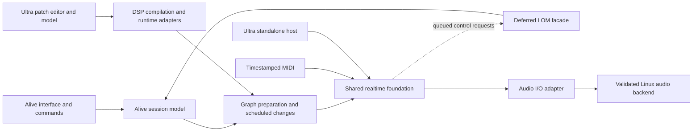

# Alive / Ultra Plan

Updated: 2026-10-20.

Status: product and architecture planning. No product code, build system, or compatibility test suite has been established. The architecture and milestones below are the planning baseline; choices that still require workflow or platform evidence are identified explicitly. This document makes no delivery-date or working-compatibility claim.

## Product Goal

Build a clean-room DAW in the Ableton Live product category, with its own session model, audio and MIDI engine, launcher, arrangement editing, routing, automation, persistence, user interface, and device system. Preserve a path toward Live set compatibility, the selected Live edition's built-in device catalog, and Max for Live-style patch compatibility.

Alive is the DAW. Ultra is a patch authoring environment, execution integration layer, and object library built on a shared realtime foundation. It can appear as an editor inside Alive and eventually as a standalone application. Reuse existing DSP compilers and patch/synthesis runtimes where they meet the requirements; neither product requires a new general-purpose synthesis engine. Product names and historical Live/Max boundaries do not determine engine, process, clock, or repository boundaries.

Linux is the primary platform, with low and predictable latency as an architectural requirement. The first performance workload is playing instruments from MIDI. Design choices must be evaluated against event timing, audible response, sustained processing deadlines, and behavior under editing and system load.

Implement compatibility through documented behavior, independent implementations, and reproducible reference fixtures. Ableton and Cycling '74 binaries or internal source code are not shipping dependencies. Installed software may serve as a licensed reference environment; proprietary-runtime redistribution or optional adapters require a separate decision.

## First Useful Workflow

The first performance milestone is a small native instrument played from a MIDI controller on Linux. Use deterministic oscillator/envelope/gain DSP with preallocated voices so that instrument complexity does not obscure backend and scheduling behavior. Cover note-on/off, velocity, sustain, voice exhaustion, and all-notes-off. Timestamp MIDI at the earliest reliable ingress point, map it onto the audio timeline, and apply events at defined sample offsets.

The first product milestone adds a minimal interface, a MIDI clip, parameter automation, and native save/reopen around that instrument. A command interface reproduces the same operations. Audio-loop launching is the next workflow expansion. Existing Live project import and Max compatibility remain separate research tracks unless they become explicit first-release requirements.

| Area | Initial Scope | Expansion Path |
| --- | --- | --- |
| Projects | Native projects with stable identity and reliable save/reopen | Version migration, recovery, broader editing |
| Audio and MIDI | Timestamped live MIDI driving a small native instrument and physical output | Audio-loop loading, streaming, resampling, warping, recording |
| Timing | Audio-clock mapping, sample-offset events, transport, deterministic MIDI clip playback | Beat-grid launching, tempo maps, arrangement interaction |
| Devices | One native instrument with bounded voices, state, and automation | Patch-authored devices, stock-device families, external plugin hosting |
| Live sets | Early read-only import experiment | Useful playback, then guarded export for specific supported edits |
| Ultra | Equivalent native and patch-authored instrument on the shared foundation | Max-compatible execution profile, embedded editor, standalone authoring |

Select the initial Linux audio/MIDI integration and pin its dependencies through the research and benchmark gates below. Also select the target Live version and edition for compatibility. Live 12.4.6 with Max 9.1.5 is the available investigation reference, not an automatic compatibility promise.

## Architecture and Ownership

The recommended architecture is a shared realtime foundation with separate session and patch authoring models. "Shared" describes ownership and timing, not a requirement to implement the foundation ourselves. Compare existing foundations and a minimal custom host before selecting the implementation. Validate the boundary with the same instrument implemented through both paths.

| Component | Responsibility |
| --- | --- |
| Shared realtime foundation | Device processing contract, frame clock, timestamped events, parameter application, buffer management, graph activation/retirement, latency metadata, reusable DSP primitives |
| Alive session layer | Tracks, clips, scenes, arrangement, routing intent, transport commands, automation authoring, undo, persistence, application interface |
| Ultra authoring and execution layer | Patch model/editor, object definitions, DSP compilation or runtime adapters, patch-specific execution semantics, bounded native message execution where reuse does not suffice |
| Compatibility adapters | `.als` and `.amxd` translation, selected Max object behavior, LOM paths and control semantics |
| Linux host | Physical audio/MIDI integration, stream lifecycle, device clock mapping, backend observability |

Alive sessions and Ultra patches produce executable devices/subgraphs for the same processing contract. Native devices and patch-authored devices share DSP implementations where their semantics match. They use one active host timeline, parameter identity scheme, and graph lifetime protocol. Embedded Ultra introduces no additional hardware stream or independently advancing audio clock. Evaluate any additional buffering explicitly rather than accepting it as a consequence of the product boundary.

Keep session editing and patch editing as distinct models; neither needs to become the other's storage schema. Keep compatibility-specific message order, vector behavior, and deferred work inside a defined execution profile. A shared clock does not require every object to have the same scheduling semantics. Initially preserve patch subgraphs as execution units where that helps correctness; flatten or fuse them only when equivalence and performance justify it.

The standalone Ultra application is a smaller host of the same foundation. Its host supplies physical I/O and reports DAW-specific services as unavailable. Alive remains useful without Ultra, and the shared foundation must not depend on Alive session types, either UI, or the LOM facade.

Compare this approach with separate DAW/patch engines behind a host bridge and a fully unified session/patch model. Separate engines can preserve independent execution semantics but increase integration and maintenance obligations; a fully unified model can simplify some transformations but couples two different authoring domains. The shared foundation is the leading choice because it centralizes timing and device lifecycle while preserving focused models. Validate this choice before building a general graph framework.



A single repository with focused modules is the recommended starting organization. Rust is a candidate for new host/model code; C/C++ libraries, their build systems, and a narrow audited FFI are acceptable when reuse wins. Compare Faust's generated Rust and C++ paths rather than choosing an engine by language. Keep the initial shared contracts small and extract reusable machinery from the instrument/patch experiment. Separate processes are a separate fault-isolation decision, especially for external plugins; they do not inherently imply an extra audio block, but their scheduling, buffering, and recovery costs require measurement. Separate repositories, release cycles, dynamic loading, or a stable ABI need demonstrated consumers. An internal Rust trait is not a stable plugin ABI.

### Repository Setup

Start with one GitHub repository, provisionally `alive`, containing both applications and the shared foundation. Keeping changes to the host, patch execution, and benchmark in one commit lets the first experiments revise their interfaces together. Alive and Ultra remain distinct products/modules with independent build targets where practical. Repository placement does not require either application to depend on the other's UI or session model.

The initial repository can contain this `PLAN.md` and research experiments. As implementation earns its structure, group Alive and Ultra application code under `apps/alive` and `apps/ultra`, shared libraries under `packages`, reusable validation inputs under `fixtures`, and disposable investigations under `experiments`. These are logical ownership boundaries, not a request to scaffold empty packages or choose a build system before the reuse comparison. Put experiment run instructions and conclusions in this plan so it remains the single planning document.

Create the repository with an explicit owner and visibility; private is the proposed initial visibility while product licensing remains undecided. An `ultra` repository can be reserved later if useful for naming, but do not duplicate the runtime, plan, or source between two active repositories. Split a module only when its API, versioning, standalone consumers, and release needs justify the coordination cost. If a split is later chosen, define one canonical owner for the shared foundation and test compatible versions together; neither application should import the other application's internals.

## Reuse Strategy for Ultra

Ultra should provide coherent patch authoring, device browsing, parameters, presets, routing, automation, and dependency reporting. Execution can use different explicitly declared profiles. A Faust DSP module, a Pd patch, and a SuperCollider SynthDef need not share a file format or message scheduler to feel integrated in the same application. Native Ultra graphs should reuse selected DSP modules; existing patches retain their runtime semantics. Automatic conversion between arbitrary Pd, SuperCollider, and Max programs is not assumed.

| Project | Proposed Role | Boundary to Validate |
| --- | --- | --- |
| Faust | First-class DSP authoring/compiler and reusable instrument/effect library; native code and WebAssembly targets | Host owns voices or selects Faust's polyphonic architecture, events, parameters, state, and lifecycle; compiler output alone is not a DAW or general patch scheduler |
| Pure Data / libpd | Embedded execution of existing Pd patches; candidate foundation for Ultra's message/signal execution where Pd semantics fit | Preserve Pd scheduling and tick behavior, compatible externals, instance/thread rules, and stated realtime limits; Pd compatibility does not imply Max compatibility |
| SuperCollider | SynthDef/UGen ecosystem and candidate synthesis runtime; optional server integration or deliberate adoption as the core synthesis graph | Distinguish sclang, scsynth, and supernova; native embedding, graph ownership, control-rate behavior, event timing, and GPL terms need evaluation |
| Supersonic / Clockwork | Candidate reusable host/synthesis foundation for native and browser Ultra; Supersonic combines scsynth with Clockwork | Alpha APIs, process singleton, block adaptation, MIDI ingress, bounded command work, supported UGens, and AGPL/commercial licensing |

### Faust and Pd Integration

Start with ahead-of-time Faust compilation for deterministic oscillator/envelope/gain DSP. Its generated native `compute(count, inputs, outputs)` interface can run under a host callback; the adapter must respect buffer aliasing capabilities and handle timestamped changes deliberately. Default generated DSP does not make every parameter change sample-accurate automatically. Compile, initialize, and prepare replacement instances outside the callback. Consider interactive libfaust/JIT compilation later, under the same preparation/publication protocol.

Faust already provides `faust2puredata` and `faust2supercollider`: one DSP source can become a Pd external or a SuperCollider UGen, as well as a native Ultra device. These are alternative compilation targets, not a reason to route every signal through multiple runtimes. Browser UGens must be included in a compatible WASM build; native plugin binaries do not become browser-loadable. FaustWasm also provides a direct WebAudio path, so adopting SuperCollider is not a prerequisite for web DSP.

Evaluate libpd before writing a Pd-like object/message scheduler. It is the embeddable Pd runtime, separate from Pd's desktop editor, with host-driven processing, patch loading, MIDI, and named message receivers. Query `libpd_blocksize()` for the selected build; its normal tick is 64 frames. Check 32-frame and variable host callbacks, event placement inside a tick, and added buffering rather than assuming either zero delay or a mandatory extra block in every configuration.

The inspected libpd processing wrapper calls `sys_lock()` around processing, and patch loading also locks and allocates. Actual locking depends on the selected Pd build. Establish ownership that prevents control operations from blocking render, inspect hook/queue behavior, and test multi-instance builds and compatible externals. A lock-free outgoing notification helper does not make every incoming libpd call queued or realtime-safe. If adopting libpd would require invasive scheduler changes for native Ultra, weigh that maintenance against keeping a well-defined Pd execution profile.

### SuperCollider and Supersonic

SuperCollider offers a mature synthesis graph, buses, scheduling, SynthDefs, and UGens. Ultra can create SynthDefs without requiring users to write sclang. Existing sclang programs still need the language runtime and its libraries; a synthesis engine is not a replacement for that language. Upstream libscsynth exists, but its public embedding API can change across minor versions and is not a simple generic host-buffer processing interface. Validate the actual driver/embedding path before promising in-process host-driven rendering. OSC is a useful external protocol, not a requirement that every local device/event pass through a socket.

Separate sequencer lookahead from live MIDI latency. SuperCollider's documented default `Server.latency` of 0.2 seconds is a sequencing setting; its timing guide recommends no added lookahead for live MIDI/GUI/HID input. `OffsetOut` can preserve synth onset offsets, but does not make all controls sample-accurate. SC UGen plugins depend on SC's runtime API and allocator contracts; they cannot generally be treated as independent plain DSP functions.

Supersonic is particularly relevant because its current architecture already separates a DSP guest from Clockwork's host infrastructure. It runs scsynth natively and as WASM in an AudioWorklet, with OSC scheduling, telemetry, memory pools, and client-side asset preparation. Compare three foundation choices: a minimal host with Faust/libpd adapters; Clockwork hosting an Ultra DSP graph; and Supersonic's scsynth graph as the synthesis core. A browser path increases the value of reuse but does not settle the Linux choice.

Its compatibility documentation excludes `DiskIn`, `DiskOut`, `VDiskIn`, and several UI/analysis UGens in the inspected build. The host can supply alternative media services, but scsynth command compatibility is not blanket support for existing SC projects, arbitrary UGen plugins, or DAW disk streaming. Include the supported UGen/dependency inventory in the adoption decision.

The inspected Supersonic `EmbeddedHost` owns the physical device; Clockwork's separate `clockwork_embed_attach` / `clockwork_embed_render` API lets an existing host drive buffers without opening another device. Its `dsp_api.h` is the guest boundary. These are useful concrete interfaces, with current limitations: one engine per process, fixed engine blocks behind arbitrary-size host-buffer FIFOs, and a documented input delay of up to one engine block in the attach path. Multiple Ultra devices therefore cannot each assume an independent Clockwork engine. Evaluate one shared engine with independently identified subgraphs, state, routing, and lifecycle, or establish the work needed for independent instances.

Clockwork's inspected guest contract says native MIDI arrival is represented by the block where it was drained, whereas web events can carry arrival timestamps. Determine whether an alternative ingress preserves the sample-offset information required by our instrument benchmark. Its pool allocation and no-blocking claims also do not prove bounded execution time: Supersonic runs asynchronous scsynth command stages inline on the audio thread. Measure definition loading, buffer commits, synth construction, queue bursts, and graph replacement under sustained playback; require preparation or work budgets where deadlines would otherwise be exceeded.

### Browser Scope and Licensing

Treat a web version initially as Ultra patch/instrument authoring and auditioning, with a possible later Alive session subset. Share portable DSP sources, versioned project/patch data, parameter identities, and test fixtures where supported. Keep platform I/O, filesystem/dependency loading, device discovery, and scheduling adapters explicit. A common editor or OSC surface does not establish identical execution or support for every patch on every platform. Persist the device's execution profile, dependency versions, and target capabilities; preserve unavailable devices with clear diagnostics.

Compare Supersonic AudioWorklet/WASM with direct FaustWasm using the same simple instrument. Supersonic offers SharedArrayBuffer/ring transport when cross-origin isolation is available and a postMessage fallback with different overhead and capabilities. Verify required browser/WASM features, HTTPS or localhost, user-gesture audio startup, Web MIDI support/permission, suspension/recovery, memory ceilings, and COOP/COEP plus cross-origin resource handling. Report the actual render quantum and device/output latency. The Linux 64-frame target is not a promised browser setting, and sample-accurate scheduled playback does not establish physical live-MIDI latency.

Licensing remains undecided. Compare a GPL/AGPL-compatible product with a product that aims to keep host code under permissive or proprietary terms before selecting the foundation. Pd/libpd's core BSD-style terms are comparatively permissive; each external has its own terms. Faust's current compiler is LGPL-2.1-or-later, and its FAQ distinguishes compiler licensing from generated output; inspect libraries and architecture exceptions for the actual generated device. SuperCollider is GPL-covered. Supersonic currently declares AGPL-3.0-or-later for the combined program, and Clockwork offers AGPL or commercial licensing. A commercial Clockwork license alone does not relicense the scsynth code. Browser delivery and relevant AGPL network-use obligations need to be included in that comparison. A process boundary or a common protocol alone does not decide license compatibility.

The preferred starting hypothesis is Faust for reusable DSP plus a thin Ultra device/authoring layer, with libpd evaluated for Pd execution and Clockwork/Supersonic seriously compared as foundations. Select the minimum runtime set that passes the Linux and authoring gates. Build new scheduling/synthesis machinery only for concrete gaps established by that comparison.

## Linux Audio and MIDI Research

Compare API layers and actual backend configurations separately. CPAL using JACK and a direct JACK client may both use the same PipeWire graph; they are different application integrations, not necessarily different audio servers. Measure identical workloads and document every queue, conversion, resampler, and clock boundary.

| Candidate | Questions to Resolve |
| --- | --- |
| Native PipeWire | `pw_filter` versus `pw_stream` suitability; audio/MIDI timing, graph position, latency metadata, port routing, realtime callbacks, Rust binding coverage |
| JACK API on PipeWire | Sample-offset MIDI, synchronous processing, latency reporting, quantum changes, xruns, port connections; compare a native JACK server separately only when useful |
| CPAL with selected Linux backends | Exact released-version features, input/output clock handling, latency/xrun visibility, MIDI integration outside CPAL, wrapper overhead and hidden buffering |
| Clockwork device layer or host-driven embedding | Which PipeWire/JACK/ALSA implementation is actually selected; callback and engine block sizes, FIFO delay, MIDI timestamps, priority acquisition, actual-device reporting, and recovery; distinguish reusable host infrastructure from an audio API |
| Direct ALSA | A focused control/reference or fallback path where it helps distinguish hardware and server overhead; account for routing and device-sharing costs |

Current CPAL upstream documentation and its manifest expose optional JACK and native PipeWire backends. That observation does not select a released version or establish equivalent capabilities across integrations. Avoid treating CPAL as inherently slow or as a complete pro-audio/MIDI host. Native PipeWire is also not automatically faster than its JACK implementation; API access, implementation quality, and actual configuration determine the result.

For MIDI, compare JACK/PipeWire graph events and ALSA sequencer ingress where relevant. Specify how each timestamp maps to the engine sample clock, how late events are treated, and whether a new event waits for another queue or quantum. Distinguish synthetic scheduled MIDI, real controller ingress, and physical key-to-sound response. Preserve note-offs and sustain-release behavior under load.

Research scheduler permissions, RTKit or equivalent priority acquisition, memory residency/pre-touch, page faults, denormals, and the thread priorities of the backend and application. Verify actual granted scheduling rather than only a requested flag. Compare the normal target-distribution kernel with PREEMPT_RT when scheduling traces justify it; an RT kernel does not repair unbounded application work. Keep the application usable without requiring a privileged launch. CPU affinity, power policy, IRQ placement, and similar tuning are measured experiment variables, not universal setup requirements.

## Latency Benchmark Contract

Start with an output-only MIDI instrument, then run the same DSP through an Ultra-authored graph. Use identical voices, events, sample rate, and output routing. Measure any additional sample delay, callback cost, and timing variance attributable to patch execution. Max compatibility may intentionally add documented vector/control latency; distinguish that profile from native Ultra behavior.

Use a direct Faust-generated device as the DSP reference where practical. After source research, shortlist runtime candidates for the equivalent patch experiment: a tiny native Ultra graph, libpd hosting the same DSP as an external, or Supersonic using a corresponding UGen/SynthDef. Build only the shortlisted paths. Share the DSP source where possible; when implementations differ, compare against declared signal/envelope tolerances and keep DSP differences separate from scheduler/adapter overhead. Add a short audio-input impulse test to reveal reblocking delay that an output-only instrument cannot expose. A later browser probe reuses the score and metrics, with its own platform settings and acceptance criteria.

| Configuration at 48 kHz | Processing Period | Role |
| --- | --- | --- |
| 64 frames | 1.33 ms | Initial low-latency target for supported hardware |
| 128 frames | 2.67 ms | Reliability comparison and fallback |
| 32 frames | 0.67 ms | Stress experiment when hardware/backend support it |

These are processing deadlines, not claims about audible MIDI latency. Separate MIDI transport/controller delay, ingress-to-sample scheduling, output buffering, conversion, and device latency. In-block sample offsets improve scheduling precision but cannot recover an event that arrived after its processing deadline. Define late-event policy and report its frequency.

Record median, p95, p99, p99.9, and maximum observed scheduling/processing times, event lateness, xruns, and rendered onset positions. Use physical measurement for claims about MIDI-to-analog sound; software timestamps alone establish only the instrumented software segment. State synchronization and calibration error, test hardware, kernel, backend/dependency versions, actual graph quantum/rate, and all settings that affect the measurement.

Proposed acceptance starts with a 30-minute repeatable run at 64 frames with zero observed xruns and no missed observed deadlines for a declared voice/event workload, followed by a longer soak and stressed runs. Record deadline headroom rather than only average CPU usage. Sweep voice counts and MIDI bursts; include sustain/voice stealing, UI redraw, save, device edits, and competing CPU/disk activity as separate scenarios. A finite successful run is evidence for that setup, not a hard realtime guarantee. Final workload and headroom budgets are outputs of research and local measurement.

PipeWire `pw-top` provides graph/node timing and xrun/error counters; distinguish driver graph timing from an individual node's DSP time. Use application-side bounded tracing as well. Kernel tools such as `rtla timerlat` can diagnose scheduling delays, but do not measure audible instrument latency.

## Realtime Execution

The control domain owns model edits, undo, LOM requests, dependency loading, graph preparation, and file operations. The render domain owns active DSP state and bounded audio/MIDI processing. Callbacks must not perform file I/O, unpredictable allocation or deallocation, blocking model/UI access, or unbounded command execution.

Graph preparation, activation, retirement, and reclamation are distinct operations. Prepare nodes and storage off the callback, activate a valid graph at a defined processing boundary, preserve or explicitly reset DSP state, acknowledge retirement, and reclaim old storage off the callback. Reject stale events using graph and transport generations. State capture must produce a coherent snapshot without locking the audio thread.

Each queue needs a capacity, processing budget, acceptance rule, and saturation behavior. Meter updates can be coalesced. Structural commands require explicit acceptance or rejection. MIDI note-offs, device removal, and transport reset must not silently leave notes active. A bounded or lock-free queue alone does not establish realtime safety.

| Host Contract | Execution Domain | Required Behavior |
| --- | --- | --- |
| Preparation and reconfiguration | Non-realtime | Sample rate, maximum processing size, channel layouts, scratch storage, dependencies, vector adaptation, preparation failure |
| Audio and event processing | Render | Borrowed buffers with explicit aliasing and lifetime, bounded event storage, frame offsets, deterministic ordering; no retained host-buffer references |
| Transport context | Supplied by host to render | Frame clock, musical position, tempo segment, running/loop state, discontinuity generation, offline/realtime mode |
| Parameter control | Control binding and render application | Stable parameter keys, value mapping, smoothing, source precedence, acquisition and release |
| LOM commands and observations | Deferred control | Request/reply association, capability errors, notification ordering, invalidation, persistent-binding policy |
| State capture and restore | Coordinated non-realtime | Snapshot consistency, schema version, unavailable dependencies, bounded handoff of render-owned state |
| Graph publication and retirement | Control prepares, render activates, control reclaims | Activation boundary, generation checks, retained state, acknowledgement, overload rejection |
| Fault reporting | Separate control/render policies | Unsupported objects, expired targets, event runaway, queue overflow, DSP failure, declared silence/bypass behavior |

Verify this contract by replacing and removing active devices, saving during playback, forcing queue saturation, and submitting late events for retired objects. Instrument callback allocation, deallocation, and blocking operations. Measure callback deadlines and xruns on declared hardware.

## Time, Launching, and Parameters

Define an engine frame clock separately from musical position and the tempo map. Seeking, restarting, or invalidating scheduled playback advances a discontinuity generation. Specify how beat-based events are scheduled or recomputed after tempo changes, and how loops, stop, and simultaneous events affect pending work.

For the supported workflow, define launch quantization, the ownership of events exactly at block boundaries, active-note handling across stop and loop wrap, and the ordering of launch and parameter events. When arrangement playback is added, specify how Session and Arrangement sources take control of each track. Supported sample positions should remain consistent across different host block partitions.

Devices must expose latency and channel-layout information even if the first release supports only simple graphs. Declare the initial policy for delay compensation, sidechains, bypass, tails, and feedback. The first graph may reject cycles and report uncompensated paths as unsupported; later compensation must have a defined place in the contract.

Parameter state distinguishes the stored base value, automation, modulation, and temporary remote control. Define stable identity, physical and normalized ranges, quantization, smoothing, sample offsets, source precedence, and acquisition/release behavior. Save operations must preserve the appropriate stored state rather than accidentally recording a transient effective value.

## Native Persistence and Live Sets

Native project persistence, `.als` import, and `.als` export are separate capabilities. Native projects use stable identities, a versioned schema, atomic writes, and explicit media references. Establish save/reopen and undo behavior in the first workflow; add migration and interrupted-save recovery fixtures as the format grows.

The `.als` importer retains a source representation and a mapping between imported file IDs and Alive identities. Preserve unknown content and unsupported device state where feasible. Unsupported devices remain visible in their original chain position, with a clear explanation of whether playback bypasses them, produces silence, or cannot reproduce the original result. Resolve media and device dependencies independently of XML parsing.

Unknown XML preservation does not establish safe export: opaque state may refer to objects, parameter targets, or positions changed by an edit. Enable export only for an explicit supported edit set with known reference effects. Refuse structural edits whose exported consistency cannot be established. Initial exports create new files and leave the source recoverable.

Export acceptance requires a no-op round trip, a narrowly scoped supported edit, and fixtures with unknown data and cross-references. Reopen copies in the selected Live version and check object associations and behavior as well as Alive's own interpretation. Demonstrate that unsafe edits are refused. Parsing, useful playback, and safe round-trip editing remain separate support claims.

## Ultra and Max Compatibility

Define a named execution profile covering message types and coercion, hot/cold inlets, outlet and patch-cord order, depth-first message traversal, synchronous execution, deferred work, timers, initialization, DSP vectors, and supported feedback. Classify objects by execution domain. Bound recursive messages and event generation, and expose unsupported or runaway behavior explicitly.

Max distinguishes message scheduling and DSP execution, including high/low priority work and configurations that service scheduled work with the audio thread. Moving every patch message onto a UI thread or treating every patch as a generic DSP DAG would not reproduce those semantics. Hardware callback lengths and Ultra signal vectors must be adapted deliberately.

Evaluate `.amxd` compatibility in separate steps: container decoding, dependency closure, message execution, DSP execution, and host integration. Dependencies include abstractions, external objects, scripts, and data files. Reject unsupported executable dependencies in the initial subset; an in-process Rust runtime does not sandbox native externals.

Start with a small interpreted compatibility profile using reusable primitives where semantics match and independent implementations where they differ. Pd is not a drop-in Max scheduler. Compare message traces and audio results with the reference environment before considering lowering supported graphs to native code. Dynamic patching, opaque encodings, unavailable externals, and runtime-specific behavior may remain unsupported. Arbitrary `.amxd`-to-Rust compilation is not a baseline assumption.

The Max compatibility feasibility gate must execute an existing patch whose dependencies are fully supported, alongside small fixtures for ordered messages, deferred events, DSP, and host access. A successful gain patch or decoded container alone is insufficient for that claim. Track the exact supported files and object/dependency coverage. This gate does not block native MIDI performance or native Ultra graph experiments.

## Live Object Model Services

Expose a versioned subset of paths, object types, properties, functions, mutations, and notifications over Alive's command model. Begin with the paths required by the selected workflow; add query, set, call, observe, deletion, and stale-target fixtures before claiming the corresponding support. LOM is a bounded compatibility surface and does not expose all of Live's internal state.

Ordinary `live.path`, `live.object`, and `live.observer` interactions use deferred control-thread services. Define observer delivery order, subscription lifetime, path changes, object deletion, and errors. Mutations must not execute directly from observer notification delivery; deferred follow-up operations need explicit scheduling behavior.

Keep internal object identities, imported file IDs, per-device LOM handles, and saved target bindings distinct. The API overview describes IDs as device-scoped and not stored, while the object references document "Use Persistent Mapping" across save/restore and device moves. Resolve this qualification with mapping-enabled and mapping-disabled tests across reload, movement, duplication, deletion, and undo. Until tested for the target version, persistent mapping remains unverified.

`live.remote~` needs a separate render-side parameter-control path. Its references describe sample-accurate application from Max's audio thread with one audio buffer of latency, ordinary parameter automation disabled during remote control, unchanged stored set values, no undo steps, and envelopes remaining active. Verify these behaviors and the meaning of the buffer latency for the chosen configuration. Target lookup and binding can be deferred; sample-accurate application must not call the model/UI. Declare this object unsupported until the required behavior is implemented and measured.

## Devices, Plugins, and Media

Ultra's Max-like objects and Alive's Live-native device catalog are independent compatibility programs. The eventual ambition includes the complete built-in catalog for the selected Live version and edition: instruments such as Operator, Wavetable, Simpler/Sampler, and stock audio/MIDI effects. Each needs its own DSP, modulation, parameter behavior, automation, state, presets, and controls. Ultra hosting does not supply those implementations.

Prioritize devices using real workflows and track DSP, state, parameter, preset, and UI coverage independently. Keep external plugins, racks, presets, clips, packs, and M4L devices as separate families. Select plugin format and operating-system binary support together; an imported Windows plugin reference is not automatically executable on Linux. Plugin discovery, state restoration, latency, editor hosting, and crash isolation each need an explicit contract.

Physical I/O does not provide media decoding, resampling, prefetch, disk streaming, warp playback, or recording. The audio-media expansion uses a declared bounded media policy and reports missing, oversized, or unsupported media. Add streaming, warp modes, and recording through independent milestones. When input/recording enters scope, include duplex clock drift, monitoring latency, timestamp alignment, and interrupted-recording recovery.

Evaluate CPAL against the selected platform using a pinned version, supported sample formats/rates, callback-length handling, device-loss recovery, and observable xruns. Keep another backend possible through the adapter. The existing Wine/PipeASIO observation is not evidence of native backend latency or production audio quality.

## Cloud Research Handoff

The next cloud session should investigate architecture and Linux integration with source research and small runnable experiments before committing to production implementation. It can work from this file and public sources; local installation paths and earlier probe artifacts are optional reference context. Return one coherent recommendation and update this file in place. Keep observations, recommendations, and locally untested hypotheses distinct. Code examples are part of the investigation and should answer specific unresolved questions.

### Research Packages

| Package | Questions | Required Output |
| --- | --- | --- |
| Shared foundation and reuse | Compare product/model boundaries independently from implementation reuse. Evaluate a minimal host with Faust/libpd, Clockwork hosting an Ultra graph, and Supersonic/scsynth as the synthesis core before proposing new schedulers. | Dependency/process diagrams, ownership table, frame/event/parameter/state contracts, maintenance cost, and one experiment that could disprove each shortlisted foundation |
| Linux audio/MIDI integration | Compare native PipeWire, JACK on PipeWire, CPAL's exact released backends, and the value of an ALSA control path. How are controller timestamps mapped, lateness handled, latency reported, and scheduling privileges obtained? | Versioned capability matrix, a shortlist of two integrations for local testing, and explicit buffering/clock diagrams; distinguish wrapper API from server/backend |
| Realtime execution | How are voices, events, graph preparation, activation, retirement, and state capture bounded? How do sustained MIDI, UI/save work, sample-rate/quantum changes, and device failure affect deadlines? | Minimal render lifecycle, overload/reset policy, memory/priority strategy, observability plan, and justified provisional workload/headroom budgets |
| Ultra execution profiles | Which Faust, Pd/libpd, SC/Supersonic, and native capabilities belong in a common device facade? Which Max ordering/vector/deferred behaviors need separate execution? Can runtime reuse avoid a new object scheduler? | One tiny instrument graph, a parameter/preset/dependency contract, multi-device state/routing design, explicit semantic differences, and a separate Max-compatible subset |
| Browser feasibility | Compare direct FaustWasm with Supersonic AudioWorklet/WASM; what can share sources/data with native Ultra, and which browser constraints change latency, dependencies, or capabilities? | A small portable-instrument probe design, SAB/postMessage deployment matrix, MIDI and suspension/recovery protocol, and explicit native-only features; no full web DAW requirement |
| Licensing and maintenance | Compare GPL/AGPL-compatible and permissive/proprietary host strategies. Inspect compiler outputs, architectures, Pd externals, SC UGens, browser assets, and Clockwork's commercial option separately. | Dependency/license inventory with exact revisions and actionable architecture implications; do not infer relicensing or obligations solely from process placement |
| Local validation | Which claims require a real controller, interface, kernel, or running reference DAW? How are software timing, physical MIDI-to-audio onset, and backend scheduling measured separately? | Reproducible benchmark protocol with exact metrics, controls, test matrix, acceptance criteria, calibration, and required hardware/input information |

Use official Faust, libpd/Pd, SuperCollider, Supersonic/Clockwork, PipeWire, JACK, ALSA, Linux kernel, library, and Cycling '74 documentation as primary sources. Inspect maintained implementations where documentation leaves a gap and record source revision and license. CPAL version/features and Rust-binding coverage must be verified against an actual selected release rather than inferred from current upstream branches. Treat alpha APIs and upstream realtime/compatibility claims as things to verify. Research should choose a small testable foundation and a backend shortlist, not a universal engine framework or the full device catalog.

Proceed in order: establish the source/version/license and capability matrix; shortlist foundations and two Linux integrations; implement the smallest offline reference and shortlisted runtime experiment; then hand the native integration/protocol to a local session with the actual controller/interface. Keep the web feasibility work bounded and separately report its result. Do not expand into full engine or editor implementation while a foundational reuse decision remains open.

### Runnable Cloud Experiments

The cloud session may write, build, and run research code when its environment provides the required tools. Keep runnable sources in an `experiments` directory in its working checkout or return them as a separate code artifact if it only receives this document. The one-document requirement applies to the plan and findings; experiment source, build definitions, and test fixtures are legitimate code deliverables. Keep narrative conclusions and reproduction instructions in `PLAN.md`, without separate review documents or a revision history.

| Priority | Experiment | Question and Required Evidence |
| --- | --- | --- |
| First | Offline Faust MIDI-instrument reference | Generate a small oscillator/envelope/gain instrument, drive a fixed voice pool from a deterministic frame-stamped score, and render audio without a physical device. Check onset positions, note-off/sustain/voice stealing, reset behavior, and equivalent results under supported block partitions. Record dependency versions, commands, expected results, and actual output. |
| Second | One shortlisted Ultra/runtime adapter | Run a tiny graph through the strongest candidate after source screening: native host, libpd, or Clockwork/Supersonic. Reuse the reference DSP where practical. Exercise two independently controlled devices, event timing, parameter changes, supported block adaptation, and an input impulse. Probe replacement/loading and saturation behavior within the candidate's supported lifecycle. Record mismatches and unsupported operations rather than hiding them behind a new abstraction. |
| Optional | Small browser instrument | If the first two probes leave time, run the instrument through direct FaustWasm or Supersonic with a minimal control surface. Use browser automation for scheduled-event and lifecycle checks where available. Test SAB and postMessage when relevant, and record actual browser capabilities and observed results. Physical Web MIDI and audible output latency remain local validation. |

Where feasible, have the second experiment expose a small command-line path for local Linux audio/MIDI integration using the shortlisted backend. Build/check this in the cloud if dependencies are available; mark hardware-dependent execution as pending. Prefer a verified official embedding API over a mock adapter that merely resembles one. Every executable experiment needs a reproducible dependency/build setup, deterministic checks for the decision it tests, and explicit failures for unsupported configurations.

Record each example as source-only, build-verified, executed headlessly/offline, or locally hardware-validated, according to the evidence actually obtained. Offline rendering, headless timer processing, browser automation, callback instrumentation, and hosted-CPU timing can reveal correctness or integration problems; they do not establish controller-to-analog latency, granted realtime priority on the target system, or the 64-frame Linux acceptance result. Report commands, exit status, environment, signal tolerances, and failures without filling gaps with invented benchmark results. Treat the code as experimental until the selected architecture is validated and its production lifecycle is reviewed.

### Prompt to Pass to a Cloud Session

```text
Read PLAN.md as the complete current project context and update that same file
with a curated architecture/research conclusion. Keep one plan document with
the current recommendation integrated throughout, without a revision log or
separate review/research documents. Runnable experiment source and build files
are allowed under experiments in your working checkout or as a code artifact.

We are designing Alive, a clean-room DAW, and Ultra, an integrated patch
authoring environment that should reuse existing DSP and execution systems.
Linux is the primary platform. The first performance
workload is playing instruments from a MIDI controller with low, predictable
audible latency under sustained load and editing. There is no product code yet.
Use one repository initially for Alive, Ultra, shared packages, and experiments.
Keep their module boundaries clear; do not create separate repositories, publish
code, or choose the product license as a side effect of the investigation.

Reconsider the product boundary from first principles. Compare separate DAW and
patch engines, a shared realtime foundation with separate session/patch authoring
models, and a unified model. The leading hypothesis is a shared processing
contract, audio timeline, event/parameter machinery, DSP library, and graph
lifecycle. Preserve compatibility-specific execution semantics where required.
Identify what evidence would change that recommendation.

Evaluate Faust as reusable native/WASM DSP, Pd/libpd as an embedded patch
runtime or execution foundation, upstream SuperCollider, and samaaron/supersonic
with its Clockwork host. Compare a minimal host with adapters, Clockwork hosting
an Ultra graph, and Supersonic's scsynth graph as the synthesis core. Do not
assume we need to write another Pd-like scheduler or general synthesis engine.
Separate sclang programs, SynthDefs/UGens, Pd patches, Faust DSP, and Max patches;
a common Ultra UI does not make their semantics or dependencies identical.

For libpd inspect ticks, locks/build options, callbacks, externals, multi-instance
ownership, and live-edit safety. For SC distinguish server lookahead from live
input latency. For Supersonic/Clockwork inspect host-owned versus device-owning
embedding, the current process singleton, input FIFO delay, native MIDI arrival
timestamps, inline command work, graph isolation/state, and actual capabilities
of the pinned revision. Investigate gaps before relying on no-allocation claims.

Research native PipeWire, JACK on PipeWire, CPAL's relevant released Linux
backends, and an optional ALSA reference path. Distinguish APIs from the audio
server/backend actually used. Compare MIDI timestamp/sample-clock integration,
buffering, latency metadata, xrun reporting, quantum/rate changes, realtime
scheduling permissions, failure recovery, and Rust implementation maturity.
Include Clockwork's actual device paths when it is shortlisted. Select two
concrete integrations for a controlled local benchmark without multiplying
every engine/backend combination.

Specify a direct Faust-generated MIDI instrument and an equivalent Ultra path
through shortlisted native, Pd, or SC execution. Reuse DSP source where practical
and state tolerances when implementations differ. Define bounded event/voice
behavior, live graph replacement, parameter/state ownership, and a separate Max
compatibility profile. Study processing delay, buffering, and deadline variance;
include an audio-input impulse check to expose reblocking delay.

Write and run small code examples to test those choices: first an offline
Faust instrument with deterministic MIDI/parameter events and bounded voices;
then one real adapter to the strongest shortlisted runtime using its verified
API. Check two-device isolation, onset/parameter timing, note lifecycle, block
adaptation, loading/replacement, and overload behavior where supported. Avoid
building adapters for every candidate. Supply reproducible sources, dependency
pins, build/run commands, expected checks, observed results, and failures.
Keep the code experimental. If tools or dependencies prevent a build or run,
label that limit explicitly; do not report an unrun example as working.

Compare direct FaustWasm and Supersonic for a future web Ultra instrument/editor
subset. Cover AudioWorklet quantum, SAB versus postMessage, browser/WASM support,
cross-origin isolation, Web MIDI permissions, audio startup, output latency,
suspension/recovery, and portable assets/state. Keep Linux as the first gate and
do not promise native latency or arbitrary native external/plugin support in
the browser. A tiny browser example is optional after the two primary probes.
Licensing is undecided: compare GPL/AGPL-compatible and
permissive/proprietary host options. Check Faust output/architecture terms, Pd
externals, SC GPL, and Supersonic/Clockwork AGPL/commercial boundaries separately.

Design a local protocol at 48 kHz with 64- and 128-frame periods and an optional
32-frame stress case. Report latency segments, jitter/tail distributions,
maximum observed cycle times, deadline headroom, xruns, note lifecycle, and
behavior during UI/save/device-edit and competing-system load. Separate
software timestamp tests from calibrated physical MIDI-to-audio measurements.

Deliver a source-cited reuse/architecture recommendation, backend and licensing
matrices, minimal contract sketches, a local benchmark protocol, provisional
acceptance budgets, experimental code with its validation status, and unresolved
decisions integrated into PLAN.md. Cite
exact versions/revisions and distinguish measured facts from hypotheses. A
cloud session cannot establish this machine's audio latency or reproduce the
supplied Live/Max observations without local evidence.
Distinguish source-only examples, successful builds, offline/headless/browser
runs, and target-hardware measurements. The immediate deliverable is a research
conclusion supported by runnable experiments plus a concrete local validation
protocol, ready to review before product implementation.
```

## Delivery Milestones

Milestones are acceptance gates, not dates. The import and Ultra experiments can proceed independently of the native product slice unless the selected first-release workflow requires them.

| Milestone | Result | Prerequisites | Acceptance Evidence |
| --- | --- | --- | --- |
| Architecture, reuse, and Linux research | Select a foundation candidate and shortlist audio/MIDI integrations, with licensing implications explicit | Linux-first and live MIDI-instrument priorities; Faust/Pd/SC/Supersonic comparison | Source-cited comparisons, minimal offline/reference and runtime-adapter experiments with actual validation status, timing/ownership contracts, dependency/license matrix, local benchmark protocol |
| Native MIDI performance probe | Play a bounded native instrument from live MIDI | Backend shortlist, timestamp mapping, minimal processing contract | Latency/jitter/deadline measurements, voice and burst tests, queue-overflow and note-lifecycle behavior |
| Shared-foundation experiment | Render the instrument directly and through shortlisted Ultra/runtime paths | Native probe, smallest useful patch representation, selected reusable DSP/runtime | Comparable signal/event results, measured adapter overhead, input-delay check, independent device state/routing, graph-edit and overload behavior |
| Native Alive slice | Play/record a MIDI clip, automate the instrument, save and reopen through a minimal UI | Proven processing path, transport, parameter, and persistence contracts | Reproducible command sequence, deterministic offline output, state/undo checks, performance under UI/save load |
| `.als` import probe | Inspect and import one bounded set subset with dependency diagnostics | Reference fixtures and source/internal identity mapping | Preserved source data, supported/unsupported content tests, no implied save-back support |
| Max-compatible semantic probe | Execute a named existing-patch subset on the shared foundation | Compatibility scheduler profile and dependency inventory | Ordered message traces, DSP comparison, one existing supported patch, rejection behavior |
| Embedded patch editing | Author and replace a supported instrument/effect graph inside Alive | Native slice, shared-foundation experiment, host-service contract | State restoration, safe live edits, parameter-control timing, overload behavior |
| Guarded `.als` export | Save a copy after a specifically supported imported edit | Native persistence, import probe, reference-safety analysis | Target Live round trips, unsafe-edit refusal, atomic-write recovery |
| Workflow and device expansion | Add audio-loop launching, prioritized instruments/effects, arrangement, plugins, and media capabilities | Relevant earlier gates | Reference expectations before each compatibility implementation; updated coverage matrix |
| Ultra authoring and standalone | Edit patches and run them with standalone host services | Proven runtime/host boundary and state model | Same runtime behavior in both hosts, explicit unavailable DAW services, independent audio-I/O lifecycle |
| Browser Ultra feasibility | Run the small portable instrument with a bounded editor/control surface | Selected portable DSP/runtime candidates; separately scoped after Linux protocol | FaustWasm/Supersonic comparison, browser MIDI and output measurements, deployment and recovery checks, declared dependency/capability limits |

MCP/scripting and broader application integration use the same core commands as the UI. Add them as consumers of working operations rather than prerequisites for the first audible workflow. Keep full stock-device coverage and the standalone patch editor independently releasable from the native Alive slice.

## Compatibility Validation

Create reference expectations before implementing each compatibility family. Record Live/Max versions, input and dependency hashes, sample rate, vector/buffer settings, initial state, operations, and expected outputs. Keep reference observations separate from Alive-generated snapshots and verify that comparison tools detect deliberately wrong results.

Use exact comparisons for deterministic identities, structure, and event ordering where appropriate. For DSP, use controlled inputs and documented tolerances; random or stateful processing may require repeatability controls and spectral/envelope comparisons rather than bit identity. Verify events at both ends of a block, tempo changes before launches, seek with pending work, loop wrap with notes, target deletion, graph replacement, and queue saturation.

| Family | Available Evidence | Support to Establish |
| --- | --- | --- |
| Native Alive projects | Architecture and MIDI-instrument workflow specification | Save/reopen, MIDI clips, automation, undo, stable identity, migration, recovery |
| Linux realtime performance | Current backend/API documentation; no local product benchmark | Controller-to-sample mapping, physical output latency, jitter, headroom, xruns, native/patch-path comparison |
| Reusable runtimes and browser Ultra | Official Faust/libpd/SC source and Supersonic/Clockwork interfaces; no local builds or browser probe | Selected dependency versions/licenses, embedding and independent-device behavior, bounded callback work, portable DSP/state and browser capability matrix |
| `.als` | Supplied gzip/XML observations and bundled-file inventory | Parsing, dependency resolution, playback, and export as separate levels |
| `.amxd` | Supplied container markers and patch-chunk observations | Decoding, dependency closure, execution profile, supported files |
| LOM | One supplied tempo-read probe and inspected documentation | Alive query/mutation/observer behavior, lifecycle, remote control, persistent bindings |
| Live-native devices | Target families identified | Device-specific DSP, parameters, automation, state, presets, controls |
| External plugins | Candidate formats only | Selected format/platform, discovery, compatible binaries, state, latency, failure handling |
| `.adv`, `.adg`, `.alc`, `.alp` | Supplied installation counts | Selected preset/rack/clip/pack structures and transitive device/media dependencies |

## Risk Controls

| Risk | Responsible Subsystem | Control and Acceptance Gate |
| --- | --- | --- |
| Callback misses or unsafe graph lifetime | Engine | Bounded processing, retirement acknowledgement, callback instrumentation, measured deadlines and xruns |
| Invalid exported references | Formats and persistence | Restricted export edits, target Live validation, recoverable source, refusal when consistency is unknown |
| Max behavior or encoding mismatch | Ultra and compatibility | Named semantic profile, dependency inventory, reference traces, explicit unsupported states |
| Incorrect automation/remote-control interaction | Engine and LOM | Separate stored/effective values, source precedence, acquisition/release and save tests |
| Device-catalog scope overwhelms delivery | Product and device system | Workflow priorities, independent device-family coverage, useful native milestone first |
| Backend or plugin-platform mismatch | Linux host and plugin host | Linux-first integration, pinned dependencies, supported binary/configuration fixtures |
| Reuse brings unsuitable timing or runtime constraints | Shared foundation and Ultra | Compare block adaptation, MIDI ingress, locks, command budgets, instances, state, and maintenance before adoption; keep execution profiles explicit |
| Dependency license conflicts with product licensing | Foundation selection | Compare both product-license strategies at pinned revisions; inspect generated outputs, externals, browser delivery, and commercial options separately |
| Evidence or redistribution uncertainty | Compatibility research | Traceable sources, independently authored fixtures, clear separation of observations and inferences |

Define the intended clean-room process before compatibility implementation, including permitted evidence and any needed separation of research and implementation. Each compatibility requirement must trace to documentation, an observation, or an independently authored fixture. Do not turn optional proprietary-runtime research into a dependency of the native core. Retain applicable notices for reused third-party source and establish redistribution rights before including reference assets in a public corpus.

## Reference Evidence and Limits

The local investigation reported Live 12.4.6 and Max 9.1.5 under Wine. Runtime probes used disposable prefix clones and a copied bundled demo set; the original prefix and user projects were not used for those tests.

A probe connected `live.path` for `live_set` to `live.object get tempo` and logged `tempo 167.` at the expected initialization time. The cloned `MaxPlug.log` entry was timestamped `2026-10-14 16:29:09.046070`. Its missing `LOMProbe` label means attribution relies on matching wiring and timing. This supports one basic query inside Live/Max; it does not establish Ultra execution, mutations, observers, lifecycle behavior, or playback quality. PipeASIO opened at 44.1 kHz with a 128-sample buffer, logged missed cycles, and lacked realtime scheduling permission. No save-back test was performed.

The supplied installation inventory counted 26 `.als`, 110 `.amxd`, 1,072 `.adg`, 2,557 `.adv`, 350 `.alc`, and 3 `.alp` files. Bundled sets decompressed from gzip to XML; most sampled sets reported `Creator=Live 12.4d1` and `MinorVersion=12.0_12402`. Sampled sets included 30 `MxDeviceMidiEffect` and 4 `MxDeviceAudioEffect` instances. These observations do not establish broad schema or version coverage.

Surveyed `.amxd` containers began with `ampf` and included `meta` and `ptch` chunks. Patch-chunk observations included 8 JSON-parsing chunks, 80 beginning with `mx@c`, and 22 containing `ciph`. Encodings and transitive dependencies remain unresolved; these counts are not an executable coverage matrix. Installed Max runtime/editor components do not establish permission to embed or redistribute them in another product.

Installed Max documentation and public references were checked on 2026-10-20 for scheduler behavior, deferred LOM messages, persistent mapping, and `live.remote~`. Documentation differences require targeted reference tests. The supplied inventory scripts, original probe artifacts, and earlier temporary SoundCraft checkout were not present in this workspace during the review, and the runtime observations were not rerun.

Linux backend research on 2026-10-20 checked official PipeWire filter, JACK configuration, `pw-jack`, and `pw-top` documentation; JACK process-callback, MIDI sample-offset, and latency APIs; Linux PREEMPT_RT and `rtla timerlat` documentation; and CPAL upstream documentation/manifest. These establish API/configuration capabilities, not comparative latency. No Linux system settings were changed and no new audio or MIDI benchmark was performed.

Runtime reuse research on 2026-10-20 checked Faust's DSP/architecture interfaces, FAQ, compiler and library notices, Pd/SC compilation targets, and FaustWasm; libpd's wrapper API, processing locks and license; and SuperCollider's embedding header, timing guide, and GPL notices. Supersonic was inspected at `08b587055f0dbe6f6ff7d52e09bc2ae331121480` (manifest version 0.91.0), including its documentation, embedding header, build composition, and license. Its pinned Clockwork submodule was `94b67500c96e105491682ec68741b5018560eab7`; inspected sources included `dsp_api.h`, `clockwork_embed.h`, device/boundary documentation, and license. Both projects label themselves alpha. These are source/documentation observations; no dependency was built, no upstream tests were run, and no native/browser performance or broad patch compatibility was established.

SoundCraft is an architecture reference for plain-data models, layered crates, and shared commands across UI and automation. Its model and engine embody its own DAW semantics. The earlier source inspection identified revision `c0cb99340891d306e216582db465f3594b89dc1d`; recheck source and license terms before reuse, including separate branding terms. It is not a base to turn into an Ableton clone.

## References

- [Faust](https://github.com/grame-cncm/faust), [architecture manual](https://faustdoc.grame.fr/manual/architectures/), [licensing FAQ](https://faustdoc.grame.fr/manual/faq/), and [compiler license](https://github.com/grame-cncm/faust/blob/master/COPYING.txt): native DSP integration and generated-output terms.
- [Faust Pd target](https://github.com/grame-cncm/faust/blob/master/tools/faust2appls/faust2puredata), [SC target](https://github.com/grame-cncm/faust/blob/master/tools/faust2appls/faust2supercollider), and [FaustWasm](https://github.com/grame-cncm/faustwasm): reuse across native patch runtimes and WebAudio.
- [Pure Data](https://puredata.info/), [libpd](https://github.com/libpd/libpd), [embedding API](https://github.com/libpd/libpd/blob/master/libpd_wrapper/z_libpd.h), and [processing implementation](https://github.com/libpd/libpd/blob/master/libpd_wrapper/z_libpd.c): Pd reuse, tick behavior, and threading audit.
- [SuperCollider](https://github.com/supercollider/supercollider), [embedding header](https://github.com/supercollider/supercollider/blob/develop/include/server/SC_WorldOptions.h), and [server timing guide](https://github.com/supercollider/supercollider/blob/develop/HelpSource/Guides/ServerTiming.schelp): server/language boundaries and live-input versus sequencer timing.
- [Supersonic](https://github.com/samaaron/supersonic), [embedding](https://github.com/samaaron/supersonic/blob/08b587055f0dbe6f6ff7d52e09bc2ae331121480/docs/EMBEDDING.md), [SC differences](https://github.com/samaaron/supersonic/blob/08b587055f0dbe6f6ff7d52e09bc2ae331121480/docs/SCSYNTH_DIFFERENCES.md), [web modes](https://github.com/samaaron/supersonic/blob/08b587055f0dbe6f6ff7d52e09bc2ae331121480/docs/MODES.md), and [license](https://github.com/samaaron/supersonic/blob/08b587055f0dbe6f6ff7d52e09bc2ae331121480/LICENSE): native/web synthesis candidate and declared differences/terms.
- [Clockwork](https://github.com/samaaron/clockwork), [guest DSP API](https://github.com/samaaron/clockwork/blob/94b67500c96e105491682ec68741b5018560eab7/src/dsp_api.h), [host-driven embedding API](https://github.com/samaaron/clockwork/blob/94b67500c96e105491682ec68741b5018560eab7/src/clockwork_embed.h), and [license](https://github.com/samaaron/clockwork/blob/94b67500c96e105491682ec68741b5018560eab7/LICENSE): reusable host boundary, singleton/reblocking/timestamp constraints, and commercial-license option.
- [CPAL](https://github.com/RustAudio/cpal): physical audio-I/O candidate; choose a version and validate backend behavior on the target platform.
- [PipeWire DSP filter tutorial](https://docs.pipewire.org/page_tutorial7.html), [JACK configuration](https://docs.pipewire.org/page_man_pipewire-jack_conf_5.html), and [pw-jack](https://docs.pipewire.org/page_man_pw-jack_1.html): native and JACK-compatible Linux integration.
- [PipeWire pw-top](https://docs.pipewire.org/page_man_pw-top_1.html): driver/node timing, actual quantum/rate, and xrun/error observability.
- [JACK callbacks](https://jackaudio.org/api/group__ClientCallbacks.html), [MIDI API](https://jackaudio.org/api/group__MIDIAPI.html), and [latency API](https://jackaudio.org/api/group__LatencyFunctions.html): realtime constraints, event sample offsets, and latency metadata.
- [Linux realtime preemption](https://docs.kernel.org/core-api/real-time/theory.html) and [rtla timerlat](https://docs.kernel.org/tools/rtla/rtla-timerlat.html): scheduler behavior and diagnostic tools.
- [SoundCraft](https://github.com/storytold/soundcraft): architecture reference, subject to revision and license verification before reuse.
- [Live API overview](https://docs.cycling74.com/userguide/m4l/live_api_overview): object hierarchy, IDs, and notification concepts.
- [live.path](https://docs.cycling74.com/reference/live.path/), [live.object](https://docs.cycling74.com/reference/live.object/), [live.observer](https://docs.cycling74.com/reference/live.observer/), and [live.remote~](https://docs.cycling74.com/reference/live.remote~/): host behavior and persistence references.
- [Max scheduler](https://docs.cycling74.com/userguide/scheduler), [sample-accurate messages](https://docs.cycling74.com/userguide/sample_accurate_messages), [trigger](https://docs.cycling74.com/reference/trigger/), and [objects](https://docs.cycling74.com/userguide/objects): execution and ordering references.
- Installed documentation root: `/home/venetanji/.wine-ableton/drive_c/ProgramData/Ableton/Live 12 Suite/Resources/Max/resources/docs`. Relevant material is in `userguide/content` and `refpages/m4l-ref`; this machine-local path is optional supporting evidence, not a prerequisite for reading the plan.
