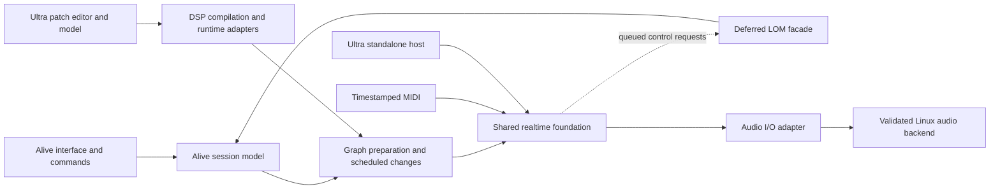

# Alive / Ultra Plan

## Phase 2 Direction: Live / Max Workflow Fidelity, 2026-10-28

Execution is active under `docs/PHASE2_HANDOFF.md`. The reviewed plan and original
reproducers are checkpointed at `70c356d`, with no application changes from
`1ebf216`. Fresh baseline evidence is in `experiments/phase2-20261028/baseline/`:
the original native Apply/editor assertion fails again; the focused probes
reproduce the queued-edit, focused-save and metadata-loss defects. Task 1 accepts
this known-bad baseline. Task 2's reviewed queue/generation/brace/Duplicate fix
is integrated, with 107 Alive Node and six focused Chromium checks passing;
native qualification remains pending. Task 5's fix-round candidate `72e79ae`
passes the full traced original Alive and Arrangement native journeys; scoped
specification re-review and quality review accept the four harness findings.
That increment is integrated as `65dbf5a` with 17 root helper regressions passing.
The optional installed-help fixture repair is reviewed and integrated at
`003024f`, including its two regressions in CI; the combined full Ultra native
rerun now passes. Pushed checkpoint `5b464e7` passes CI `40686059005` and all four
package targets in `40686058990`, with publication skipped. Its headless
contracts include 543 UI/component tests plus existing schema/reference/native
graph gates; 19 desktop helper regressions pass. These results are attributed
to that earlier commit. Task 3's independently reviewed candidate `5663956`
is integrated as `9997589`: focused drafts, bounded owner-wide Save preflight,
picker/write reservation, lost-release reconciliation and real Linux Quit.
The final affected native smokes pass; the ten-case matrix predates the final
lifetime changes, and Save-only note-off has deterministic IPC coverage rather
than rendered PCM evidence. Task 4's reviewed `a2fdc98` is integrated as
`b4b1a5c`, preserving validated device metadata/presets while repackaging and
supporting effect rename. Native worker save/reopen and two independent hosted
Tone controls pass; hosted preset recall is not implemented or claimed.
Root's combined Node/component suite records 572 passing tests and eight
focused Chromium checks. A fresh `b4b1a5c` rebuild exits 0, and all four serial
combined native journeys pass: Alive 197.710s, Arrangement 118.157s, Ultra
canvas/documents 166.320s and instrument authoring 139.502s. The instrument has
18 edit cycles over 62.833s; 26 captures contain 10,873,472 finite stereo frames.
This is private software PipeWire/CPAL at 48 kHz/512, not physical audio or the
required 1800-playing-second endurance qualification. Reports, commands, hashes
and both-size screenshots are retained in
`experiments/phase2-20261028/reliability/`. Fresh full pinned headless contracts
exit 0 in 212.257s on the integrated source, including all 572 UI/component
tests plus schema/reference/native C++ suites. Final pushed-head CI/packages remain
separate gates. Exact-checkpoint CI `40695723200` now fails late in the Alive
native walkthrough: Replace Harmony device does not produce a viewable chooser.
Its UI/reference and Chromium jobs pass. The original failure artifacts are
retained and a narrow Terra diagnosis is active; P2.0 is not promoted on the
strength of the local pass. The concrete Master packet `6638858` has clean
scoped reviews and locally compiled C/Rust ABI witnesses, but remains unfrozen
until this gate is resolved. No new Master capability is
accepted yet. Independent Terra preflight review has tightened its draft
contract; consumers remain gated on P2.0. The durable
execution ledger is `.superpowers/sdd/2026-10-28-phase2-live-max/progress.md`.

The owner prioritizes familiar Live/Max workflows and a much closer visual
composition before general Live Set/Max-file compatibility. They explicitly
identify the missing Master channel. The proposed Phase 2 design and work
sequence are now the primary planning entry points:

- Design: `docs/superpowers/specs/2026-10-28-phase2-live-max-design.md`.
- Plan: `docs/superpowers/plans/2026-10-28-phase2-live-max.md`.
- Multi-agent execution: `docs/superpowers/plans/2026-10-28-phase2-multi-agent-execution.md`.
- Compaction/resume and goal text: `docs/PHASE2_HANDOFF.md`.
- Fresh Live output-channel reference: `docs/PHASE2_REFERENCE_20261028.md`.
- Source/reproducer baseline: `docs/DEVELOPMENT_REVIEW_20261028.md`.

Proposed sequence: P2.0 state-loss fixes and reproducible native/Arrangement CI;
P2.1 a real saved native stereo Master, fixed-right Session output strip and
bottom Arrangement lane, compact Live-style composition and both-size native
qualification; P2.2 direct clip/automation/device editing and Max graph authoring;
P2.3 genuine WAV/portable projects and general device metadata; separately gated
instrument/effect/recording and compatibility cohorts; final integrated evidence.
The first new feature is Master, not another standalone instrument demo. It
must include native gain/meters, persistence, history/live ownership and tests.

The reviewed planning documents define the active implementation work; the
current execution checkpoint above supersedes their historical planning-only
status. The working MIDI Session/Arrangement and reusable-device host are retained.
The prior workspace plan remains the implementation record and detailed audio
dependency. Stale statements in historical sections do not override current
source or the dated review. Historical baseline CI at `1ebf216` failed the
original Apply/editor-close assertion. The later harness diagnosis/fix and
current combined native qualification are recorded at the top of this file;
the assertion remains intact. Physical audio and final endurance are separate
gates from native software-loopback journeys and four-platform packaging.

Three GPT-6.1 Sol exploration agents assessed Alive, Ultra and delivery. REA was
used for a fresh bounded Live 12.4.6 Master-layout/fader study in disposable
Wine/Xvfb; UI action evidence and process lifecycle are distinguished. Max
reference evidence is reused, not represented as a fresh run. Cloud workers
consume original contracts/fixtures; installed-app study and physical acceptance
remain local. Original/source Wine preferences are verified unchanged.

Execution follow-up: the owner requests multiple `gpt-6.1-terra` subagents and
plans to compact before setting the implementation goal. That exact model ID
successfully dispatched two planning reviewers; `terra-6.1` was the rejected
spelling, and the advertised model list was incomplete. The runbook fixes a
controller-plus-three-child schedule, exclusive file/resource ownership,
contract freezes and fresh spec/quality reviews. The durable handoff preserves
expected dirty work, baseline failures and next runnable packets. The active
goal now authorizes implementation; this paragraph records the earlier
planning provenance. Fresh resumed dispatch again accepts `gpt-6.1-terra`.

2026-10-28 review/build checkpoint: upstream is fast-forwarded to `1ebf216`.
Both local binaries build. The current source review reproduces queued
source/generation mistakes in Alive and pending-input/preset preservation
problems in Ultra. Resolve these before expanding the unfinished WAV workflow.
Findings, runnable reproducers, native qualification status and the proposed
cloud/local handoff are in `docs/DEVELOPMENT_REVIEW_20261028.md`.

## Active Direction: Arrangement And Session, 2026-10-26

Current handoff: the pushed `ea8e401` checkpoint includes the implemented MIDI
timeline, not only the earlier Session controls. See
[the current workflow ledger](docs/WORKFLOW_COVERAGE.md#current-checkpoint-and-next-actions)
for exact-head CI and remaining work. Its four-platform packaging passed;
its native CI job was cancelled during dependency installation, so final native
qualification remains open. No current product regression follows from that
cancellation. The stage-by-stage records below preserve historical evidence,
not a list of capabilities still missing today.

The owner resumed the workflow goal after the compact Session checkpoint.
The cutoff-after-reopen failure is fixed without weakening its assertion, and
the MIDI desktop host is independently approved through `ee83d30`. Reviewed
checkpoint `e38c87b` is pushed; exact-head CI and all four package targets pass.
MIDI timeline editing at `91cb9d1` now passes the actual create/edit/play,
per-track Session override/return and save/Quit/process-restart journey.
Both target sizes and final direct Arrangement gain are verified; independent
task review approves. Alive (Test) now uses the coherent tested build.
Genuine WAV tracks and a portable mixed project follow; general Ultra authoring
remains separately scoped. Current workflow/reference
coverage is tracked in `docs/WORKFLOW_COVERAGE.md`; this is not a replacement
implementation plan. New original-application captures stay private. Reuse
reliable existing action/result evidence before adding each interaction.

The owner resumed work with PR #6 comment 6383966857 as the current product
direction. It supersedes the earlier Arrangement exclusion and testing pause.
Build a real horizontal MIDI/audio timeline and Tab-switchable Session columns,
sharing tracks/mixer/Ultra chains with explicit per-track playback authority.
Current v3 has neither timeline scheduling nor audio-file tracks; preserve it
while adding those capabilities. Do not claim the existing control form meets
the new UI acceptance gates. Work continues in this worktree/feature branch.

Spec: `docs/superpowers/specs/2026-10-26-alive-workspaces-design.md`.
Execution plan: `docs/superpowers/plans/alive-workspaces-20261026.md`.
The active implementation sequence is Session/shared shell, real Arrangement
model/MIDI ownership and timeline editing through the native two-view MIDI
journey, then actual audio tracks and mixed-project acceptance. Earlier completed
work and open regression gates
below retain their original scope and source attribution.

The Session/shared-shell increment is implemented at `238c427`, with the
focused unfinished-detail-field correction at `97533b8`. Track columns,
aligned slots/scenes, per-column mixers, collapsible browser and resizable
Clip/Devices detail now use the existing native owner. View changes are local
navigation; Arrangement remains explicitly unavailable. The corrected source
passes 500 UI and 13 Alive browser checks, a separate release build and actual
native WebKit pending-field/playback/scene/editor/Save/Quit checks. Parent
verification matches 148 manifest entries and 116 committed source/harness
blobs; finite software capture is 3.136 seconds, not endurance. A later full
native journey also passes on exact `97533b8` release assets, separately pinned
under `native-followup-97533b8/`; neither pass qualifies subsequent source.
Evidence: `experiments/alive-workspaces-20261026/`. Independent fix re-review
approves compliance and quality with no remaining finding. Pushed-commit CI
remains required at the checkpoint; no Arrangement/audio or
final integrated acceptance is inferred from this UI increment.

User testing follow-up, 2026-10-26: the owner says the interface still differs
too much from Live and requests more icons and clearer clip slots. They
explicitly choose a denser Live-style grid first, retaining the current four
playable slots per track. A fresh bounded Wine/Xvfb study of the identified
Live 12.4.6 copy confirms compact colored clip bodies, separate left launch
areas, neutral empty cells, fixed-width tracks, compact icons and vertical
mixer organization. Reference evidence and limits:
`experiments/alive-session-ui-reference-20261026/`.
The focused revision is implemented at `e38676a`: original icons, four real
28px slot rows, fixed 146px tracks, distinct native playback/selection states,
existing gain/peaks presented vertically, guarded empty-slot double-click and
a less crowded detail area. All 67 Alive Node tests and 17 focused Chromium
checks pass; six affected checks pass again after the final CSS bounds fix.
Actual release WebKit verifies both sizes, precise fader values, automation
edit/undo, editor lifetime and the original clip/playback/save/reopen/Stop/Quit
journey. The null AT-SPI-child failure after editor close is isolated in a
regression and fixed in the test helper at `cd9fdd1`; original journey assertions
remain intact. Parent verifies four committed UI blobs, six source/binary pins,
144 raw artifacts and 1,461,760 finite stereo capture frames (30.453333 seconds).
Final reported stream errors/rejected commands are zero. This is software
PipeWire/CPAL at 48 kHz/512 frames, not physical audio or endurance.
Evidence: `experiments/alive-session-ui-revision-20261026/`. Independent review
found stale scene receipts after opening a supported legacy fallback. Fix
`ad47d2a` hides the disclosure by mode and has failing/passing DOM/browser
regressions; final Node 68/68, rendered transition, timing 10/10 and frames 1/1
pass. CI now explicitly runs the frames regression. Targeted native test
`6a8f644` passes legacy accessibility absence, fresh prepared identities and
cleared/new request receipts on the final rebuilt binary. Its first driver run
omitted restarting audio after Open; the corrected driver and original failure
are retained separately. Scoped re-review approves compliance and quality with
no blockers. The original full journey/screenshots retain `e38676a` attribution;
final native validation covers the affected transition. Parent verifies all six
final source/test/workflow blobs and UI/binary pins. The refreshed standalone
launcher points to this tested final build.
No new Arrangement or PCM admission follows from that checkpoint. Its testing
pause is superseded by the workflow resumption recorded at the top of this file.

Exact checkpoint `6beb210` CI `40308165402` passes UI/Chromium, native/Rust
and headless renders, then fails the full native desktop journey at
`check_alive_desktop.py:791`: selected effect cutoff is expected to be 2000.
The retained saved session contains effect cutoff 2000 and instrument cutoff
1333; the failure accessibility tree still displays the Subtractive instrument
and cutoff 1333. Later clip/editor-resource/CPAL gates are skipped.
Packages `40308165397` pass all four targets, with publishing skipped. These
outcomes supersede that checkpoint's previous pending status, not its failure.

The cause is demonstrated and fixed at `cc7d541`: a native Devices detail
tooltip intercepted button events queued with pointer motion; actual DOM
tracing receives motion but no click. The test shares the existing bounded
owned-window check before one press/release. Exact cutoff 2000 and all original
journey assertions remain, with a real covering-tooltip regression. Actual
native RED/GREEN and the complete original journey pass locally in 199.087s;
independent review approves spec and quality. Parent verifies nine raw hashes,
ten source/binary pins, seven committed blobs and 4,576,768 finite stereo capture
frames (95.349333s). Final reported stream errors/rejected commands are zero.
This is software PipeWire/CPAL at 48 kHz/512 frames, not physical audio or
endurance. Existing accessibility/compositor harness warnings remain disclosed.
Evidence: `experiments/alive-workspaces-20261026/cutoff-ci-fix/`.
Remote CI on the new pushed checkpoint remains required.
Prior checkpoint `5abd9eb`: CI `40338484521` and packages `40338484480`
ran on that exact commit. CI's Linux job hit its 40-minute limit after dependency
installation consumed about 33 minutes (69.7 MB at 35.4 kB/s with Ubuntu mirror
retries); native build/checks passed, Rust build
was canceled and downstream desktop gates did not run. UI/protocol and Chromium
jobs pass; Windows and both macOS packages pass, while Linux packaging was
canceled for the newer PR run during dependency installation. PR #6 remains
draft and records current
working versus missing workflows. The complete-envelope/oracle 2C-prep slice
is independently approved at `c8f6522`: 106,661,824 bounded oracle assertions
and the complete native suite pass. No runtime capability is enabled by that
preparation work. Finite multi-track native integration at `0606542` passes the
complete native suite (157.49 seconds), focused PCM/work/transaction tests and
current-source shipping refusal; independent spec and quality review approved
with no findings. Two active
instrument tracks pass; the sparse eight-track fixture has one sounding lane,
and denser configurations remain conservatively refused. Authority actions,
loops and measured desktop admission are next. This is still native test work,
not an available Arrangement app feature.
Reviewed checkpoint `8a6192f` is pushed and PR #6's description is updated.
Its CI `40351129360` passes UI/protocol and Chromium; Linux exceeded its
40-minute job limit after dependency installation took 39 minutes 4 seconds.
Native compilation was canceled and subsequent native gates did not run.
Packages `40351129269` pass on all four targets. The local authority-actions
slice at `92d84d1` passes its existing native suites, but independent review
reproduced loss of a pending Launch slot in published state when playback
crosses an Arrangement boundary. Fix `74d92d4` derives that projection from the
queued action, with playing adjacent/gap boundaries and concurrent snapshots
covered. Its focused tests and complete native suite (171.14 seconds) pass;
independent scoped re-review approves with no new findings. Source suffix loops
and Arrangement-only Seek are next. No existing launcher binary has been replaced.
Reviewed checkpoint `65eb486` is now pushed with the authority implementation,
fix and retained evidence; PR #6 is updated. Exact-head CI `40360213014` passes
UI/browser, native/Rust and offline renders, then fails the actual desktop
journey at `check_alive_desktop.py:723`: Replace Pulse device does not open a
viewable Load Ultra Device chooser. Cause investigation is active; original
assertions remain. Later clip/resource/CPAL gates skip. Packages `40360212684`
pass all four targets, with tag publication skipped. Source suffix loops and Arrangement-only Seek are independently
approved at `a0c34e3`: focused tests, the unchanged complete oracle and full
native CI (175.99 seconds) pass, including pending-request preservation and
exact Session PCM through refused seeks. Song-loop/coincident-boundary closure
is independently approved at `5981cfe`: focused tests, the unchanged
oracle and full native CI (180.70 seconds) pass, including Stop/resume exactly
at the song end. Complete MIDI runtime measurement and desktop integration are
next; shipping v4 remains disabled. Chooser diagnostics at `0bbad18` pass the complete original local
journey (193.56 seconds), but independent review reproduces a disappearing-window
BadWindow failure in the new observations; scoped correction is required before
push. The original CI chooser cause remains unconfirmed, with no product fix
claimed. Diagnostic correction `0d9ccd6` passes the disappearing-window native
regressions and existing input helper. Its full original journey fails later
at changed-source recovery: a temporary snapshot error masks the expected
dependency message after earlier Save/reopen values and missing-source checks
pass. Product fix `4470230` reproduces both final-refresh and background-poll
masking in mounted-view tests and preserves primary errors alongside refresh
health. All 508 UI and 18 browser tests pass; a fresh coherent native build
passes the unchanged original journey in 193.11 seconds, including changed-source
recovery and Quit. Independent spec and quality review approves; existing build/
harness warnings remain disclosed. The existing launcher now
uses the tested replacement; old binaries are retained. Task 2D MIDI measurement
is complete and independently approved at `8e17719`, with shipping v4 still
disabled. The runner retains 287 distributions / 344400 timing samples,
separate guards and exact provenance. Full native CI passes in 180.37 seconds.
Parent verification matches all 733 raw artifacts, four committed source pins
and every quantile/deadline-overrun count recomputed from the samples.
The review records a nonblocking runner-completeness hardening gap; the final
audited sample set is unaffected. Profile 1 is the desktop candidate at
practical buffers >=256 frames;
profile 2 remains unadmitted because combined synthetic stress overruns even
at 1024. The synthetic extra DSP bank and scalar work surrogates are explicit
limitations. Complete prospective native admission still governs each project.
Use two instruments and an admitted three-root project for the first MIDI
journey; larger conversions refuse without replacing the playable v3 project.
Existing v3 eight-track support and audio settings remain unchanged. Evidence:
`experiments/alive-workspaces-20261026/task2d-measurement/`.
Reviewed checkpoint `a1cf2e7` is pushed with these fixes, native MIDI evidence
and independent reviews. PR #6 remains draft and its description is updated.
Exact-head CI `40374437793` passes UI/Chromium, native/Rust and offline renders,
then fails the desktop journey when the Pulse hosted-editor window is not
observed opening (`check_alive_desktop.py:860`, `check_documents_desktop.py:126`).
Earlier chooser and piano/history actions pass; later clip/resource/CPAL gates
skip. Artifact diagnosis leaves the original activation cause unresolved;
focus/scroll timing is a hypothesis. A bounded native activation probe follows
the completed timing run: both original single-activation probes pass, leaving
the CI cause unknown. Diagnostic source `6d88803` adds three first-activation
receipts and passes the full original journey in 193.18 seconds. Review finds
that receipt-file failures could interrupt the test; correction `6d8c95a`
reproduces three native failure paths, preserves the identical original focus
exception, and passes the full journey in 193.83 seconds. Scoped re-review approves with no remaining finding. No product, original input, timeout or assertion changed. Evidence:
`experiments/alive-workspaces-20261026/editor-activation/`.
Packages `40374437738` pass all four targets, with tag publication skipped.
The real Arrangement and mixed-project acceptance gates remain open.

Reviewed checkpoint `ad706ca` is pushed with the measurement policy, diagnostic
correction and retained evidence; PR #6 remains draft with an updated workflow
description. CI `40384189184` passes UI/protocol, Chromium, native/Rust, offline
renders and the complete desktop/editor journey. The subsequent clip test fails
waiting for transient "pending launch" while observing the requested clip
already Playing/applied; timing diagnosis is in progress, with no product cause
claimed. Later editor-resource/CPAL gates skip. Packages `40384188941` pass
all four targets, with tag publication skipped. Task 2D desktop integration
is active on that base: checked document/chain access, strict MIDI v4
preparation, authenticated commands, history/persistence and real Session
readers precede the immediate Task 4 MIDI timeline. A bounded reference-only
WAV study fills the subsequent audio task's import/trim/source-recovery gap;
it does not delay or reorder MIDI implementation. That study is now complete:
`docs/ALIVE_AUDIO_REFERENCE.md` records import, mono/stereo waveforms, movement,
trim, looping and external-reference save. Restart/missing-source recovery
remain unobserved after the pinned disposable reference failed to reopen;
official documentation is explicitly labeled fallback. All 113 private artifacts
verify, and owned reference processes/display are cleaned.

Task 2D's provisional native app now passes explicit MIDI conversion, two-track
Arrangement playback, Session override/Return/scoped Stop, automation and
hosted-editor lifetime, followed by Save/Quit/restart and exact document
round-trip/playback. The unchanged original template refuses its excessive
event envelope transactionally; a separately authored split-triad progression
with cutoff, level and Utility gain automation admits under profile 1. This
does not simplify saved user music during conversion. The provisional journey
captures 18.048 seconds of finite software audio and both viewport sizes, not
endurance. Its observed 48 kHz/512-frame epoch reports zero CPAL errors/Xruns
but one callback over budget (13.34 ms maximum); no deadline claim is made.
The queued-source-identity regression and shared v3/v4 request-serial reuse are
fixed at `4b9a88b`. Final checks pass: 252 Rust tests (four existing ignores),
79 UI tests, all 20 Alive browser tests, complete native suites and the unchanged
original v3 desktop journey. The final v4 native run also plays v3 before
conversion, then repeats the full workflow and process-restart roundtrip. Its
observed pre-Quit epochs have zero reported errors/Xruns/over-budget callbacks;
15.562667 finite software-capture seconds are not endurance. The earlier
over-budget observation remains retained. Evidence:
`experiments/alive-workspaces-20261026/task2d-desktop/`.
Independent Task 2D review found a queued slot edit could overwrite an accepted
sibling field. Fix `ee83d30` resolves unchanged fields from the current slot
inside the queue and refuses deleted or rewired targets. Both edit orders
reproduce before the fix and pass afterward; 85 UI and two focused browser
checks pass. Scoped re-review approves, closing the integration task. Broad
native evidence remains pinned to `4b9a88b`. A separate scoped harness
correction addresses the saved-clip CI observation failure. Timeline
creation/editing remains the immediate next product increment; this is not yet
the complete Arrangement journey.


The saved-clip harness correction is independently approved through `a634f4d`.
A controlled launch has 30.85 ms left pending while its accessibility traversal
takes 71.58 ms; bounded early-bar synchronization preserves the original pending
and applied assertions. A separate covering-tooltip reproduction establishes
runtime disclosure interception; existing owned-window readiness fixes it.
Recording and failure screenshots cannot mask original input errors. All twelve
native checks pass on harness `6ab7775` with product `4b9a88b`; the final
screenshot guard has focused RED/GREEN coverage. Parent verifies 563712 finite
software capture frames (11.744 seconds), with zero final reported errors,
rejections or voices. This is not endurance. Original remote causation remains
unproved and exact-head remote CI remains open. Evidence:
`experiments/alive-workspaces-20261026/clip-observation/`.

Reviewed checkpoint `e38c87b` is pushed with the admitted MIDI desktop host,
queued-slot correction, native harness correction and retained reviews/evidence.
PR #6 remains draft with its current workflow description and attributed native
screenshots. Exact-head CI `40398432588` passes all jobs, including the original native
journeys, new observation fault modes, editor resources and CPAL software
loopback. Packages `40398432637` have Linux/Windows/Apple Silicon passes; Intel
macOS is still running. Task 4 real MIDI timeline editing is active on this
base, with the first actual create/select/move interaction inspected before
broadening. The installed launcher remains on the prior coherent tested product.

Fresh private Arrangement study LOCAL-ARR-R1 observes occurrence creation,
movement, source-loop extension/undo, two-track Session override, scoped Stop,
per-track/global Return and save/new/open. Derived findings and precise gaps
are in `docs/ALIVE_ARRANGEMENT_REFERENCE.md`; raw captures/project stay private.
Initial stalled PipeASIO transport is excluded from playback observations;
advancing MME/DirectX transport establishes UI state only, with no audio capture
or timing claim. Owned display/prefix cleanup verifies original preferences
unchanged. Process-restart persistence and device-state reference remain open.

The pure strict v4 source/placement model is implemented through `59c6076`,
outside the active Document. Its strict wire, transactional focused edits,
deterministic conversion, stable identities and exact endpoint timing pass
24 focused and 77 session tests. Independent review caught native-v3 admission
leaking into candidate conversion; the shared pure conversion/strict decoder
fix is approved after ten capability-refusal scenarios and scoped re-review.
This does not enable v4 app open/save, playback or audio-file support.
Evidence: `experiments/alive-workspaces-20261026/task2a/`.
The additive native ABI and one genuine MIDI Arrangement lane are committed
at `db4a934` / `d7f8490`, with reviewed fixes at `db39ab0`. The native-only
test subset uses one source across one to eight nonlooping placements, with
real saved Ultra graphs, offset-held-note/automation chase, full-chain resets
and bounded work. Exact PCM matches the mixed partition sequence and fixed
partitions 1, 31, 32, 63, 64, 127, 128, 256, 512 and 1024. Shipping refusal,
C/Rust layouts, full native regressions and 79 Rust session tests pass.
Parent verifies twelve committed source blobs, seven binary and four fixture
hashes against retained manifests. Independent review identified rejected
post-end START atomicity and chased-before-ordinary note-on ordering. Separate
regressions reproduce both failures before the fix and pass afterward. Scoped
re-review approves the fixes with zero open blocking findings. The full guarded
v4 suite, shipping refusal and full native CI pass after the correction; the
original Stop/baseline comparison still passes 43008 samples. Fix evidence is
retained separately in `experiments/alive-workspaces-20261026/task2b-fix1/`.
This is not production v4 admission:
both builds publish zero feature bits, and only the dedicated test target
admits this subset. The normal library refuses configure/request without
changing the playing v3 session. Multi-track authority, seek, loops, desktop
integration and full measured admission remain open. Evidence:
`experiments/alive-workspaces-20261026/task2b/`. The staged
contract is `docs/superpowers/specs/2026-10-26-alive-workspaces-runtime-contract.md`.
It is a design target, not measured admission. Subsequent native slices add
MIDI Arrangement, explicit authority/return, bounded PCM, then real timeline
editing. The working v3 app and launcher stay usable throughout.

The local **Alive (Test)** launcher remains installed and freshly validates.
It runs the separate `alive` release executable through `apps/alive/run.sh`,
without rebuilding on launch. Its current Session UI build is `ad47d2a` / `6a8f644`,
qualified in the revision evidence above. The prior pinned build (`97533b8`) passed a
fresh saved two-device offline probe, including exact offsets 0, 1, 31, 63, 64
and 127, partition equality, automation ownership, isolation, mute/solo,
loop/seek/Stop, save/reopen and device removal. This does not enable Arrangement
or imported audio, and is not a new desktop or endurance result. Launcher
hashes, command exits and probe report are retained under
`experiments/alive-workspaces-20261026/launcher-checkpoint/`.

At pushed `f0fb9e5`, CI `40264211910` passes browser, UI/contracts,
native/Rust and offline rendering but its native desktop step times out after
five minutes; later native gates are skipped. All four platform packages in
`40264211925` succeed, with publishing skipped. A targeted local reproduction
of the full unchanged desktop journey now passes on the exact `97533b8` release
assets, including original history/editor/file/device-removal/Quit checks.
Its private PipeWire capture has 4175872 finite stereo frames / 86.997333
capture seconds at 48 kHz / 512 frames, with zero reported errors/rejections;
this is neither endurance nor continuously playing time. The CI timeout cause
remains unproved; a local pass does not qualify the failed CI run. Evidence:
`experiments/alive-workspaces-20261026/ci-f0fb9e5/` and
`experiments/alive-workspaces-20261026/native-followup-97533b8/`.

At pushed `9bf3180`, CI `40267085010` repeats the five-minute desktop
timeout after successful UI/browser/native/Rust/offline checks; later native
gates are skipped. The artifact reaches save/reopen and dependency recovery
and completes recorder cleanup, but has no final journey report. Independent
streaming confirms 9246208 finite stereo frames / 192.629333 capture seconds,
not endurance. Retained observations report zero audio errors/rejections;
the timeout cause remains unproved. Packages `40267085031` pass Linux,
Windows and ARM macOS; Intel macOS fails after building/signing Alive.app
when DMG unmount repeatedly reports `hdiutil: Resource busy`. Publishing is
skipped. This records the failure point without claiming its root cause. Evidence:
`experiments/alive-workspaces-20261026/ci-9bf3180/`.

Reviewed native source and retained evidence are pushed at `87cb416`.
Exact-head CI `40271664266` passes UI/browser/native/Rust/offline checks and
the full desktop journey in 267 seconds under its original five-minute limit.
The subsequent saved-clips/observability test fails at `Duplicate clip`: the
new workspace's Devices detail is open, while the existing navigation helper
omits the selected-clip controls needed to reveal Clip detail. Later editor
resource and CPAL gates are skipped. Correction `729dc9a` is independently
approved for source/code quality: the original local failure reproduces, and
the corrected run passes clip editing/history/preparation/save. The complete
run still fails at the unchanged stopped-launch assertion: `Cued Clip 1 copy`
remains visible instead of the requested Clip 1 with an applied receipt.
One targeted press/release and native-frame ownership are recorded, but raw
receipts and Session status were not retained, so the cause remains unproved.
The one bounded diagnostic run then passes that original stopped Launch and
all clip/shared-source recovery checks, but adds measured observation time,
so it does not establish the prior failure's cause. It exposes a later
qualification failure: expanded diagnostics cover the audio-settings opener.
Its actual tree/screenshot and pinned layering support a second narrow helper
correction at `3522e31`: reveal the existing audio-settings opener by collapsing
expanded diagnostics. One original uninstrumented full journey then exits 0
through stopped/quantized launch, scoped Stop, edit/history/Apply/editor,
save/reopen, shared-source recovery, all three final qualification cycles and
Save/Quit. Independent scoped review approves the correction with no new
findings and closes the local full-original-GREEN gap. The earlier stopped-launch
cause remains unproved; no retry or repeatability claim is added.
The complete report records six finalized stream epochs, 4.117333 proven playing
seconds and no sampling errors. Independent capture verification finds 417280
finite stereo frames / 8.693333 capture seconds, distinct from playing time.
Parent verifies 409 current input hashes, 407 committed input blobs, 47 raw
artifact hashes and report-declared logs. This short private software-audio run
does not qualify endurance, production v4 or final-head CI. Separate evidence:
`experiments/alive-workspaces-20261026/ci-clip-navigation/` and
`experiments/alive-workspaces-20261026/ci-clip-launch-diagnostic/`, with the
approved correction under `ci-clip-navigation/fix1/`. Package run `40271664433`
passed Linux, Windows and ARM macOS; Intel macOS was subsequently cancelled.
This does not qualify the final branch. Native 2C has not started.

Bounded phase/query/stack diagnostics are implemented at `08156ea`. The
unchanged local full desktop journey passes in 185.552 seconds (wrapper
194.928 seconds); capture finalization takes 1.362 seconds and final diagnostics
7.153 seconds. Nine periodic snapshots and the final Quit are retained.
Independent review identified missing stdout capacity for final-phase boundaries
after ordinary progress is exhausted. Fix `cb079f2` reserves six bounded
observations; its regression first fails against the original helper, then all
ten helper tests and preservation checks pass. Scoped re-review approves the
fix with no open findings. The local native measurements predate this
stdout-only fix and retain their original source attribution.
The provisional eight-minute CI step limit is diagnostic only. Prior timeout
causes remain unproved, and this later remote pass does not explain them.
Evidence: `experiments/alive-workspaces-20261026/ci-timing/`. These corrections
precede 2C-prep's complete MIDI envelope/oracle proof and runtime widening.

Foundation rechecked on 2026-10-26: the remote release integration still points
to `31033483eb3baf15edab1734b966cc6d55c4b8c7` and remains an ancestor of this
branch. The later diagnostic/navigation checkpoint `efa4280` passes complete
CI `40276304022`, including UI/Chromium and Linux native/Rust/CPAL gates.
Packages `40276304032` pass Linux, Windows, Intel macOS and ARM macOS;
publishing is skipped. These outcomes qualify that checkpoint, not the
subsequent Session UI revision, and do not explain earlier failed runs.
Historical checkpoint
`0e791ec28f2ecf89cb9bab31516d57668e361333` has CI
`40089612067` passes browser, UI/contracts, native build/Rust and offline render,
but fails the desktop journey opening `Pulse - Ultra Hosted Editor`; subsequent
native clip/retirement/loopback steps are skipped. The failure screenshot shows
lower chain controls obscured by expanded diagnostics, a possible pointer cause
that remains unproved. Its packages run `40089612068` passes Linux, Windows and
both macOS targets; publishing is skipped. These are historical outcomes, not
qualification of the workspace changes.

Updated: 2026-10-26. Combined release integration includes packaging/audit PR #2, reusable-instrument PR #4 at `ab8b0e2`, and preserved validation PR #5 at `8da5fd2`. The 0.1.0-rc.1 candidate includes the native Quit and pending-history admission fixes. Earlier evidence below retains its original source revisions and hardware limits.

## Alive Application: Active Implementation Plan

**Goal:** Continue draft PR #6 into a usable standalone music-making application
hosting reusable Ultra instruments and effects. The two-track session below is
the completed foundation, not acceptance of this expanded goal.

**Foundation:** Continue isolated `feat/alive-session-host`, based on
`31033483eb3baf15edab1734b966cc6d55c4b8c7` on
`build/ultra-desktop-releases`. PR #6 remains draft/open; HEAD at the start of
this expansion was `0c615b1e9aa4003dd7f09ea11d45988476bf0434`. Current refs were
fetched before work. Do not change release branches or PRs #2/#5. Recheck the
foundation before final testing. No merges, tags, publishing, deployment,
credential or environment-setting changes.

Execute and test these milestones in order, retaining a usable example and
coherent pushed checkpoints. Read-only reference/design work may proceed in
parallel. Preserve existing native/UI/history/Quit/scoped-Stop/notice gates.

**Historical checkpoint pause (superseded by the active direction):** User
requested a pause for hands-on testing after Task 14.
The reviewed atomic scenes and retained evidence were complete locally
(`2b1eab1`, `3d4beb0`). The standalone release binary matched that
scene source at that checkpoint and ran through `bash apps/alive/run.sh`. Task 15 was
dispatched but interrupted before implementation; the final example/audit,
1800 proven-playing seconds, whole-branch review and final exact-head CI/package
qualification remain open. The subsequent Arrangement/Session request resumed
implementation; final qualification belongs to the resulting interface/runtime.

### Milestone 1: Standalone Application

- [x] Separate `alive` executable/identity and separately launchable `ultra`,
  sharing one Rust/native runtime implementation and optional hosted editors.
- [x] Alive output-host/device and buffer controls reuse the CPAL driver;
  stopped reconfiguration, saved preferences, actionable disconnected-device
  errors and recovery are verified in the native app.
- [x] Preserve reliable New/Open/Save/Save As and pending/dirty-state resolution.
- [x] Distinct Alive and Ultra packages can coexist; each staged app finds its
  bundled examples outside the repository. Verify resources/notices and CI.
- [x] Test, commit, push and update draft PR with this milestone's evidence
  (`2e13410`; current-head CI remains pending).

Local M1 evidence: `experiments/alive-application-m1-20261024/`. The separate
package's initially missing Tauri capabilities reproduced an editor-Close bug;
scoped grants, actual generated-context tests, editor-destruction assertions and
native window-manager Close/Cancel now pass. Final native walkthrough captures
25.355 seconds of finite software stereo audio with zero reported errors,
failures or rejected commands. Eight editor cycles retain one WebKit worker.
Actual Alive/Ultra DEBs have no file-ownership collisions; the extracted Alive
proves default and New use its own bundled template, then plays both devices.
151 shared Rust tests (+ one Alive context test), 443 UI tests, 103 Chromium,
full contracts/reference/native/callback/scoped-Stop gates and 20 package/notice
tests pass. Local AppImage generation is blocked by the legacy bundler's Arch
RELR/glycin incompatibility; Ubuntu and other-platform CI remain required.
No new endurance claim: the expanded 30-minute gate remains outstanding.
Draft PR #6 now describes all five milestones and the independent packages;
the earlier `0c615b1` CI results remain historical. A fresh display-free saved
session render and all 20 packaging/notice tests pass at the M1 checkpoint.
Follow-up CI exposed platform `ar` dialect/text-output differences in the DEB
test fixture on macOS/Windows. The portable SysV reader and exact-byte fixture
pass 21 package/notice tests, independent malformed/valid archive probes and
both actual Tauri DEBs' extraction/linkage/notices/bundled render. Scoped review
is clean; platform CI must rerun this correction. UI/reference and Chromium on
`548b1a1` pass; full native/package checks are still being reconciled.
The portable correction at `848f53e` passes all three CI jobs, including the
actual Alive desktop/editor and CPAL-loopback gates. Both application packages
pass on all four platform runners; publishing is skipped. Evidence is retained
in `experiments/alive-application-m1-20261024/ci-848f53e.json`. The downloaded
Ubuntu Alive AppImage also passes hashes/notices/linkage/native ABI and bundled
offline rendering on this Arch machine, without a development library override.
Accessible local files: `dist/alive/ci-848f53e/`; later chain changes still need
their own CI/package qualification.

### Milestone 2: Reusable Effect Chains

- [x] Versioned instrument/effect contract with explicit input/output bundles,
  MIDI declaration, stable parameter IDs and tested version-1 compatibility.
- [x] Instrument followed by an ordered, bounded Ultra effect chain; add,
  remove, reorder, bypass and parameters use stopped structural preparation.
- [x] Reusable Ultra utility and Faust filter/delay patches load through the
  same validator/runtime. No privileged host DSP or copied instrument patch.
- [x] Deterministic order/bypass/isolation/state tests; timing and tail/reset
  policy documented. Keep the existing 16-root pool; admit total devices before
  replacement rather than increasing runtime limits without measurement.
- [x] Test, commit, push and update draft PR before expanding the interface.

### Task 6: Versioned Effect Devices And Shared Signal Objects

Implement the headless reusable-device foundation for M2 before chain hosting.
Preserve version-1 instrument files and their strict validation. Add a strict
version-2 manifest with kind `instrument` or `audioEffect`, MIDI
`{input: {node, inlet} | null, output: null}`, and audio
`{input: {node, bundle} | null, output: {channels, layout}}`. Input bundle uses
the same explicit `{channels, layout}` descriptor. Instruments require authored
`poly.note~` MIDI input and no audio input. Effects require no MIDI and a bound
`audio.in~` input. Support declared stereo I/O first; reject mismatched/unsupported
layouts visibly. Normalize both versions to one Rust host descriptor; represent
the absent note entry explicitly. Existing session-v1 must still accept only
instruments until the chain runtime lands.

Add `audio.in~` (native kind 66, two mono outlets, no physical input) and
`lowpass.stereo~` (67, two mono inputs/outputs, live cutoff/resonance). The input
object reads an explicit external sample pair supplied by the evaluator caller;
default input is silence for ordinary Ultra roots. The stereo filter reuses the
existing generated Faust `UltraFilterKernel` on lanes 0/1 of already allocated
kernel storage. Do not copy/reimplement DSP or add an engine. Add explicit bounded
reset of filter state on hard termination. Update matching C/C++/Rust/JS enums,
registries, ports, numeric admission, contracts and original help/examples.

Ship two saved reusable effects under `apps/ultra/examples/`: stereo Utility
(`audio.in~` into two existing signal multiplies, shared manifest-bound `line~`
gain, then `dac~ 1 2`) and Stereo Lowpass (authored input/filter/sink). Use stable
IDs and parameter keys, original content and the same validator as instruments.
Adapt Ultra's device panel so effect parameters/presets work without a keyboard
claim. Keep Alive's existing example and headless probe passing.

Start with failing Rust/JS manifest and native signal tests. Prove stereo input
separation, silence without supplied input, impulse filter tail/reset, parameter
bindings and version-1 compatibility. Run native, Rust and contracts/UI gates;
retain red/green evidence. No session-chain routing, UI chain editor, pool/track
limit increase or packaging changes in this task. Commit a coherent checkpoint.

Implemented at `cbe310a`, independent spec/quality review approved: strict normalized
v1/v2 manifests, shared external-input/stereo-filter objects and both saved
effects. The existing two-track instrument example remains usable; effects are
explicitly rejected by session-v1 until chain integration. Native/callback and
contracts gates pass, with 158 Rust tests (two existing ignored), 447 Node/UI
tests and 103 Chromium tests. Evidence: `.superpowers/sdd/PLAN/task-6-report.md`
and `/tmp/alive-task6-*.log`; no new native GUI or hardware claim.
Review found no functional defect. Existing Node loader/color warnings remain
validation noise, not a passing-output or audio-performance claim. Ordered
native chain hosting is now Task 7; the complete M2 gate is still outstanding.
The separate `alive`/`ultra` developer build succeeds at this checkpoint. A fresh
display-free `alive --session-probe` passes 412452 frames per comparison with
identical arbitrary partitions and saved-device boundary events; receipt:
`/tmp/alive-task6-app-render/report.json`. The build retains the existing
`reserve_native` dead-code warning. This is offline regression evidence.

### Task 7: Ordered Native Chains

After Task 6 review, implement a separate native v2 ABI, preserving every v1
layout/symbol and all existing tests through adapters into one internal runtime.
Use the concrete ABI in the reviewed Task 7 interface design. Two tracks each
own one instrument and at most two effects (six devices total); the existing
16-root pool is unchanged. Device-table indices are distinct from chain order
and document/revision handles. Automation names a device plus parameter slot;
notes target the track's instrument. Prospective validation rejects duplicate,
cross-track, unowned, incompatible or overloaded resources before application.

Run each hosted root once per sample in chain order, mix only the endpoint and
defer control notifications until every sample root finishes. Preserve ordinary
Ultra root execution. Bound all callback work; prepare/load/destroy off callback.
Keep 16 parameters/device, 1024 events, 32/frame, 64/1024 frames, 64 queued
commands and independent Stop. Improve chase to one schedule scan plus bounded
device-parameter work. One authoritative frame clock; no new buffering/engine.

A bounded live bypass command returns the dry sample at the same frame while
the wet kernel continues processing. Base and bypass commands authenticate a
document/revision handle before enqueue. Stop/seek/loop/end/removal/replacement
hard-clear active and bypassed tails. Note-off permits normal release/ringing.
Mute/solo act once at the endpoint and do not suspend state advancement.

Write failing v2 native tests first. Test a noncommuting chain: impulse at
frame 0 and Utility gain zero at frame 1; Utility then Lowpass retains a tail,
reverse order suppresses it. Prove exact dry bypass and warm resumption against
a continuously wet reference, independent instances, automation/base ownership,
arbitrary 1/31/63/64/127/1024 partitions, density/queue overload, every termination
and stale handle rejection. Retain callback allocation/free/lock guards and all
v1 tests. Measure six-device discontinuity and dense-callback cost. No Rust
session migration or chain UI in this task; existing Alive remains usable.

Implemented at `edd7678`, independently reviewed and corrected at `920bdc6`.
One private graph validator now serves both ABI adapters while preserving v1
admission/error ordering. Scoped fix review found no new Critical/Important
issues; native v1 ABI assertions and live wet-to-dry sample coverage carry into
Task 8. The unchanged v1 suite,
new v2 chain suite, full native/contracts gates and callback guards pass. The
six-device fixture measures mean 1052.424 microseconds for a dense 1024-frame
callback and 32.308 microseconds for full-schedule seek plus one frame; these are
instrumented wall-clock fixtures, not physical deadlines or eight-track proof.
Extra `audio.in~` readers share an effect's declared instance input; incidental
instrument readers remain silent. Evidence and exact C ABI are retained in
`.superpowers/sdd/PLAN/task-7-report.md`. Rust/desktop session-v1 remains usable
and instrument-only until Tasks 8/9 integrate the chain runtime.

### Task 8: Chain Persistence And Desktop Ownership

Integrate the native v2 ABI in Rust with size/layout checks. Give every saved
device a stable instance ID distinct from reusable file ID. Instrument plus up
to two effect references form each track's ordered chain. Automation binds
instance ID and stable parameter key, never chain index. Strictly migrate old
session-v1 files deterministically; save canonical session-v2. Source hashes
cover canonical source JSON before applying instance bases. Changed/missing/
incompatible dependencies identify track, instance, path and Replace recovery.
Save As relocates every dependency; failed load/save/prepare preserves state.

Prepare all candidate graphs/values/density before stopping CPAL or replacing
active state. Use monotonically increasing per-root revisions even on rollback.
Live base/bypass update the saved model only after native queue admission.
Merge draft bases/mixer/bypass by instance ID. Musical drafts cannot substitute
or reorder chains. Add/remove/reorder/replacement use stopped preparation;
removal explicitly removes only that instance's automation. Hosted editor
authentication binds generation and instance, not track index or caller label.
Open/close/reopen retains the existing independent DSP lifetime and teardown.

Test old-session migration, native ABI sizes, real saved-effect loading, order/
bypass/isolation/ownership, reorder-safe automation, source changes, overload,
Save As and reopen/play. Extend the display-free probe with actual saved chains.
Keep existing two-track UI functional via a small compatibility view until Task
9. No track-count expansion. Run Rust/native/contracts gates and checkpoint.

Implemented at `edd7165`, independently approved with no Critical/Important
findings. Canonical session-v2, deterministic v1 migration, original-source
hashes, stable instance-targeted lanes, stopped chain operations and native
window bindings are integrated. Both deferred Task 7 coverage items are tested.
171 Rust tests (two existing ignored), Alive capability test, 449 primary Node
tests, full native/pinned contracts and actual/staged saved-chain probes pass.
The existing real desktop journey and eight editor cycles also pass on the
unchanged rebuilt release app; receipts/screenshots are retained under
`experiments/alive-chains-m2-20261024/`. Minor existing warning and partial-install
rollback test coverage remain ledgered for final triage. Desktop chain controls
and full M2 acceptance remain Task 9; there is no new endurance/physical claim.

### Task 9: Minimal Chain Interface

Expose selected-track instrument/effect chain, metadata-driven parameters and
optional editor per instance. Add/remove/reorder/replacement explain their
stopped-transport requirement. Live bypass preserves warm state. Keep base and
effective ownership visible. Generalize automation target selection from fixed
cutoff/level to instance/parameter metadata while preserving the original lanes.
Selection does not imply launching. Preserve compact charcoal/amber/Liberation
Sans presentation, audio sidebar, draft/file/Quit behavior and native editor
capabilities/teardown. Run bounded full-surface Impeccable verification with real
Tauri, focused UI/browser tests and the complete native two-track chain/editor/
save/reopen/play journey. Only then check off M2 and push its evidence. Never
infer DSP lifetime or sample timing from Live/Max editor observations.

Implemented at `efbeeb8`, independently approved with no Critical/Important
findings. Selected-track chains, stable instance selection, metadata parameters/
automation and live effect bypass pass 18 focused and two Chromium tests;
full pinned contracts pass with 454 primary Node tests. Shared Rust remains
171 passed/two existing ignored plus one Alive-context test. The actual release
app completes the instrument->Utility->Lowpass/independent-Utility/editor/
Save/reopen/play/source-error/Quit journey with 38.144 seconds finite software
stereo and zero reported errors/rejections. Eight editor cycles retain one
WebKit worker/three PIDs; first-close to final-idle PSS grows 450586->486392 KiB
and descriptors fall 154->153. Evidence/screenshots:
`experiments/alive-chains-m2-20261024/`. M2 and the present M4 panels/editor slice
are qualified at pushed `7d6410f`: all three CI jobs and all four both-app
package targets pass; publishing is skipped. Receipts are retained beside the
native evidence. Shared-source recovery guidance is tracked in Task 12.
Later piano-roll/clip/eight-track and final 30-minute acceptance require their
own verification. Existing
unused-helper warning remains ledgered; no physical/xrun/leak-free claim.

### Milestone 3: Musical Workflow

- [x] Single-clip piano-roll add/select/move/resize/delete, velocity, fixed
  grid and focused undo; prepare/apply/play/save/reopen with an effect editor.
- [x] Extend the track/clip/device-chain workflow with clip duplication and
  individual clip loop length.
- [x] Four clip slots per track and quantized individual launch/stop with
  reliable termination, separate selection/default/prepared/runtime state.
- [x] Expand to measured bounded eight tracks before adding scene launch.
- [x] Automation binds stable device-instance/parameter IDs across chain edits
  and persistence; focused editing undo preserves existing Ultra behavior.
- [ ] Add scene launching only after individual launch tests pass. Test and
  checkpoint each complete slice; no arrangement, recording or engine rewrite.

### Task 10: Piano Roll And Pending-Edit History

After M2 acceptance, make the existing single-clip SVG interactive without a
new audio ABI. Add/select/move/resize/delete notes, velocity and keyboard edits
on a fixed 1/16-note grid (0.25 quarter-note beat). Preserve imported off-grid
offsets; validate rounded-frame overlaps and reject truncating length changes.
Use pointer capture, stable gesture geometry and cancellation; one gesture is
one transaction. Keep precise numeric fields and keyboard access.

Rust owns focused pending-musical-edit history, bounded to 64 entries and 8 MiB
combined payload. `alive_edit` and `alive_history` authenticate generation and
draft revision; stale requests preserve state. Route existing musical fields
through this gate. Undo merges accepted live bases/bypass/mixer by instance ID.
Successful Apply/Discard/New/Open/structural change clears the scope; direct
failure preserves it. An explicitly accepted Apply/Discard remains a scope
boundary if a later enclosing file/Quit action is canceled or fails. Keep Ultra
undo unchanged. Test gestures, cancellation, off-grid
rounding, ownership and failed Apply, then actual native edit/play/save/reopen.
Detailed recommendations: `.superpowers/sdd/PLAN/task-10-workflow-design.md`
and `task-10-reconciliation.md`; this task has no clip-bank or capacity increase.

Implemented at `8bab95a`, with independently reproduced queued-intent ownership
fixed at `3a25df8`; scoped spec/quality review and round-one re-review approve.
Every musical intent retains its originating scope and stable track identity;
ordinary queued edits use their predecessor's accepted revision. Rust history
is bounded and preserves accepted live controls. Full contracts, 177 Rust tests
(two existing ignored), focused extensions/Alive context, 482 Node and four
Chromium tests pass. Actual release edit/undo/failed-Apply/Stop/Apply/editor/
Save/reopen/Quit acceptance passes on the fixed source with 58.048 seconds
finite software audio at 48 kHz/512 frames. Evidence and source/binary hashes:
`experiments/alive-piano-m3-20261024/`. The earlier unchanged-editor resource
gate observes one worker/three PIDs but PSS grows 37693 KiB; it does not establish
leak freedom. Existing runtime/build warnings remain disclosed for final triage.
This remains session/native-v2 with one clip per track, two tracks and six
devices. Clip banks/quantized launch, capacity/scenes and final endurance are
the next gates; no physical audio/xrun claim follows from this checkpoint.

At pushed checkpoint `d1f8a66`, both UI CI jobs pass, but native CI
`40062078651` fails in the actual chain-reorder walkthrough after the second
synthetic reorder click. Its build/Rust/headless steps pass; the failed native
job is not qualified. Retained artifacts are in
`experiments/alive-piano-m3-20261024/ci-d1f8a66-failure/`.
The frozen-app diagnosis reproduces a native tooltip covering the next reorder
target; motion followed by a bounded native-window ownership check allows one
click to pass all six focused comparisons. Attribution to the historical CI
failure remains an inference because that run lacks a pre-click event trace.
The original reorder assertion stays required. The serialized harness correction
at `79aec9d` passes a focused native covering-tooltip regression under
process-local fatal GTK criticals and the complete native journey. It waits for
actual window ownership before one click and for the new chooser entry before
slash release; shared Ultra input is unchanged. Independent scoped spec/quality
review approves with no findings; new exact-source CI qualification is pending.
Retained logs, screenshots,
source/build hashes and the 56.661-second finite software-capture receipt are in
`experiments/alive-piano-m3-20261024/ci-input-correction/`.
The separate GTK chooser warning
is traced to a synthetic slash release on an unrealized location entry by the
bounded frozen-app comparison in `gtk-diagnostic/`, without a general
warning-free claim. Both-app packages pass on all four platform runners at
`40062078658`, with publishing skipped; the retained receipt is
`experiments/alive-piano-m3-20261024/packages-d1f8a66.json`.
Final exact-source CI/package acceptance remains open.

### Task 11: Native Clip Bank And Quantized Actions

Append one fixed v3 C ABI with storage for eight tracks, sixteen devices and
32 clips (four slots per track), initially admitting only two tracks/six
devices. Preserve v1/v2 layouts, semantics and tests through common helpers;
old state getters reject without writing if a larger state is unrepresentable.
Keep 1024 stored events, 32/frame, 64/1024 frames, sixteen roots, two effects per
track and the 64-command snapshot. Structural array size is not admitted audio
capacity. No new DSP engine or per-clip device instance.

Use native per-track cursors and one-bar quantization, separate from UI
selection. Switch/stop clears only its track; coalesce same-frame seam/launch/
seek transitions, chase ownership once, and dispatch incoming phase-zero events
once. Launch never compiles, replaces graphs or invalidates editors. Explicit
request serials/preparation revision and queued/applied/rejected/superseded
outcomes distinguish queue admission from execution. Stop retains its reserved
capacity and epoch guarantees.

Prospective native admission covers every selectable clip combination and
outgoing/incoming splice, including global seams, partial bars and short empty
loops. Bound reset/chase/parameter/control work separately from stored events.
Repeated seeks/restarts cannot bypass absolute-frame rolling dispatch/work
guards; reject optional overload while reserving unconditional termination.
Use the reconciliation's cyclic/segment envelope and independently test it
against small brute-force cases. Select/document work ceilings using actual
Faust-kernel measurements at the initial profile, not guessed deadlines.
Prove exact samples across arbitrary 1..1024 partitions, all transitions/races,
ownership, queue saturation, callback guards and original v1/v2 regressions.
Keep the desktop's existing v2 example usable until Task 12 integrates v3.

Native checkpoint `db96180` implements the fixed ABI and initial 2/6/8 profile;
the desktop remains v2. Full native/legacy/callback guards, 179 Rust tests
(two existing ignored), Alive context and isolated contracts pass. Retained
evidence: `experiments/alive-clips-m3-20261024/`. Independent review reproduced
one stopped-action receipt supersession defect and one local invariant-resource
diagnostic issue. Fix `1bc37b9` passes focused red/green, full v3 callback guards
and v1/v2 compatibility; scoped re-review confirms both addressed with no new
breakage. The initial native 2/6/8 slice is accepted for Task 12 integration.
The guarded offline timing matrix supports practical buffers of 256 frames or
more on the recorded Ryzen host only. The earlier 64-frame 3.017-ms outlier
remains disclosed; its complete intermediate log/source snapshot was not saved.
No desktop clip-bank, eight-track, scene, physical-audio or endurance acceptance
is inferred from this checkpoint.

Pushed checkpoint `dc76fa9` passes UI/reference and Chromium CI. Native Linux
qualification was canceled by the following source before completion. Its
Windows package job fails MSVC compilation
on the new GNU-only popcount/ctz operations; the exact failure is retained in
`experiments/alive-clips-m3-20261024/windows-build-dc76fa9/`. A narrow C++17
portability correction `fdcdd1b` passes local guarded v3/legacy tests and
independent spec/quality review, and is pushed separately. All three CI jobs
at that exact commit pass (`40069422716`), including the real desktop journey,
editor-resource regression and CPAL loopback. Package matrix `40069422711`
passes Linux, Windows/MSVC and Apple Silicon but fails Intel macOS at Tauri's
DMG wrapper after successful compilation/app signing. The underlying cause is
not exposed by the emitted generic error. Read-only diagnosis verifies that
pinned Tauri CLI verbosity exposes the hidden child diagnostics; the separately
reviewed one-argument diagnostic at `813ba76` exposes the next job's child
output. The `16294e6` Intel job subsequently passes both application/DMG builds;
the original hidden-child failure's cause remains unknown.
It is not a claimed functional fix, and no environment setting changes.
The exact Windows package log/source receipt qualifies the portable correction;
the failed overall matrix does not qualify all packages.
The preceding package matrix was canceled after its Windows failure; no
canceled platform is counted as a success.

### Task 12: Saved Clips And Individual Launch Interface

Integrate reviewed native v3 into Rust and strict `alive-session-v3` storage.
Deterministic v1->v2->v3 migration preserves beat values, source hashes, device
IDs, bases, automation and mixer. Four nullable slots/track contain stable clip
and note IDs; saved defaults start stopped on reopen. Selection, queued action
and running clip/phase remain distinct. If stricter admission rejects conversion,
preserve the runnable v2 document and explain the limit.

Create/duplicate/delete clips and edit loop length through focused history;
duplication creates score IDs while retaining the track's device instances.
Draft-only clips cannot launch. Aggregate per-track bounds span stored clips:
128 notes, sixteen lane records and 256 points; global compiled events stay
1024. Expose actionable density/work errors, including contributing tracks/
clips and conservative-envelope rejection. Preserve Apply/file/editor ownership
and failed-operation safety. Test round-trip, Save As, source/reference errors,
individual switching/stopping, independent score copies and editor continuity;
complete the actual release app journey before expanding track admission.

Resolve the confirmed shared-source guidance gap from
`.superpowers/sdd/PLAN/shared-source-recovery-analysis.md`: selected Replace
cannot install while another reference to the externally changed file retains
its old hash. Identify that condition without claiming Replace always recovers
it. Document the verified recovery: preserve the changed file at a new path,
restore the matching original at the shared path, then explicitly replace each
intended instance. Explain the original-backup requirement. Keep normal hashes
strict and selected Replace isolated; do not silently refingerprint siblings.
Cover the error and recovery with focused regressions.

Implemented at `ecfed29`, with request-feedback correction `93879f5` and
independent spec/quality review plus scoped re-review accepted. Strict v3,
deterministic migration/playable v2 fallback, Rust-owned IDs/focused history,
four-slot UI, prepared identity maps and bounded native receipts are integrated.
Shared-source failure and preserved-copy/original-backup/sequential Replace
recovery pass in the actual app, including editor continuity on failure.
The profile remains two tracks, six devices and eight clips; this does not
enable eight tracks or scenes.

Retained evidence: `experiments/alive-clips-m3-20261024/task12-native/`.
The original shared Rust gate has 187 passes and two existing ignores. The
corrected UI has 491 passes, Chromium five, release-wrapper tests seventeen.
Separate Alive/Ultra release builds and the final `813ba76` native clip journey
pass; parent verifies 302 committed/current source hashes and eight artifacts.
Its software stereo capture is 318976 finite frames (6.645333 seconds).
The retained `ecfed29` full native journey preserves all six file/Quit/history
flags and 59.445333 seconds of finite capture; eight editor cycles retain one
worker but show PSS growth. These are short software Xvfb/PipeWire checks on
Ryzen 9 5900HS at 48 kHz, requested/observed 512 frames, not endurance, physical
audio, leak freedom or cumulative error totals. Raw PCM stays temporary;
hashes/independent streamed checks and non-PCM artifacts are retained. Task 12
is locally complete. Pushed evidence checkpoint `16294e6` passes all three CI
jobs (`40072316990`), including the new actual saved-clip journey, retained
desktop/editor-resource gates and CPAL loopback. Both-app packages at
`40072317053` pass all four package targets, including both Intel macOS DMGs;
publishing is skipped. Exact job metadata and verbose Intel output are retained
under `experiments/alive-clips-m3-20261024/macos-intel-16294e6/`.
Its Linux artifact `12552037601` predates local Task 13a work and has not been
downloaded/requalified locally. Final-source CI/packages still remain required.

### Task 13: Measure And Admit Eight Tracks

Execute two reviewed checkpoints: first stream-lifetime/telemetry and bounded
resource/capture sampling at the accepted two-track profile, then native
capacity measurements and desktop eight-track admission. The first checkpoint
does not enable a larger profile. This isolates lifecycle and measurement
correctness from the capacity decision while keeping the current app usable.

Add bounded callback timing/error observability and retain per-stream epochs
through reconfiguration. Record CPU ticks, PSS, process/worker counts, callback
duration/actual buffer budgets and available audio errors. Distinguish callback
processing cost from scheduling lateness, software loopback and physical xruns.

Measure initial 2/6, then internal 4/8 and 8/16 actual-kernel fixtures before
enabling the eight-track profile in the same v3 ABI. Include uneven two-effect
chains, full admitted voices/events/parameters, short loops, aligned switches,
seek/reset/chase and publication. Preserve sixteen roots; eight instruments
plus nine effects rejects before dependency access. Keep event limits explicit:
eight simultaneous triads plus two automation points each is 40 events and must
reject the 32/frame cap. Never shift authored timing or raise limits to pass.
Report distributions/maxima and practical negotiated desktop buffers; proposed
50% p99.9 headroom is advisory, not an invented user gate. Test an actual native
eight-track clip/chain workflow. The final 30-minute soak belongs to Task 15.

Task 13a is locally accepted through `3024057` after the original independent
review and two scoped correction reviews. Callback ownership now gates native
replacement and ordinary root Close until both callback owners are gone, while
authorized Quit and scoped Stop remain available. Typed stream epochs, bounded
numeric timing records, lifetime totals and the finite resource/capture sampler
are integrated into the existing native CI journey. The profile remains
two tracks / six devices / eight clips at this checkpoint; the separately
qualified Task 13b expansion follows below.

Evidence: `experiments/alive-streams-m3-20261024/`. The final Alive clip wrapper
has six complete epochs, 3787 callbacks, 8.178364 proven playing seconds and no
typed CPAL/render/shape errors or processing-budget exceedances. The affected
real Ultra numeric/history/save/restart workflow passes. Eight explicit-state
control stages on a two-track/four-device fixture prove 63.230005 playing
seconds, two final epochs and 8824 callbacks. The final software clip capture
contains 317952 finite stereo frames. Parent checks source/build identities,
retained bytes, exact lifetime/histogram sums, all stage CPU calculations and
capture cleanup. Rust full 203 passes/four explicit ignores are attributed to
the first correction checkpoint; final focused owner tests pass 21 and Node
routing tests 84. Earlier native guards and same-source enabled/disabled timing
distributions retain their source identity and documented impact assessment.

These are short Linux Xvfb/software PipeWire checks on Ryzen 9 5900HS, 48 kHz
stereo, requested/observed 512 frames. The control run's app PSS increases
461980 -> 499640 KiB; transient CPU coverage remains incomplete. No leak-free,
physical underrun, scheduling-lateness or endurance claim follows. Pinned CPAL
may create/free its owned error payload outside the guarded app-owned fill and
typed-action boundary. Timing excludes the final clock/publication tail; other
platforms' terminal shutdown remains source-only here. The tooltip/pointer
finding is deferred to the final interface audit. All three CI jobs at exact
pushed checkpoint `e1f09e5` pass (`40078972894`), including sampler units,
the actual saved-clip/observability journey, editor-resource and CPAL gates.
The both-app package matrix (`40078972874`) passes all four targets: Linux,
Windows/MSVC, Apple Silicon and Intel macOS. Publishing is skipped; exact-head
CI/package receipts are retained with the stream evidence. Linux artifact `12554573512`
is downloaded to `dist/alive/ci-e1f09e5/`; all four Alive/Ultra DEB/AppImage
checksums and extracted notices/linkage/native ABI/bundled offline renders pass
without a development library override. This is not a graphical package run.
These results qualify the stream-lifetime checkpoint; capacity, scenes and
the final soak still follow.

Task 13b is locally accepted at production checkpoint `a04f259` with
verification corrections `223dd34` and `1768324`. Independent review found two
test-witness gaps; scoped reviews now accept both target-action termination
and actual same-callback publication observations, with no new breakage.
The original audio-isolation comparisons remain. Final focused allocation/free/
lock guards pass, with sixteen target-action witnesses and 51,077 same-callback
read observations. Copied-source negative probes reject discarded actions,
late readers and the prior between-callback false pass. Production bytes,
fixtures and timed functions are unchanged by the two verification fixes;
historical measurements retain their exact source/artifact identities.

Strict v3 admits up to eight tracks/sixteen roots with separately measured
policy 2, retaining policy 1 within two tracks/six devices and legacy v2 at
two/six. Four slots per track, at most two effects per track, 1024 events,
32 events/frame, 64 events/1024 frames, 64 commands and 128 receipts remain.
The explicit forty-event and seventeen-root cases reject, as do unchanged
populated 188-frame loop fixtures whose conservative envelope is 96 > 64.
Atomic multi-track actions remain disabled until Task 14 qualifies them.

Evidence: `experiments/alive-capacity-m3-20261024/`. Parent independently checks
692 original retained files/224 historical source hashes plus 327 first-fix and
199 second-fix files, all 145 native timing distributions/174000 raw samples,
60 paired telemetry distributions and eight CPU endpoint calculations. The
eight-track combined 512-frame nearest-rank p99.9 is 7.163 ms/max 7.844 ms;
at 1024 frames, 11.154 ms/max 11.203 ms. The largest eight-track 1024-frame
maximum across cases is 12.642 ms. The combined scalar-scan surrogate is not a
proven execution-time bound. Practical full-profile guidance is at least 512
observed frames, preferring 1024 near bounds; policy 1 retains 256. Settings
remain unchanged and the proposed 50% p99.9 target remains advisory.

Actual separate release Alive/native/DEB artifacts and eight-track journey
pass: all eight applied clip switches, independent bases/editors, automation
ownership, gain/mute/solo, local Stop leaving seven tracks playing, Save/Open,
remove/add/create/Apply/play and final termination. Four complete retired epochs
total 8511 callbacks/4357632 frames, maximum fill 5.616093 ms, zero typed
CPAL/render/shape/clock/overflow/budget-error counts. The finite software capture
contains 2094080 frames/43.626667 seconds; parent streams/verifies all three
captures and recorder cleanup. The short overhead controls report 63.133925
live-checked playing seconds, but omit raw frame/monotonic interval observations
and cannot count toward the final 1800-second gate.

Host remains Ryzen 9 5900HS/Linux/private Xvfb/software PipeWire, 48 kHz stereo,
requested/observed 512 frames. Native PSS is 485858 -> 495939 KiB/max 615699,
with eight identity-gap rows; controls grow 490745 -> 528018 KiB with one gap.
No physical underrun, scheduling-lateness, leak-free or endurance claim follows.
The first journey's sticky-header pointer failure and previous tooltip finding
belong to Task 15's one audit batch; keyboard activation is not a pointer fix.
Full Rust 206 pass/four explicit ignores, full native, completed contracts,
DOM 46 and release staging 18 pass. The narrow release prerequisite atomically
stages fresh native-library inodes before Cargo tests. Local Arch AppImage
tool failures and attributed compiler/display/portal noise remain retained;
supported-runner final-source CI/packages are still required at final handoff.

### Task 14: Scene Launching

After individual clips and eight-track admission pass, add one atomic scene-row
command using the existing quantized track actions. Empty slots stop their
tracks. Prove sample equivalence to simultaneous individual requests, all-or-none
queue failure, supersession and Stop races. Preserve selection independence,
device ownership, persistence and the complete native workflow; no arrangement.

Implemented at `2b1eab1`; independent spec/quality review finds no blocking
defect. One missing solo-enabled scene/sample comparison is carried into Task 15.
Both measured profiles now support one atomic prepared row request with common
target and per-track outcomes, including empty-slot Stops and partial individual
supersession. ABI/schema/root/event/queue/work ceilings remain unchanged.
Retained evidence: `experiments/alive-scenes-m3-20261024/`. Parent replay checks
691 retained files, all 20 committed task files, 28 measured native sources,
56 release distributions / 67,200 raw samples and separate guarded bounds.
Combined 8-track/16-device nearest-rank p99.9 is 5.697854/8.804767/15.514588 ms
at 256/512/1024 frames; the surrogate is not a proved execution-time upper bound
and larger cases miss the advisory target. Buffer guidance remains conservative.
The final actual Alive scene workflow proves mixed/all-eight/empty rows,
scoped Stop, independent editor state, history, save/reopen and stopped rebuild.
Four finalized PipeWire epochs at 48 kHz stereo f32 / observed 512 frames sum to
9974 callbacks / 5,106,688 frames, maximum measured processing 5.013437 ms and
zero reported typed errors or software over-budget callbacks. Finite software
capture is 51.722667 seconds; resource coverage gaps and +6082 KiB short-workflow
PSS growth are retained, with no physical-underrun or endurance claim.
The original clip pointer failures and unknown earlier `7b76c7e` CI Undo failure
remain failures. The narrowly corrected pointer harness passes original
postconditions; its disclosure occlusion is proved, initial launch cause is
unknown. Historical `7b76c7e` packages pass all four both-app platform targets
with publishing skipped; final-source CI/package qualification remains pending.

### Milestone 4: Hosted Device Usability

- [x] Compact metadata-driven chain panels and optional Edit in Ultra; editor
  open/close/reopen retains independent DSP and selected-instance isolation.
- [x] Complete actionable device-reference recovery guidance. Explicit
  structural replacement and rejected missing/changed/incompatible dependencies
  preserve the active session; shared-source guidance and recovery regressions
  are verified in Task 12. A matching original backup remains required.
- [x] Native interface audit using Impeccable: inspect the complete desktop
  surface in one batch, fix together, at most one confirmation pass.

### Milestone 5: Acceptance And Handoff

- [ ] Contrasting saved example with multiple instances, instrument/effect/
  effect chain, clips, automation and mixer. Full native create/edit/launch/
  parameter/editor/save/Quit/reopen/play walkthrough and screenshots.
- [ ] Deterministic headless timing/partition/queue/termination/chain/persistence
  regressions and callback allocation/lock guards on the final source.
- [ ] New 30-minute native playback/edit/editor soak: CPU, PSS, process/workers,
  callback timing and actually observable audio counters. Record backend,
  hardware, rate/buffer and software versus physical qualification. The earlier
  602.551-playing-second run below does not meet this new gate.
- [ ] Final pushed-commit CI exercises both applications and supported platform
  packages; provide accessible Linux artifact, exact commands, limitations and
  a short manual acceptance checklist. No release publishing.

### Task 15: Final Native Acceptance And Draft Handoff

Create the contrasting saved example with several independent instances,
multiple clips, automation/mixer settings and an instrument->effect->effect
chain. Complete native create/edit/duplicate/launch/stop/parameter/editor/
Save/Quit/reopen/play acceptance. Run one bounded full-surface Impeccable audit,
fix together and perform at most one confirmation pass. Retain screenshots.

Run a new 1800-playing-second release-app soak with repeated clip/transport/
edit/editor operations, CPU/PSS/process/worker and callback timing samples,
every stream epoch's errors, hardware/backend/rate/requested/observed buffers
and finite stereo capture. Do not substitute historical ten-minute evidence or
claim physical audio/MIDI/underruns from software counters. Finish native/Rust/
UI/browser/contracts/notices and independent whole-branch review; reconcile
foundation refs, push the reviewed feature head and qualify CI/both-app packages
on that exact commit. Update draft PR with observed evidence, accessible Linux
artifact, exact run commands, limitations and manual checklist. No publishing.

Physical MIDI remains stretch work after all five milestones pass. Timing stays
on one authoritative native frame clock; AOT Faust remains alongside Clockwork,
not inside its guest. Bound scheduling, voices, devices and callback work;
prepare/load/destroy outside the callback with no allocation, locks or UI waits.
Mono/stereo descriptors remain explicit; wider layouts are out of scope.

## Alive Session: Completed Foundation

**Goal:** A saved, reopenable Alive session with two independent Ultra devices,
editable repeating note clips, cutoff/level automation, mixer, and optional Ultra
editors whose lifetimes do not own DSP.

**Foundation:** Isolated `feat/alive-session-host` initially started at combined
integration `bf4301e570068241fc33b442dd50018aacb60945`, fetched from
`origin/integration/ultra-rc1-review` (also merged PR #5 on the release branch).
After fetching again, it rebased onto release foundation
`31033483eb3baf15edab1734b966cc6d55c4b8c7`, preserving the admitted-range endpoint
rendering fix and its DOM regression. Only this feature branch was rebased.
It contains PR #4 at `ab8b0e250044ad2d2abe23490969337ee52d2e45` and the
guarded Quit/history fixes. PR #2 and PR #4 remain open against main. Do not edit
or merge those branches; reconcile refs again before final testing.

**Architecture:** Reuse the version-1 Ultra manifest, saved graph and native
Faust evaluator. Rust validates/persists sessions and prepares fixed schedules;
the existing single CPAL callback owns transport, device execution and mixing.
A compact Alive application has its own `alive` executable/identity and shares
the Rust library/native engine with `ultra`. It opens Ultra editors on demand.
There is no mandatory per-track webview or process.

**Spec:** The user's complete goal and `apps/alive/SESSION_CONTRACT.md`.
This remains the sole curated plan, executed in complete vertical slices.

Global constraints: 48 kHz; at most two tracks and four voices per device;
buffers 1..1024 frames; explicit mono/stereo bundles only; no callback allocation,
free, blocking mutex, compilation or UI dependence. Preserve existing regressions
and notices. No merges, tags, releases, deployments, credentials or environment
setting changes. Existing integration remains a dependency until main contains it.

### Task 1: Headless Timing And Device Host

- [x] Read local instructions/product/manifest/probe; fetch refs; isolate branch.
- [x] Add bounded session API/runtime in
  `apps/ultra/src-tauri/native/alive_session.h` and `.hpp`; integrate with
  `backend.cpp`. Consume prepared Ultra roots; provide transport, schedule,
  mixer and meters on the same audio clock.
- [x] First failing `alive_session_test.cpp`: events at `0,1,31,63,64,127`,
  comparing `render({1}) == render({32,64,127,1024})` without forcing callback
  splits at event boundaries. Cover isolation, stop/seek/loop/removal, overload,
  parameter ownership and mute/solo; guard callback allocation/free/locks.
- [x] Measure native-signal versus legacy Clockwork event placement; distinguish
  intrinsic latency from deliberate buffering. Reject unsupported mixed paths.
- [x] Run native regression gates and commit the working slice before UI work.

Native implementation `e31caba` and independent-review fix `42172fe` pass the
full native gate and callback allocation/free/mutex guards. Review reproduced
and fixed live arithmetic-mode constraint admission and the Stop/Start queue
snapshot race with deterministic regressions. Native placement is exact at
all six offsets; legacy Clockwork output is offset+64. Hosted alignment delay
is zero, and the hosted profile rejects legacy Voice and named cross-root paths.

### Task 2: Session Persistence And Device Admission

- [x] Add Rust model/loader/FFI in `apps/ultra/src-tauri/src/session/`. Schema
  stores path/id/version, base parameters, notes/durations/velocity, automation,
  tempo/loop and mixer. Prepare all dependencies before replacing active state.
- [x] Add `apps/alive/examples/two-instruments.alive`, referencing the saved
  `apps/ultra/examples/subtractive.ultra` twice without copying patch or DSP.
- [x] Test `decode(encode(session)) == session`, missing/incompatible dependency
  rollback, bounds and invalid bindings. Add display-free `--session-probe`
  rendering this saved example to WAV and a machine-readable report.
- [x] Run Rust/headless checks and commit the complete persistence slice.

Task 2 evidence (`f28172a` + review fix `7e30d8e`): ten Rust session tests pass.
The actual display-free CLI renders 412452 frames per comparison through two
saved devices. Samples match across fixed1024 and arbitrary1/31/63/64/127/1024/
17/509 partitions. It proves second-cycle audio, two loop generations, frame
position, seek generation/voice termination, automation ownership, isolation,
mute/solo, removal and save/reopen/play. This is offline native evidence;
desktop, endurance and physical audio are not established by it. Independent
review found two native admission/Stop-ordering issues under Task1; their
corrections passed scoped re-review before the interface proceeded.
An additional real saved-device fixture schedules notes plus cutoff/level on
both instances at frames0,1,31,63,64,127. It observes all twelve effective-value
pairs on the scheduled sample and compares one-frame output with irregular
17/127/64/31/1 partitions. This supplements the native timing-kernel latency
measurement; it does not infer audible onset from an ADSR's first nonzero sample.

### Task 3: Minimal Native Interface And Editor Lifetime

- [x] Add transport/two tracks, editable notes and automation, manifest-driven
  controls, gain/mute/solo/meters in the existing compact visual language.
- [x] Open Ultra editor for a hosted device; bound parameter edits are live;
  close/reopen preserves DSP and playback. Structure uses stopped prepare/apply.
- [x] Atomic Save/Open and unsaved-state handling; full real Tauri walkthrough
  with playback capture and screenshots, including save/reopen/play again.

Task 3 is implemented in `3a84a3f`, display corrections `130b2b1`, and native
lifecycle/packaging/CI `7b5e76c`. The actual native journey created a session,
loaded the source device twice, edited note duration/velocity and both lanes,
played, changed bases/mixer, closed/reopened the real hosted graph editor,
saved/reopened/played, preserved playback on missing-device Open, and removed a
stopped device. A 25.461-second software capture is finite, nonzero and exactly
equal across the authored duplicated-mono stereo channels. Scoped backend and
frontend reviews have no remaining Critical/Important implementation findings.
Graph structure is read-only while hosted; stopped source editing and Replace
are explicit. New defaults to the packaged usable example, with one/two tracks.

### Task 4: Acceptance And Draft PR

- [x] Reconcile refs; preserve UI/native/Rust/package regression gates and add
  headless session tests to CI.
- [x] At least 600 seconds of native playback with repeated transport/edit
  operations; record errors, resource growth and only observable underruns,
  hardware/backend/rate/buffer and software-versus-physical qualification.
- [x] Review branch; push only the new branch; open/update draft PR #6 with
  commands, screenshots, evidence and limitations; wire all required CI gates.
- [x] Audit every goal requirement against current evidence. A reproducible
  architectural blocker gets a working slice and narrow decision.

### Task 5: Separate Alive Entry Point

- [x] Build distinct `alive`/`ultra` executables from one shared Rust library;
  generate one app-specific Tauri context per executable, preserving macOS
  embedded-plist uniqueness. Give Alive its own identity/data directory.
- [x] Add `apps/alive/build.sh` and `run.sh`; keep relative session paths and
  CLI flags intact. Preserve the legacy `ultra --alive` launch.
- [x] Verify CLI/headless rendering and simultaneous native Alive/Ultra windows;
  replay session/editor/save/reopen/Quit and editor-resource regressions through
  the actual `alive` binary. Check bundled companion paths and package notices.
- [x] Wire distinct-binary/headless/native/package gates on the new pushed
  revision; draft PR #6 records final remote conclusions, which must pass before
  handoff. Earlier endurance receipts remain tied to their recorded runtime
  revision; they are not a new ten-minute run of the separate executable.

Current local gates: full native adapter/callback guards, 151 Rust tests (two
intentional ignores), 442 UI/component tests, 103 rendered Chromium tests,
full recorded-reference/contracts gate and 14 package/notice tests pass. The
fresh headless CLI includes actual saved-device boundary observations and all
transport/isolation/round-trip checks. Pending-history admission, application
Quit generations and scoped Stop regressions remain passing. A final native
600-playing-second run completed 602.551 playing seconds and 47 edit/transport
cycles. All 64 observations show zero stream errors/failures/rejections; the
840.576-second software capture is finite and nonzero. Process-tree PSS changed
489751 to 540315 KiB (+49.4 MiB), descriptors 202 to 164, threads 128 to 105;
after initial retirement, all subsequent samples have three processes.
The first run exposed retained WebKit workers; a reviewed Linux teardown hook
breaks pinned Wry's IPC reference cycle. The eight-reopen regression now retains
one worker, versus nine before the fix, and runs in CI. Source, capture hashes,
screenshots, resource ranges and the requirement audit are retained in
`experiments/alive-session-20261024/`. Raw PCM stays local; a four-second WAV
excerpt is retained. No physical audio or CPAL underrun count is claimed.
Final pushed-commit remote CI is maintained in draft PR #6 and must be green
before handoff; this ledger does not substitute an earlier revision's results.
Prior standalone instrument evidence below is not session acceptance.

## Reusable Subtractive Instrument: Completed Foundation

Goal: author, play, save/reopen and instantiate a complete four-voice subtractive
instrument through the existing canvas. Deliver a tested draft PR with an original
example and explicit limits on Alive integration and hardware qualification.

Design: preserve Rust/Tauri, native document ownership and the existing
Clockwork/Faust host. Extend the existing native signal evaluator with AOT Faust
primitives, not a separate fixed synthesizer. Six objects use an explicit discrete
four-channel voice bundle (not speaker channels): `poly.note~` produces frequency,
gate and velocity bundles; `saw.voice~`, `lowpass.voice~`, `adsr.voice~` and
`*.voice~` operate on these bundles; `mix.voice~` reduces to mono. Existing
`gain~`, `join~` and `stereo.dac~` provide the output path. Mono/stereo remain the
only public audio output layouts. One allocator per document, 1..4 active voices,
oldest-voice stealing, bounded queues and out-of-band Stop/Panic termination.

The device is the saved authored graph plus a versioned manifest containing its
stable identifier, MIDI entry node, exact stereo output layout, seven parameter
bindings and bounded presets. A compact Perform panel operates those bindings;
its on-screen keyboard sends MIDI note pairs through the same entry. A new
instance creates an independent native root. A headless host harness loads the
same example to prove processing without an editor. That foundation did not
implement Alive session hosting; the native host and acceptance evidence are
tracked in the active implementation plan above.

Alternatives considered: extending the old fixed sine/ASR bank would leave the
synth unauthorable; unrestricted Faust/JIT patch compilation adds unnecessary
compiler/publication infrastructure. The small AOT object set permits real wiring
and focused safety tests within the current engine. Native signal DSP shares the
host timeline alongside the legacy Clockwork guest; do not claim these new nodes
run inside the legacy guest or inherit its 64-frame voice delay.

Execution and acceptance checklist (update evidence here as each slice passes):

- [x] Fetch repository, identify merged foundation, inspect current docs/tests and
  establish an isolated branch. Current worktree was clean at entry.
- [x] Measure release-build process-tree CPU and PSS for audio off/on and visible/
  minimized; investigate repeated WebKit work. First reproduce with private
  Xvfb mapped/unmapped and explicitly distinguish desktop minimization.
- [x] Add failing native voice/DSP/channel tests, implement only the six required
  objects with preinitialized Faust state, and prove voice stealing, termination,
  channel rejection and independent document state. Native object kinds 60..65;
  native port type 5 is exactly four discrete voice lanes.
- [x] Add Rust and JS object admission/catalog support with matching bounds and
  channel validation. Preserve blank inline entry and top/bottom ports.
- [x] Add strict saved device manifest, parameter/preset roundtrip tests, Perform
  panel, keyboard release safety and independent instance command. Bindings name
  existing node parameters; no hidden hardcoded synthesis route.
- [x] Ship the original subtractive example and host harness. Test audible filter,
  envelope and level changes without restarting output; prove that disconnecting
  a required audio cable changes/silences the rendered result.
- [x] Run a real release Tauri walkthrough from an empty canvas, play, edit, save,
  close/reopen, recall presets and use two independent instances. Capture actual
  output while editing/zooming/panning, exact host/backend/rate/buffer and errors.
- [x] Compare performance with the same command/workload, retain screenshots and
  machine-readable measurements, and document repeatable commands/reference scope.
- [x] Review the final diff and run applicable local checks; retain evidence and
  gaps for the draft PR. Delivery gate: push the draft and inspect CI on the
  final pushed commit before handoff; record that result on the PR.

Safety gates: no render-callback allocation/free, DSP compilation/initialization,
destruction or blocking locks; all new DSP state is prepared outside render and
bounded clears/parameter writes are permitted. Full queues must preserve release
via document Stop; old queued note-ons cannot rearm after that boundary. Audio
must continue while the editor is busy or absent in the host harness.

Evidence: `experiments/ultra-instrument-20261024/performance/` retains actual
release before/after process-tree samples on the identical connected starter.
CPU (one logical core) falls 38.1 -> 11.6% visible / 28.5 -> 2.8% minimized with
DSP off, and 40.1 -> 24.2% / 31.0 -> 20.6% with its score running. Native WM
Normal/Iconic states are verified. PSS falls modestly. This single paired private
Xvfb/software-PipeWire run does not qualify compositor/hardware performance;
active sequencing still causes significant WebKit work.

Local native ABI/callback-safety checks and the full Rust suite (127 pass, two
intentional ignores) pass. The headless probe renders 207744 stereo frames at
48 kHz, exercises three saved presets and two independent roots, preserves
runtime on metadata/live changes, and proves filter/envelope response plus
exact mute/disconnection/Stop silence. The real Tauri walkthrough authored all
16 objects and 18 cables from empty entry, saved/recalled/reopened a preset and
used two independent instances. A held note remained audible during a cutoff
edit, and release settled to exact silence. Sustained output covered 2880000
stereo frames / 60 seconds across 18 edit/zoom/pan cycles, with output in every
analyzed one-second window. Actual CPAL/PipeWire output was 48 kHz stereo,
512 frames / 10.67 ms, with zero stream errors; `pw-top` returned no batch
counters, so no direct PipeWire underrun count is claimed. The separate CPAL
gate passed with 150528 finite stereo frames and 271 callbacks. This remains
software-loopback evidence on a Ryzen 9 5900HS, not hardware qualification.
Review identified nested Perform target resolution and transformed release at
full FIFO; regression fixes are included. Final local checks pass: 409 UI tests,
103 rendered-browser tests, full contracts/native gates and the Rust/host/audio
checks described above. Final pushed-commit CI status and run URL are recorded
on the draft PR. Logs and raw captures are under
`/tmp/ultra-instrument-evidence/`; curated reports, screenshots, original host
audio and reproducible commands are retained in the experiment folder.
The missing Python validator was installed only into an
isolated temporary tools environment, without changing system configuration.

Status: architecture research, a constrained Clockwork/Faust host, and an early Rust/Tauri Ultra patch-editor test build. There is no production DAW or Live/Max compatibility implementation. Offline, actual Linux desktop and real PipeWire-JACK evidence are distinguished below from unmeasured physical audio/MIDI latency and unqualified realtime performance. This plan makes no delivery-date or broad compatibility claim.

## Current Recommendation

**Pursue Faust + Clockwork through the constrained Ultra adapter, with Rust + Tauri as the desktop application stack.** The constrained native host and compact node-based Ultra test app are implemented; Rust CPAL 0.18.2 now owns desktop device settings and native output. This is an adoption for application I/O, not a measured realtime advantage over direct JACK. Keep the direct Faust path as the deterministic oracle; do not replace Clockwork with a new generic host/scheduler merely because the raw embedding API needs constraints.

1. **Make the editable patch canvas the primary interface.** The Rust/Tauri app now opens a compact, object-first canvas with inline name/argument entry, supported-object autocomplete, lock/edit modes, selection and group movement, top inlets/bottom outlets, contextual help, live numeric controls, undo/redo and bounded JSON save/reopen. View-only zoom/Fit exists; cursor-anchored zoom and Space/middle-button drag panning are now implemented, with ten passing rendered-browser interaction checks. Message and bang execute with DSP off through the native bounded control worker; starting audio hands clock ownership to the callback. Native shared root documents own their embedded views, histories and execution state. The fixed Chord lab and original patcher remain separate reference profiles. Rust owns native commands and authoritative validation. SoundCraft supplies loose model/command-layer ideas, not copied code or its egui UI stack.
2. **Use the tested constrained host contract.** Complete aligned 64-frame Clockwork calls behind a causal adapter provide one declared 64-frame delay across arbitrary input/output partitions. Exclusive ingress, 16 events per engine block, bounded queues/horizon and readiness checks avoid the raw-host admission/initialization gaps within this application profile.
3. **Fail visibly and safely, not silently.** Panic and engine faults globally mute until stopped restart. Document Stop uses an out-of-band coalescing epoch; a full-FIFO direct Voice note-off falls back to that scoped Stop, clearing the target document while preserving other roots. Older queued events cannot rearm it; saved edits remain admitted without pre-stop hot emission. Ordinary held notes/sustain have no lease. Other admission overflow rejects explicitly.
4. **Keep the first patch subset honest.** The registry has 66 native kinds plus patcher/comment authoring constructs, including typed controls, list/routing/named messages, arithmetic and twelve mono signal kinds. `ultra-canvas-v1` and embedded `ultra-patcher-v2` lower to bounded executable graphs. Wires determine native message execution and actual output mapping. The legacy Voice route retains two prepared four-voice Faust banks; the authored instrument uses prepared AOT Faust saw/filter/ADSR kernels in the native signal evaluator; this is not arbitrary Faust compilation, full Max/Pd compatibility, live code loading or a complete device library. The older Chord lab remains a fixed instrument profile.
5. **Treat the downloadable build as a research test app.** Rust/Tauri and native binaries compile locally; core/offline, graph, negative-control and backend test-double checks pass. Earlier target-desktop Tauri/direct-JACK runs exercised software MIDI/audio at 512/256/128/64 frames. The current desktop uses CPAL with native PipeWire/ALSA discovery and explicit output settings; direct JACK remains in `ultra-diagnostic` and regression fixtures. Physical MIDI and external MIDI clock are absent on the CPAL desktop path. Physical MIDI-to-analog latency and sustained realtime acceptance remain pending; xruns occurred during desktop interactions. The user confirmed that the missing HDMI right channel was a speaker cable issue and is resolved. The Linux binary has explicit runtime requirements, not universal portability.
6. **Reuse patch execution before rebuilding it.** A new headless libpd/Cyclone/Faust probe demonstrates selected real Pd externals and bit-exact same-voice DSP at tick boundaries. Evaluate this as a whole-device patch profile, not a replacement for the native sample-accurate contract. The reusable UI controls, compact-editor observations and 26-class Max catalog/intake reader remain separate from compatibility execution. The installed-help map inventories 2,103 help files plus 42 supporting patches, with no full-help conformance passes; the supplied Max 9.1.5 corpus now supports bounded synchronous comparison, with confirmed typing/state differences and incomplete scheduling/format evidence.
7. **Use AGPL-3.0-or-later for Alive/Ultra-owned code.** See `LICENSE` and `LICENSING.md`; upstream component licenses, notices and exceptions remain intact. The app's actual native core uses Clockwork's existing AGPL/commercial-licensed code with audited Faust-generated DSP; no commercial agreement is assumed. Rust/Tauri and system JACK/GTK/WebKit terms are separate. scsynth/Supersonic and its costs are not part of this custom Faust guest.

Clockwork supplies the real ring/timed store, engine clock, memory infrastructure and host substrate. Ultra supplies bounded ingress, causal adaptation, device/voice/parameter semantics, the patch document/UI, graph validation, explicit fault UX and stopped lifecycle ownership. The initial Linux desktop validation found and fixed route-isolation, live-rebuild and server-recovery UI defects. The native DSP-off executor, embedded document ownership and typed control families are implemented; this cleanup addresses safety under overload, bounded UI publication, help cable validation and portable public contracts. Qualify sustained editing/playback and a separately designed physical-MIDI bridge before making hardware timing claims or expanding the graph subset. Repository commits and PR checks are the primary handoff, not ZIP demo iterations. Raw-upstream failure fixtures remain useful regression evidence, not claims that every Clockwork caller has been hardened.

### Multichannel and data-layer boundary

Audio ports describe a channel bundle even when the width is one. `apps/ultra/ui/audio-bus.mjs` validates immutable, JSON-safe bus descriptors, exact format matches and explicit join/split/channel maps. The first lab joins A mono and B mono into one stereo bundle, then explicitly maps channels to hardware L/R. Device identity is not speaker identity. The native `AudioBusView` boundary currently accepts exactly two non-null outputs; unsupported widths fail closed. Descriptor support for wider/ambisonic formats is not wider native rendering support.

Keep live sample arrays in preallocated DSP buffers/views. Dictionary-like control data describes layouts, routing and parameters; a future routing object validates/prepares changes off the callback before publication. Stored audio uses asset/buffer handles, not JSON copies of live PCM. This is an architectural contract, not a completed arbitrary dict-driven graph compiler. Distinguish discrete channels, speaker feeds and ambisonic coefficients. Require dimension, order, coefficient ordering and normalization for an ambisonic connection; matching channel counts alone is insufficient. No silent up/downmix, padding, normalization conversion or fake spatial decoder.

Reuse Faust's existing libraries, including HOA, rather than independently rebuilding their DSP. Validate the pinned function's output convention before assigning a standard bus label. Max MC and dictionaries are references for separate signal/control paths, not a claim that our preset implements Max MC semantics. Sources: [MC objects](https://docs.cycling74.com/userguide/mc/mc_signals_newobjects/), [Max dictionaries](https://docs.cycling74.com/userguide/dictionaries/), [Faust HOA](https://faustlibraries.grame.fr/libs/hoa/).

### Faust HOA reuse evidence

`experiments/faust-hoa/` compiles and executes the already pinned Faust 2.88.0 HOA library through five reproducible generated C++ fixtures. Reuse its DSP rather than rebuild encoding/rotation/decoding. The descriptor includes separate circular 2D W-SIN-COS/UNIT and spherical 3D ACN/SN3D/N3D formats. The standalone offline test passes 117,368 numerical checks with maximum absolute error 3.04136e-6 against tolerance 2e-5; it is not Clockwork-hosted HOA or a new spatial feature in Chord lab.

- Circular 2D encoding produces 2N+1 channels `[W, sin(a), cos(a), …]` with unit-amplitude circular harmonics. The probe exercises order 31 / 63 channels, plus a lower-order encode→rotate→in-phase→8-speaker decode and stereo path. This is a distinct 2D bus, not 3D ACN/SN3D.
- Full 3D produces (N+1)^2 channels in ACN order with SN3D magnitudes. In this exact pin, the directional convention is antipodal to conventional +X front / +Y left / +Z up: raw front starts `[1,0,0,-1]`. A tested Faust wrapper negates odd-degree bands before labeling the output conventional ACN/SN3D. The probe covers all 64 channels through order 7 and extended elevations. Metadata cannot substitute for this sample conversion.
- Under the descriptor's 64-channel cap, 2D reaches order 31 and 3D order 7. These are host/model bounds, not declared Faust maxima. The native app still renders only its stereo bus.
- The pinned library's 3D section supplies encoding, moving-source encoding and optimization, but no general 3D field rotator or 3D decoder. `rEncoder3D` is not arbitrary-field rotation, and `decoderStereo` is a 2D stereo approximation, not a binaural HRTF renderer. Qualify or reuse an appropriate additional decoder before a 3D monitoring claim.

The library source has LGPL-2.1-or-later terms with its explicit generated-code exception; project-owned wrappers/tests remain AGPL-3.0-or-later. Preserve source notices and inspect actual generated dependencies, not just the compiler's license. See the probe README and dependency hashes for reproducible commands, equations, source scope and limits.

## Product Goal

Build a clean-room DAW in the Ableton Live product category, with its own session model, audio and MIDI engine, launcher, arrangement editing, routing, automation, persistence, user interface, and device system. Preserve a path toward Live set compatibility, the selected Live edition's built-in device catalog, and Max for Live-style patch compatibility.

Alive is the DAW. Ultra is a patch authoring environment, execution integration layer, and object library built on a shared realtime foundation. It can appear as an editor inside Alive and eventually as a standalone application. Reuse existing DSP compilers and patch/synthesis runtimes where they meet the requirements; neither product requires a new general-purpose synthesis engine. Product names and historical Live/Max boundaries do not determine engine, process, clock, or repository boundaries.

Linux is the primary platform, with low and predictable latency as an architectural requirement. The first performance workload is playing instruments from MIDI. Design choices must be evaluated against event timing, audible response, sustained processing deadlines, and behavior under editing and system load.

Implement compatibility through documented behavior, independent implementations, and reproducible reference fixtures. Ableton and Cycling '74 binaries or internal source code are not shipping dependencies. Installed software may serve as a licensed reference environment; proprietary-runtime redistribution or optional adapters require a separate decision.

## First Useful Workflow

The first performance milestone is a small native instrument played from a MIDI controller on Linux. Use deterministic oscillator/envelope/gain DSP with preallocated voices so that instrument complexity does not obscure backend and scheduling behavior. Cover note-on/off, velocity, sustain, voice exhaustion, and all-notes-off. Timestamp MIDI at the earliest reliable ingress point, map it onto the audio timeline, and apply events at defined sample offsets.

The first interactive slice is now Ultra: a Rust/Tauri patching interface around the validated instrument, with a deliberately limited graph/document model and native command layer. The editor has native desktop evidence and an earlier direct-JACK software MIDI/audio baseline. Current desktop output uses Rust CPAL; physical MIDI ingress and external clock must be added and qualified on that path before controller playback. Calibrated output measurements remain pending. The later Alive product milestone adds MIDI clips, automation, native save/reopen and audio-loop launching using the same foundation. Existing Live project import and Max compatibility remain separate research tracks, not claims made by the test app.

| Area | Initial Scope | Expansion Path |
| --- | --- | --- |
| Projects | Native projects with stable identity and reliable save/reopen | Version migration, recovery, broader editing |
| Audio and MIDI | Timestamped live MIDI driving a small native instrument and physical output | Audio-loop loading, streaming, resampling, warping, recording |
| Timing | Audio-clock mapping, sample-offset events, transport, deterministic MIDI clip playback | Beat-grid launching, tempo maps, arrangement interaction |
| Devices | One native instrument with bounded voices, state, and automation | Patch-authored devices, stock-device families, external plugin hosting |
| Live sets | Early read-only import experiment | Useful playback, then guarded export for specific supported edits |
| Ultra | Equivalent native and patch-authored instrument on the shared foundation | Max-compatible execution profile, embedded editor, standalone authoring |

Use pinned CPAL 0.18.2 for current desktop audio and retain the direct-JACK diagnostic baseline. Select and qualify a timestamp-preserving MIDI integration through the research and benchmark gates below. Also select the target Live version and edition for compatibility. Live 12.4.6 with Max 9.1.5 is the available investigation reference, not an automatic compatibility promise.

## Architecture and Ownership

The recommended architecture is a shared realtime foundation with separate session and patch authoring models. "Shared" describes ownership and timing, not a requirement to implement the foundation ourselves. Actual Clockwork-hosted Faust execution and the constrained adapter now support a first Ultra test application rather than a new custom foundation. The app hardens its own bounded input/admission/lifecycle path; raw-upstream and production/hardware limits remain explicit below. The direct Faust and Clockwork/Faust paths share DSP/policy for exact comparison; Pd remains a different execution profile: the original Pd oscillator fixture is not waveform-equivalent, while the new same-Faust-voice Pd external matches the direct primitive at tested tick boundaries. Neither establishes arbitrary patch, polyphony or Max equivalence.

| Component | Responsibility |
| --- | --- |
| Shared realtime foundation | Device processing contract, frame clock, timestamped events, parameter application, buffer management, graph activation/retirement, latency metadata, reusable DSP primitives |
| Alive session layer | Tracks, clips, scenes, arrangement, routing intent, transport commands, automation authoring, undo, persistence, application interface |
| Ultra authoring and execution layer | Patch model/editor, object definitions, DSP compilation or runtime adapters, patch-specific execution semantics, bounded native message execution where reuse does not suffice |
| Compatibility adapters | `.als` and `.amxd` translation, selected Max object behavior, LOM paths and control semantics |
| Linux host | Physical audio/MIDI integration, stream lifecycle, device clock mapping, backend observability |

Alive sessions and Ultra patches produce executable devices/subgraphs for the same processing contract. Native devices and patch-authored devices share DSP implementations where their semantics match. They use one active host timeline, parameter identity scheme, and graph lifetime protocol. Embedded Ultra introduces no additional hardware stream or independently advancing audio clock. Evaluate any additional buffering explicitly rather than accepting it as a consequence of the product boundary.

Keep session editing and patch editing as distinct models; neither needs to become the other's storage schema. Keep compatibility-specific message order, vector behavior, and deferred work inside a defined execution profile. A shared clock does not require every object to have the same scheduling semantics. Initially preserve patch subgraphs as execution units where that helps correctness; flatten or fuse them only when equivalence and performance justify it.

The standalone Ultra application is a smaller host of the same foundation. Its host supplies physical I/O and reports DAW-specific services as unavailable. Alive remains useful without Ultra, and the shared foundation must not depend on Alive session types, either UI, or the LOM facade.

Compare this approach with separate DAW/patch engines behind a host bridge and a fully unified session/patch model. Separate engines can preserve independent execution semantics but increase integration and maintenance obligations; a fully unified model can simplify some transformations but couples two different authoring domains. The shared foundation is the leading choice because it centralizes timing and device lifecycle while preserving focused models. Validate this choice before building a general graph framework.



A single repository with focused modules is the recommended starting organization. Rust + Tauri is the selected application/control/UI-shell stack. Existing C/C++ Clockwork/Faust libraries remain behind a narrow reviewed native boundary; this does not require rewriting mature DSP in Rust. Compare Faust's generated Rust and C++ paths rather than choosing an engine by language. Keep the initial shared contracts small and extract reusable machinery from the instrument/patch experiment. Separate processes are a separate fault-isolation decision, especially for external plugins; they do not inherently imply an extra audio block, but their scheduling, buffering, and recovery costs require measurement. Separate repositories, release cycles, dynamic loading, or a stable ABI need demonstrated consumers. An internal Rust trait is not a stable plugin ABI.

### Repository Setup

Start with one GitHub repository, provisionally `alive`, containing both applications and the shared foundation. Keeping changes to the host, patch execution, and benchmark in one commit lets the first experiments revise their interfaces together. Alive and Ultra remain distinct products/modules with independent build targets where practical. Repository placement does not require either application to depend on the other's UI or session model.

The initial repository can contain this `PLAN.md` and research experiments. As implementation earns its structure, group Alive and Ultra application code under `apps/alive` and `apps/ultra`, shared libraries under `packages`, reusable validation inputs under `fixtures`, and disposable investigations under `experiments`. These are logical ownership boundaries, not a request to scaffold empty packages or choose a build system before the reuse comparison. Put experiment run instructions and conclusions in this plan so it remains the single planning document.

Use the existing `venetanji/alive` repository. Preserve its current ownership and visibility; choosing AGPL-3.0-or-later does not authorize making the repository public; do not change repository sharing as a research side effect. An `ultra` repository can be reserved later if useful for naming, but do not duplicate the runtime, plan, or source between two active repositories. Split a module only when its API, versioning, standalone consumers, and release needs justify the coordination cost. If a split is later chosen, define one canonical owner for the shared foundation and test compatible versions together; neither application should import the other application's internals.

## Reuse Strategy for Ultra

Ultra is a common authoring/device experience, not a claim that Faust DSP, Pd patches, SynthDefs, sclang programs, and Max patches share semantics. Keep execution profiles and dependency manifests explicit. No automatic arbitrary conversion is assumed. The following evidence is a source/documentation audit; actual builds and runs are separately enumerated under Research Experiments.

| Foundation | What it buys | Work and coupling retained | Counter-evidence that would change the decision |
| --- | --- | --- | --- |
| Direct host + AOT Faust; optional libpd profile | Executed deterministic oracle and fallback; simple buffer/event control | Would require owning transport/queues/lifecycle/observability that Clockwork can reuse; hardware still untested | Select as production fallback only if the bounded Clockwork hardening gate fails or its licensing/integration cost outweighs demonstrated reuse |
| Clockwork hosting the custom Ultra/Faust guest | Actual hosted output/timing/isolation evidence; real scheduler/client/memory/telemetry reuse, related web boundary | Partition-dependent input mapping, scheduler admission/termination and due-work budgets, explicit readiness/teardown; Ultra-owned device/state semantics | Constrained adapter passes its offline input/admission/lifecycle gate; actual desktop and PipeWire-JACK graph tests pass for the bounded cases below. Physical hardware/deadline qualification remains |
| Supersonic/scsynth synthesis core | SC graph, buses, SynthDefs and UGen ecosystem; concrete Clockwork guest | SC-specific semantics, unsupported UGens/media, inline heavy command stages, shared resources and GPL/AGPL scope | Prefer if actual SC workflows remove substantial engine work and product licensing permits it, while preloaded/budgeted edits pass tail/deadline and isolation tests |

Separate engines behind a bridge remain a fault/isolation option, not an automatic extra-block requirement. A fully unified session/patch model is not justified by either experiment: it couples authoring semantics without solving MIDI clocks, runtime locks, or lifecycle. Keep the initial repository and internal contract small; no stable external ABI is established.

### Versioned Library Evidence

Source inspection and actual build versions are deliberately separate. Upstream/live documentation was read on 2026-10-20. Reproduce the experiments using their locked downloads below, not a moving upstream branch.

| Component | Exact inspected revision | Primary evidence |
| --- | --- | --- |
| Faust compiler/interfaces | 2.90.12, `0883a5e457f636c3ca53b3e03237fdee66881241`; **experiment uses 2.88.0**, pinned separately | [DSP interface](https://github.com/grame-cncm/faust/blob/0883a5e457f636c3ca53b3e03237fdee66881241/architecture/faust/dsp/dsp.h), [compiler license](https://github.com/grame-cncm/faust/blob/0883a5e457f636c3ca53b3e03237fdee66881241/COPYING.txt), [architecture manual](https://faustdoc.grame.fr/manual/architectures/), [FAQ](https://faustdoc.grame.fr/manual/faq/) |
| Faust library audit | `eb6a5e330653d6b877e049cccdc95361ea07d2a4` (inspection compiler's gitlink); build uses its bundled distribution | [Oscillator source and notice](https://github.com/grame-cncm/faustlibraries/blob/eb6a5e330653d6b877e049cccdc95361ea07d2a4/oscillators.lib); inspect used functions/transitive imports, not only top-level header |
| libpd | 0.16.1, `ba0dc63262901d658af8bbda5e619a60fa975e78` | [API](https://github.com/libpd/libpd/blob/ba0dc63262901d658af8bbda5e619a60fa975e78/libpd_wrapper/z_libpd.h), [processing/dispatch](https://github.com/libpd/libpd/blob/ba0dc63262901d658af8bbda5e619a60fa975e78/libpd_wrapper/z_libpd.c), [build flags](https://github.com/libpd/libpd/blob/ba0dc63262901d658af8bbda5e619a60fa975e78/Makefile), [license](https://github.com/libpd/libpd/blob/ba0dc63262901d658af8bbda5e619a60fa975e78/LICENSE.txt), [embedding docs](https://github.com/libpd/libpd/wiki/libpd) |
| Pd dependency | `f009fd8d7b537e209e09898d487fdf1bf547da2b`, selected by libpd gitlink; runtime prints 0.56.5 | [Thread/lock implementation](https://github.com/pure-data/pure-data/blob/f009fd8d7b537e209e09898d487fdf1bf547da2b/src/s_inter.c) |
| Clockwork | `94b67500c96e105491682ec68741b5018560eab7` | [Host-driven embed](https://github.com/samaaron/clockwork/blob/94b67500c96e105491682ec68741b5018560eab7/src/clockwork_embed.h), [guest contract](https://github.com/samaaron/clockwork/blob/94b67500c96e105491682ec68741b5018560eab7/src/dsp_api.h), [license/build-component terms](https://github.com/samaaron/clockwork/blob/94b67500c96e105491682ec68741b5018560eab7/LICENSE) |
| Supersonic | 0.91.0 manifest, `08b587055f0dbe6f6ff7d52e09bc2ae331121480` | [Embedding](https://github.com/samaaron/supersonic/blob/08b587055f0dbe6f6ff7d52e09bc2ae331121480/docs/EMBEDDING.md), [SC differences](https://github.com/samaaron/supersonic/blob/08b587055f0dbe6f6ff7d52e09bc2ae331121480/docs/SCSYNTH_DIFFERENCES.md), [guest implementation](https://github.com/samaaron/supersonic/blob/08b587055f0dbe6f6ff7d52e09bc2ae331121480/dsp/scsynth/scsynth_dsp.cpp), [web modes](https://github.com/samaaron/supersonic/blob/08b587055f0dbe6f6ff7d52e09bc2ae331121480/docs/MODES.md), [license](https://github.com/samaaron/supersonic/blob/08b587055f0dbe6f6ff7d52e09bc2ae331121480/LICENSE) |
| Upstream SuperCollider | `5b69dfedb283208c4eccc88fba4588843174f080` | [Embedding header](https://github.com/supercollider/supercollider/blob/5b69dfedb283208c4eccc88fba4588843174f080/include/server/SC_WorldOptions.h), [timing guide](https://github.com/supercollider/supercollider/blob/5b69dfedb283208c4eccc88fba4588843174f080/HelpSource/Guides/ServerTiming.schelp) |
| FaustWasm | `1c0d17a7bb4a047a4a08cb34a0bc6a3ee2019b67` | [README/timing tests](https://github.com/grame-cncm/faustwasm/blob/1c0d17a7bb4a047a4a08cb34a0bc6a3ee2019b67/README.md), [AudioWorklet implementation](https://github.com/grame-cncm/faustwasm/blob/1c0d17a7bb4a047a4a08cb34a0bc6a3ee2019b67/src/FaustAudioWorkletProcessor.ts), [wrapper license](https://github.com/grame-cncm/faustwasm/blob/1c0d17a7bb4a047a4a08cb34a0bc6a3ee2019b67/COPYING.txt) |

### Faust: Narrow Processing Contract
The dsp.h interface has init, instanceInit, instanceConstants, instanceResetUserInterface, instanceClear, clone, buildUserInterface and compute(count, planar inputs, planar outputs). init includes class-level table initialization as well as instance initialization: prepare tables/instances before rendering, and do not casually run class initialization concurrently with live instances. Default buffers must be distinct; in-place requires the matching compiler option and scalar path. compute's date_usec overload delegates to ordinary compute in the base implementation, so passing a timestamp alone does not schedule parameters.
A bounded host should keep sorted frame-offset events and split compute into spans at changes; use fixed event capacity, fixed voice capacity, explicit stealing and panic policies. Host-owned voice allocation can reuse the identical monophonic Faust DSP per voice and avoids hiding lifecycle in an unexamined polyphonic architecture. One state object per voice/device plus read-only shared tables supports isolation, but prove by two-device fixture. State serialization is a host schema, not raw object-byte serialization. Replacement prepares new state off audio, publishes only a bounded pointer/slot swap at a block boundary, acknowledges retirement then frees off audio. Fixed-duration crossfade costs two graphs and needs a declared CPU budget. AOT avoids compiler/JIT work during performance. Faust does not supply the session graph, MIDI ingress, compatibility message semantics or project persistence.
Disproof gates: render offsets 0,1,31,63,64,127; compare segmented vs one-sample reference; count allocation and lock calls during render; replace while held/sustained notes sound; exercise voice stealing, velocity-zero note-off, duplicate pitches, sustain release and queue overflow. Distinct device parameters must never affect the other. Enforce sample/voice/event ceilings; no finite WCET follows merely from the language generating finite computations.

#### Generated Rust versus C++

Rust sources at the same inspection pin:
https://github.com/grame-cncm/faust/blob/0883a5e457f636c3ca53b3e03237fdee66881241/architecture/rust/README.md
https://github.com/grame-cncm/faust/blob/0883a5e457f636c3ca53b3e03237fdee66881241/architecture/rust/minimal.rs
Rust output is an actual supported compiler target, not a reason to wrap C++ by default. The inspected FaustDsp trait uses mutable-self compute with borrowed input/output slices and ParamIndex get/set methods; C++ uses UI-exposed zones and planar pointer arrays. Neither API supplies Alive's event/lifetime contract. Rust's architecture README warns large DSP structs can overflow the stack through Box::new(Dsp::new()) in debug builds; generated projects support default-boxed 0.2.0 for direct heap initialization. Allocate/initialize off render regardless. Rust borrow checking helps owner discipline, but FFI to libpd, OS callbacks and generated/static storage still need audit; no language proves deadline bounds. In fact, the actual source-only `generated/voice.rs` from Faust 2.88.0 uses a `std::sync::RwLock` around its shared oscillator table, including a read lock inside `compute`. Do not infer a lock-free Rust render path from the language or the C++ result; this generated path requires its own redesign/validation before realtime adoption. C++ has broader existing architecture coverage and integrates the C libpd probe with less tooling. The application stack is now explicitly Rust/Tauri, with C++ Clockwork/Faust reached through reviewed FFI. That does not make the source-only generated Rust DSP a validated replacement. Before any such DSP migration, generate both from identical source/compiler flags and compare event/envelope output, callback cost, code/build size, initialization memory and static/table behavior. Compare debug and release initialization; do not compare different optimization/SIMD settings then attribute differences to language. The inspected Rust minimal architecture is GPL-3.0-or-later WITH an unmodified-architecture larger-work exception, not the same base license as C++ dsp.h.

### Pd/libpd: Explicit Execution Profile
Use libpd_init, libpd_new_instance, libpd_set_instance, libpd_init_audio, libpd_openfile, DSP-on message, libpd_process_float or raw, then close/free off render. MULTI=true sets both PDINSTANCE and PDTHREADS; without it new_instance returns NULL and set_instance does nothing. Query blocksize rather than baking in 64. A patch handle and $0 namespace are not equivalent to an independent Pd runtime; test both separate instances with identical receiver symbols and same-instance $0-qualified patches.
The API's noteon(channel,pitch,velocity), controlchange etc have no frame-offset/timestamp parameter. Note-off is note-on velocity zero. Documentation says host messages affect the next tick; implementation immediately invokes Pd receiver dispatch while holding sys_lock, so arbitrary message graphs can execute during the call, before the next audio process. Do NOT assume libpd_float or noteon is enqueue-only. A restricted patch can implement explicit in-tick control scheduling, but that is a declared patch protocol, not general timestamped MIDI support. One tick per process call minimizes batching; process_float(ticks>1) does not expose a host event injection point between those ticks.
The processing macro takes sys_lock, polls GUI/network work via sys_pollgui, processes each tick and copies buffers, then unlocks. Under PDTHREADS+PDINSTANCE, sys_lock takes the instance mutex and global rwlock read lock. Under no PDTHREADS it is a no-op (except test-locking mode). Therefore separate instances do not prove freedom from global lock contention; loader/class changes require audit. Loading/closing, resizing arrays and receiver operations are not safe realtime publication primitives. Arbitrary Pd patches can recurse or do expensive control work, and externals add their own globals, locks, allocations and dependencies. Outgoing hook queues cannot make incoming calls realtime-safe.
Reblocking: at 64/128 host frames, process one/two ticks with explicit inter-tick events; at 32 or irregular frames a host FIFO must accumulate input and retain output. A generator may render ahead without audio input; an effect cannot consume input not yet received. Measure an input impulse, distinguish input buffering delay from event quantization and output FIFO prefill, and publish exact policy. No blanket zero-delay or mandatory universal one-block assertion.
Experiment: two MULTI instances each with oscillator/gate/gain plus pass-through impulse patch, identical symbols, deterministic event requests and 32/64/128/irregular callbacks. Record requested vs applied event frame (ceil-to-tick policy explicitly, never secretly early), output difference, state independence and open/close timing. A load/replace test with rendering paused proves only lifecycle, not live replacement deadlines. Concurrent-load stress must report global lock wait and tail render times before any live-edit safety claim. Keep runtime/pool teardown off callback. This test can reject Pd as native Ultra while retaining useful Pd compatibility.

### Clockwork Hosting a Custom Faust Guest

This is **Clockwork + an Ultra/Faust guest**, not Supersonic/scsynth and not Faust-generated SC UGens. The native experiment links Clockwork's actual core, client/rings, Rust timed store and host-driven embedding, with the existing Faust-generated C++ instrument inside `dsp_api.h`. The measured results and failures are in Research Experiments. No alternate Clockwork revision is needed: use `94b67500c96e105491682ec68741b5018560eab7` unchanged.

#### Actual Build and Ownership Boundary

The pinned [CMake configuration](https://github.com/samaaron/clockwork/blob/94b67500c96e105491682ec68741b5018560eab7/CMakeLists.txt) accepts `CLOCKWORK_DSP` plus an external `CLOCKWORK_DSP_DIR`, whose CMake file defines that target. Link the embedder to `clockwork_bundle` to retain the cyclic core/guest/Rust static dependencies. The native fixture enables `CLOCKWORK_SCHEDULER` and `CLOCKWORK_RUST`; device, native MIDI, gamepad, OSC networking, plugins, Link and standalone peripherals are disabled. Disabling OSC networking does not disable encoded OSC messages through the in-process client or timed-store parsing.

The guest advertises `holds_schedule=0`: Clockwork owns future-message storage and delivery. Setting scheduler OFF or calling `dsp_osc` directly would not establish that boundary and is not how the integration comparisons run. `clockwork_embed_attach` opens no physical device; `clockwork_client_send` admits packets to the real ring, and `clockwork_embed_render` drives actual engine ticks and scheduled guest callbacks. Output correctness therefore exercises more than guest-object compilation, but remains offline execution.

| Clockwork supplies in this build | Ultra/Alive must still own |
| --- | --- |
| Shared arena/client protocol, bounded storage, ingress/egress plumbing, timed store, stable scheduler ordering, engine/sample clock and telemetry | Musical/session model, device/voice/parameter identities, sample-offset Faust span processing, event validation/admission, termination guarantees and per-device quotas |
| Guest memory/configuration and whole-engine lifecycle hooks | Per-device preparation/publication/retirement, generation filtering, coherent snapshots/presets, durable persistence and dependency management |
| Native host-driven embedding and a related web core/guest boundary | Correct input adaptation policy, physical audio/MIDI integration/calibration, UI, browser adapters, deadline qualification and product capability policy |

One engine can contain two independent logical devices, but is not process-level fault isolation. An expensive or invalid guest shares the callback. The exact guest's fixed device banks, event capacity and spare-slot exchange are research policy, not generic graph/patch hot loading supplied by Clockwork.

#### Timestamp and Scheduling Contract

The [guest ABI](https://github.com/samaaron/clockwork/blob/94b67500c96e105491682ec68741b5018560eab7/src/dsp_api.h) gives `dsp_osc` both the event timetag and the **target block's** time before `dsp_process`. Convert their difference using `48000 / 2^32`, then render spans at those offsets. Immediate tags are exactly 0/1; present-day NTP32.32 has the sign bit set, so `when <= 1` is not a valid immediate test. Absolute NTP conversion must preserve its unsigned bit pattern rather than overflowing signed rounding. Use a shared epoch and round only small relative differences.

The [timed store](https://github.com/samaaron/clockwork/blob/94b67500c96e105491682ec68741b5018560eab7/rust/clockwork-schedule/src/store.rs) orders `(when, stability)` with a monotonic insertion counter. It fires inclusively through the next block boundary: the guest must retain an event at offset==block size for the next block, not clamp it one sample early or drop it. Equal-time order is admission order; this is not a global ordering promise across independent producer clocks. Late-event metrics count only sufficiently old events, so zero host late-count does not establish exact placement; the guest explicitly counts/clamps past events to its earliest unrendered sample.

#### Callback Bounds and Admission Failure

The [engine ingress](https://github.com/samaaron/clockwork/blob/94b67500c96e105491682ec68741b5018560eab7/src/audio_processor.cpp) drains at most 32 ring **frames** per processing call, not 32 OSC elements. Bound packet size and nested bundle work separately. The desktop timed store has 512 slots and a 512 KiB data arena; [fire_due](https://github.com/samaaron/clockwork/blob/94b67500c96e105491682ec68741b5018560eab7/src/scheduler/fire_due.h) drains all due entries without a separate callback-work budget. Store admission can scan/sort live offsets and compact payloads with memmove. Storage is finite, but those operations are not a small constant per-cycle budget.

A successful client send establishes ring admission, **not eventual scheduled-event admission**. Store exhaustion increments drop metrics/logging without a per-event acceptance acknowledgment to the guest. A note-off lost here is invisible to a guest-local overflow latch while an accepted future note-on can still execute. This is a host/admission limitation, not a Faust DSP or scsynth behavior. Preserve the failed termination characterization in the experiment; an optional note lease is not an acceptable silent substitution for indefinite held notes/sustain.

Native built-in guest allocation counters are not enabled by default. `clockwork_guest_malloc_counted()` distinguishes an active counter from a zero caused by absent instrumentation. The experiment's independent render-bracketed instrumentation and positive controls are the relevant observations, with their coverage limits explicitly listed below. Atomic/spin work, internal shared-library activity, scheduler compaction and total runtime deadlines require source audit and further tests even if intercepted allocation/mutex counts are zero.

#### Embedding, Input and Lifecycle

The [actual embed implementation](https://github.com/samaaron/clockwork/blob/94b67500c96e105491682ec68741b5018560eab7/src/embed/clockwork_embed.cpp) preallocates input/output FIFOs, then consumes available input and zero-pads a partial engine block whenever output is needed. The input timeline can therefore depend on the first host partition. Aligned buffers and a frame-zero impulse do not establish arbitrary-buffer correctness. Measure multiple input positions and compare the entire stream; instrument output onset, event quantization and input adaptation are separate results.

High-level `clockwork_embed_attach` rejects any second live embed handle, even matching geometry; the header's joining language describes a different lower-level attach path. Logical devices belong inside the single guest. `clockwork_embed_close` calls `clockwork_detach`, which only decrements the attachment count and does not destroy the guest. The native internal `destroy_dsp`/`teardown_memory` hooks in [audio_processor.h](https://github.com/samaaron/clockwork/blob/94b67500c96e105491682ec68741b5018560eab7/src/audio_processor.h) are not a stable public per-device lifecycle API. Do not count handle close as DSP reclamation.

Whole-guest rebuild and `DspHost.flush_schedule` affect all logical devices; they cannot implement an A-only replacement without disturbing B. Ultra needs prepared device slots and target-generation filtering. Compilation, full Faust table/instance initialization, dependency loading and destruction stay outside active rendering. A fixed preprepared spare-bank swap is evidence for that bounded case only, not arbitrary code loading, migration or a concurrent reclamation protocol. Native engine block requests support 1..1024 in this profile (default 128); invalid requests can fall back to a default. Query the actual geometry, and enforce the research guest's narrower 48 kHz / maximum-256 contract explicitly.

#### Native MIDI Is a Separate Validation Track

The pinned native MIDI path preserves a trailing OSC `t` argument carrying the mapped OS-event timestamp. `dsp_osc.when` still identifies the block where the event was drained. The [native callback](https://github.com/samaaron/clockwork/blob/94b67500c96e105491682ec68741b5018560eab7/rust/clockwork-midi/src/device.rs), [encoder](https://github.com/samaaron/clockwork/blob/94b67500c96e105491682ec68741b5018560eab7/rust/clockwork-midi/src/schema.rs) and engine event route retain the payload field; Ultra should consume it rather than assume native timestamps were discarded.

[StampClock](https://github.com/samaaron/clockwork/blob/94b67500c96e105491682ec68741b5018560eab7/rust/clockwork-midi/src/stamp.rs) uses the minimum callback-minus-OS gap over current/previous 10-second windows, one mapping per connection. Zero OS stamps fall back to callback-now; first-sample delay, drift, platform resolution and system-clock steps remain uncertainty. The next local ingress experiment should first test this existing path with a trailing-field-aware guest and calibrated audio clock. Introduce a separate timestamp-preserving JACK/PipeWire adapter only if measured requirements are not met. Synthetic OSC through the scheduler does not validate OS MIDI capture or physical key-to-output latency.


### SuperCollider and Supersonic
Upstream libscsynth WorldOptions.h warns ABI may change across minor versions; its public exports create/cleanup worlds, send packets, copy sound buffers and NRT render, not a generic host-buffer render contract. Supersonic's guest adaptation is the concrete host-driven path; do not claim upstream World_New alone supplies it. Supersonic EmbeddedHost owns devices, fronts file operations and serializes sends; boot/shutdown/loadDefinitions block and must remain off render. onMessage runs NRT gateway, onLog may include audio and must stay cheap.
The guest scsynth_dsp.cpp applies when against block_time to set sample offsets before message execution; holds_schedule=0 delegates holding timed messages to Clockwork. That proves preservation of offset information, not that every UGen/control honors it. SC guide distinguishes sequence lookahead from live input: default 0.2s Server.latency is not unavoidable engine latency, and live input should add no such lookahead. OffsetOut-style onset placement must be distinguished from control-rate parameters and envelope semantics.
Supersonic docs explicitly run all asynchronous command stages inline on audio, though file reads/decode are client-side. Thus /d_recv parse/construct, synth construction, buffer zeroing/copying and large command bursts can exceed deadlines despite no malloc/system I/O. scsynth_dsp.cpp confirms commands finish their stages in their arrival block. Preload definitions, preallocate voices/buffers, restrict command vocabulary and sizes while running, or add preparation/budgets before claiming low-tail live editing. Measure max cycle under each operation, not just steady state.
UGen support is explicit: no DiskIn, DiskOut, VDiskIn or UI UGens; named analysis UGens absent. The source also documents changed negative/zero envelope behavior and idempotent notify across rebuild, so compatible OSC commands do not establish bit-identical upstream semantics. Built-in cold restart currently rebuilds scsynth state. Two logical devices must partition buses/groups/node IDs/buffers and clean up only their own objects; resource exhaustion and malicious/heavy patches still share a realtime engine.

### Licensing and Product Options
- AOT Faust with original DSP and audited imports/architecture is the strongest permissive/proprietary-host path. Compiler LGPL-2.1-or-later is distinct from output. The inspected dsp.h has LGPL plus a larger-work exception conditioned on leaving that architecture section unmodified. oscillators.lib has an explicit generated-code exception including modified compiled output; other imported library files and notices still require inspection. Do not infer all architectures/third-party DSP have identical terms.
- libpd/Pd core inspected license is BSD-style, with per-file exceptions. Externals remain separate license and multi-instance/RT audits. Avoid shipping arbitrary externals by default.
- Upstream SC inspected code is GPL-2.0-or-later. Supersonic LICENSE declares combined program AGPL-3.0-or-later, scsynth GPL-2.0-or-later used under GPL-3.0; sc3-plugins also GPL with named mda exceptions. Its supplied synthdefs MIT and sample package CC0 do not relicense the engine.
- Clockwork code offers AGPL-3.0-or-later OR commercial. Its license explicitly lists optional GPL Ableton Link, LinkAudioInputRenderer and ASIO choices alongside permissive dependencies. A commercial Clockwork agreement does not automatically cover those optional components or SC, nor make Supersonic proprietary-compatible. Check actual build flags and contract scope.
- FaustWasm wrapper COPYING.txt is LGPL-2.1-or-later, separate from generated WASM DSP and optional embedded libfaust compiler. AOT assets can omit the compiler, but not ignore wrapper obligations. GPL/AGPL-compatible distribution must plan corresponding source/build/notice delivery; browser downloads and AGPL network obligations need product-specific review. A socket/process boundary alone is not legal clearance.

The actual experiment uses Faust 2.88.0, whose bundled basics.lib contains processArray/tabulateNd function-level AGPL-3.0-only notices despite a general library exception header. The experiment's generated metadata uses sine/ASR primitives instead. The build hashes below, not the 2.90.12 inspection pin, identify the 2.88.0 build pin. No blanket 'Faust library output is proprietary-safe' conclusion follows from one header or generated metadata alone. Close the used-function/transitive import inventory before distribution.

#### Actual Clockwork/Faust Headless Build Components

The checked build uses the original Clockwork revision with the custom Faust guest, not the Supersonic build. Its [license inventory](https://github.com/samaaron/clockwork/blob/94b67500c96e105491682ec68741b5018560eab7/LICENSE) and actual target flags determine the relevant components. Alive/Ultra-owned code uses AGPL-3.0-or-later. This component inventory is not legal clearance of a distribution.

| Component in the selected source/build | Terms and qualification |
| --- | --- |
| Clockwork core and its Rust subsystems | Headers/packages declare AGPL-3.0-or-later OR Clockwork commercial terms. No commercial agreement was obtained or assumed |
| oscpack | MIT; OSC parser symbols are present in the linked native probe |
| Audio-file/codec sources in Clockwork's static target | dr_libs public-domain/MIT-0 and stb_vorbis public-domain/MIT. These sources compile into the target; unused archive members can be discarded by the final linker, so distinguish target inventory from final distribution contents |
| Rust dependencies | Upstream Cargo.lock retained with `--locked`; portable-atomic 1.15.0 declares Apache-2.0 OR MIT. Cargo.lock may contain optional packages not selected by this build; it is not a list of everything linked |
| Faust-generated DSP and unmodified architecture headers | Existing 2.88.0 used-function/generated-code exceptions and notices above; compiler library is a build tool, not linked to the render executable |
| Host toolchain/runtime | Pinned CMake/Rust tools and recorded GCC/system C/C++ runtime; preserve applicable package/runtime notices for any binary distribution, rather than treating the research PR as a distribution clearance |
| Excluded by this configuration | No scsynth/SC UGens, Smoothie native device layer, midir OS MIDI, gilrs, Link/LinkAudioInputRenderer, ASIO, CLAP/VST3 bridge or Erlang NIF. Their optional GPL/commercial terms are not a cost of this headless custom-guest result |

A future native device/browser/plugin variant must repeat the component check with its actual flags. The standard native probe links system libstdc++, libm, libgcc and libc; no browser artifact or proprietary runtime is shipped here. Do not transfer Supersonic's scsynth parsing/UGen behavior or combined-license conclusion to this different guest.

#### License Strategy Matrix

This is a technical dependency inventory, not legal clearance. The pinned license links above and the actual build-input notices below control; the selected project license is AGPL-3.0-or-later for original code; upstream terms remain separate.

| Selected component | GPL/AGPL-compatible product path | Permissive/proprietary host path | Required next check |
| --- | --- | --- | --- |
| AOT Faust-generated DSP | Retain applicable generated-code/library/architecture notices and source obligations | Potentially viable with used-function exceptions and unmodified architecture sections; not universal for all imports | Freeze transitive functions, generated metadata, architecture edits, and build inputs per device |
| Pd/libpd core | BSD-style core usable subject to retained notices | Comparatively low copyleft coupling for audited core | Audit every external separately for license, globals, locks, and build flags |
| Upstream SC/scsynth | GPL-compatible distribution strategy required for included engine code | No proprietary-compatible assumption from OSC/process separation | Review actual combination and distribution; choose a different foundation if obligations conflict |
| Clockwork with Ultra guest | AGPL option plus component-specific terms | Commercial option needs explicit scope; optional GPL components remain separate | Use the upstream AGPL path; no commercial agreement assumed. Audit source/notices delivery and enabled Link/ASIO/etc. components |
| Supersonic/scsynth combination | Declared AGPL combined program and component notices must be honored | Commercial Clockwork alone does not relicense SC or the combined distribution | Verify compatibility with the selected AGPL path and inventory built-in/third-party UGens before adoption |
| FaustWasm wrapper and emitted assets | Wrapper LGPL and generated DSP/library terms remain distinct | AOT avoids runtime compiler, not wrapper or emitted-code obligations | Browser asset/source/notices delivery and modifications need review; no native plugin redistribution assumption |

### Browser Feasibility, Not a Web DAW

Custom Clockwork/Faust and Supersonic/scsynth browser builds must be evaluated separately. Clockwork's [CMake web target](https://github.com/samaaron/clockwork/blob/94b67500c96e105491682ec68741b5018560eab7/CMakeLists.txt) reuses the core/guest but excludes the native `embed.cpp` FIFO, fixes the worklet block at 128 and imports shared WASM memory. Its [worklet code](https://github.com/samaaron/clockwork/blob/94b67500c96e105491682ec68741b5018560eab7/js/workers/clockwork_audio_worklet.js) must be checked against the selected transport: postMessage for control is not by itself proof that shared WebAssembly.Memory or cross-origin isolation is unnecessary. Native/headless success cannot validate JS delivery, web MIDI, suspension/recreation, build flags or browser headers. A browser attempt must pin the actual Emscripten/Rust toolchains rather than allowing CMake's floating-nightly fallback. No browser execution is claimed here.

Direct FaustWasm is the recommended first web instrument/editor feasibility baseline: reusable DSP source, precompiled .wasm+JSON metadata, optional polyphonic mixer/effect assets; compiler can be absent at runtime. At inspected pin, optional AudioContext-second arguments on parameter/MIDI methods are rounded to frames and honored inside a quantum. Untimed calls apply on arrival; late timestamps apply ASAP. FFT path is block-granular; ScriptProcessor fallback is arrival-based and not a modern low-latency target. Source hardcodes kBlockSize=128 and uses queue splice/shift and block-event sorting: timing feature is not a bounded-allocation/work guarantee. Require event quotas, horizon limits and stress profiling. README identifies test/timing/measure.mjs for actual headless Chromium AudioWorklet sample checks; this audit did not run it.
Supersonic provides SynthDef/UGen graph and timestamped OSC schedule in SAB or postMessage modes. SAB is selected only with crossOriginIsolated, requires COOP same-origin and COEP require-corp plus compatible CORS/CORP for cross-origin assets. Producers spinlock the ring; full writes are dropped and counted, no fallback. PM incurs event-loop/serialization delivery variance and metrics snapshots (150ms default). PM is not feature-identical: scopes/capture are SAB-only. Both modes still require schedulable deadlines, bounded command work, and late-event policy. Prefer precompiled supported SynthDefs and predecoded bounded assets over dynamic native-plugin assumptions.
For both: test secure-context deployment, audio resume after user gesture, Web MIDI support/permission and timestamp conversion to audio clock, actual sample rate/quantum, measured base/output latency where supported, device change, background tab, suspend/resume and all-notes-off on disconnect. Persist portable source/parameter/voice state plus execution profile/dependency hashes, not engine memory. Browser live MIDI-to-audio requires physical measurement; headless sample-position tests prove only scheduled rendering. Linux's 64-frame gate is not a browser promise. No browser experiment was run.

#### Bounded Browser Probe Design

| Path | Deployment / transport | Timing and capability limits | First probe, still not run |
| --- | --- | --- | --- |
| Direct AOT FaustWasm AudioWorklet | HTTPS/localhost, user-gesture context resume; load pinned WASM/metadata/mixer assets | Inspected implementation assumes 128-frame processing; timed MIDI/parameter APIs exist, but late events are ASAP and queue work is not proven bounded | Reuse simple instrument, drive boundary/interior timestamps, compare observed frames with declared tolerance, cap pending events, test suspend/resume and state reset |
| Supersonic SAB | Cross-origin isolation (COOP/COEP), compatible CORS/CORP for assets; ring transport | Ring saturation drops/counts writes; producer synchronization and heavy guest commands still need budgets; scopes/capture available | Same small supported SynthDef, saturation/late-message counters, isolation headers and resource-loading failures, recovery after suspension |
| Supersonic postMessage | Fallback when isolation unavailable, still requires secure WebAudio setup | Serialization/event-loop delivery variance; not feature-equivalent to SAB, scopes/capture absent | Repeat scheduled-event and lifecycle cases, explicitly report mode and lost capabilities rather than treating fallback as identical |

Probe each on the actual supported browser/version, recording sample rate, actual callback lengths, `baseLatency`/`outputLatency` if available (null when not), startup/resume outcome, MIDI permission/support and timestamp-clock mapping. Browser automation can validate rendered offsets and state transitions; live controller-to-analog latency needs calibrated hardware. Keep native externals, arbitrary SC plugins, DAW disk streaming and complete Live/Max compatibility outside this web subset. Reuse DSP source and versioned parameter/preset/dependency data, not raw native engine memory. No browser implementation is necessary to accept the current Linux research conclusion.

### Foundation Decision Gates
The current application uses the bounded Clockwork adapter described under Ultra Test Application. Its causal buffering/admission proof addresses the earlier raw-host gaps within one exclusive-client configuration; it does not excuse unsafe raw calls or establish hardware deadlines. Retain direct Faust as oracle/fallback. Select Supersonic only for a separately justified SC graph/UGen requirement and compatible licensing; its heavy-command behavior is not an inherent cost of a custom Clockwork guest. Keep Pd semantics and locks in the optional Pd profile. Reject or revise the candidate on the following concrete gates rather than on implementation size alone.


Explicit foundation falsification tests and maintenance costs:
1. Minimal host/Faust (+ Pd profile): fail native foundation if exact frame changes differ from one-sample reference, A's mutation affects B, any render-path allocation/blocking operation appears, teardown happens before retirement acknowledgement, or a capped workload misses provisional local deadline budget. Pd profile must separately fail/document sub-tick MIDI requirements and concurrent load waits rather than weaken native requirements. Maintenance cost: own thin graph publication, event mapping, state, voices and backend observability; maintain small C/FFI adapters plus runtime-specific profiles. Avoid implementing a general patch scheduler until missing semantics are concrete.
2. Clockwork guest host: feed events at frames 1 and 63 through real native ingress, consume the payload arrival timetag and require distinct correct offsets; using only the drain-block timestamp fails the requirement. Two logical devices use distinct IDs/state/buses, replacing A must not reset B or its future events. Probe mismatched and matching second attach to expose singleton rather than count handles as isolation. Feed impulse at every offset through 32/64/128/irregular host blocks; reject unexplained delay or lost frames. Fill rings/scheduler and asset lane, require counted refusal and bounded per-cycle work, and cancel future generation-specific notes before replacement. Force rate/device restart and verify documented reconstruction. Maintenance cost: alpha API churn, embedding/FIFO and singleton adaptation, timestamp consumption/calibration, quota/graph/state layer; reduce duplicated host infrastructure but gain coupling to engine lifecycle/licensing and optional dependency flags.
3. Supersonic synthesis core: all Clockwork gates plus compare onset through offset-aware output and ordinary controls separately; push increasing SynthDef size, /b_alloc, buffer commits/copies, node creation and simultaneous queue bursts under sustained sound. Require hard admission limits or prepare/budget mechanism before deadline qualification. Replace group A while group B has held/sustained notes, buffer assets and future bundles; fail on cross-device cancellation or bus/node ID collisions. Unsupported UGen must produce diagnostic without corrupting prior graph. Measure pool exhaustion and reclaim/recovery, not just initial creation. Maintenance cost: scsynth fork semantics, UGen inventory/ABI and native-vs-WASM build matrix, command admission and state reconstruction, SC language boundary, plus GPL/AGPL compliance. Greatest graph reuse, greatest synthesis-model commitment.


## Linux Audio and MIDI Research

The desktop application now uses pinned Rust CPAL 0.18.2 for device discovery, saved output selection and stream lifetime, with native PipeWire and ALSA on Linux. Direct JACK audio+MIDI remains the tested diagnostic/control path; native `pw_filter` remains a comparison candidate. The earlier direct-JACK timing research below still informs MIDI and latency qualification, but is not the current desktop implementation. No backend is asserted faster, and no physical latency or sustained realtime acceptance is established.

### Source and Version Selection

- PipeWire source tag 1.6.9, matching the version displayed by official documentation: https://github.com/PipeWire/pipewire/tree/1.6.9 . Audited filter.h, spa/node/io.h, midi-src.c, and ALSA sequencer source. Target's installed PipeWire/WirePlumber/kernel/ALSA versions must still be recorded; do not silently demand a system upgrade.
- CPAL released crate 0.18.2; crate VCS revision e1612d5d98152f8dc2a62e1b51ef7cbf4f7f26b7, Rust minimum 1.85, Apache-2.0. https://docs.rs/crate/cpal/0.18.2/source/.cargo_vcs_info.json and https://docs.rs/crate/cpal/0.18.2/source/Cargo.toml . The desktop pins cpal = "=0.18.2" in `apps/ultra/src-tauri/Cargo.toml` and commits the resolved Cargo.lock. Its Linux dependencies specify alsa 0.11, jack 0.13.5 optional, pipewire 0.10 optional (v0_3_53 feature), pulseaudio 0.3 optional. These are upstream manifest version ranges; the application lockfile, not these ranges, identifies its resolved dependencies.
- Direct Rust JACK candidate jack = "=0.13.5". Official crate docs confirm MIDI ports/iteration, process and notification handlers, and cycle-time scope: https://docs.rs/jack/latest/jack/index.html (page explicitly 0.13.5). For an initial C/C++ probe the stable C API and PipeWire's libjack avoid a Rust-binding assumption entirely.
- PipeWire Rust-binding coverage is NOT fully verified here: the 0.10.0 docs/source URLs were unavailable, and the attempted upstream GitHub mirror did not resolve. CPAL source proves its use of Stream/time/IO callbacks, NOT coverage of pw_filter plus RT-safe MIDI POD parsing. Use the documented C filter API/narrow FFI in the native probe rather than claiming all necessary safe Rust wrappers exist. Resolve and pin a binding only after checking the actual released filter API and lifetime/thread contracts.

### Backend Capability Matrix

| Integration | Audio clock / MIDI | Buffers and reported latency | Xrun / changes / recovery | Scheduling and decision |
|---|---|---|---|---|
| Native PipeWire 1.6.9 pw_filter | process receives spa_io_position: clock id, nsec, position, rate, duration, delay, rate_diff, next_nsec and discontinuity/recovery flags. MIDI/UMP SPA sequences carry cycle-relative sample offsets. One filter can own both audio and MIDI ports. | Use actual clock.duration every callback, not requested quantum. Publish intrinsic ProcessLatency; consume propagated port Latency ranges. No app FIFO is necessary for compatible DSP, but upstream capture, async links, conversion/resampling and hardware may add delay. | Observe clock/graph epoch changes and state_changed errors. Reprepare rate-dependent DSP outside render; oversized unsupported buffers produce bounded silence and a reconfigure request. Reconnect and restore routing from control side. | PW_FILTER_FLAG_RT_PROCESS requests data-thread execution; no allocation, I/O, locks or logging there. Best direct graph integration; more Linux-specific port/SPA/lifecycle code. |
| Direct JACK API on PipeWire 1.6.9 | Audio and jack_midi_event_t.time offsets in one process callback. jack_last_frame_time identifies cycle frame; jack_get_cycle_times relates frames to JACK microseconds. Frame counters wrap and discontinuities require epoch handling. | Callback nframes is authoritative. Query capture/playback latency ranges and publish intrinsic processing delay. pw-jack chooses PipeWire libjack, not jackd. No automatic extra bridge audio block should be assumed. | Explicit xrun, buffer-size, sample-rate, latency and shutdown callbacks. Shutdown only flags/wakes control code; recreate client/ports and restore connections off render. Preallocate supported maximum quantum. | Server-managed processing callback, with actual scheduling policy verified locally. Mature audio+MIDI surface and smaller first probe. Test compatibility implementation, not just abstract JACK promises. |
| CPAL 0.18.2 PipeWire feature | Native pw_stream audio; callback/capture/playback StreamInstant derived from pw_time or fallback. No MIDI ports in generic CPAL API; separate MIDI clock mapping is needed. | Tracks observed frames in buffer_size(); requested output frames capped by mapped capacity. Stream delay contributes to playback timestamp. Not the pw_filter API. | Emits Xrun on recovery-flag transition if IO clock is available; stream/device/default-device errors. Format mismatch deactivates stream. Controller must rebuild after invalidation. | Uses mainloop-local listeners and deliberately omits RT_PROCESS; optional realtime feature promotes processing thread. Adopted for desktop I/O/settings; callback scheduling, buffering and recovery still require measured qualification. |
| CPAL 0.18.2 JACK feature | JACK audio only; now uses JACK time; cycle timing and port latency produce callback/playback estimates. Separate input/output clients, not a single generic duplex/MIDI graph. | Interleaves/deinterleaves through temporary vectors. buffer_size() reads server size. | Xrun error notification; sample-rate change invalidates/quits stream. Buffer-size callback replaces vectors (allocation), unlike desired preallocated hot path. | Actual JACK server controls processing scheduling. Generic wrapper loses direct MIDI/graph access; use direct JACK for first probe. |
| CPAL 0.18.2 ALSA (always compiled on Linux) | PCM status/delay timestamps, with timestamp-mode fallbacks; stream.now must be compared within its supported time domain. MIDI is separate. | Fixed size requests nearest supported period, not guaranteed exact size; inspected code requests two-period ring and two-period playback start threshold. ALSA default can route through a PipeWire ALSA plugin, so this is not necessarily direct hardware. | Handles EPIPE/xrun and suspend/resume; caller handles device loss and rebuild. Query actual period/buffer after configuration. | Own worker; realtime/realtime-dbus features available. Useful explicit hw:CARD,DEV control only when permissions/device availability allow it. |
| CPAL 0.18.2 PulseAudio feature | PulseAudio protocol audio; could terminate at pipewire-pulse. Latency estimates polled by worker, interpolated between updates (100 ms maximum polling interval); no MIDI. | Protocol buffering separate from graph quantum; do not infer pro-audio period from CPAL buffer request. | Generic errors and lifecycle, not direct graph-xrun/clock ownership. Rate/reconnect handling needs targeted probe if selected. | Not shortlisted for first low-latency instrument. Remains a desktop compatibility candidate. |
| Direct ALSA PCM + sequencer diagnostic | PCM hardware/system timestamp pairs and separate sequencer queue time must be explicitly related; requested audio timestamp type can fall back in driver. | Inspect actual PCM periods, buffer depth, avail/delay, audio timestamp type and accuracy; avoid plug/default when measuring server removal. | EPIPE prepare/reprime; suspend resume/prepare; device disappearance close/reopen. Rate change requires reconfiguration. | App owns priority/locking and recovery. Exclusive hardware access and no graph routing are extra maintenance costs. |

CPAL default features are empty. Explicit pipewire/pulseaudio/jack features compile those hosts. Linux default_host() tries compiled-and-available PipeWire, then PulseAudio, then ALSA; it does NOT automatically select JACK. Select host_from_id explicitly and record it. Source: https://github.com/RustAudio/cpal/blob/e1612d5d98152f8dc2a62e1b51ef7cbf4f7f26b7/src/platform/mod.rs . Do not repeat the obsolete generalization that released CPAL lacks native PipeWire.

Source audit links for matrix:
- https://github.com/PipeWire/pipewire/blob/1.6.9/src/pipewire/filter.h
- https://github.com/PipeWire/pipewire/blob/1.6.9/spa/include/spa/node/io.h
- https://github.com/PipeWire/pipewire/blob/1.6.9/src/examples/midi-src.c
- https://docs.pipewire.org/page_latency.html
- https://docs.pipewire.org/page_man_pw-jack_1.html
- https://jackaudio.org/api/group__TimeFunctions.html
- https://jackaudio.org/api/group__MIDIAPI.html
- https://jackaudio.org/api/group__ClientCallbacks.html
- https://jackaudio.org/api/group__LatencyFunctions.html
- https://github.com/RustAudio/cpal/blob/e1612d5d98152f8dc2a62e1b51ef7cbf4f7f26b7/src/host/pipewire/stream.rs
- https://github.com/RustAudio/cpal/blob/e1612d5d98152f8dc2a62e1b51ef7cbf4f7f26b7/src/host/jack/stream.rs
- https://github.com/RustAudio/cpal/blob/e1612d5d98152f8dc2a62e1b51ef7cbf4f7f26b7/src/host/alsa/mod.rs
- https://github.com/RustAudio/cpal/blob/e1612d5d98152f8dc2a62e1b51ef7cbf4f7f26b7/src/host/pulseaudio/stream.rs
- https://docs.kernel.org/sound/designs/timestamping.html
- https://www.alsa-project.org/alsa-doc/alsa-lib/pcm.html

### Timestamp and Buffering Boundaries

Native physical path:
controller scan/USB or DIN transmission -> ALSA-sequencer timestamp/queue -> PipeWire MIDI node -> SPA sequence offset -> same-cycle instrument event splitter -> PipeWire audio graph -> ALSA PCM/interface queues -> DAC.

JACK-on-PipeWire path:
same controller/ALSA/PipeWire MIDI ingress -> PipeWire JACK MIDI port -> one JACK process callback (audio + MIDI) -> same PipeWire audio/device graph -> DAC.

CPAL path:
separate MIDI ingress timestamp -> bounded queue + clock-domain mapping -> CPAL audio callback (chosen host explicitly recorded) -> that backend's queues -> hardware. A separate MIDI callback's arrival time is not automatically a hardware or audio-frame timestamp.

Crucial implementation observation: PipeWire 1.6.9 spa/plugins/alsa/alsa-seq.c enables real-time queue timestamping for external subscribers. Its event reader obtains event age relative to queue_time and converts to sample offset as duration - 1 - age_in_frames when age < duration, otherwise offset 0. Thus the graph preserves an intra-cycle placement but can clamp old events and does not hand the original absolute controller ingress time to the instrument as that offset. Measure capture scheduling; do not call this zero-latency or full ingress provenance. Source: https://github.com/PipeWire/pipewire/blob/1.6.9/spa/plugins/alsa/alsa-seq.c . Actual USB/DIN/device behavior remains unknown.

Engine event contract proposal: epoch + absolute frame + stable sequence tie-break + source timing quality + original ingress timestamp when available. Graph-provided offsets map directly into current callback; do not re-timestamp them at dequeue. For separately clocked input, maintain validated clock-pair mapping and drift/residual diagnostics; never directly subtract MONOTONIC_RAW from MONOTONIC or arbitrary JACK/queue clocks. With cycle origin (T0,F0), estimate F = F0 + (T-T0)*effective_frames_per_time only after establishing the domains. Track mapping uncertainty. For live late events, clamp to earliest not-yet-rendered sample and increment lateness histogram; do not insert sequencer lookahead. Scheduled future events remain queued; never wrap/clamp them into the current block. On epoch discontinuity discard old scheduled work, reset voice/sustain state, and resynchronize before restoring output.

Publish actual intrinsic adapter delay, not execution time. PipeWire's latency documentation says an async link generally contributes one graph quantum (driver output exception); inspect negotiated node/link properties rather than assuming a process boundary or the CPAL wrapper adds exactly one block. JACK timestamp APIs provide estimates except cycle frame origin; skipped cycles invalidate simple cumulative arithmetic. Backend latency metadata predicts routing/device delay, not verified acoustic response.

Scheduling: PipeWire's RT module first uses available RLIMIT_RTPRIO and otherwise can use realtime portal/RTKit. Check actual thread policy/priority and warnings; successful connection is not evidence of RT scheduling. Prefault/preallocate bounded render memory; record memlock limits and page faults. Changing privileges, kernel, affinities or security settings is separate approved local setup, not part of research. Source: https://docs.pipewire.org/page_module_rt.html . PREEMPT_RT or rtla diagnostics may explain scheduler tails, not establish audio latency: https://docs.kernel.org/tools/rtla/rtla-timerlat.html .


## Latency Benchmark Contract

At 48 kHz, 64/128/32 frames are 1.333/2.667/0.667 ms processing periods, not audible latency. Keep scheduled sample-placement evidence, callback duration, wakeup delay, intrinsic adapter delay, and calibrated physical controller-to-analog response separate. The small cloud probes use four native voices or two Pd devices; the proposed local 32-voice workload is an expansion gate, not tested capacity.

### Physical Performance Protocol (Pending)

1. Inventory exact CPU, governor/power mode, kernel build/PREEMPT model, interface+firmware, controller, MIDI connection type, USB topology, driver, distro packages, PipeWire/WirePlumber config, loaded libjack path, DSP/compiler commits, limits, and thread policies. Capture graph/device sample rates, quantum, hardware periods/buffers, links/resamplers, latency metadata and stderr warnings. Resolve stable physical device IDs; no Bluetooth, hidden monitor path or default-route switching in baseline.
2. Use the same deterministic bounded oscillator/envelope/gain instrument and score on both backends: baseline 32 voices, two independently controlled devices, stereo 48 kHz, maximum 256 ordinary events/callback, preallocated queue 4096 events. These workload limits are provisional engineering choices, not measured capacity. Reserve reset/note-release handling: overflow must not strand sustain or notes; latch panic/reset if loss compromises lifecycle. Test 33rd voice, duplicate notes, velocity-zero note-on, CC64, all-notes-off and source disconnect. Distinguish semantic overload tests from throughput benchmarks.
3. Run 48 kHz at observed 64 and 128 frames (1.3333 and 2.6667 ms periods); optional 32 frames (0.6667 ms) is stress, not a release blocker. For controlled sessions PIPEWIRE_QUANTUM=64/48000 requests forced graph rate/quantum; verify actual graph and device settings. Do not silently apply system-wide settings. Repeat with 128 and restore settings afterward. PIPEWIRE_LATENCY is a request, not proof of actual period. Source: https://docs.pipewire.org/page_man_pipewire-jack_conf_5.html .
4. Software tests first: deterministic injected graph MIDI at offsets 0,1,N-1; equal-time ordered events; boundary/future/late events; 32/64/128 and irregular offline partitions; impulse through each adapter; known event-to-first-nonzero frame and parameter changes. Compare to offline reference and deliberately wrong offsets so the test can fail. Render a diagnostic impulse for timing as well as musical envelope, whose threshold would otherwise bias onset. This establishes frame placement only, not physical controller response.
5. Physical measurement: externally generated MIDI with an electrical reference pulse recorded on one synchronized acquisition channel, analog DAW output on another. Calibrate reference-pulse-to-complete-MIDI-message timing with a logic analyzer or known generator, recording transport and firmware. Do not connect DIN signal directly to an audio input; use suitable isolation/level conversion or a proper analyzer. For USB use a generator with synchronized GPIO trace or controller contact sensor; otherwise label software-send-to-output, not key-to-sound. Record trigger and output in the SAME capture clock. Swap capture channels/repeat shared reference to bound channel skew. Publish the reference-point definition and calibration uncertainty; do not subtract assumed ADC/DAC delays or half an audio round trip.
6. Collect at least 10,000 notes with randomized phase relative to audio callback, documented seed and spacing sufficient for independent onsets. Repeat each backend/quantum/load combination three times in randomized order after warmup. Use a 30-minute sustained run for each required 64/128 baseline and representative loaded condition; maximum observed values are observation-window maxima, not hard worst-case bounds.
7. Load matrix: idle; repeated UI edits/animation; save/load preparation; device replacement; sustained 32 voices; legal MIDI event bursts; competing CPU/memory/disk load; combined workload. Do not stress the system using unbounded RT workers. Run no-logging baseline and bounded-telemetry variant to quantify instrumentation effects. Scheduler tracing separately if it perturbs audio. Log cycle start/end, expected deadline, start lateness, callback duration, graph completion when available, queue high-water marks, events late/dropped, voice steals, page faults, xruns, and actual rates/quanta into preallocated ring; drain to disk off RT.
8. Recovery tests separate from clean-playback statistics: quantum 64->128->64, 48k->44.1k->48k where supported, unplug/replug, server restart, MIDI disconnect while sustain down, queue overflow, intentionally failed graph preparation. Expect bounded silence/reset and visible error; rebuild outside render, then restore negotiated routing/state. Record silence duration and new clock epoch, do not count graceful silence as continuous success or hide these faults in aggregate percentiles.
9. Report median/p95/p99/p99.9/max physical latency, p99-p50 and p99.9-p50 spreads, callback duration/start-lateness distributions and maxima, deadline headroom, total observed cycles, xrun count, all dropped/late events, calibration bounds and confidence limitations. Show segments separately: physical/input ingress; ingress-to-renderable placement; DSP/adapter delay; output queues/DAC. Never sum overlapping latency estimates or call round-trip audio latency MIDI latency.

### Provisional Acceptance Budgets

- Exact scheduled software placement: <=1 sample error for the native/Faust host path, no unexplained block delay; independent devices do not cross-talk or share state. Fixed-tick runtime deviations must be declared, measured, and tested against that profile, not redefined as native success.
- At 64/128 frames under the stated baseline workload, target callback execution p99.9 <=50% period and max observed <=75% period: 64 => 0.667/1.000 ms; 128 => 1.333/2.000 ms. The remaining headroom is deliberate margin for scheduling/graph neighbors, not proof of whole-graph schedulability. Also require actual completion before backend deadline including wakeup delay.
- Zero unexplained xruns, lost note releases, stuck voices or render-time allocations/locks in required sustained baseline/representative editing runs. Count and surface all deliberate overload failures. Unsupported requested period is a configuration failure, not an automatic performance failure at another hidden period.
- Aspirational physical gate for a wired controller/interface: p99 <=10 ms at 64 and <=12 ms at 128; p99-p50 <=one period plus measured ingress jitter and calibration uncertainty. These are product targets selected for responsive playing, NOT claims from sources or hardware measurements. If missed, retain segment evidence and decide whether ingress, backend, runtime or hardware dominates before changing architecture. Do not weaken budgets merely to pass an unknown machine.
- Recover device/server failure without crash, use-after-free or stuck note; no promise of uninterrupted audio during loss. Choose user-facing recovery-time target only after measured reconnect behavior.

Performance decision remains evidence-led: desktop CPAL adoption does not waive these timing/recovery gates. Compare its explicitly selected host and future MIDI clock bridge with the retained direct-JACK baseline. Prefer native pw_filter only if it demonstrates a meaningful capability or measured tail/latency benefit, or other paths limit UMP/routing/clock observability. Backend availability and software-loopback success are not latency equivalence.

### Per-case report record

Use one machine-readable record per run with fields: case_id; timestamp_utc; source_commit; dependency_lock_hash; backend_api; backend_library_version_and_loaded_path; server_version; kernel; interface_id; controller_id; midi_transport; physical_reference_definition; calibration_method; calibration_uncertainty_us; requested_rate; observed_graph_rate; observed_device_rate; requested_quantum; observed_quantum_min_max; hardware_period_size_count; routing_graph_hash; resampling_present; intrinsic_adapter_delay_frames; reported_playback_latency_min_max; thread_policy_priority; load_profile; voices; event_capacity; random_seed; warmup_seconds; duration_seconds; cycles_observed; notes_observed; callback_duration_us {p50,p95,p99,p999,max}; callback_start_lateness_us {p50,p99,p999,max}; minimum_deadline_headroom_us; missed_deadlines; xruns; input_events; late_events; dropped_events; queue_peak; render_allocations; render_page_faults; stuck_notes; physical_latency_us {p50,p95,p99,p999,max}; physical_tail_spread_us; software_onset_error_frames_max; parameter_offset_error_frames_max; impulse_added_delay_frames; recovery_outage_ms; errors; result {pass,fail,unsupported,not_run}; failed_criteria; raw_trace_path; calibration_trace_path.

Unknown values must be null with a reason, never zero. Keep native-vs-runtime and backend-vs-backend paired comparisons at equal measured configuration, workload and physical routing. An unsupported 64-frame hardware configuration cannot establish a 64-frame gate; report unsupported and obtain a product decision. A missing external trigger cannot establish physical MIDI/key latency: report software-only and leave the physical gate not_run. A failed calibration invalidates the physical latency comparison, not the independently measured software correctness. Measure audio-input loopback impulse through direct pass-through before runtime insertion; report delta from that SAME path, not a guessed one-way value from round-trip latency.


## Realtime Execution

The control domain owns model edits, undo, LOM requests, dependency loading, graph preparation, and file operations. The render domain owns active DSP state and bounded audio/MIDI processing. Callbacks must not perform file I/O, unpredictable allocation or deallocation, blocking model/UI access, or unbounded command execution.

Graph preparation, activation, retirement, and reclamation are distinct operations. Prepare nodes and storage off the callback, activate a valid graph at a defined processing boundary, preserve or explicitly reset DSP state, acknowledge retirement, and reclaim old storage off the callback. Reject stale events using graph and transport generations. State capture must produce a coherent snapshot without locking the audio thread.

Each queue needs a capacity, processing budget, acceptance rule, and saturation behavior. Meter updates can be coalesced. Structural commands require explicit acceptance or rejection. MIDI note-offs, device removal, and transport reset must not silently leave notes active. A bounded or lock-free queue alone does not establish realtime safety.

| Host Contract | Execution Domain | Required Behavior |
| --- | --- | --- |
| Preparation and reconfiguration | Non-realtime | Sample rate, maximum processing size, channel layouts, scratch storage, dependencies, vector adaptation, preparation failure |
| Audio and event processing | Render | Borrowed buffers with explicit aliasing and lifetime, bounded event storage, frame offsets, deterministic ordering; no retained host-buffer references |
| Transport context | Supplied by host to render | Frame clock, musical position, tempo segment, running/loop state, discontinuity generation, offline/realtime mode |
| Parameter control | Control binding and render application | Stable parameter keys, value mapping, smoothing, source precedence, acquisition and release |
| LOM commands and observations | Deferred control | Request/reply association, capability errors, notification ordering, invalidation, persistent-binding policy |
| State capture and restore | Coordinated non-realtime | Snapshot consistency, schema version, unavailable dependencies, bounded handoff of render-owned state |
| Graph publication and retirement | Control prepares, render activates, control reclaims | Activation boundary, generation checks, retained state, acknowledgement, overload rejection |
| Fault reporting | Separate control/render policies | Unsupported objects, expired targets, event runaway, queue overflow, DSP failure, declared silence/bypass behavior |

Verify this contract by replacing and removing active devices, saving during playback, forcing queue saturation, and submitting late events for retired objects. Instrument callback allocation, deallocation, and blocking operations. Measure callback deadlines and xruns on declared hardware.

### Minimal Contract Sketch and Decision Boundaries

This is an implementation proposal, not a stable ABI or an implemented generic graph engine. Extract it only from the validated direct/Clockwork cases and the explicit Pd-profile limits, not from a generic framework assumption. The proposed native instrument and Ultra device facade is shared; their execution profile declares where they differ.

```text
PrepareSpec { sample_rate, max_frames, input_layout, output_layout,
              voice_limit, event_limit, profile, dependency_manifest }
RenderContext { absolute_frame, frames, timeline_generation, graph_generation,
                transport_segment, offline }
Event { frame, stable_sequence, target_device_id, target_generation,
        kind, bounded_payload }
PreparedDevice { stable_id, profile, parameter_descriptors, latency_frames,
                 prepared_storage, prepared_state }
render(context, borrowed_planar_inputs, borrowed_planar_outputs, sorted_events)
  -> bounded_status_flags
```

- A block owns the half-open interval `[absolute_frame, absolute_frame + frames)`. An event on its right boundary belongs to the next block; equal-frame events retain the source's stable sequence. A native adapter renders spans between event offsets, applies the event, then renders the next span. It does not pretend ordinary Faust control zones carry timestamps. A Pd adapter declares tick quantization and reblocking delay instead of silently claiming the native contract's precision.
- Live arrival carries an ingress clock identifier and uncertainty where available. Map it to the active host frame epoch once; clamp late live events to the earliest unrendered sample and count lateness. Do not backdate an event into already-produced audio. A device/transport generation mismatch rejects stale events. On seek, stop, reconnection, or rate change, release notes and reset the mapping before accepting a new generation. Scheduled-clip lookahead must not become mandatory live-input lookahead.
- Start with fixed device IDs, two isolated instrument devices, bounded voice arrays, an acyclic routing description, and preallocated scratch. Reject unsupported feedback and graph sizes. No new general message scheduler, dynamic plugin ABI, or universal patch format is required. Borrowed audio buffers cannot escape a render call; zero-input instruments and duplex processors have separate declared layouts.
- Parameter identity is `device UUID + stable parameter key`, not a UI label or pointer. A descriptor declares unit, physical range, normalized mapping, quantization, smoothing, and event resolution. Store the base value separately from effective automation/modulation/remote values. A preset records schema/profile/dependency versions and base values; arbitrary runtime-internal state is not implied by that facade. Unsupported state remains preserved with a diagnostic, not replaced with a silently different device.
- Control prepares replacement graph N+1, including DSP initialization and storage; render adopts it at an agreed boundary only if its generation is valid and retirement capacity is available. Render acknowledges the retired graph; control reclaims it afterward. Crossfade is optional extra processing with an explicit budget, not a free default. If a runtime cannot prepare independently without taking locks also used by render, mark live replacement unsupported and require stopped processing for that profile. The offline libpd probe does not validate concurrent loading.
- Save copies bounded stored-parameter state through a generation-tagged snapshot handoff; serialize it outside render. Arbitrary delay lines or runtime state require a separately bounded capture protocol or stopped capture. No audio-thread filesystem calls or synchronous UI/model locks. A rate/quantum change outside prepared bounds requests a non-render rebuild, produces declared silence, and reports the condition instead of resizing inside render.
- A bounded ingress queue must also have a bounded drain budget. Reject excess note-ons and structural commands visibly; reserve termination/reset capacity. If an accepted note's termination cannot be retained, latch a per-device panic/reset that is consumed before normal events, clear sustain/held notes, and report lost fidelity. Do not call this lossless overload handling. Meter updates may be coalesced; future scheduled events stay outside the current-block budget until due. Clock reset and stale-target tests must verify no stuck notes.

The experiments validate only the portions listed in their result tables. Snapshot concurrency, graph publication/reclamation, allocation instrumentation, realtime backend integration, and live controller timing remain acceptance work, not features established by these sketches.

### Separate Max Compatibility Profile

Keep the future `max-subset-v1` execution profile separate from native/Faust and Pd execution. The implemented `max-subset-inventory-v1` reader is an intake/diagnostic tool, not that execution profile. The [Max scheduler documentation](https://docs.cycling74.com/userguide/scheduler/) describes depth-first message delivery, high/low-priority work, and distinct `defer` versus `deferlow` queue behavior. A topologically sorted DSP graph cannot replace those message semantics. Before claiming compatibility, compare reference traces for an explicit trigger fan-out, cold-inlet state, recursive-message cutoff, deferred event order, and initialization under recorded scheduler settings.

[Sample-accurate messages](https://docs.cycling74.com/userguide/sample_accurate_messages/) are conditional on scheduler settings and supported objects, not a blanket property of all Max messages. Test scheduled impulses and ramps at offsets 0, 1, and vector-end; record hardware-buffer and signal-vector sizes separately. Signal-to-message feedback such as `snapshot~` retains relative timing but is documented to add a vector. Do not collapse this into the native path's event rule. `live.remote~` remains unsupported until its separate parameter ownership, smoothing, and documented buffer delay are reproduced against the target Live/Max versions. No Max binary or proprietary patch asset is needed by the cloud experiments.


## Time, Launching, and Parameters

Define an engine frame clock separately from musical position and the tempo map. Seeking, restarting, or invalidating scheduled playback advances a discontinuity generation. Specify how beat-based events are scheduled or recomputed after tempo changes, and how loops, stop, and simultaneous events affect pending work.

For the supported workflow, define launch quantization, the ownership of events exactly at block boundaries, active-note handling across stop and loop wrap, and the ordering of launch and parameter events. When arrangement playback is added, specify how Session and Arrangement sources take control of each track. Supported sample positions should remain consistent across different host block partitions.

Devices must expose latency and channel-layout information even if the first release supports only simple graphs. Declare the initial policy for delay compensation, sidechains, bypass, tails, and feedback. The first graph may reject cycles and report uncompensated paths as unsupported; later compensation must have a defined place in the contract.

Parameter state distinguishes the stored base value, automation, modulation, and temporary remote control. Define stable identity, physical and normalized ranges, quantization, smoothing, sample offsets, source precedence, and acquisition/release behavior. Save operations must preserve the appropriate stored state rather than accidentally recording a transient effective value.

## Native Persistence and Live Sets

Native project persistence, `.als` import, and `.als` export are separate capabilities. Native projects use stable identities, a versioned schema, atomic writes, and explicit media references. Establish save/reopen and undo behavior in the first workflow; add migration and interrupted-save recovery fixtures as the format grows.

The `.als` importer retains a source representation and a mapping between imported file IDs and Alive identities. Preserve unknown content and unsupported device state where feasible. Unsupported devices remain visible in their original chain position, with a clear explanation of whether playback bypasses them, produces silence, or cannot reproduce the original result. Resolve media and device dependencies independently of XML parsing.

Unknown XML preservation does not establish safe export: opaque state may refer to objects, parameter targets, or positions changed by an edit. Enable export only for an explicit supported edit set with known reference effects. Refuse structural edits whose exported consistency cannot be established. Initial exports create new files and leave the source recoverable.

Export acceptance requires a no-op round trip, a narrowly scoped supported edit, and fixtures with unknown data and cross-references. Reopen copies in the selected Live version and check object associations and behavior as well as Alive's own interpretation. Demonstrate that unsafe edits are refused. Parsing, useful playback, and safe round-trip editing remain separate support claims.

## Ultra and Max Compatibility

Define a named execution profile covering message types and coercion, hot/cold inlets, outlet and patch-cord order, depth-first message traversal, synchronous execution, deferred work, timers, initialization, DSP vectors, and supported feedback. Classify objects by execution domain. Bound recursive messages and event generation, and expose unsupported or runaway behavior explicitly.

Max distinguishes message scheduling and DSP execution, including high/low priority work and configurations that service scheduled work with the audio thread. Moving every patch message onto a UI thread or treating every patch as a generic DSP DAG would not reproduce those semantics. Hardware callback lengths and Ultra signal vectors must be adapted deliberately.

Evaluate `.amxd` compatibility in separate steps: container decoding, dependency closure, message execution, DSP execution, and host integration. Dependencies include abstractions, external objects, scripts, and data files. Reject unsupported executable dependencies in the initial subset; an in-process Rust runtime does not sandbox native externals.

Before building a general interpreted Max object engine, evaluate a whole-device Pd/Cyclone profile with Faust DSP externals behind the shared host contract. Reuse Pd object/message/DSP execution where reference fixtures support it; build independent compatibility behavior only where differences are established. Do not interleave independently scheduled runtimes object-by-object without an explicit timing boundary. Pd is not a drop-in Max scheduler. Compare message traces and audio results with the reference environment before considering lowering supported graphs to native code. Dynamic patching, opaque encodings, unavailable externals, and runtime-specific behavior may remain unsupported. Arbitrary `.amxd`-to-Rust compilation is not a baseline assumption.

### Authoring components and bounded Max intake

The implemented authoring and research layers separate presentation, file intake, runtime behavior and reference evidence rather than inferring compatibility from object names:

- `apps/ultra/ui/components/` provides reusable DOM controls and a JSON state/event contract; `apps/ultra/ui/component-lab.html` is an interactive **UI-only** preview with no IPC, graph execution or audio. The standalone component lab remains disconnected from native execution; the default canvas separately validates its expanded bounded graph over prepared voice banks. UI events such as a 0/1 toggle or simple numeric-list message are Ultra presentation conventions, not verified Max object semantics.
- `experiments/max-subset/` provides a bounded, non-executing `.maxpat` inventory reader and a 26-class documentation-only candidate-object catalog. Its 16 tests cover synthetic golden intake, bounds, malformed data, unsafe paths and manifest schema/negative cases. Preserve original text/JSON, IDs, positions, presentation fields, explicit cord order, unknown attributes and dependency records. Malformed/oversized inputs and unsafe dependency paths are rejected; dependencies are never loaded. Successful structural intake remains `executable: false`. Synthetic fixtures do not establish Max compatibility, round-trip editing, or safe export. AMXD containers, opaque/native externals, Live services, Gen, Jitter, scripts and multichannel wrappers remain unsupported.
- The local reference corpus at `37e3b0f282bc5c03e57acdbe658dbb946f549527` supplies self-created patches, 20 recorded Max traces and one offline DSP score. The corrected corpus from `fd8a7681d8aacd9c02084a033417b90bebc1b109` is now included under `experiments/max-reference/`; the independent reference branch remains unchanged. Its raw observations are useful; corrected annotations explicitly preserve unknown causality and ambiguous source candidates rather than inventing provenance. The comparison and local handoff below identify exact gaps. The catalog remains DOC_ONLY/non-executing until individual runtime behavior passes reference tests; having a capture is not an implementation pass.
- Validate trigger fan-out/connection order, hot/cold inlets, coercion, lists/selectors, load lifecycle, timers and deferred work before making supported-object claims. Max `cycle~` phase/reset behavior, `gain~` nonlinear control/ramp behavior, and toggle values need their own fixtures; do not substitute similarly named Pd/Faust/UI objects without evidence.

The bounded native editable canvas is now implemented as described below. DSP-off message execution is implemented within the bounded native profile; the later broader integration is a qualified whole-device Pd/Cyclone profile, not an automatic extension of this fixed Faust-bank DSP graph. General live graph editing, undo/model synchronization, state migration and sample-accurate cross-runtime events are not provided merely by the component lab or inventory reader. Keep the current native app operational while these gates are evaluated.

The Max compatibility feasibility gate must execute an existing patch whose dependencies are fully supported, alongside small fixtures for ordered messages, deferred events, DSP, and host access. A successful gain patch or decoded container alone is insufficient for that claim. Track the exact supported files and object/dependency coverage. This gate does not block native MIDI performance or native Ultra graph experiments.

## Live Object Model Services

Expose a versioned subset of paths, object types, properties, functions, mutations, and notifications over Alive's command model. Begin with the paths required by the selected workflow; add query, set, call, observe, deletion, and stale-target fixtures before claiming the corresponding support. LOM is a bounded compatibility surface and does not expose all of Live's internal state.

Ordinary `live.path`, `live.object`, and `live.observer` interactions use deferred control-thread services. Define observer delivery order, subscription lifetime, path changes, object deletion, and errors. Mutations must not execute directly from observer notification delivery; deferred follow-up operations need explicit scheduling behavior.

Keep internal object identities, imported file IDs, per-device LOM handles, and saved target bindings distinct. The API overview describes IDs as device-scoped and not stored, while the object references document "Use Persistent Mapping" across save/restore and device moves. Resolve this qualification with mapping-enabled and mapping-disabled tests across reload, movement, duplication, deletion, and undo. Until tested for the target version, persistent mapping remains unverified.

`live.remote~` needs a separate render-side parameter-control path. Its references describe sample-accurate application from Max's audio thread with one audio buffer of latency, ordinary parameter automation disabled during remote control, unchanged stored set values, no undo steps, and envelopes remaining active. Verify these behaviors and the meaning of the buffer latency for the chosen configuration. Target lookup and binding can be deferred; sample-accurate application must not call the model/UI. Declare this object unsupported until the required behavior is implemented and measured.

## Devices, Plugins, and Media

Ultra's Max-like objects and Alive's Live-native device catalog are independent compatibility programs. The eventual ambition includes the complete built-in catalog for the selected Live version and edition: instruments such as Operator, Wavetable, Simpler/Sampler, and stock audio/MIDI effects. Each needs its own DSP, modulation, parameter behavior, automation, state, presets, and controls. Ultra hosting does not supply those implementations.

Prioritize devices using real workflows and track DSP, state, parameter, preset, and UI coverage independently. Keep external plugins, racks, presets, clips, packs, and M4L devices as separate families. Select plugin format and operating-system binary support together; an imported Windows plugin reference is not automatically executable on Linux. Plugin discovery, state restoration, latency, editor hosting, and crash isolation each need an explicit contract.

Physical I/O does not provide media decoding, resampling, prefetch, disk streaming, warp playback, or recording. The audio-media expansion uses a declared bounded media policy and reports missing, oversized, or unsupported media. Add streaming, warp modes, and recording through independent milestones. When input/recording enters scope, include duplex clock drift, monitoring latency, timestamp alignment, and interrupted-recording recovery.

Continue qualifying the adopted CPAL 0.18.2 desktop path against supported sample formats/rates, callback lengths, device-loss recovery and observable xruns. Keep another backend possible through the adapter. The existing Wine/PipeASIO observation is not evidence of native backend latency or production audio quality.

## Ultra Test Application: Rust + Tauri

Ultra is the first interactive test slice. The desktop shell and command/patch validation layer are Rust + Tauri; the original node canvas is embedded in the local webview. The native bridge hosts the actual constrained Clockwork/Faust engine. It is not a remotely hosted page, a localhost HTTP app, a WebAudio mock, or a complete Max/Pd implementation.

The current visual direction follows the observed Max patcher: a charcoal work area, compact dark object boxes, amber object names, visible top/bottom ports and distinct signal/control cables. The original fixed patcher retains its earlier lighter layout and embedded keyboard. SoundCraft is a **loose architecture reference** for a pure-data model and shared command layer, not the UI/framework or engine base. Its inspected revision `25d52c646aea780c8076ff966076f994ad256221` uses egui, whereas Ultra deliberately uses Tauri. See [model](https://github.com/storytold/soundcraft/blob/25d52c646aea780c8076ff966076f994ad256221/crates/model/src/lib.rs), [commands](https://github.com/storytold/soundcraft/blob/25d52c646aea780c8076ff966076f994ad256221/crates/engine/src/lib.rs), and [notices](https://github.com/storytold/soundcraft/blob/25d52c646aea780c8076ff966076f994ad256221/NOTICE). No SoundCraft implementation, images, name or branding is incorporated.

### Original Patcher Reference Profile

This section describes the retained original fixed-chain page, not the default editable canvas. MIDI/JACK details refer to its earlier direct-JACK implementation and diagnostic evidence, not physical MIDI availability on the current CPAL desktop. The starter patch contains two independent chains:

```text
note.in → faust.voice~ → gain~ → audio.out~
```

- Drag/select/delete objects, connect/disconnect compatible ports, inspect a selection, and restore supported objects from the palette. There is at most one of each of the four object types per device, eight objects and six connections total.
- Keyboard/pointer notes, sustain and gain control the native guest. Device A is MIDI channel 1 / left output; B is MIDI channel 2 / right output. Each has four prepared sine/ASR voices and deterministic oldest-voice stealing.
- Rust validates route structure and IDs independently of the frontend. Only complete same-device chains enable output; incomplete routes are muted and invalid patches mute both routes. Cables affect these actual routing masks, but do not compile arbitrary DSP algorithms. Unsupported graphs are rejected, not approximated as compatible Max patches.
- Start/Stop/Panic and status expose native readiness, fault state, frames, rejected events, JACK period and xruns. These are real counters, not simulated meters. Normal key/pointer release, sustain release and focus loss send releases/all-off. Panic and overload are visible safety stops requiring Stop/Start.
- Patch JSON stores the supported nodes, connections, layout and gain values. Import validates size/version/bounds; export has an explicit text fallback rather than promising unverified webview downloads. No undo stack, autosave, arbitrary Faust source editing, device catalog, dynamic patch compilation or Max/Pd file import is implemented.
- A browser-only preview explicitly reports no native engine and does not synthesize fake audio. The delivered desktop executable embeds the UI and uses native IPC.

### Editable Canvas: ultra-canvas-v1

The app's default window is `canvas.html`. This is the first actual editable graph, not a reskinned fixed demo. Add objects from the palette, create/edit by inline keyboard entry, move/select groups in edit mode, connect bottom outlets to top inlets, select/delete objects or cords, undo/redo, and save/open authored JSON. Message text and bang are independent nodes. Control, mono and stereo-bundle ports are distinct; type-invalid cables are refused. See `apps/ultra/PATCH_PROTOCOL.md` for exact object semantics, bounds and IPC, rather than assuming Max behavior from similar names.

The native callback executes the prepared control graph: stable edge-order depth-first dispatch; sample-clock metro; counter/chord arithmetic; bounded scheduled makenote termination; MIDI-input channel routing; note and envelope messages to the prepared Faust voices. The audio graph is explicitly voice→gain→join→dac. Join input selection actually swaps/duplicates/silences native output channels, not just canvas cables. Missing join inputs mean silence. Twelve mono signal kinds and bounded typed/list messages are supported; arbitrary signal feedback, dictionaries, general Max message syntax and unsupported processors remain outside this profile. The prior Chord lab's external MIDI-clock transport is not silently inherited by this graph; native/diagnostic `midiin` routes note-on/off pairs only. CPAL supplies no MIDI, so the current desktop has no physical MIDI input or external MIDI clock even though the graph contract and direct-JACK tests retain those capabilities.

Contract and ownership:

- V2 authoring permits 512 nodes, 1024 cables, 16 embedded levels and 1 MiB compact JSON; executable lowering retains 32 nodes and 64 edges. Up to 16 independent root documents share the native engine. Strict IDs/parameters/port types and finite numeric bounds apply. Rust validates before native admission; the native compiler independently validates the POD plan. Invalid graphs retain the last accepted graph.
- Prepared graph snapshots publish through the bounded 64-control FIFO at callback boundaries; a separate 16-document epoch scan prioritizes coalesced scoped/global Stop. Stale actions are suppressed and stale authoring changes remain stopped. No graph parsing, heap ownership destruction, Faust compilation/initialization or dynamic dependency loading occurs in rendering. Runtime traversal has a 256-entry stack, 4,096-dispatch callback budget and 64 pending note timers; overflow fails closed rather than losing a termination.
- Structural changes clear old notes/timers and mute the first 64 mapped frames to retire causal FIFO audio before the new mapping. Users explicitly restart metro. This is safe bounded replacement, not seamless general hot-patching or state migration. Stale generation events cannot rearm the replaced graph.
- Ordinary numeric parameters update without graph replacement or stopping metro. Sliders emit coalesced latest-wins updates during dragging. MIDI channel and voice device are structural-only to prevent old-channel note-offs being stranded. Layout-only dragging performs no native graph apply. Envelope controls retain the per-note latching contract; gain is live.
- Stop/focus loss cancels timers and clears voices. Stop/start retains the latest accepted graph but leaves timers/toggles stopped. Native shutdown races are guarded by stopped ownership; the UI's pending Start cannot swallow a later Stop/navigation teardown. UI event-queue saturation fails closed, including a rejected message that could contain a note-off. Native observations update readouts without feeding commands back.
- The model retains typed channel bundles, but this native adapter still has exactly two prepared voice banks and two output channels. Ambisonic metadata/standalone HOA research do not imply spatial DSP execution in this canvas.

Evidence: portable runtime tests exercise deterministic message/timer schedules across callback partitions, two million total samples, finite/ABI/topology rejection and exponential-DAG budget exhaustion. Real Engine/fake-JACK checks prove output rewiring, explicit dual mono and missing-input silence, old-timer cancellation, live parameters, MIDI routing without the legacy path, profile transitions, generation rejection, stop/restart and overload termination. Existing adapter/sequence regressions remain passing. The actual Rust app test suite includes a real native FFI install/parameter/status/rejection/retention smoke test. These are offline/software tests, not physical MIDI or realtime deadline measurements.

The rendered browser canvas is now verified with pinned Playwright 1.56.1 / Chromium 141.0.7390.37, sandbox enabled and no native-audio shim. Browser checks cover top/bottom port geometry, adding, dragging, wiring, deletion, undo/redo, export and invalid-import retention. Browser preview honestly disables native playback. This supersedes the earlier generic-Chromium launch limitation for this new page's browser tests; it does not establish native WebKit execution or hardware playback.

`.github/workflows/ultra-ci.yml` adds read-only PR/main/manual checks: UI/reference/portable C++ tests, rendered Chromium editing smoke with screenshots, and Linux native plus locked Rust/Tauri tests/build. Actions are pinned to official commit SHAs; test packages are version-locked. No release/deployment or repository write permissions are granted. CI status on the PR is the current run evidence; local passing checks are not described as an already successful GitHub run.

### Compact Editor and Completed Max UI Study

The original local UI study is complete and its compact implementation is integrated from the source stack through `c13294a`, rather than left as an unassigned design task. Evidence is in `experiments/max-ui-reference/README.md`, `operations.json`, the hash manifest, screenshots and supplied Max-saved snapshots. Max 9.1.5 ran under the installed Wine 11.13 in a disposable prefix/private Xvfb display. No proprietary implementation or help assets are shipped in Ultra. The two user-supplied saved files are byte-identical format baselines, not a before/after pair; standalone saving restrictions were not bypassed.

- Observed: Ctrl E edit/lock, N inline creation, `met` autocomplete choices, unknown-class errors, inlet hover assistance, accepted-message context help and distinct signal cords. No analogous emitted-message outlet menu appeared in the bounded attempt; Ultra's **Emits** menu is an original addition, not a reproduced Max feature.
- Implemented source: `canvas-catalog.mjs`, `canvas-entry.mjs` and `canvas-node.mjs` provide supported-name/argument metadata, compact specialized controls, keyboard entry/autocomplete, edit/lock, group selection/movement, port help, optional inspector and original help examples. The initial 15-kind profile has expanded to 60 native kinds; `int`, `flonum` and `cycle~` now have explicit native implementations and bounded contracts, rather than aliases to unrelated objects.
- Existing view-only zoom/Fit leaves patch coordinates and native graph state unchanged. The integrated follow-up adds pointer-anchored zoom and Space/middle-button drag panning, including coordinate-correct selection, wiring, creation and object dragging. Ten rendered-browser checks pass, including panned/zoomed creation, dragging, cable geometry and lock boundaries. Navigation must not enter patch undo or trigger native graph replacement.
- Current safety follow-ups cover Escape while a text input owns focus and structural inspector changes while locked. Editing text may cancel locally, but must not bypass note/timer cleanup; locked controls must not mutate structural fields. These fixes are implemented and covered by the current local contract checks; native WebKit/device qualification remains separate.

Typed I/F/S controls, DSP-off messages and embedded patchers are now implemented. The retained Max study establishes bounded observations, not complete compatibility. Preserve unknown Max authoring fields only through a separately specified import envelope; saved-format preservation is distinct from execution compatibility.

### DSP-independent Message Execution: Implemented Bounded Profile

The native worker advances control messages and timers at the 48 kHz frame scale while audio is stopped; the audio callback owns execution while DSP runs. Signal evaluation requires DSP. Audio-off events do not open an output device. Typed int/float/flonum/slider, list processors and ordered message dispatch have explicit native tests; this does not establish arbitrary Max scheduling equivalence. See `apps/ultra/PATCH_PROTOCOL.md` for current ownership and lifecycle contracts.

The help inventory records 2,103 installed help files and 42 supporting patches. Full-help conformance remains **0/2,103**, and object-compatibility percentage is undefined. Local licensed source/helper identities and runtime observations remain optional oracle evidence. Public portable fixtures must be independently authored and must never be presented as Max oracle passes. Missing local evidence must be reported explicitly; identity mismatches must still fail.

### Bounded PR #1 Cleanup and Qualification

Scope: recover Stop Audio after Panic; make document termination safe under FIFO overload; bound/coalesce pending UI edits and prioritize safety; validate imported Basic cables in the full root context; remove proprietary/local fixture dependencies from public contracts without weakening oracle identity checks. Keep shared authoritative documents, Rust/Tauri and Clockwork/Faust. No object mapping expansion or Ableton-device implementation belongs to this cleanup.

Multichannel rendering beyond the current stereo output and coherent timing across future Alive/Ultra integrations remain explicit future requirements. Existing bus descriptors and callback partition tests do not establish arbitrary multichannel rendering, external clock synchronization, physical MIDI latency or hardware audio behavior.

Current local verification (2026-10-23): UI/component aggregate 379 passed / 13 skipped; final focused shared/DOM regressions 81 passed; Rust release tests 119 passed / 2 ignored; native and Rust/Tauri release builds passed. Native backend/sequence/canvas, external audio, document audio/runtime, signal audio and numeric/message/print backend suites passed. All 50 Clockwork probe cases passed. An independent diff review found no remaining blocking correctness issue. Public contract runner `bash apps/ultra/tests/ci/check-contracts.sh` passed end to end, including portable native suites and retained-reference replays (714 list matches; 197 signal cases / 114,560 samples; 287 arithmetic passes, 4 explicit local refusals and 9 outside-qualified-creation cases). Hierarchy oracle evidence is explicitly UNAVAILABLE. Arithmetic preparation has 81 passed / 9 skipped (8 missing local capture methods and 1 pre-existing private-root case); eleven private-derived helper cases report UNAVAILABLE while original helper suites execute. Strict identity/tamper/partial/symlink regressions pass. No unavailable case is a Max oracle pass.

Local browser checks are blocked: the Playwright-pinned executable is absent, and sandboxed system Chromium aborts because its sandbox helper is not configured for this environment. No sandbox bypass was used. The actual CPAL private-software-output Rust test passed (271 callbacks, no stream errors), and capture diagnostics show 159,747 finite stereo frames with both peaks 0.13779527. The overall capture gate **failed**: PipeWire 1.4.2 returned status 1 after planned SIGINT, outside the analyzer's verified-version allowlist. This is not a passing CPAL gate; the analyzer was not weakened. Hardware audio, physical MIDI latency, sustained realtime deadlines and interactive native WebKit checks were not qualified by this cleanup.

Earlier passing desktop/browser/CI runs below are historical evidence, not results for the cleanup head. Exact-head GitHub checks must be inspected after push; local results are not remote CI success. Draft PR #2's completed packaging matrix is separate; this work does not modify or integrate it.

### Playable Chord Lab profile

This retained fixed-instrument profile has historical direct-JACK/external-clock evidence. The current CPAL desktop supports its internal clock and on-screen controls, not physical MIDI or external clock. The JACK behaviors below describe the diagnostic/native contract, not a currently available CPAL MIDI bridge.

Open **Chord lab** from the existing patcher. This is an actual native instrument with a fixed visible graph and editable controls, not arbitrary graph compilation. The original patcher remains available. Its processing path is the real Clockwork-hosted app Faust guest, not libpd, browser synthesis or a timer pretending to be native audio.

- A uses native transport → sixteenth-note metro → cycle 1–8 → triad lookup → octave arithmetic → transpose/clamp → note gate → four-voice sine/ASR instrument. Major/minor/sus4 intervals are [0,4,7]/[0,3,7]/[0,5,7]. Pitch is root + triad[step % 3] + 12 * floor(step / 3) + transpose, clamped to MIDI 0–127. Bounds: BPM 30–240, root 24–84, transpose -24..24, gate 10–90%, velocity 1–127.
- Internal note scheduling is an integer rational audio-clock phase, not JavaScript timers. External mode accepts JACK MIDI F8 at 24 PPQN, six pulses per step, FA restart, FB continue from the next retained step, and FC release/stop while remaining armed. FB does not preserve partial-step phase or implement Song Position Pointer. External gates expire on sample time even if clock input disappears; the estimated clock interval is bounded 1..48000 frames with nominal-BPM fallback. The worst admitted gate is 5.4 seconds plus envelope release, not an indefinite held note. There is no PLL, physical MIDI timing or hardware sync qualification.
- B remains playable by MIDI channel 2, the on-screen keyboard or typing keys. A's manual note/sustain input is refused while sequence mode is armed, preventing cross-source same-pitch releases. Entering sequence mode hard-clears A's old manual voices. B-only route edits preserve A's sequencer. A route removal, AllOff/reset, panic and stopped restart cancel future sequence notes.
- App-only Faust `core/voice.dsp` adds attack/release controls; the frozen original reference remains unchanged. Value zero retains 16 frames. Values 1..127 map to 4 ms attack increments and 8 ms release increments, max 508/1016 ms. Both timings latch per note; editing them affects future notes, not existing tails. Gain is live. Musical AllOff/CC123 releases with the chosen envelope; internal HardClear and CC120 clear voices immediately while preserving parameters. This distinction prevents long tails reappearing after route reconnect. See `core/VOICE.txt` for float endpoint and retirement details.
- A/B mono outputs feed an explicit join into a two-channel stereo bus and hardware mapping. Wider/ambisonic bus metadata is not a promise of a multichannel JACK device or spatial processing in this lab.
- The UI has Start audio versus Run/Arm transport, stop/panic, visible step/pitch maths, MIDI keyboard, envelope and gain controls, and bounded JSON parameter-preset import/export. Presets describe only this fixed profile, never arbitrary executable code, dependencies or routing. Sequence-setting changes stop transport; Run explicitly restarts it. Focus loss releases notes/stops transport; navigation back stops audio. Browser view has no native audio substitute.

Validation uses real Clockwork offline rendering, actual native adapter tests with an explicit fake JACK ABI, portable sequence tests and deterministic UI-model/page-module tests. The Rust/Tauri release build and six Rust tests pass. The combined JS suite passes 56 tests, including component, bus, controller, real page-module DOM adapter and legacy graph/event checks; DOM adapters are not a visual browser. Tests also cover startup parameter edits, adopting inherited route masks 0–3, preset rejection and best-effort native Panic after failed note-off/sequence-disable IPC, with Stop recovery if Panic IPC itself fails. Sequence event schedules remain identical over a million frames with callback partitions 1/7/31/64/128/511/1024; real Engine PCM is also partition-invariant. Tests cover MIDI clock offsets, lost-clock release, bounded ingress rejection, restart cancellation, A ownership/B isolation, B-only route edits, max-release disconnect/reconnect and CC120 versus CC123. Original default-envelope scores remain bit-exact; prepared-zone/core render instrumentation observes no intercepted allocation/free/mutex calls in the tested envelope paths. ASan/UBSan pass for the new C++ suites with leak detection disabled because LeakSanitizer cannot run under the executor's ptrace environment; the Rust dependency is not sanitizer-instrumented.

At the original Chord-lab implementation checkpoint, the new page had not been visually or physically tested: that executor's browser could not reach its build loopback server and Chromium failed before page load. No sandbox bypass was used. This historical limitation does not negate the later compact-canvas/native evidence; DOM/model tests and compilation still do not by themselves qualify the retained Chord-lab page. Local desktop testing, real MIDI-clock input, sustained xrun/deadline checks and listening remain explicit gates. `ultra-diagnostic --chord-demo FILE.wav` renders an eight-second demonstration through the same native sequence class and actual Clockwork/Faust engine without JACK; it is offline correctness/listening material, not hardware measurement.

### Native Host and Safety Contract

The application uses the same pinned Clockwork/Faust source behind `apps/ultra/core`, without modifying upstream Clockwork. Its constrained adapter, rather than every possible raw Clockwork caller, now meets the tested safety/correctness gates:

| Prior raw-host gap | Constrained application behavior | Remaining tradeoff |
| --- | --- | --- |
| Input timing varies with arbitrary embed partitions | Gather a complete 64-frame input block and return the preceding output block; call actual embedding only with complete aligned blocks | A declared fixed **64-frame delay applies to all output**, including instruments: 1.333 ms at 48 kHz. This is not zero latency or measured physical latency |
| Ring/store rejection can lose note termination | Exclusive private client, bounded packets, 64 pending scheduled events, maximum 1,024-frame horizon and 16 events per engine block; send only the immediately rendered block | Admission failure globally mutes and invalidates pending future work until stopped restart. An overloaded A can silence B; continuity and per-device failure isolation are not promised |
| Unbounded due burst relative to guest capacity | No external/raw OSC ingress; at most 16 packets enter before each actual 64-frame tick, below the upstream 32-ring-frame drain and 512-store-slot capacities | Proof depends on exclusive trusted application ownership. It does not fix the upstream scheduler for arbitrary additional clients |
| Guest refusal can leave attach success | Exact 48 kHz / 64-frame geometry and an explicit guest-ready check before exposing ready state | Other sample rates are refused; no live sample-rate migration |
| Handle close does not destroy guest | Stop/deactivate callbacks, close the client/handle and invoke the native internal teardown path outside render | Relies on this pinned internal boundary; no arbitrary concurrent reclamation or hot compilation |

The native control FIFO and callback-owned scheduled queue each have fixed capacity 64; they are separate storage, not a single shared 64-event total. The control FIFO contains UI events and route commands in their serialized order. The callback snapshots producer head once, so draining cannot chase an unbounded producer; a route command can submit at most two all-off events, still subject to the core's 16-event block budget. The callback is the sole producer into Clockwork. The core's separate 64-entry UI queue remains available to other core consumers; the native backend uses its control FIFO instead. Enqueue success is not a guarantee that later block-budget admission succeeds: failure surfaces as a sticky fault and silence. There is no per-note expiry lease; held/sustained notes remain valid while the session is healthy.

Control locks, graph validation, initialization, dependency preparation and destruction stay outside render. Status/panic use lock-free scalar atomics. Native app startup/exit is serialized; exceptions are contained at C ABI boundaries. The native callback applies its control FIFO snapshot before new MIDI, so equal-time controls precede MIDI. Route edits arriving after that snapshot take effect next callback; the same callback-owned mask governs MIDI admission and output muting. The standalone core API still orders submitted MIDI before its own UI ingress. These are deterministic implementation orders, not claims about physical arrival order. The finite research guest counter deliberately safety-stops before about 12.43 hours at 48 kHz; restart resets it. This is not unlimited uptime validation.

### Audio Backend and User Testing

The desktop now uses Rust CPAL **0.18.2**, pinned in the application Cargo.lock, with native PipeWire and ALSA on Linux. `apps/ultra/src-tauri/src/audio.rs` owns discovery, format selection, configuration persistence, output conversion and stream lifetime; Clockwork/Faust remains the prepared native DSP. See `apps/ultra/AUDIO.md` for the current operational contract. CPAL's other platform backends are not cross-platform build or packaging evidence.

Audio settings select host, output device and requested buffer. Save leaves audio off; Save & start explicitly opens it. Preferences are local application data, separate from patch JSON, and startup never enables audio automatically. Missing saved devices retain their identifier and fail visibly instead of silently substituting another output. The app never changes global audio settings, restarts services or captures a microphone. Integrated fixes preserve selected output across refresh and allow recovery from an unavailable saved host; current local contract checks pass, while real device recovery qualification remains pending.

DSP remains exactly 48,000 Hz and stereo, with the separate declared 64-frame causal delay. The server may resample an admitted stream; that does not make the DSP rate variable. Requested buffers 32–8192 are checked against advertised capabilities; the device owns actual callback length. Status reports the last observed callback, not measured speaker latency. Rust renders bounded native chunks of at most 1024 frames using preallocated scratch, interleaves supported device formats without another application FIFO and fails closed above 16,384 device frames or on malformed callbacks. Stream faults require Stop/Start; xruns are reported separately. Drop the stream before reclaiming native state. Our callback's bounded/allocation-free design is not a guarantee about CPAL/driver internals or realtime deadlines.

Direct JACK remains in `ultra-diagnostic` and legacy ABI/MIDI fixtures, with NoStartServer, stereo output and a MIDI port. Its 48 kHz/≤1024-frame server-period restriction and JACK sample-offset/latency evidence apply to that adapter, not CPAL's device-callback limit. **Physical MIDI and external MIDI clock are deferred on the CPAL desktop path.** On-screen messages/keys and internal clocks still use the native event path; DSP-independent messages are not implemented yet.

The Linux binary remains a research test build, not a universal AppImage. The earlier built artifact required GLIBC 2.39, GLIBCXX 3.4.31 and GTK3/WebKitGTK 4.1; rebuild and inspect the current artifact rather than assuming those floors are universal. CPAL adds ALSA/PipeWire development/runtime requirements and libclang for bindings. Other OS packaging and actual target-distribution compatibility remain unqualified. `apps/ultra/RUNNING.txt`, `AUDIO.md` and `THIRD-PARTY.txt` are operational/reference documents; this file remains the curated plan.

The stack includes real CPAL software-loopback and Tauri checks: `bash apps/ultra/tests/check_cpal_audio.sh /tmp/ultra-cpal-results` and `bash apps/ultra/tests/check_canvas_desktop.sh --software-audio /tmp/ultra-ui-results`. They create private software-only PipeWire/WirePlumber graphs and private runtime/state/application data, without hardware monitors or changes to the user's graph. They test captured finite audible stereo, configuration reload, invalid buffers, Stop/Start and an actual webview-triggered note with a silent untriggered channel and terminated tail. The real CPAL loopback path is now added to CI, but was not run in this local executor because PipeWire tools are missing. The exact-head PR run must pass this gate; existence of the runner is not a passing run. None establishes physical listening, MIDI ingress or calibrated latency.

### Build and Validation Evidence

The historical results below are scoped to their recorded source/profile. Current integration checks separately pass: 101 JS tests, 16 inventory tests, 4 annotation tests, 3 help-inventory tests, 14 UI-evidence hashes and portable native tests; the native build plus `check_backend`, `check_canvas`, `check_sequence` and `external_audio_test` also pass. Ten rendered browser checks pass, including zoomed editing/cable geometry and locked Help/Inspector/drag rejection. Camera-only actions are tested to emit no native IPC. These software/test-double results do not certify real CPAL loopback, native WebKit interaction, physical devices or realtime deadlines. The source stack and review fixes are delivered through the existing draft PR, without merging. The exact-head GitHub checks are authoritative for remote build and real CPAL loopback results; older green runs do not validate a newer head.

Builds use the existing checksum-pinned Clockwork/Faust/CMake/Rust inputs, plus a checked-in app Cargo.lock: Tauri 2.8.5, tauri-build 2.4.1, compatible tauri-runtime 2.8.0 / runtime-wry 2.8.1, serde 1.0.228 and serde_json 1.0.145. The cloud compiler was GCC/G++ 14.2.0. GTK 3.24.49 / WebKitGTK 4.1 2.52.6 prerequisites were extracted from verified official Debian packages for that build, not installed into the system. A separate target-desktop rebuild uses GCC 16.2.1 and the installed Arch GTK/WebKit libraries; see local evidence below. The normal source build expects the target distro's official Tauri development prerequisites. This is a pinned source/lockfile build, not a hermetic OS image.

```sh
# Repository root, after installing the target distro's development prerequisites:
bash apps/ultra/build.sh --native-only
bash apps/ultra/build.sh
bash apps/ultra/run.sh

# Core tests and isolated deliberate-fault controls:
bash experiments/clockwork-hardening/run.sh
bash experiments/clockwork-hardening/sanitize.sh
python3 experiments/clockwork-hardening/mutation.py

# Pure patch-model validation:
node apps/ultra/ui/graph.test.mjs
node --check apps/ultra/ui/app.mjs
```

| Evidence | Observed result / limitation |
| --- | --- |
| Hardened real-host signal/timing | Direct reference exactly reproduced after the declared 64-frame delay, including original score, equal-time ordering and offsets 0/1/31/63/64/127 across host partitions 1/32/64/128/256 and irregular 1/31/63/64/127/3/17 |
| Input adapter | Eleven labeled impulses match `input[frame-64]` for every output frame at all six partitions; no partition-dependent shift/loss/duplication |
| Admission/termination | Per-block 16, scheduled 64, UI 64 capacity and active/future rejected-off failures latch visible fault/silence. Accepted future notes do not rearm a failed engine |
| Sustained work/lifecycle | 32,000 real scheduler deliveries across 2,000 blocks, maximum 16 guest callbacks/pending events per tested block; long held sustain without lease; normal A reset preserves B exactly; 20 clean same-process lifetimes/restarts including pending-note cancellation |
| Instrumentation/sanitizers | No observed render allocations/frees/pthread mutex locks in instrumented cases. C/C++ ASan+UBSan pass; Rust library uninstrumented and leak detection disabled under ptrace. Same interception/coverage limits as the characterization fixture |
| Negative controls | Isolated +1-frame timestamp mutation fails exact output oracle; discarded fault latch fails rejected-off/accepted-on silence. Production sources remain unchanged by mutation runs |
| Original regressions | Existing direct Faust/libpd suites and all 50 raw Clockwork characterization cases still pass their assertions; raw-host unsafe cases remain explicit, not erased by the constrained wrapper |
| Native app build | Actual Rust/Tauri release executable, native shared library and offline diagnostic compile successfully |
| Offline native audio | Actual Clockwork/Faust two-second stereo WAV: 96,000 frames at 48 kHz, note onsets A64/B95, finite signal and exact silent release tail |
| Rust/frontend graph validation | Five Rust validation tests and JS graph/syntax checks pass; source review found/fixed startup-status, identifier-bound and reconnect-gain inconsistencies |
| Backend unit test double | Explicit fake-JACK ABI callback tests verify offsets, independent termination, refusal of unsupported rate/period and overload silence. **Not actual JACK-server execution**; fake library never belongs in the app launcher/binary package |
| Actual native desktop interaction | Local Tauri window tested on Wayland/Hyprland: drag, route edits, object deletion/restoration, both pointer keyboards, typing A, gain/sustain, JSON paste/native file-picker import, focus loss, Panic and clean active-audio exit. Screenshots and limits below. Browser DSP remains untested |
| Real audio/MIDI server | Existing PipeWire-JACK at 48 kHz, observed 512/256/128/64-frame periods: software MIDI offsets, channel isolation, sustain/termination, overload, repeated lifecycle and approved real server-loss/recovery tested. Physical controller/analog latency and sustained deadlines remain pending; desktop-interaction xruns observed |

The actual local app and graph tests support bounded functional use on this machine. They do not qualify sustained realtime performance or physical latency. Keep the PR in draft and retain the explicit limitations below.


### Target Linux Desktop Validation: Direct-JACK Baseline

This section preserves earlier actual desktop/direct-JACK evidence, not a rerun of the current CPAL stack. Its server-period restrictions, MIDI paths, shared-server scripts and screenshots must not be presented as current CPAL acceptance. Use the isolated CPAL runners above for current desktop output.

Validation on 2026-10-20 starts from the same draft PR branch at `2ae10bf078bd5384587bf152d1f5c8e74ad3d5d7`. No `AGENTS.md` was present in the checkout or inspected parents. The supplied source archive matched that commit exactly; original archives were preserved. Both the supplied binary and a local source rebuild launched actual Tauri windows.

| Component | Observed configuration |
| --- | --- |
| Desktop / CPU | Omarchy on Arch Linux, x86_64; Ryzen 9 5900HS, 8 cores / 16 threads, about 38 GiB RAM; Wayland / Hyprland 0.56.2; two scaled displays |
| Kernel / privileges | `7.2.8-9-omarchy`, PREEMPT_DYNAMIC/PREEMPT, HZ=1000; no PREEMPT_RT evidence. Shell RT-priority limit 0, locked-memory limit 8,192 KiB. Active Ultra `data-loop.0` observed as SCHED_RR priority 20 through PipeWire |
| Build / GUI | GCC/G++ 16.2.1; installed Rust 1.99, scripts use pinned Rust 1.85.1 and CMake 3.31.6; GTK3 3.24.52, WebKitGTK4.1 2.54.1, glibc 2.44 |
| Audio / MIDI | Existing PipeWire / pipewire-jack 1.6.9, WirePlumber 0.5.18, 48 kHz; HDMI LG TV default playback and analog output available. No USB MIDI controller found; input is software JACK MIDI. Captures tap Ultra outputs, never a microphone |
| Debug tools | Requested QjackCtl and qpwgraph installed with `sudo -n pacman -S --needed --noconfirm qjackctl qpwgraph`; no other system dependencies installed by this validation |

Initial PipeWire metadata: rate 48,000, quantum 256, min/max 32/2,048, force-quantum 0, force-rate 0. Without an override, activation negotiated a 2,048-frame callback, exceeding Ultra's supported 1,024 maximum and correctly latching silence. The user approved temporary forced periods 256/128/64 and brief restarts of the existing PipeWire service for recovery testing. These are session test changes, not launcher defaults or persistent configuration. Those temporary overrides were restored to 0. The user subsequently selected 512 frames; the approved direct-ALSA test restored that value. A later service restart at 17:48:43 reset force-quantum to 0; its trigger was not established. The final combined isolated regression temporarily used the already-approved 256-frame setting and restored the value it actually found, 0. Rate remains 48,000, default quantum 256, min/max 32/2,048 and force-rate 0; existing services remain active. Do not assume that an earlier override survives a service restart.

Read-only inspection identifies the large-period source: the existing `~/.config/pipewire/pipewire.conf.d/90-hdmi-audio-quantum.conf` sets `node.force-quantum = 2048` specifically for `alsa_output.pci-0000_04_00.1.hdmi-stereo`. The active sink reports that property. `80-low-latency-default.conf` separately sets the default quantum to 256. Neither file was edited. At the user's 512-frame graph setting, HDMI's ALSA PCM reports 48 kHz, two channels, a 1,024-frame hardware period and 32,768-frame buffer; graph period, hardware buffer and adapter delay are different quantities.

All requested baseline checks ran before application edits:

~~~sh
(cd experiments/faust-reference && make setup && make test && make sanitize SANITIZER_OPTIONS=detect_leaks=1)
bash experiments/libpd-adapter/run.sh
bash experiments/clockwork-faust/run.sh
bash experiments/clockwork-hardening/run.sh
SANITIZER_OPTIONS=detect_leaks=1 bash experiments/clockwork-hardening/sanitize.sh
python3 experiments/clockwork-hardening/mutation.py
bash apps/ultra/build.sh
D="$PWD/experiments/clockwork-faust/.deps"
PATH="$D/rust/bin:$PATH" CARGO_HOME="$D/cargo" \
  ULTRA_NATIVE_LIB_DIR="$PWD/apps/ultra/build" LD_LIBRARY_PATH="$PWD/apps/ultra/build" \
  "$D/rust/bin/cargo" test --manifest-path apps/ultra/src-tauri/Cargo.toml --release --locked
node apps/ultra/ui/graph.test.mjs
node --check apps/ultra/ui/app.mjs
python3 apps/ultra/tests/check_backend.py
apps/ultra/build/ultra-diagnostic --render-demo /tmp/ultra-local-demo.wav
~~~

Direct Faust/libpd pass; all 50 original Clockwork cases pass their assertions, including expected raw-host unsafe gaps. Hardened-core tests, both mutation controls, five Rust graph tests, JS checks, explicit fake-JACK tests and offline diagnostic pass. Local C/C++ ASan/UBSan also pass with leak detection enabled; the Rust static library is uninstrumented. These checks do not prove realtime deadlines.

Three reproducible defects are fixed, each with a failing-before/passing-after regression:

- **Route isolation:** deleting an A cable sent global all-off, cutting B's held MIDI note. Removing a cable/object now releases only its device. Completing an incomplete route sends no redundant reset to a muted device, avoiding false rejection notices. `check_desktop_isolation.py` drives the actual webview while the real probe captures both channels: A mutes and B continues until its own all-off. `events.test.mjs` also executes the actual control code with paused patch IPC: B key-up and focus-loss releases survive an A edit even while the displayed route mask is temporarily zero. Global Panic/focus-loss releases remain intentional.
- **Live rebuild:** overwriting the mapped native library caused a confirmed SIGBUS on the audio thread. Temporary-file installation plus atomic rename preserves the running inode. `check_build_install.py` runs the actual launcher with inert compiler tools and a genuine old mmap; a real rebuild with audio active also preserves the app process. Native render/ownership code is unchanged.
- **Server recovery:** shutdown flagged loss and muted output, but disabled Stop despite the Stop/Start instruction. Stop now remains enabled for server loss. `check_desktop_recovery.py` checks the observed disconnect/button sensitivity and exercises Stop/Start; the real basic probe passes again after service restoration. Start already performs stopped native cleanup.

The subsequent PR review found three more reproducible defects, each with a failing-before/passing-after regression:

- **MIDI route ordering:** a future-offset note admitted before an interleaved disconnect could execute after its immediate all-off and become audible again on reconnect. Native UI events and route markers now share one bounded FIFO consumed before each buffer's MIDI. Cleanup retires old notes while preserving fresh UI presses after reconnect and the other device's output. `check_backend.py` uses explicit fake-JACK callbacks to reproduce the interleaving, queued UI notes and fast reconnects; it also verifies native FIFO capacity 64, rejected-termination silence and stopped queue cancellation. This is deterministic adapter evidence, not a concurrent-thread or real-server test.
- **Gain during patch IPC:** patch acceptance reapplied a gain snapshot taken before the request. Changing a slider while the request was pending left the UI and engine at different levels. The latest accepted patch revision now applies current gain values; `events.test.mjs` pauses IPC and verifies the new value reaches native control.
- **Stale recovery errors:** after Panic/Stop, the retired core's fault hid a later unsupported-rate startup error and kept the stopped UI in fault state. Native fault flags/messages now require a ready engine. The fake-JACK control regression verifies the current 48 kHz requirement is reported after the failed restart.

Review validation passes: native build/offline diagnostic, the extended fake-JACK adapter checks, JS graph/event/syntax checks, five Rust validation tests, mapped-library installation, direct Faust/libpd, all 50 original Clockwork characterization cases, hardened-core and both mutation controls. C/C++ hardened-core and native offline ASan/UBSan checks pass with leak checking enabled; Rust remains uninstrumented. These review fixes have not been rerun against the live desktop or real JACK server; the earlier real-server evidence below predates them. Sustained realtime and physical latency gates remain open.

The missing HDMI right channel is **resolved**: on 2026-10-20 the user confirmed a speaker cable issue. The listening observations below record the earlier investigation; they do not represent an open Ultra, PipeWire or driver defect.

| Actual local test | Observed result / limit |
| --- | --- |
| Real JACK, 512/256/128/64 | A event frame 2,048 produces first nonzero output at 2,112; B frame 2,079 at 2,143 at each observed period. Exactly 64 frames of software adapter delay, not MIDI-to-DAC latency. Short retained basic captures have no probe xrun notifications |
| MIDI / controls | A note-off preserves sustained B; B sustain release reaches exact silence; channel 3 ignored. A route edit preserves B. Both pointer keyboards are isolated; typing A and release work. UI gain/sustain control the native engine |
| Overload / lifecycle | Audible baseline then 129 simultaneous events causes visible global safety stop/silence; Stop/Start recovers. Five additional Start/Stop cycles complete. Ordinary notes have no expiry lease |
| Native editor | Pointer drag changes exported coordinates; reconnect, cross-device rejection, delete/palette restore, invalid import rejection, export/pasted import and native GTK file-picker import exercised. Optional Download remains unverified |
| Focus / Panic / exit | Focus loss releases a held note; Panic visibly latches silence. Closing during both held MIDI notes exits without a new core dump or remaining Ultra ports. The graph change disrupted capture timing, so that close capture is not a timing pass |
| Real server recovery | Approved restart visibly reports disconnect/stopped audio. Fixed Stop/Start recreates ports and real basic probe passes. PipeWire, pipewire-pulse and WirePlumber are active afterward |
| Resolved silent HDMI right channel at 512 | User hears A but not B, and reports neither Ultra outlet is audible when routed to the LG TV's right input. Both rebuilt and supplied cloud binaries pass private actual-pointer keyboard checks: B produces right-channel peak 0.0062000123, A the same peak on left at gain 4, opposite outputs remain zero, and releases terminate. Initial JACK links are L/FL and R/FR on the same LG sink; user experiments subsequently cross-connect them. Sink FL/FR volumes are equal and unmuted; PipeWire and ALSA both report FL/FR stereo. The user subsequently confirmed a speaker cable issue; the missing right channel is resolved. First-two physical-port auto-selection remains fragile across device/order changes |
| Independent stereo playback | An 18-second 48 kHz stereo PCM16 WAV alternates 3 seconds of left 440 Hz and right 880 Hz, three times; Python sample inspection and independent FFmpeg decoding verify both channels (peak 0.019989 each) and exactly silent inactive channels. User hears only left through `pw-play --volume 0.5`. A second stereo PCM32 file uses the same 440 Hz tone on alternating channels at peak 0.005. During an explicitly approved PipeWire stop, `aplay --quiet --fatal-errors -D hw:1,3` plays that file successfully but the user still hears no right. Services and the recorded 512-frame override were restored. A subsequent 12-second file uses the system ALSA spoken "front left" / "front right" samples on alternating channels, with independently decoded peaks 0.0799866 and exactly silent opposite channels. `pw-play --target alsa_output.pci-0000_04_00.1.hdmi-stereo --volume 1.0` completes; the HDMI right monitor reaches 0.0799866 but the user hears only "front left." The user confirms that the identical spoken WAV also produces only "front left" in Chrome/preview. These reproduce the symptom outside Ultra; the earlier direct ALSA test also excludes running PipeWire for that case. They do not yet explain the reported stereo Chrome/Telegram playback |
| Digital monitor / desktop recovery | A passive JACK tap of the HDMI sink's FL/FR monitor observes finite signal on both channels (peaks 0.227836/0.214834); concurrent user playback prevents attributing those peaks to the test file. After service restarts, Telegram repeatedly logs default-device creation failures while a fresh process using its OpenAL library can create a playback context. The user fully quits/reopens Telegram and confirms audio returns. This supports a stale application connection after restart; recovery of other applications was not individually confirmed |
| Live comparison with recovered Telegram | User selects 1,024 frames and restarts Ultra: running status, no xruns/rejections at inspection. Telegram and Ultra have active F32P links to the exact same HDMI FL/FR ports; all audio ports report 32-bit float mono DSP. Telegram additionally labels its ports FL/FR, while Ultra uses JACK output names. A passive four-input probe retains only per-second peaks/RMS, no audio: B produces right output (single-note peak about 0.18755), A left (about 0.16430), and the HDMI right monitor carries signal during B's test. Telegram continues playing, so monitor peaks are mixed and do not independently isolate B. The user still hears A but not B while reporting Telegram stereo. Chrome's inspected stream is also 48 kHz, two channels FL/FR, with F32P links to these same HDMI ports. Stream color alone does not establish a format mismatch; the matched-file Chrome test now reproduces the missing right channel |
| Known-good music reference | The user reports a supplied music WAV plays correctly in Chrome/preview, as does Netflix in Chrome on this same Linux computer. The reference and spoken test both decode as PCM16 stereo at 48 kHz; the inspected HDMI profile is stereo with balanced volumes and an ALSA FL/FR map. A machine-local 21-second comparison uses a six-second reference excerpt: original stereo at 0-6 seconds, its right-channel content sent to left only at 7-13 seconds, then the identical content/level sent to right only at 14-20 seconds. Peak is capped at 0.1; independent FFmpeg decoding verifies the two isolated cases are sample-identical apart from routing and their inactive channels are exactly zero. The later speaker cable diagnosis closes the listening discrepancy; this comparison is no longer a pending gate. The reference audio and derived test remain local and are not committed |
| Realtime concern | Focus switching produced two probe xrun notifications across its two clients; the app reported one. Longer UI sessions also accumulated xruns. No sustained performance acceptance or callback-time bound is established |

The user reported that foreground text automation reached their terminal when focus changed. That attempt is excluded as interaction evidence. No further desktop-wide keyboard, pointer or focus injection is used. `check_isolated_desktop.sh` instead launches the actual native Tauri app in a private Xvfb display, D-Bus session, runtime directory and AT-SPI registry; accessibility actions address the spawned app's process. A private runtime directory also isolates auto-activated portal/accessibility sockets; `PIPEWIRE_RUNTIME_DIR` retains the existing audio connection. The first version omitted that runtime isolation and disrupted the desktop accessibility socket; the existing accessibility service was restored and the abort was identified as an AT-SPI test client, not Ultra. Both a no-app check and the final combined native-app regression verify isolation: the desktop accessibility socket retains the same inode and accepts connections before and after. `check_private_pointer.py` verifies that the addressed X server is Xvfb before exercising actual keyboard-button pointer handlers through XTest on that private display; it sends no keyboard events. The runner lowers both app gains to 4 and exercises pointer keys, isolation/reconnection and software MIDI. The final combined run passes at 256 frames with no probe xruns, late sends or discontinuities and correct note termination. It refuses an existing Ultra process or occupied `ultra` JACK ports before launching or sending MIDI; refusal was verified with both an existing app and an active port-only client. It never starts/restarts an audio server or changes its settings. The approved temporary period was set/restored by the surrounding validation session, not the runner. Do not start another Ultra instance during this shared-audio test.

Earlier direct-JACK native screenshot: [1280 x 840, private X11 display, actual 256-frame JACK](apps/ultra/screenshots/linux-isolated.png). This is a native webview on Xvfb, not a browser-only preview or a Wayland screenshot. Earlier real Wayland interaction/layout checks include 1000 x 700. The fixed canvas scrolls rather than rearranging objects; dragging can overlap objects. Private-session portal/AT-SPI and realtime-request diagnostics occur; they are separate from the confirmed rebuild crash and prevent assuming RT scheduling from a private-session pass. One preliminary probe returned nonzero without retained stdout and remains unclassified; retained final captures passed. These observations are not a universal reliability claim.

Local evidence is retained under `/tmp/ultra-linux-validation-20261020`: baseline/build logs, real-JACK JSON/captures, `direct-alsa.log`, the independently decoded stereo WAVs, and `runtime-isolated-final.log` plus `runtime-isolated-final/runtime-isolation.json`. The latter records exit 0, the restored override 0 and the unchanged desktop socket. These temporary artifacts are machine-local; checked-in commands/tests and the screenshot provide the portable reproduction path. No microphone recording or Telegram message content was collected.

Reproduce the new checks from repository root:

~~~sh
python3 apps/ultra/tests/check_build_install.py
node apps/ultra/ui/events.test.mjs
# Historical direct-JACK native UI regression, using a private display:
# Not the current CPAL desktop acceptance command.
# Close other Ultra instances; existing 48 kHz server with supported period.
bash apps/ultra/tests/check_isolated_desktop.sh /tmp/ultra-isolated-results
# Direct probes for an intentionally selected existing instance:
c++ -std=c++20 -O2 apps/ultra/tests/jack_probe.cpp \
  $(pkg-config --cflags --libs jack) -pthread -o /tmp/ultra-jack-probe
# Existing 48 kHz server; actual Ultra running, connected app gains 1..8:
/tmp/ultra-jack-probe basic
python3 apps/ultra/tests/check_desktop_isolation.py --probe /tmp/ultra-jack-probe
/tmp/ultra-jack-probe overload
# Inspect fault, then Stop/Start before more sound tests.
# Only AFTER an explicitly approved server restart and a supported period:
python3 apps/ultra/tests/check_desktop_recovery.py
/tmp/ultra-jack-probe basic
~~~

The real probe uses separate sender/capture clients to avoid a feedback cycle, preallocated callback storage and a graph-settling interval. Missing/repeated capture frames, nonfinite output and late sends fail the check; overload requires healthy signal before muting. MIDI scenarios send bounded cleanup all-off afterward. `hold` and passive `capture` report acquisition separately with `pass: null`; they require scenario-specific assertions. `check-free` opens the existing server without activation or MIDI and refuses occupied target ports. They are neither fake-JACK nor physical latency evidence. Desktop checks require Python GI/AT-SPI; the private runner additionally needs Xvfb/xvfb-run/dbus-run-session. They never install packages or restart servers themselves.

Remaining local work: calibrated controller-to-analog latency, physical controller/removal testing, sustained 30-minute idle/editing/load runs, xrun attribution, callback-tail/deadline instrumentation, and interface recovery beyond a service restart. Native `pw_filter`, browser DSP, arbitrary patch compilation and general live replacement remain separate gates. The approximately 12.43-hour session limit remains. AGPL-3.0-or-later is selected for project-owned code; distribution compliance remains a separate review.


## Research Experiments and Local Handoff

The following are small research fixtures, not production device APIs. Original cloud execution used Linux x86_64, kernel 6.18.55, g++ 14.2.0 (Debian 14.2.0-19), Python 3.12.14 on 2026-10-20, without physical devices, a browser or realtime priority. All listed regression suites were rerun on the target Linux desktop before app changes; the separate local desktop/JACK results are recorded above. Neither upstream's complete test suite nor arbitrary patches/externals were validated.

### Reproduce

From the repository root:

```sh
(cd experiments/faust-reference && make setup && make test && make sanitize)
bash experiments/libpd-adapter/run.sh
```

The scripts require Linux x86_64 for the provided Faust binary, a C/C++ compiler, make, Python 3, curl, tar, unzip and SHA256 tooling. They download official sources/binaries, verify the pinned hashes, and build locally without installing system software. Faust generation uses the real `generateCAuxFilesFromFile` C API through Python ctypes; the resulting render executable does **not** link libfaust/LLVM and has no JIT. The libpd adapter links the actual upstream runtime built with `MULTI=true UTIL=false EXTRA=false`. Dependency/build directories and executables are ignored, not included in the PR.

| Dependency used in experiments | Pin and source | Download SHA256 |
| --- | --- | --- |
| Faust compiler library | [2.88.0 official Linux binary](https://github.com/grame-cncm/faust/releases/download/2.88.0/libfaust-ubuntu-x86_64.zip); source commit `8c00913e44d42f9d25aa3f1a0d500bde5662d7bc` | `7f7784567d8770dfbc1351f53b32dfb4d4c5baef0ba5f39fd925d5407ab63ff2` |
| Faust headers/libraries | [2.88.0 source distribution](https://github.com/grame-cncm/faust/releases/download/2.88.0/faust-2.88.0.tar.gz), including bundled library contents | `e4e175cf236924b5b7d4784cbb8c50cc01e211159e169655dd9e6d8f92b871d9` |
| libpd | `ba0dc63262901d658af8bbda5e619a60fa975e78`, 0.16.1; [pinned source](https://github.com/libpd/libpd/tree/ba0dc63262901d658af8bbda5e619a60fa975e78) | `7432b9108d6741f8ca5fd786ce83ed391d92b5197e93fd3762a5e81ae663095d` |
| Pd submodule | `f009fd8d7b537e209e09898d487fdf1bf547da2b`; [pinned source](https://github.com/pure-data/pure-data/tree/f009fd8d7b537e209e09898d487fdf1bf547da2b); runtime prints 0.56.5 | `29ad07f1f13dd199e2ebcd3c486dca4c496e4874dd856c925dc3891e11e58267` |

Official Faust archives are approximately 106 MiB binary plus 78 MiB source. Hashes lock the inputs used here; setup does not silently substitute a newer release. Build pins differ from the newer Faust interface inspection pin, deliberately. The main signal/lifecycle conclusions are established by the actual 2.88.0 generated code, not inferred from 2.90.12.

### Offline Faust Instrument

Files: `experiments/faust-reference/voice.dsp`, `generate.py`, `generated/voice.hpp`, `generated/voice.rs`, `host.hpp`, `test.cpp`, `Makefile`, `setup.sh`.

Graph: phase-shifted sine → finite linear ASR → velocity gain → level → fixed headroom mix. Four preconstructed generated voices, 48 kHz, 16-sample attack/release, velocity/127 and 0.25 per-voice scale. The nonzero starting phase makes onset detection independent of a sine zero crossing. Controls are cached UI-zone pointers, applied only by the render-owner thread between compute spans, not concurrent UI writes. See the [Faust MIDI conventions](https://faustdoc.grame.fr/manual/midi/) for the supplied architecture behavior; this fixture deliberately defines its own bounded host policy instead of claiming `dsp_poly` conformance.

The fixed score permits at most 256 events and host partitions of 1–256 frames. Equal-time events retain input order. Note-off releases all held instances of a pitch on the single supported channel; velocity-zero note-on is note-off. Sustain ≥64 defers release; all-notes-off overrides it. Voice exhaustion steals the oldest started voice and resets its DSP. Hard stealing is deterministic but not click-free. Reset clears DSP, sustain, and host level state. This is not MPE, a general MIDI stack, or a realtime ingress queue.

| Check | Expected assertion / tolerance | Observed result |
| --- | --- | --- |
| Onset and release | First active sample at frame 37; zero from frame 117 after release and 156 after sustain release | Passed; exact onset, asserted silent ranges hold (not a claim those are the first zero samples) |
| Velocity | Full-array scaled comparison, max absolute error ≤ `1e-7` | `7.45058e-09` |
| Partition independence | Compare 1, 32, 64, 128, 256 and repeating 3/17/1/64/31/128 frames | Bit-identical on this build, maximum difference 0 |
| Note lifecycle | Four-voice ceiling; oldest pitch 60 stolen; zero-velocity/off, sustain, all-notes-off and reset | Passed; post-reset note suffix equals fresh state |
| Parameter timing | Mute frames 53–89, resume at 90 | Exact zero in mute interval; asserted resume |
| Invalid inputs | Reject oversized score, unsorted/out-of-range events and unsupported block sizes | Passed before rendering |
| Failure sensitivity | Shift first onset 37→38 in an isolated test copy | Onset assertion fails, nonzero exit |

`make setup` and `make test` returned exit 0. `make sanitize` returned exit 0 with AddressSanitizer and UndefinedBehaviorSanitizer and **leak detection disabled**. The initial default LeakSanitizer execution failed because this sandbox uses ptrace; this is an environment limitation, not a passing leak check. The Makefile exposes that limitation rather than hiding it; on an unrestricted local machine, `make sanitize SANITIZER_OPTIONS=detect_leaks=1` requests leak checking. The generator normalizes trailing whitespace only, preserving emitted DSP semantics.

`python3 generate.py --language rust` returned exit 0 and emitted `generated/voice.rs`; that file is **source-only**. The original Faust probe had no Rust toolchain. The Clockwork experiment now provisions Rust for its host subsystems, but this generated Faust Rust file has still not been compiled or executed; its embedding, signal correctness and performance remain untested. C++ DSP was built and executed offline. This standalone reference has no allocation-hook/deadline or physical I/O result; the separate Clockwork fixture below adds render-hook and bounded prepared-replacement evidence, not hardware or general live-edit guarantees.

The used primitive inventory in the 2.88.0 distribution is basics 1.23.0, envelopes 1.3.0 (`en.asr`), maths 2.9.0, oscillators 1.8.0 (`os.oscp` and phasor/table helpers), and platform 1.3.0. Used GRAME primitives have the generated-code exception; generated metadata preserves emitted notices. `processArray`/`tabulateNd` AGPL-only entries elsewhere in basics.lib are not used. Unmodified architecture headers (`dsp.h`, `MapUI.h`, `PathBuilder.h`, `UI.h`, `meta.h`, `export.h`) are downloaded, not vendored, and carry their own exception terms. This bounded inventory is not permission to assume every later Faust graph/import is license-compatible.

### Real libpd Adapter

Files: `experiments/libpd-adapter/voice.pd`, `probe.cpp`, `check.py`, `run.sh`.

Each of two real Pd instances hosts a monophonic graph: frequency → `osc~`; gate → `pack f 2` → `line~`; multiply oscillator × envelope × gain → output 1. Input 1 → output 2 is an independent impulse diagnostic. Identical receiver names deliberately test namespace/state isolation. The adapter uses actual `libpd_new_instance`, `libpd_set_instance`, `libpd_init_audio`, `libpd_openfile`, `libpd_process_float`, `libpd_blocksize`, and teardown APIs. It verifies the selected build has 64-frame ticks and multiple instances.

| Check | Policy / expected result | Observed result |
| --- | --- | --- |
| Independent devices | Gate/gain changes in A must not alter B, with identical receiver names | Passed; inactive device exactly silent, active device within its own gain bound |
| Requested event timing | **Adapter policy:** apply at first tick start not earlier than requested frame | Gate 65→128; gain-zero 257→320. This is not a sample-offset libpd MIDI API |
| Aligned input | One direct tick, `adc~`→`dac~` diagnostic | Impulse at frame 0, no added sample delay in this tested patch |
| Arbitrary-buffer causal adapter | Emit previous tick while accumulating the next input tick | Exactly 64 added frames (1.333333 ms at 48 kHz). This chosen FIFO is not unavoidable libpd latency |
| Partition independence | 32/64/128 and repeating 1/31/7/96/128/3 frames, tolerance 0 | Bit-identical. Output gate tick 192 and gain-zero 384 include FIFO delay |
| Signal sanity | 440 Hz ±1 Hz from positive crossings; gain 0.5 ±`1e-4`; 2 ms requested release below 128 frames at `1e-7` threshold | 440 crossings/sec, peak 0.5, last nonzero release sample 63 |
| Replacement | Stop processing, prepare/reset replacement, switch active owner/routing, retire/free old instance | Passed; explicit replacement state sounds afterward. No concurrent loading or state migration claim |
| Saturation | Capacity 256; preflight at most 17 due entries; normal limit 16 dispatches. Any capacity/work-budget overflow permanently fails the score, cancels all pending future work in O(1), rejects later admissions and latches one gate reset | Existing 300-event burst passes. Exact future-on/rejected-off, 17-event due overload, active-note capacity overflow and fresh-score recovery tests pass. This bounds the adapter, not arbitrary Pd execution |
| Future termination regression | 255 gain events at 15/tick, accepted gate-on at 1088, rejected gate-off at 1152; require silence from 1216 onward | Original one-shot panic implementation failed with a stuck note; fail-closed score passes through frame 1535. Regression is required by check.py |
| Failure sensitivity | Shift diagnostic input impulse by one sample in a test copy | FIFO-delay assertion fails, exit 1 |

`bash experiments/libpd-adapter/run.sh` verified both archive hashes, built the real dependency, and returned exit 0 with every assertion group passing, including `future_overflow`, `tick_overflow` and `active_overflow`. The exact rejected-gate-off regression first failed against the original Score code (exit 1), so the check detects the bug rather than merely describing the fix. Recovery from a failed Score requires applying its pending reset to the device before replacing it with a fresh Score; discarding a pending reset is not safe. Direct device calls and concurrent ingress are outside this single-owner score protocol. The optional printed 10,000-pair offline timing observation has no controlled scheduling/load and is not used for an acceptance claim or backend selection. It is neither a physical latency measurement nor a realtime worst-case bound.

**Comparison limit of this original adapter:** no Faust external was compiled into this fixture, and the two scores/DSP implementations are not identical. The separate Pd/Cyclone/Faust experiment below now supplies a same-generated-voice comparison; it does not retroactively make this original oscillator/envelope fixture identical. Pd's oscillator phase/table and tick-quantized `line~` envelope differ from the Faust sine/ASR path. Frequency/gain/release checks establish only narrow conceptual instrument sanity, not cross-runtime sample/waveform equality. The Pd fixture has no polyphonic/sustain/MIDI-velocity facade; the native fixture owns four voices. The experiment therefore supports an optional Pd profile and exposes why it must not silently replace native Ultra semantics.

Concurrent rendering/loading/unloading, arbitrary externals, dynamic dependencies, rate/quantum recovery, clock mapping, clickless state migration, live MIDI I/O and Max compatibility remain unsupported. Per-instance plus global Pd locks remain present; no runtime patch or lock removal was attempted. The smallest hardware CLI is deferred rather than supplied as an untested facade: local backend integration is the next gate, not a hidden completed deliverable.

### Real Pd/Cyclone/Faust Reuse Probe

`experiments/pd-cyclone-faust/` tests the reuse boundary directly: libpd opens a real `.pd` patch, Pd dynamically loads an AOT Faust voice external plus unmodified selected Cyclone externals, and libpd processes the actual signal graph. This is **not** a Clockwork-hosted Pd guest, a replacement for the current native app, or Max reference execution.

The experiment retains libpd `ba0dc63262901d658af8bbda5e619a60fa975e78`, Pd `f009fd8d7b537e209e09898d487fdf1bf547da2b` (0.56.5), and Faust 2.88.0. It selects [Cyclone 0.9.4](https://github.com/porres/pd-cyclone/releases/tag/cyclone_0.9.4), commit `173ea9f376711035a76e3bbf2374fae6c6d236c8`, whose documented Pd minimum is 0.56.2. The newer 0.9.6 minimum is 0.57, so it is not silently substituted. `dependencies.json` pins archive/source/compiler-library hashes and actual component terms; the system C/C++ compiler version is recorded, not hermetically provisioned. Faust regeneration is checked byte-identical to the existing generated reference header. Project-owned code is AGPL-3.0-or-later; permissive Pd/Cyclone terms do not erase the separate Faust architecture/library or Clockwork terms.

With sibling dependencies prepared, reproduce without system installation or audio hardware:

~~~sh
bash experiments/pd-cyclone-faust/run.sh
cat experiments/pd-cyclone-faust/build/results.json
node --test apps/ultra/ui/components/components.test.mjs
python3 -m unittest discover -s experiments/max-subset -v
node apps/ultra/ui/events.test.mjs
python3 apps/ultra/tests/check_isolated_launcher.py
~~~

Observed native/headless evidence:

| Check | Result and limit |
| --- | --- |
| Identical Faust DSP | 1,536 frames / 24 64-frame ticks at 48 kHz match the direct `Voice` primitive bit-for-bit, including frequency/gain/gate/level/reset operations. Monophonic voice comparison, not the native four-voice MIDI allocation/sustain policy |
| Actual Cyclone DSP | Faust output and an independent audio-input path pass through real `cyclone/clip~`; samples match their expected clamps. This object is deprecated upstream in favor of vanilla Pd and its diagnostic is retained |
| Typed control and order | Actual `gate`, `split` and Pd trigger traces cover bang, float, symbol, mixed list, arbitrary selector and stable delivery. Hooks observe direct dispatch before audio processing; the fixture's scheduling policy must not be confused with an inherent universal next-tick API rule |
| State and lifecycle | Exact B future parameter/gate waveform sequence survives A reset, stopped prepared replacement and retirement; identical receiver names remain independent. No concurrent loading/reclamation claim |
| Tick timing | Requested frames 0, 1, 31, 63, 64, 65 and 127 are deliberately rounded up to the next 64-frame host-dispatch boundary; output matches the direct Voice with those quantized events, not the unquantized score |
| Admission | Fixed 256-event offline score and 16-due-per-tick preflight; bad input, rejected termination and overload latch reset/cancel future events. Same-frame insertion order is retained; fresh-score recovery follows reset |
| Dependency negative controls | Removing Faust, Cyclone clip, gate or split in four fresh-process runs fails object creation and the behavioral checks. A missing/silent external cannot masquerade as a successful integration |
| UI controls | 16 headless component/lab checks pass for state, editing, activation, disabled behavior, event callbacks, slider quantization and DOM range-sanitization order. Browser/native visual interaction of these new controls has not been executed here |
| Pending edits and test provenance | New B presses survive pending A edits; removed/reconnecting routes remain gated until latest acceptance. Isolated desktop runner now explicitly launches the checked release binary/library, with an inert regression proving selection instead of a stale packaged copy |

`build/results.json`, `audio.csv` and dispatch traces are reproducible outputs, not Max ground truth. The catalog exposes the exact tested Pd/Cyclone behavior for comparison with the supplied local fixtures and the bounded differential probe below. Pd processing locks remain; arbitrary graphs can recurse, allocate or perform unbounded work; offline trace hooks allocate. Loading, initialization and destruction stay outside processing. There is no arbitrary host-buffer adapter or physical latency/deadline result in this new experiment. The custom external and host are research code, not a hardened generic plugin ABI or fault-recovery implementation.

**Recommendation:** reuse Pd/Cyclone at a whole-device profile boundary where semantics and timing are qualified, with Faust supplying DSP inside that profile. This is positive concrete reuse evidence, not grounds to discard the tested Faust/Clockwork native path or claim Max compatibility. The first three synchronous Max/Pd comparisons now establish concrete adapter gaps; the next gate is regression-backed correction of those gaps and bounded editor-to-runtime graph preparation/publication, including explicit stopped-only operations where Pd locks prevent safe live mutation.

### Max Reference Review and Local Session Handoff

**Direction:** retain the constrained Faust/Clockwork native path and Rust/Tauri UI. Reuse Pd/Cyclone for a qualified whole-device patch profile, not as an automatically Max-compatible runtime. Build narrow message/state adapters from observed differences rather than rewriting every Pd object in Faust. Faust supplies DSP; typed messages, ordering, UI state and lifecycle remain Ultra/runtime responsibilities. Use Plugdata's Pd-authoritative editing/undo approach as an architecture reference, not a drop-in Tauri component; no Plugdata source is incorporated here.

Reference: [local corpus commit 37e3b0f](https://github.com/venetanji/alive/commit/37e3b0f282bc5c03e57acdbe658dbb946f549527), based on `aa13d68`. The integrated annotation correction is [fd8a768](https://github.com/venetanji/alive/commit/fd8a7681d8aacd9c02084a033417b90bebc1b109). All 49 changed Git blobs were independently verified; raw captures, fixtures and DSP recordings remain byte-identical. The corrected verifier passes 32 patch graphs, 20 complete recorded traces, 32 schema-valid manifests and 150 indexed artifact hashes. These are supplied Max executions, not Max reruns by this session. Max 9.1.5 Windows x64 ran under Wine 11.13; message probes were DSP-off with Overdrive/Scheduler in Audio Interrupt off. The DSP score used 48 kHz, signal vector 64, I/O vector 512, NonRealTime. Read each manifest rather than assuming one setting applies to every run.

The float32 WAV is four channels, 1,920 frames at 48 kHz and matches the recorded sample arrays exactly. Independent checks reproduce approximately 3.525e-8 cosine and 2.782e-8 ramp maximum errors against analytic signals, and 1.724e-8 product error versus recorded component factors. The ramp reaches one at frame 480; cosine starts at one. This validates one offline startup score, not physical latency, realtime deadlines, arbitrary event offsets, interrupted ramps or gain~ behavior. Repeat arrays are byte-identical; that alone does not independently prove separate fresh processes. The WAV verifier should additionally assert fmt/data header fields, not just payload and RIFF/WAVE signatures.

**Corrected provenance boundaries:**

- `scripts/normalize.py` now records latest_input_id only as arrival context, with causal_input_id null and causality not_measured. In `14-scheduler`, sequence 16's delayed output no longer falsely claims event_8 caused it.
- Logger source candidates retain every distinct direct incoming source. In `18-dsp`, obj-2/0 and obj-46/0 share the driver_left logger inlet, so source_resolution is ambiguous and the singular source is null.
- Four new regression tests pass and fail against the old normalizer. Independent negative controls reject fabricated causality, wrong latest input, dropped candidates, selection of an ambiguous source and restored operation_id. Regeneration of all 20 expected files is byte-identical; no new Max execution is implied. These checks are not proof of physical timing or unknown atom types.

`experiments/max-pd-compare/` executes actual pinned libpd/Pd, without audio initialization, against explicit hand mappings of three complete supplied synchronous scores (16 inputs, 13 outputs):

| Score | Observed result | Implementation consequence |
| --- | --- | --- |
| 19-depth-first | Exact inner_right → inner_left → outer_left bang trace | Reuse this tested synchronous propagation behavior; not arbitrary fan-out order |
| 03-hot-cold | First four ordered values match; Pd emits float where Max emits int. Pd int rejects `set 11`, retaining 9 where Max later emits 11 | Explicit numeric tags/coercion and silent int state-setting adapter required |
| 08-pack | Initial symbol differs: Pd `symbol` versus Max `s`; later four lists match values/order | Explicit initial slot state required; Max JS collector loses numeric list-atom types, so type equivalence is unknown |

No corrective adapters are implemented by this probe. The script deliberately reports divergences and uses null for otherwise-equal observations with unknown numeric atom types. Exit zero is successful investigation, not a compatibility pass. It ignores faulty derived annotations and compares raw ordered synchronous observations only. libpd `ba0dc63262901d658af8bbda5e619a60fa975e78`, Pd `f009fd8d7b537e209e09898d487fdf1bf547da2b`; loaded-library SHA256 is recorded in the results snapshot. No general message parser, asynchronous scheduler comparison, Max runtime embedding or hardware evidence is implied.

#### Pick up locally

Keep any local work committed or stashed first. Fetch the draft PR branch; the corrected reference corpus is now included, so no separate reference worktree is required:

```sh
git fetch origin research/runtime-foundations-probes
git switch research/runtime-foundations-probes
git pull --ff-only origin research/runtime-foundations-probes
bash experiments/libpd-adapter/run.sh
python3 experiments/max-pd-compare/compare.py \
  --reference-root experiments/max-reference \
  --libpd experiments/libpd-adapter/build/libpd-ba0dc63262901d658af8bbda5e619a60fa975e78/libs/libpd.so
```

If the PR branch is already checked out in another worktree, use that worktree or create a new local work branch from origin/research/runtime-foundations-probes instead. Do not reset or force-push the separate reference branch. The two branches share aa13d68; the PR branch also contains the AGPL decision. No merge to main is requested.

#### Ordered next work and acceptance gates

1. Finish source integration and validate CPAL settings/recovery, compact-editor safety and view-only zoom/pan, including actual software-loopback CI; keep the existing PR draft. Preserve the integrated corrected corpus and its tests. Annotation corrections are complete; raw captures and AGPL files remain intact. Synthetic format pairs are still not Max-saved observations.
2. Convert the three differential outcomes into asserted per-case expectations, including expected divergences and negative controls. Add a narrow typed-message/state adapter for int silent-set and pack initial state; compare native Pd and adapted results separately. Numeric list-atom equality stays unknown until a timestamp/type-preserving Max collector captures it. Promote catalog evidence only per tested operation, never an entire class from one score.
3. Implement and qualify the DSP-independent bounded synchronous-message gate described above before expanding typed numeric/slider families; keep timers a separately specified lifecycle gate. Continue qualifying the native canvas, with its stable IDs, hot/cold semantics, undo and prepared activation. Integrating Pd remains separate and should initially keep loading/destruction stopped-only. Keep presentation state distinct from execution state; the lab's binary toggle is not Max toggle numeric pass-through. Reject unsupported objects/dependencies rather than silently substituting.
4. Extend the local Max collector with Console diagnostics, typed list atoms and unambiguous output routes. Lack of output is not proof an input was accepted. Capture scheduler retrigger/cancel, priority settings and timing separately; synthetic OSC or synchronous traces do not validate physical MIDI ingress. The UI study now includes two identical user-supplied Max-saved JSON baselines; a true Max-saved before/after pair and AMXD remain pending. Do not bypass licensing restrictions.
5. Preserve the working Faust/Clockwork app and all existing regression suites. Qualify stopped patch replacement/isolation before any live editing, then separately measure callback limits, sustained desktop playback and physical MIDI-to-analog latency. Keep this PR draft; no broad Max compatibility or realtime qualification claim.

### Actual Clockwork-Hosted Faust Integration

Files live under `experiments/clockwork-faust/`: custom guest/build definition, native embed probe, independent allocation/lock instrumentation, bootstrap/build scripts and a fresh-process assertion harness. The guest includes the **existing** `faust-reference/host.hpp` voice and generated DSP; it does not substitute a new oscillator or a scsynth UGen. Four active voices per logical device, 48 kHz, velocity/gate/sustain/oldest-steal/reset/level behavior and the original 15-event score are retained. A separate preprepared bank per device permits one bounded replacement without allocating, initializing Faust tables, loading dependencies or destroying objects during render.

#### Reproducible Build

From the repository root:

```sh
bash experiments/clockwork-faust/run.sh
# Once built, repeat only the hosted cases:
python3 experiments/clockwork-faust/check.py
# Optional C/C++ ASan + UBSan matrix:
bash experiments/clockwork-faust/sanitize.sh
```

`setup.sh` installs official CMake/Rust release components only inside the ignored experiment `.deps` directory. It downloads the exact Clockwork source archive and checks its lockfile, then uses the existing Faust 2.88.0 setup if its headers are missing. No system configuration, device permissions, global toolchain installation, commercial agreement or product license is changed.

| Input | Pin | SHA256 |
| --- | --- | --- |
| Clockwork source | `94b67500c96e105491682ec68741b5018560eab7`, unchanged [source archive](https://codeload.github.com/samaaron/clockwork/tar.gz/94b67500c96e105491682ec68741b5018560eab7) | `09063eee6323b656dbe65258955d5387e5053829c9324afe16b257fca04d07ca` |
| Clockwork Rust dependency lock | Archive's `rust/Cargo.lock`; upstream CMake invokes Cargo with `--locked` | `1cad43e702066ecb5a1659b7906306f513d71c5b88b6711323ece88b6458c20c` |
| CMake | [3.31.6 Linux x86_64](https://github.com/Kitware/CMake/releases/download/v3.31.6/cmake-3.31.6-linux-x86_64.tar.gz) | `5a1133ff103c71eb5120e2cc3de922733e7d8a26a98ae716397e8676adb367bf` |
| Rust toolchain | [1.85.1 x86_64-unknown-linux-gnu](https://static.rust-lang.org/dist/rust-1.85.1-x86_64-unknown-linux-gnu.tar.xz), rustc/std/Cargo components | `912c76f602f5f630138fca2388b2688c2c1aabcf823d71890b2b9155f743792e` |
| Faust source/generated DSP/architecture | Existing 2.88.0 reference and archive hashes above | No regenerated alternate-version instrument |

Build command: CMake Release with C++20, `CLOCKWORK_DSP=ultra_research`, external guest directory, real scheduler/Rust core ON; native device/MIDI/gamepad/OSC networking/plugins/Link/standalone OFF. `cmake --build build --target probe` succeeds, linking `clockwork_bundle`. The initial unrestricted all-target build failed in an unused comms target with missing `clockwork_osc.h` when the native OSC option was disabled; the reproducible build deliberately targets the actual embedding consumer. No upstream source edit or revision change was used to bypass the scheduler. This is a validated target build, not a claim that every optional Clockwork application builds in this configuration.

Environment remains Linux x86_64, kernel 6.18.55, GCC/G++ 14.2.0 and Python 3.12.14. CMake and Rust are now present for this experiment; the separate Faust-generated Rust file remains source-only. CMake/Cargo logs, extracted sources and binaries are ignored. The pin and locked dependencies identify what ran; no moving branch or floating Rust nightly is used.

#### Path Exercised and Timing Rules

All signal/timing/overload tests use `clockwork_embed_attach` → `clockwork_embed_client` → `clockwork_client_send` → actual ring/timed store → `dsp_osc` → `dsp_process` → `clockwork_embed_render`. Test-only observation functions read counters after rendering; they do not inject messages or invoke DSP work. Each scenario runs in a fresh process because the singleton and handle-close semantics do not promise a fresh guest on reattach.

The guest has two logical devices, four voices each, 128 bounded pending events and a maximum 256-frame scratch buffer. It accepts the pinned native engine's tested sizes 1/31/32/63/64/127/128/256 at 48 kHz. Other rates and larger blocks are explicitly refused by the guest. Message payloads are one bounded fixed-format event; arbitrary recursive OSC bundles, unbounded device graphs and arbitrary user code are not accepted. Device ID and generation accompany every event. A musical Reset retains the reference behavior; a separate lifecycle reset advances that device's generation, as does prepared replacement, so old A events cannot affect its new state or B.

The harness warms one engine block, derives an NTP epoch from the published sample clock, and schedules the reference relative to the next block. Faust spans are derived from the event timetag minus the supplied current target `block_time`, with nearest-frame conversion and exact 0/1 immediate handling. Block-end events remain pending until the next block. Late events clamp to the earliest unrendered sample and increment a guest counter. Initial harness attempts with signed absolute-NTP rounding or an unhandled one-element bundle failed the reference comparison; corrected encoding/parsing now passes the exact-signal checks. Those harness faults were not Clockwork engine defects.

#### Observed Native/Headless Results

`run.sh` and independent rebuild/check reruns returned exit 0 across **50 fresh-process characterization cases**. `sanitize.sh` also returned exit 0 for all 50 cases with C/C++ AddressSanitizer + UndefinedBehaviorSanitizer, the Rust release static library **not sanitizer-instrumented**, and leak detection disabled for the ptraced environment. This means the expected assertions, including assertions exposing unsafe behavior, held. It does **not** mean every product acceptance criterion passes. All audio comparisons reject non-finite values rather than allowing NaNs to evade an error threshold. An isolated test copy shifting every OSC timetag by one frame failed the real-host timing64 comparison with maximum error 0.0239027 and exit 1, verifying test sensitivity. An initial sanitizer finding was a mismatch in our allocation instrumentation between nothrow new and free-backed delete; matching nothrow overloads fixed it without suppressing allocator-mismatch checking or changing Clockwork. No sanitizer success is claimed for leak detection or Rust internals.

| Requirement / case | Measured result | Interpretation |
| --- | --- | --- |
| Original direct Faust score | Maximum absolute difference **0**, bit-identical, all 15 messages delivered at engine 1/31/32/63/64/127/128/256; irregular host partitions and 256-frame host requests | Actual Clockwork-hosted execution preserves the same DSP/voice policy in these cases |
| Note/parameter offsets and stable ties | Events at 0/1/31/63/64/127 and later blocks; same-time level changes/off-before-on; direct-reference maximum difference **0** | Scheduler delivery plus guest span processing works at block boundaries/interiors; tested max spans ranged 1–12 with block size |
| Future and late | Future note remains silent until frame 257; a past event is applied at the current unrendered block start; guest late count 1 | Explicit late policy, not physical ingress evidence |
| Literal immediate bundle tags 0 and 1 | Both sent through the actual client/host path; host normalizes both to guest `when=1`; exact current-block audio, late count 0 | Tested host behavior, with defensive guest handling for either immediate sentinel |
| Normal long sustain | Direct-reference equality through 6,000 frames; held sound survives frame 2,048 and is released by all-notes-off at 5,500 | Default behavior has no hidden note lease |
| A prepared replacement / lifecycle reset | B audio bit-identical to its unchanged direct reference, B level remains 77/127, generation 0 and its future events preserved. A old-generation event rejected; A new event at 128 executes | Two logical devices really share one engine without these A operations altering B |
| Guest event overflow | 256 callbacks delivered in one block into a 128-entry guest queue; 128 rejected, A generation advances, 129 stale A events ignored, A ends silent and B future audio stays exact | Guest-local admission can fail closed; it does not bound how much host scheduling work happened first |
| Ring exhaustion, normal policy | Roughly 9,829 fill packets accepted in this profile; note-off refused at transport; final 512-sample tail peak **0.25** after 8,192 rendered frames | **Failed termination criterion**, intentionally retained. Exact ring count is profile/setup-specific |
| Scheduler exhaustion, normal policy | 512 future slots occupied; note-off accepted into ring but later dropped by store (`dropped=1`); tail peak **0.25** after further 10,000 frames | **Failed termination criterion** despite client send success; guest never sees the dropped off |
| Optional lease demonstration | Both exhaustion cases have tail peak 0 with the explicit 2,048-frame lease enabled | Changes held-note semantics (about 42.67 ms plus release), so not normal policy or recommended silent repair |
| Handle close / explicit destruction | `embed_close` destroys 0 guests; stopped internal `destroy_dsp()` then destroys 1; construction/destruction during measured render = 0 | Validates only this stopped internal path; no stable public per-device reclamation contract established |
| Unsupported configuration | Guest refuses 512-frame engine or 44.1 kHz, yet public attach returns handle/status OK and rendering executes no guest | **Failed readiness/error-propagation criterion**; caller needs explicit ready/refusal checking, not just attach success |

#### Input Is Not a Uniform Delay

The guest's third channel directly copies its input, separate from the two instruments. Eleven uniquely labeled impulses at positions 0/1/31/32/33/63/64/127/128/511/1024 establish placement, amplitude and uniqueness. Aligned engine64/host64 returns the identical input array. With host32, source frame0→0 and31→31, but32→64,33→65,511→543 and1024→1056. With repeating host1/31/63/64/127/3/17, source0→0 but1→64,33→96,511→574 and1024→1087. Other engine32/128/256 partition cases are also exercised.

All labels survive these finite probes, but the timeline changes with the startup partition. It is not one constant latency value that can simply be advertised/compensated for the whole stream. This diagnostic is separate from bit-exact output-only Faust timing and from real audio-device buffers. A narrowly scoped replacement/repair of the input adapter should establish causal, partition-independent behavior with one documented fixed delay before effects, monitoring or recording rely on it.

#### Allocation, Locks and Work Coverage

Instrumentation brackets the **whole** `clockwork_embed_render` call on the render thread, including host and guest, rather than only Faust compute. GNU linker wrapping covers malloc/calloc/realloc/free and pthread mutex-lock references in the linked objects, plus overridden ordinary C++ new/delete. An optimization-resistant positive control calls ordinary malloc/free/mutex APIs through volatile function pointers and observes exactly one allocation/free/lock, verifying interception rather than directly invoking wrapper functions.

Measured reference, timing, reset/replacement and overload paths reported zero intercepted allocations, frees and pthread mutex locks. Guest counters verify no construction/destruction while render is active. These are useful observations, not proof of every allocator or lock: aligned allocation, rwlocks, spin/atomic waits, direct syscalls and calls internal to prebuilt shared libraries are not comprehensively intercepted. Rust/core source audit still matters, and no full-tree Rust sanitizer or kernel tracing result is implied. The default upstream native malloc counter is not active and is not the basis of these claims.

The observed 256 scheduled callbacks in one block proves that a guest queue limit does not impose a host drain budget. Timed-store capacity bounds total retained work but still permits bursts and in-place compaction. No maximum callback time, 64-frame hardware deadline, scheduling privilege, native MIDI capture, device recovery or physical latency was measured. Source uses 32-bit frame counters for finite fixtures; long-run wrap and unbounded process lifetimes are not validated.

#### Scope of Reuse and Next Gate

This implementation provides a working, evidence-backed custom-guest path. It does not implement arbitrary Faust compilation during playback, dynamic patch dependencies, multiple simultaneous engine instances, transparent persistence/migration, concurrent bank preparation/reclamation, browser execution, or native audio/MIDI devices. The preprepared spare is a bounded one-replacement-per-device case. The internal stopped destructor test does not imply that public `embed_close` releases the engine.

The subsequent constrained adapter and its separate regression suite now establish fixed-delay input/output, exclusive bounded admission with fail-closed termination, explicit readiness and stopped teardown for the Ultra test app. The original characterization cases remain unchanged so unsafe unrestricted calls stay visible. Indefinite sustain is preserved with lease OFF; local hardware deadlines and general live graph editing are still not established. See Ultra Test Application for the actual current scope rather than treating this raw-host characterization as an unresolved app implementation.


### Evidence Status Summary

| Work | Status |
| --- | --- |
| Faust-generated C++ instrument | Built and executed offline, deterministic assertions passed |
| Faust-generated Rust | Generated source only; not compiled/run |
| libpd real runtime adapter | Built and executed offline, deterministic assertions passed |
| Native backend integration | Desktop CPAL 0.18.2/settings and recovery integrated; current local native/Rust tests pass. Local private CPAL Rust probe passed, but the overall capture gate failed on unqualified PipeWire 1.4.2 status 1; see current cleanup qualification above and exact-head PR checks for remote results. Earlier actual PipeWire-JACK software MIDI/audio and recovery evidence remains diagnostic only. Physical MIDI/external clock absent on CPAL; hardware/RT unqualified |
| Compact Max-inspired UI | Local observation study and compact implementation integrated; view-only zoom/Fit exists. Cursor-anchored zoom, Space/middle drag pan and safety fixes implemented; local contract and ten browser checks pass, including deeper navigation validation |
| Installed-help / DSP-off gap | 2,103 help files + 42 supporting patches inventoried; 0/2,103 full-help conformance. Recorded Max DSP-off bang/toggle behavior; Ultra DSP-independent executor not implemented |
| Clockwork with custom Faust guest | Actual native/headless host + scheduler built/executed; 50 characterization cases include explicit failed adoption criteria |
| Supersonic/scsynth | Pinned source audit only, not built or executed |
| Browser DSP / native UI | AudioWorklet/WASM DSP remains source-only. Actual Rust/Tauri window built, launched and tested on Omarchy/Wayland; screenshots and observed limits recorded above |
| Physical 64/128-frame latency/realtime acceptance | Not run; requires actual hardware and calibration |
| Live/Max compatibility | Max 9.1.5 corpus bytes/manifests and offline DSP samples independently checked; three supplied synchronous scores executed through actual libpd, exposing typing/state divergences. Max itself was not rerun in this session; no general compatibility |


### Remaining Decisions Before Product Implementation

- AGPL-3.0-or-later is selected for project-owned code; preserve all upstream component terms and complete distribution compliance review. No alternative commercial agreement is assumed.
- Complete current CPAL integration/recovery tests, then sustained Linux playback/editing and calibrated physical measurements. A timestamp-preserving MIDI bridge is required before physical MIDI-to-analog qualification. Earlier direct-JACK focus-switch xruns and unsupported 2,048-frame negotiation remain baseline findings, not current CPAL callback-size failures. Compare native `pw_filter` only through the same measured workload. The build/launcher changes no server settings; local tests used explicitly approved temporary periods and service restarts, then restored runtime metadata.
- Clockwork-hosted render allocation/mutex interception and fixed preprepared per-device replacement are now measured in narrow offline cases. Full concurrency/state capture/reclamation, callback-tail load/deadline tests and physical recovery remain unvalidated. The libpd loader stays stopped/offline; its global lock is not fixed by either experiment.
- Pd waveform/preset semantics intentionally differ from Faust. The separate Pd/Cyclone/Faust probe now compares an identical generated monophonic Voice through real Pd; broader shared polyphony, arbitrary graphs and Max behavior beyond the three synchronous scores remain unqualified. Do not call the current native Pd graph a Faust-equivalent instrument or claim Max compatibility.
- Rust/Tauri is selected for the app/control layer. Keep the C++ DSP/host FFI narrow and validated; generated Rust DSP remains an optional separate comparison, not a reason to change the chosen application stack.
- Browser implementation is deferred: the documented FaustWasm-first protocol is ready, but no browser code was run. Physical Web MIDI, native MIDI, realtime privileges and Live/Max reference behavior require local evidence.
- Select the target Live version/edition and permitted clean-room evidence before compatibility implementation. Preserve the supplied observations below as observations, not newly reproduced results.

## Delivery Milestones

Milestones are acceptance gates, not dates. The import and Ultra experiments can proceed independently of the native product slice unless the selected first-release workflow requires them.

| Milestone | Result | Prerequisites | Acceptance Evidence |
| --- | --- | --- | --- |
| Architecture, reuse, and Linux research | Select a foundation candidate and shortlist audio/MIDI integrations, with licensing implications explicit | Linux-first and live MIDI-instrument priorities; Faust/Pd/SC/Supersonic comparison | Source-cited comparisons, minimal offline/reference and runtime-adapter experiments with actual validation status, timing/ownership contracts, dependency/license matrix, local benchmark protocol |
| Desktop CPAL and canvas integration | Reliable device settings/output, safe compact editing and view-only zoom/pan | Integrated source stack; explicit recovery/cleanup contracts | Real isolated loopback and native webview tests; refreshed output retention, unavailable-host recovery, Escape/lock safety and coordinate-correct pan/zoom; no hardware claim |
| DSP-off bounded messages | Implemented native worker and callback ownership handoff; broader Max scheduling qualification pending | Single-owner state/dispatch contract and explicit DSP transition lifecycle | Ordered trace/state tests, audio off/on equivalence, overload and stale-work rejection; timers and typed I/F/S follow separately |
| Native MIDI performance probe | Play a bounded native instrument from live MIDI | Timestamp-preserving CPAL MIDI bridge or explicitly selected direct backend, clock mapping, minimal processing contract | Latency/jitter/deadline measurements, voice and burst tests, queue-overflow and note-lifecycle behavior |
| Shared-foundation experiment | Direct/Clockwork offline subset and constrained input/admission/readiness adapter executed; physical qualification remains | Existing deterministic reference and actual-hosted fixture; native probe for hardware conclusions | Exact delayed-reference, input, admission/termination and lifecycle regressions pass through the constrained adapter; raw-host characterization remains distinct; local deadline/latency acceptance is still pending |
| Native Alive slice | Play/record a MIDI clip, automate the instrument, save and reopen through a minimal UI | Proven processing path, transport, parameter, and persistence contracts | Reproducible command sequence, deterministic offline output, state/undo checks, performance under UI/save load |
| `.als` import probe | Inspect and import one bounded set subset with dependency diagnostics | Reference fixtures and source/internal identity mapping | Preserved source data, supported/unsupported content tests, no implied save-back support |
| Max-compatible semantic probe | Execute a named existing-patch subset on the shared foundation | Compatibility scheduler profile and dependency inventory | Ordered message traces, DSP comparison, one existing supported patch, rejection behavior |
| Embedded patch editing | Author and replace a supported instrument/effect graph inside Alive | Native slice, shared-foundation experiment, host-service contract | State restoration, safe live edits, parameter-control timing, overload behavior |
| Guarded `.als` export | Save a copy after a specifically supported imported edit | Native persistence, import probe, reference-safety analysis | Target Live round trips, unsafe-edit refusal, atomic-write recovery |
| Workflow and device expansion | Add audio-loop launching, prioritized instruments/effects, arrangement, plugins, and media capabilities | Relevant earlier gates | Reference expectations before each compatibility implementation; updated coverage matrix |
| Ultra authoring and standalone | Edit patches and run them with standalone host services | Proven runtime/host boundary and state model | Same runtime behavior in both hosts, explicit unavailable DAW services, independent audio-I/O lifecycle |
| Browser Ultra feasibility | Run the small portable instrument with a bounded editor/control surface | Selected portable DSP/runtime candidates; separately scoped after Linux protocol | FaustWasm/Supersonic comparison, browser MIDI and output measurements, deployment and recovery checks, declared dependency/capability limits |

MCP/scripting and broader application integration use the same core commands as the UI. Add them as consumers of working operations rather than prerequisites for the first audible workflow. Keep full stock-device coverage and the standalone patch editor independently releasable from the native Alive slice.

## Compatibility Validation

Create reference expectations before implementing each compatibility family. Record Live/Max versions, input and dependency hashes, sample rate, vector/buffer settings, initial state, operations, and expected outputs. Keep reference observations separate from Alive-generated snapshots and verify that comparison tools detect deliberately wrong results.

Use exact comparisons for deterministic identities, structure, and event ordering where appropriate. For DSP, use controlled inputs and documented tolerances; random or stateful processing may require repeatability controls and spectral/envelope comparisons rather than bit identity. Verify events at both ends of a block, tempo changes before launches, seek with pending work, loop wrap with notes, target deletion, graph replacement, and queue saturation.

| Family | Available Evidence | Support to Establish |
| --- | --- | --- |
| Native Alive projects | Architecture and MIDI-instrument workflow specification | Save/reopen, MIDI clips, automation, undo, stable identity, migration, recovery |
| Linux realtime performance | Backend/API audit and earlier direct-JACK software evidence; no physical/RT acceptance; current CPAL validation separate | Controller-to-sample mapping, physical output latency, jitter, headroom, xruns, native/patch-path comparison |
| Reusable runtimes and browser Ultra | Pinned official source, direct Faust/libpd, actual Clockwork/Faust and local PipeWire-JACK probes; physical latency/browser qualification pending | Selected dependency versions/licenses, embedding and independent-device behavior, bounded callback work, portable DSP/state and browser capability matrix |
| `.als` | Supplied gzip/XML observations and bundled-file inventory | Parsing, dependency resolution, playback, and export as separate levels |
| `.amxd` | Supplied container markers and patch-chunk observations | Decoding, dependency closure, execution profile, supported files |
| LOM | One supplied tempo-read probe and inspected documentation | Alive query/mutation/observer behavior, lifecycle, remote control, persistent bindings |
| Live-native devices | Target families identified | Device-specific DSP, parameters, automation, state, presets, controls |
| External plugins | Candidate formats only | Selected format/platform, discovery, compatible binaries, state, latency, failure handling |
| `.adv`, `.adg`, `.alc`, `.alp` | Supplied installation counts | Selected preset/rack/clip/pack structures and transitive device/media dependencies |

## Risk Controls

| Risk | Responsible Subsystem | Control and Acceptance Gate |
| --- | --- | --- |
| Callback misses or unsafe graph lifetime | Engine | Bounded processing, retirement acknowledgement, callback instrumentation, measured deadlines and xruns |
| Invalid exported references | Formats and persistence | Restricted export edits, target Live validation, recoverable source, refusal when consistency is unknown |
| Max behavior or encoding mismatch | Ultra and compatibility | Named semantic profile, dependency inventory, reference traces, explicit unsupported states |
| Incorrect automation/remote-control interaction | Engine and LOM | Separate stored/effective values, source precedence, acquisition/release and save tests |
| Device-catalog scope overwhelms delivery | Product and device system | Workflow priorities, independent device-family coverage, useful native milestone first |
| Backend or plugin-platform mismatch | Linux host and plugin host | Linux-first integration, pinned dependencies, supported binary/configuration fixtures |
| Reuse brings unsuitable timing or runtime constraints | Shared foundation and Ultra | Compare block adaptation, MIDI ingress, locks, command budgets, instances, state, and maintenance before adoption; keep execution profiles explicit |
| Dependency license conflicts with product licensing | Foundation selection | Compare both product-license strategies at pinned revisions; inspect generated outputs, externals, browser delivery, and commercial options separately |
| Evidence or redistribution uncertainty | Compatibility research | Traceable sources, independently authored fixtures, clear separation of observations and inferences |

Define the intended clean-room process before compatibility implementation, including permitted evidence and any needed separation of research and implementation. Each compatibility requirement must trace to documentation, an observation, or an independently authored fixture. Do not turn optional proprietary-runtime research into a dependency of the native core. Retain applicable notices for reused third-party source and establish redistribution rights before including reference assets in a public corpus.

## Reference Evidence and Limits

The local investigation reported Live 12.4.6 and Max 9.1.5 under Wine. Runtime probes used disposable prefix clones and a copied bundled demo set; the original prefix and user projects were not used for those tests.

A probe connected `live.path` for `live_set` to `live.object get tempo` and logged `tempo 167.` at the expected initialization time. The cloned `MaxPlug.log` entry was timestamped `2026-10-14 16:29:09.046070`. Its missing `LOMProbe` label means attribution relies on matching wiring and timing. This supports one basic query inside Live/Max; it does not establish Ultra execution, mutations, observers, lifecycle behavior, or playback quality. PipeASIO opened at 44.1 kHz with a 128-sample buffer, logged missed cycles, and lacked realtime scheduling permission. No save-back test was performed.

The supplied installation inventory counted 26 `.als`, 110 `.amxd`, 1,072 `.adg`, 2,557 `.adv`, 350 `.alc`, and 3 `.alp` files. Bundled sets decompressed from gzip to XML; most sampled sets reported `Creator=Live 12.4d1` and `MinorVersion=12.0_12402`. Sampled sets included 30 `MxDeviceMidiEffect` and 4 `MxDeviceAudioEffect` instances. These observations do not establish broad schema or version coverage.

Surveyed `.amxd` containers began with `ampf` and included `meta` and `ptch` chunks. Patch-chunk observations included 8 JSON-parsing chunks, 80 beginning with `mx@c`, and 22 containing `ciph`. Encodings and transitive dependencies remain unresolved; these counts are not an executable coverage matrix. Installed Max runtime/editor components do not establish permission to embed or redistribute them in another product.

Installed Max documentation and public references were checked on 2026-10-20 for scheduler behavior, deferred LOM messages, persistent mapping, and `live.remote~`. Documentation differences require targeted reference tests. Those early installation/LOM runtime observations were not rerun during the original review. The later self-contained Max reference, UI study and help-inventory bundles are now included in this source integration with their own manifests and limits; they do not retroactively reproduce the LOM observation.

Linux backend documentation research on 2026-10-20 checked official PipeWire filter, JACK configuration, `pw-jack`, and `pw-top` documentation; JACK process-callback, MIDI sample-offset, and latency APIs; Linux PREEMPT_RT and `rtla timerlat` documentation; and CPAL upstream documentation/manifest. These establish API/configuration capabilities, not comparative latency. That source audit made no system changes or hardware measurements; the separate target-desktop tests, approved temporary settings and remaining limitations are recorded under Target Linux Desktop Validation.

Runtime reuse research on 2026-10-20 checked Faust's DSP/architecture interfaces, FAQ, compiler and library notices, Pd/SC compilation targets, and FaustWasm; libpd's wrapper API, processing locks and license; and SuperCollider's embedding header, timing guide, and GPL notices. Supersonic was inspected at `08b587055f0dbe6f6ff7d52e09bc2ae331121480` (manifest version 0.91.0), including its documentation, embedding header, build composition, and license. Its pinned Clockwork submodule was `94b67500c96e105491682ec68741b5018560eab7`; inspected sources included `dsp_api.h`, `clockwork_embed.h`, device/boundary documentation, and license. Both projects label themselves alpha. Supersonic/scsynth remains source-inspected only. Clockwork at the same pin was built with the custom Faust guest and exercised through its real native/headless embedding and timed store, with the measured successes and failed adoption criteria recorded above. Faust/libpd keep their separately stated validation limits. No physical native/browser performance or broad patch compatibility was established.

SoundCraft is a loose architecture reference for plain-data models, layered crates and shared commands, inspected at `25d52c646aea780c8076ff966076f994ad256221`. Its Rust/egui UI and DAW semantics are not adopted. MIT/Apache notices and separate branding restrictions were checked; no code/assets/branding are copied into Ultra. Ultra remains Rust/Tauri with its own node-based interface.

## References

- [Faust](https://github.com/grame-cncm/faust), [architecture manual](https://faustdoc.grame.fr/manual/architectures/), [licensing FAQ](https://faustdoc.grame.fr/manual/faq/), and [compiler license](https://github.com/grame-cncm/faust/blob/master/COPYING.txt): native DSP integration and generated-output terms.
- [Faust Pd target](https://github.com/grame-cncm/faust/blob/master/tools/faust2appls/faust2puredata), [SC target](https://github.com/grame-cncm/faust/blob/master/tools/faust2appls/faust2supercollider), and [FaustWasm](https://github.com/grame-cncm/faustwasm): reuse across native patch runtimes and WebAudio.
- [Pure Data](https://puredata.info/), [libpd](https://github.com/libpd/libpd), [embedding API](https://github.com/libpd/libpd/blob/master/libpd_wrapper/z_libpd.h), and [processing implementation](https://github.com/libpd/libpd/blob/master/libpd_wrapper/z_libpd.c): Pd reuse, tick behavior, and threading audit.
- [SuperCollider](https://github.com/supercollider/supercollider), [embedding header](https://github.com/supercollider/supercollider/blob/develop/include/server/SC_WorldOptions.h), and [server timing guide](https://github.com/supercollider/supercollider/blob/develop/HelpSource/Guides/ServerTiming.schelp): server/language boundaries and live-input versus sequencer timing.
- [Supersonic](https://github.com/samaaron/supersonic), [embedding](https://github.com/samaaron/supersonic/blob/08b587055f0dbe6f6ff7d52e09bc2ae331121480/docs/EMBEDDING.md), [SC differences](https://github.com/samaaron/supersonic/blob/08b587055f0dbe6f6ff7d52e09bc2ae331121480/docs/SCSYNTH_DIFFERENCES.md), [web modes](https://github.com/samaaron/supersonic/blob/08b587055f0dbe6f6ff7d52e09bc2ae331121480/docs/MODES.md), and [license](https://github.com/samaaron/supersonic/blob/08b587055f0dbe6f6ff7d52e09bc2ae331121480/LICENSE): native/web synthesis candidate and declared differences/terms.
- [Clockwork](https://github.com/samaaron/clockwork), [guest DSP API](https://github.com/samaaron/clockwork/blob/94b67500c96e105491682ec68741b5018560eab7/src/dsp_api.h), [host-driven embedding API](https://github.com/samaaron/clockwork/blob/94b67500c96e105491682ec68741b5018560eab7/src/clockwork_embed.h), and [license](https://github.com/samaaron/clockwork/blob/94b67500c96e105491682ec68741b5018560eab7/LICENSE): reusable host boundary, singleton/reblocking/timestamp constraints, and commercial-license option.
- [CPAL 0.18.2](https://docs.rs/cpal/0.18.2/cpal/) and [pinned source](https://github.com/RustAudio/cpal/tree/e1612d5d98152f8dc2a62e1b51ef7cbf4f7f26b7): adopted desktop audio-I/O/settings layer; MIDI bridge, hardware behavior and realtime qualification remain separate.
- [PipeWire DSP filter tutorial](https://docs.pipewire.org/page_tutorial7.html), [JACK configuration](https://docs.pipewire.org/page_man_pipewire-jack_conf_5.html), and [pw-jack](https://docs.pipewire.org/page_man_pw-jack_1.html): native and JACK-compatible Linux integration.
- [PipeWire pw-top](https://docs.pipewire.org/page_man_pw-top_1.html): driver/node timing, actual quantum/rate, and xrun/error observability.
- [JACK callbacks](https://jackaudio.org/api/group__ClientCallbacks.html), [MIDI API](https://jackaudio.org/api/group__MIDIAPI.html), and [latency API](https://jackaudio.org/api/group__LatencyFunctions.html): realtime constraints, event sample offsets, and latency metadata.
- [Linux realtime preemption](https://docs.kernel.org/core-api/real-time/theory.html) and [rtla timerlat](https://docs.kernel.org/tools/rtla/rtla-timerlat.html): scheduler behavior and diagnostic tools.
- [SoundCraft](https://github.com/storytold/soundcraft): architecture reference, subject to revision and license verification before reuse.
- [Live API overview](https://docs.cycling74.com/userguide/m4l/live_api_overview): object hierarchy, IDs, and notification concepts.
- [live.path](https://docs.cycling74.com/reference/live.path/), [live.object](https://docs.cycling74.com/reference/live.object/), [live.observer](https://docs.cycling74.com/reference/live.observer/), and [live.remote~](https://docs.cycling74.com/reference/live.remote~/): host behavior and persistence references.
- [Max scheduler](https://docs.cycling74.com/userguide/scheduler), [sample-accurate messages](https://docs.cycling74.com/userguide/sample_accurate_messages), [trigger](https://docs.cycling74.com/reference/trigger/), and [objects](https://docs.cycling74.com/userguide/objects): execution and ordering references.
- Installed documentation root: `/home/venetanji/.wine-ableton/drive_c/ProgramData/Ableton/Live 12 Suite/Resources/Max/resources/docs`. Relevant material is in `userguide/content` and `refpages/m4l-ref`; this machine-local path is optional supporting evidence, not a prerequisite for reading the plan.
