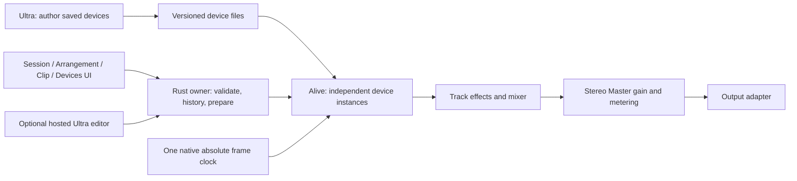

# Phase 2: Live And Max Workflow Fidelity

Status: proposed design for review; no Phase 2 application implementation is
authorized by this document. Owner direction, 2026-10-28: workflow fidelity
first, closer Live/Max appearance and interaction, a real Master channel early,
and cloud development wherever installed reference applications or physical
devices are unnecessary.

## 1. Outcome And Approach

Alive becomes a compact, dependable Live-style music workspace; Ultra becomes
its Max-style patch and reusable-device authoring environment. They remain
separate applications sharing a native engine and saved device interface.
The existing Session and MIDI Arrangement are the foundation. This is a
continuation of the workspace plan, not another synth demo or UI rewrite.

Recommended approach: complete vertical slices of behavior and appearance,
starting with state safety and a real stereo Master channel. Each slice must
work through native execution, ownership, history, persistence and input, and
must be visually reviewed against the relevant original-application evidence.

The editor is a view onto the owner; closing it does not destroy `H`. Clockwork
and native Faust execution retain their explicit timing boundary underneath
the host; this diagram does not place the new kernels inside Clockwork.

Alternatives considered:

| Approach | Benefit | Cost / decision |
| --- | --- | --- |
| Workflow slices on the existing host | Preserves working music and allows useful checkpoints; cloud workers can implement bounded contracts | Chosen; freeze shared interfaces before parallel consumers |
| Replace the shell and editor first | Fast visual change | Leaves known data-loss bugs and fake controls; insufficient for the requested functioning app combo |
| General `.als` / `.maxpat` compatibility first | Prioritizes existing-file intake | Much broader semantics and unsupported DSP; conflicts with the owner's workflow-first answer |

## 2. Exact Baseline

Inspected source: `1ebf2161e0fa2a62484566fac65c7e940567f357`,
`feat/alive-session-host`, fast-forwarded from `ea8e401`.
Release foundation: `31033483eb3baf15edab1734b966cc6d55c4b8c7` on
`build/ultra-desktop-releases`; PR #6 is an open draft against that foundation.
Do not edit or merge release branches, PR #2 or PR #5.

The dated review and reproducers are `docs/DEVELOPMENT_REVIEW_20261028.md` and
`experiments/development-review-20261028/`. Current working capabilities:

| Area | Implemented | Remaining / qualification boundary |
| --- | --- | --- |
| Alive Session | Four real slots and scenes; up to eight instrument tracks in the admitted v3 profile; independent saved devices, effects, gains, mute/solo, automation and history | No expanded slot capacity implied by visual density |
| Alive Arrangement | Admitted v4 MIDI profile 1, two tracks; real source/placement editing, shared/independent sources, offsets, suffix loops, Session override/Return, save/restart | Profile 2 unadmitted; no WAV playback |
| Master | Summed stereo output and topbar peaks | No saved output gain, bus-control API, strip or lane |
| Devices | Saved Ultra instruments and ordered stereo effects, manifest-selected parameters, separate optional editors | General authoring UI missing; stopped preparation remains necessary for structure |
| Ultra | 68 native object kinds, 32 nodes / 64 edges, 16 windows, direct object entry, ports/cords, lock, help, console, Perform and limited Max intake | No ordinary graph clipboard, common multi-selection Inspector, general packaging or presentation authoring |
| Build | Both binaries build; four-platform packaging run `40421472639` passes | CI `40421472750` fails the original native Apply/editor-close assertion; passing packages do not qualify the journey |

The local Oct28 build pins remain in the development-review evidence. Fresh
Ultra rendering was inspected on that binary in private Xvfb; it establishes
appearance in a narrow fixture, not a new audio or persistence pass.

## 3. Global Constraints

- Linux desktop is the shipped target; preserve separate `alive` and `ultra` binaries.
- Reuse Rust/Tauri, current plain HTML/CSS/JavaScript and the native engine.
- Reuse versioned saved Ultra devices; never copy their DSP into Alive.
- One native absolute audio-frame clock owns scheduling; JavaScript timers never own music.
- Native Faust kernels are not claimed to execute inside Clockwork.
- Keep editor lifetime separate from device/DSP lifetime and instance state.
- Compile, decode, prepare, load and destroy outside the audio callback.
- Callback work is bounded, allocation-free, nonblocking and independent of UI acknowledgement.
- Support explicit mono/stereo channel bundles; arbitrary multichannel and ambisonics are out of scope.
- Preserve four slots/scenes and currently admitted profiles until separately measured admission.
- Keep structural editing stopped and explicit Prepare / Apply until a safer contract passes its own gates.
- Use original UI assets, fixtures and example media; keep private reference captures local.
- No merges, tags, releases, deployments, credential changes or persistent environment-setting changes.

## 4. Reference And Evidence Contract

Use REA on installed Live/Max. Use source tools and ordinary native/browser
tests on Alive/Ultra. On Linux, REA process capture records lifecycle; scoped
XTest action logs and settled screenshots establish UI actions/results.
These are different evidence types. Do not imply the macOS UI observer runs
under Wine or that process sampling proves audio/semantic behavior.

Existing references remain authoritative only for their sampled behaviors:

| Reference | Use | Limit |
| --- | --- | --- |
| `experiments/alive-session-ui-reference-20261026/README.md` | Fixed-width tracks, separate launch/body areas, neutral empty slots, vertical mixer, empty center | Some lower controls cropped; no capacity or sound measurement |
| `docs/ALIVE_ARRANGEMENT_REFERENCE.md` | Source/placement, move/trim/resize, override/Return | No general overwrite, recording or all editing modifiers |
| `docs/ALIVE_AUDIO_REFERENCE.md` | File import, mono/stereo waveform, trim offsets and collect distinction | Missing-file/restart behavior not fully observed |
| `experiments/max-ui-reference/README.md`, `DESIGN.md` | Max compact patcher world and bounded authoring observations | No whole-Max execution claim |
| `docs/PHASE2_REFERENCE_20261028.md` | Fresh full-height Live Main strip, Main lane, fader interaction and current-product comparison | UI-only; no new Max run or reference audio measurement |

Before adding an unobserved interaction, make a small reference packet:
target/version/hash; question; exact actions; settled result; geometry and
focus; supported/unsupported states; evidence IDs; unknowns. Derive an original
behavior fixture for cloud use. Do not upload proprietary application binaries,
screenshots, help patches, presets or media to CI/public PRs.

## 5. First Gate: Preserve User Intent And Qualify The Baseline

Fix the confirmed Oct28 failures before adding musical surface area:

1. Make Independent followed by queued note/name/length edits must target the
   selected occurrence's resulting source. Resolve through stable occurrence
   identity at execution with authenticated revision, or reject a stale source
   relationship visibly. Never silently edit its former shared source. Valid
   queued sibling edits must remain usable.
2. Device base edits capture their originating project generation before queueing.
   Opening a project that reuses an instance ID cannot receive an earlier edit.
3. Ultra Save/close captures focused DOM drafts before acknowledging owner flush.
   Valid typed values commit once; invalid/incomplete values remain visible and
   block Save with a focused error. Escape restores committed value. Explicit
   Discard may discard drafts; Cancel leaves window/text intact.
4. Repackaging preserves compatible parameter keys, bindings, ranges and presets.
   Incompatible changes need an explicit preview/refusal, never silent reset.
5. Loop-only changes update the brace state. Duplicate suggests an admitted
   destination or explains its refusal. Correct stale effect-hosting copy.

Diagnose the unchanged native assertion, "Apply must close the old editor
generation", using input visibility/target, delivery, command start/completion,
generation/revision transition and actual editor retirement receipts. Current
evidence does not distinguish missed input from product lifetime failure.
Keep the assertion and fix its demonstrated cause.

The checked-in Arrangement driver must run through the checked-in private
harness. Add validated screen sizing, explicitly pass the same restart binary,
declare its ffmpeg dependency and retain failure artifacts. Then add the real
Arrangement journey to CI. An earlier failed job must not erase its diagnostic
result; overall qualification still fails when a required journey fails.

## 6. Real Master Channel

The first new feature is one stereo Master bus. Session has a fixed-right
Master column: scene launch rows above, output mixer below. Arrangement has a
bottom Master lane and the same output controls. Selecting Master exposes an
output detail view and preserves parked clip drafts and open device bindings.
Use the product label **Master** consistently; Live 12 calls its equivalent Main.

Minimum behavior:

- Saved linear gain in `[0, 4]`, default `1`; show dB (`20*log10(gain)`), with
  gain `0` displayed as `-inf`. Unity reset and numeric/keyboard access are real.
- Native order: each track's device/effects -> existing gain/mute/solo -> stereo
  sum -> Master gain -> post-gain peaks/clip latch -> output adapter. Preserve
  any existing adapter conversion/guard; the Master does not add a limiter.
- A Master command applies at the next callback command boundary and reports
  its actual absolute frame. Smooth from current to target over exactly 64
  output frames, independent of host partitioning. Initial install sets the
  saved gain directly. The ramp adds no audio pipeline delay.
- When device I/O is off and the native owner is quiescent, accept/publish the
  value through the existing stopped-control route without advancing frames;
  set current gain to target for the next stream. A stopped transport with I/O
  still running uses ordinary callback application and the 64-frame ramp.
- Peak readings are post-gain, pre-output-format conversion, over the native
  observation interval. A separate native latch records `abs(sample) > 1`;
  explicit reset clears the latch, not sound or gain. Label it as digital
  overload at that tap, not proof of physical clipping.
- Master is outside the musical-track array, track/voice counts and solo set.
  No Master mute/solo, clips, cue, sends, pan, effects or automation are implied.
- Gain changes do not seek, restart DSP, change authority, close editors or
  prepare music. Pending musical Undo/Redo/Apply/Discard preserve accepted live
  Master values just as they preserve track mixer/base values.
- Commands authenticate project generation; stale queued commands across Open
  are refused even when IDs match. Failed admission preserves saved/current gain.

Proposed persistence decision: introduce a shallow `alive-session-v5` envelope
with `{format, score, master:{gain}}`, where `score` is exactly one existing
strict v2/v3/v4 document. Nested v5 envelopes and unknown fields are rejected.
Retain raw nested-score JSON and dispatch through the existing strict file
decoders, including duplicate-member/map-key rejection; a lossy intermediate
JSON value or generic `Document` deserialization is insufficient. Enforce the
same duplicate checks on the outer envelope and Master object.
This separates output metadata from musical profile/version and preserves v3
capacity without forcing conversion to the two-track Arrangement profile.
Old files open at unity and retain old-wire saving until new Master state is
used; the first save requiring Master metadata explicitly identifies the newer
format. New sessions use v5. Do not overwrite an old format with undeclared
fields or silently downgrade non-unity gain. Internal owner metadata may wrap
the existing score without rewriting its scheduler. Round-trip fixtures and
the 1 MiB total document bound gate this decision before implementation.

Use an additive, capability-queried native Master API with versioned size-checked
state. Do not change existing ABI struct layouts. Missing capability leaves the
control unavailable with an actionable error. Measure the additional callback
cost against every still-admitted profile and rerun deadline/admission evidence.

## 7. Live Visual And Interaction Contract

This is an Operate interface. Fidelity comes from spatial composition, compact
controls, musical feedback and input behavior. Use original SVG/CSS icons;
retain Liberation Sans, charcoal surfaces, flat borders and restrained accents.
Do not introduce marketing typography, cards, ornamental gradients or motion.

Target geometry is an Alive design target derived from references, not a claim
that these numbers are exact Live dimensions:

| Surface | Target contract |
| --- | --- |
| Shared shell | One compact musical control bar, secondary document/menu row at most; total routine top chrome <=80px; diagnostic fields behind Audio details |
| Text | Body 12px, labels 11px; numeric values use tabular alignment; clear names/units |
| Tokens | Existing `--chrome #252525`, `--raised #303030`, `--canvas #373737`, `--line #505050`, text `#eeeeec`, muted `#b4b4b0`; retain amber action, blue selection, distinct playing/queued/error cues |
| Browser | Resizable 180-280px default 220px; collapse independent of music; real searchable rows and narrow categories |
| Session | Fixed 128px default track width, adjustable 112-180px; 28px single-line headers and 24px slots; all four real slots/scenes remain aligned |
| Mixer | Shared bottom baseline, vertical fader and stereo meter with dB markings; fixed-right 128px Master column; no stretching track widths to fill unused center |
| Arrangement | Musical canvas, ruler/brace/overview; track headers and mixer controls at the right, following observed Live composition; bottom Master lane; selected fields in detail, not two permanent form rows |
| Detail | Resizable 220px default, 160px minimum while shown; Clip/Devices plus contextual output detail; one stable separator and focus order |
| Piano | Explicit keyboard gutter, >=10px pitch rows at default zoom, independent time/pitch viewport and readable note bodies; no stretched fixed-viewBox hit geometry |
| Icons | Original 14-16px icons for transport, view, browser/detail, launch/stop, bypass, editor, undo and menus; named accessible controls and tooltips |

Viewport gates: **1440x900** and **1280x800** native content views, plus an
explicit minimum-size response. Desktop product: at smaller sizes prioritize
music, allow browser/detail collapse and region scrolling; never hide the sole
Stop/Master action or introduce page-level overflow. A phone DAW is out of scope.

No phantom clip rows, disabled recording buttons, placeholder returns or routing
selectors. Four playable rows can be visually dense without claiming more.
Preserve Live's fixed-width tracks and honest unused workspace.

### 7.1 Session, Transport And Browser

Selection is independent of launch; occupied body, launch segment, playing,
queued, stopped, draft-only and saved default have distinct shape/text cues.
Keyboard focus navigates slots/scenes; context actions expose real duplicate,
rename, independent source and delete. Empty cells only advertise supported
actions. Existing track Stop and strict quantized launch semantics remain.

Show musical bar/beat position from native timing, with explicit fixed 4/4
until time signatures exist. Loop and tempo are primary; raw beat/frame/receipt
values remain available in diagnostics. Tab outside controls switches workspace;
inside controls it moves focus. No navigation command mutates authority/time.

Browser v1 indexes bundled reusable devices and current project sources with
bounded search. Selection alone does nothing to playback/project. Load/assign
is explicit, kind-aware and undoable where musical. Folder/media indexing and
drag/drop are exposed only with bounded preparation and real error recovery.

### 7.2 Clip And Arrangement Editing

First make the existing piano usable: stable pitch/time geometry, pan/zoom,
fit-to-notes, keyboard gutter and velocity lane with exact numeric fallback.
Then add marquee/additive multi-note selection, duplicate/copy/paste, group
move/resize and velocity as atomic owner edits. Each completed gesture has one
history entry; Escape/cancel/lost capture restores the score and history.

Arrangement adds range -> Create MIDI as one transaction creating source plus
placement. Preserve precise source offset, suffix-loop and same-track overlap
rejection. Provide pointer-centered zoom, Fit, horizontal navigation and track
height/collapse. Cross-track moves, split/consolidate and overwrite/cropping
require separate contracts; a familiar cursor cannot imply those operations.

Direct automation edits the existing step/hold lanes: create/move/delete points
through manifest ranges with keyboard/numeric alternatives. Draw steps rather
than fictitious ramps. Prepared automation owns effective values while enabled;
panel edits update saved bases without overriding that playback ownership.
Disabled automation restores the accepted base at the defined native boundary.
Editing automation while playing is a draft until stopped Prepare / Apply.

### 7.3 Devices And Hosted Editors

Show the actual ordered instrument/effect chain as compact horizontal panels.
Labels, ranges, units and parameter keys come from manifests. Bypass stays warm;
add/remove/reorder/replace remain stopped structural operations. Make live base
versus effective automated value understandable without persistent debug text.

Open the selected instance editor, change a supported parameter, close/reopen
it, and keep playback and other instance state intact. Structural editing in a
hosted window stays read-only; editing the saved source and explicit stopped
Replace remain the supported path. A general live graph swap is deferred.

## 8. Max-Style Ultra Authoring

Preserve DESIGN.md's charcoal/amber 24px object/port/cord language. Compare at
equal zoom/DPI with original Max observations before changing glyph metrics,
wire geometry, menu density or Inspector layout. Current source dimensions
are a baseline, not evidence of Max equivalence.

Deliver these independent authoring slices:

1. **Focused edit safety:** one native preflight for inline objects, numeric,
   Inspector and Perform drafts across Save/Save As/close/Quit, including child
   and linked views. Valid commits happen once; invalid text is focusable and
   blocks acknowledgement; explicit discard/cancel remain correct.
2. **Graph fragments:** Copy/Cut/Paste/Duplicate for selected admitted nodes,
   internal edges, bends and appearance. A bounded Ultra fragment schema
   remaps IDs and contained references globally, excludes external cables,
   omits root device manifests, applies a predictable placement offset, and
   rejects capacity/kind errors atomically. Text-field clipboard keeps normal
   precedence; one operation is one owner history transaction.
3. **Selection/Inspector:** observed marquee/additive rules, retain group on
   context click, common attributes with mixed values, group move/resize and
   alignment. Unsupported shared attributes stay absent. Group edits validate
   all members before one commit and do not reset audio for appearance alone.
4. **Cables:** endpoint reconnect and editable bends, cancellation and keyboard
   alternatives, keeping type/channel compatibility and imported geometry.
   Object insertion into cables follows only after a separate observed rule.
5. **Reusable-device authoring:** general validated instrument/effect metadata,
   stable parameter keys/bindings/order/ranges/units and preset add/rename/remove.
   Existing recipe becomes a template; the saved graph is still the instrument.
   Add a validated owner metadata command instead of whole-document reloads.
6. **Help/console/lock:** focused find/help/error-source navigation and keyboard
   discoverability; retain scoped Stop and shared audio controls. Presentation
   editing is a later explicit authoring/layout contract, not a rename of Perform.

Each slice includes an original native author/save/Quit/restart fixture and
two independent hosted instances when metadata or DSP behavior changes.

## 9. Genuine Audio And Portable Projects

Continue the accepted workspace contracts and old plan's unfinished Task 3;
do not redesign their working MIDI scheduler. Existing descriptors and ABI
reservations do not establish playback: preparation currently rejects audio.

Stages: bounded decoder/assets/peaks with AUDIO disabled -> native zero-instrument
PCM through the same effect/mixer/Master path -> measured AUDIO admission ->
waveform/import/recovery UI -> portable mixed-project acceptance.

Retain the prior 48kHz mono/stereo PCM16/24 policy, per-file frame/byte limits,
eight-buffer / 64 MiB prepared PCM bound and current+candidate ownership bound.
Verify all existing exact bounds in the runtime contract before coding. No
resampling, Warp or stretch is implied. Decode/hash/peak extraction and all
buffer retirement happen off callback; references remain pinned through
configuration retirement and rollback. Audio-only zero-root configurations
must still render; an instrument presence test cannot own the entire mixer.

Resolve the old contract conflict now: **Relocate keeps source ID and requires
matching content/descriptor. Replace creates a fresh source ID and atomically
rewires explicitly selected old-source readers, preserving their slot/placement
IDs and offsets only when valid for the new asset.** Other readers keep the old
source. Prevalidate candidate plus history capacity; failure changes nothing.
Update both old contracts before audio implementation. Do not silently apply
the desktop contract's earlier unchanged-ID Replace statement.

Save As rebases devices, audio and retained history references. Collect And Save
is a distinct transaction, with collision-safe content identity, no overwrites
of unrelated assets and explicit rollback. A useful failure names the track,
source/path, expected fingerprint/format and recovery action; current prepared
music remains intact. The portable test moves the project, makes originals
unavailable, restarts, then compares restored state and render.

## 10. Instruments, Effects, Recording And Compatibility Lanes

These are gated extensions after the core editing/mixed-project slice; they
are not requirements for the first Master checkpoint:

| Lane | First useful outcome | Dependency / boundary |
| --- | --- | --- |
| Analog-style instrument | Original reusable subtractive device with familiar oscillator/filter/envelope panel and measured bounded voices | Existing saved graph first; new DSP requires native admission, parameter/event tests and reference questions |
| Simpler-style sample instrument | Original one-sample instrument with start/end, envelope and declared pitch/interpolation/loop behavior | WAV ownership is reusable, but device asset schema, voice DSP and portability are new; no existing sample player is claimed |
| Sampler-style expansion | Small explicitly bounded multi-zone/velocity mapping | Follows single-sample proof and separate memory/voice admission; no proprietary preset compatibility claim |
| Basic effects | General authoring of already working Utility/Lowpass; then one original gain/pan, delay or tone effect at a time | Two-effect/root limits stay; new DSP/work/latency requires measurement |
| Recording | Bounded finalized-take workflow with input/arm/monitor/transport ownership | Output-only CPAL is current; requires preallocated callback queues, worker file writes, disk/full-ring failure, clock/latency contract and physical acceptance |
| File compatibility | Explicit `.maxpat` supported cohorts and reports; `.als` inventory/probe after workflow milestone | Separate parse, visual, control, DSP and round-trip scores; no arbitrary file execution or full Max for Live claim |

Max cohorts progress from ordinary object entry/control/geometry, through
fragments/cords, then saved device metadata and selected DSP cases. Whole-help
conformance stays **0/2103** until measured otherwise. A green cloud replay of
original fixtures does not become a fresh Live/Max conformance run.

## 11. State, Focus And Failure Acceptance

| Situation | Required result |
| --- | --- |
| Playing + musical draft | Prepared music continues; draft-only clips cannot launch; Master/mixer/base/bypass stay live |
| Undo/Redo/Apply/Discard | Musical history changes music only; live controls survive; Apply retires stale editor generation |
| Open/New with queued edits | Commands remain in originating generation; failed Open preserves project/playback state according to existing preflight |
| Shared source + queued independence | Stable occurrence intent is resolved/rejected; no old-source mutation |
| Text/number focus | Space/Delete/clipboard/Tab edit the control; no transport/view/delete leakage |
| Gesture + Escape/capture loss/window blur | Preview rolls back, no partial owner history; committed live fader receipts remain authoritative |
| Menu close / editor close / hidden panel | Focus returns to visible owner target; playback and other device instances continue |
| Missing/incompatible/capacity error | Name cause and recovery; document/history/prepared resources remain unchanged |
| Stop/seek/loop/removal | All affected notes terminate; reserved Stop cannot starve behind ordinary commands |
| Admission/queue overload | Refuse new work atomically and preserve working music; reserved Stop still terminates notes under saturation |

## 12. Qualification And Cloud/Local Split

Cloud owns model/parser/history/regressions, deterministic native renders,
browser geometry/input tests, private Xvfb/Tauri/software PipeWire journeys,
and existing platform packages. Keep one writer on shared host/UI/ABI files;
parallelize disjoint fixtures, exploration and reviews after contracts freeze.
Do not provision a cloud service or alter runner accounts as part of this plan.

Local owns installed Live/Max reference packets, final desktop feel/listening,
physical MIDI/input/output/backend acceptance and hardware latency. Xvfb is
appropriate for reproducible UI tests and scoped reference work; it proves no
physical audio. Return exact source/build/artifact hashes with each handoff.

Required integrated gates:

- Deterministic two-device render with velocity/duration, cutoff/level automation
  at frame offsets `0,1,31,63,64,127`, host partition permutations, loop/seek/stop,
  independent instances, overload refusal, mute/solo and reliable termination.
- Master unity equivalence, exact gain/ramp/peak/latch, persistence, stale command,
  draft-merge and mono/stereo bundle tests; callback allocation/lock/work guards.
- Impulse/onset measurements for every different active DSP route, recording
  frame clock and intentional 64-frame pipeline/start guard separately from
  scheduling error. No universal zero-latency claim.
- Actual native author/play/automation/control/editor-close/reopen/save/Quit/
  process-restart/play journey, both workspaces and two target viewports. Native
  screenshots supplement action receipts and PCM; none replaces them.
- At least ten minutes of proven playing time with repeated edits/transports;
  retain the stronger existing 1800-second endurance gate where required by
  STREAM_OBSERVABILITY. Use advancing native frames plus monotonic records,
  bounded gaps, resource trends and stream epochs, not capture duration alone.
- Report hardware/backend/OS/rate/requested and observed buffer periods, routing,
  stream errors/rejections/resources and only actually observable underruns.
  Mark software-loopback versus physical output explicitly.
- Preserve pending-history, application Quit, scoped Stop, source safety,
  notices/licensing and all existing test assertions. Final pushed commit must
  pass headless, UI, native journeys, CI and platform package checks.

Completion is per milestone. Stop at a reproducible architectural blocker and
deliver the working slice, failing test, measured constraint and narrow decision;
do not fill the gap with unrelated features or claim full Live/Max compatibility.
