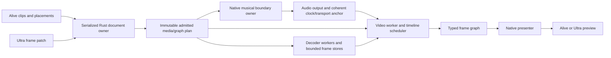

# Shared Video Engine For Alive And Ultra

Date: 2026-10-31. Status: proposed architecture; video playback is not yet
implemented and the decoder/presentation backend is not yet selected.

## Direction And Existing Evidence

The owner selected: "Design both around a shared video engine" and "Start with
silent video." Alive provides
timeline/clip workflows; Ultra provides frame processing in patches. Share the
implementation and media ownership inside each application process. Separate
Alive and Ultra processes do not acquire a new shared daemon or IPC transport
as part of this milestone.

The existing product uses Rust/Tauri with a native audio engine. Alive calls
`ultra_desktop::run_alive`; Ultra already authors reusable devices, but its
strict `ultra-canvas-v1` port types contain no video frame type. The current
CPAL output callback ignores its timestamp argument. Native absolute-frame
and song-position snapshots exist, but they do not yet constitute a calibrated
audio-to-display clock. These are extension points, not working video support.

Another session has demonstrated native execution of individual installed
Live devices. That experiment and the shared video subsystem have independent
integration gates. Device/preset hosting is not assumed by this design.

## Approaches

| Approach | Benefit | Cost / decision |
| --- | --- | --- |
| Shared media service, bounded frame graph and presenter, using a proven decoder library | One implementation for both apps; explicit audio-clock integration; room for future live inputs | Recommended. First prove the native presentation and clock bridge. |
| Separate HTML video players in each frontend | Fast initial preview | Duplicate ownership, browser timing and limited reusable native frame processing make this unsuitable for the selected architecture. |
| Entirely custom demux/decode/GPU/video scheduler | Maximum control | Much larger initial scope. Use established decoders behind a replaceable adapter instead. |

GStreamer is the leading decoder candidate, with FFmpeg libraries as the
alternative. This document does not select one by availability alone. Current
local GStreamer core/app/video versions are 1.28.8; supported release images,
Rust floor and GTK dependency compatibility still need a feasibility check.

The current desktop lockfile uses glib 0.18.5 and glib-sys 0.18.1. Published
crate manifests show GStreamer Rust 0.21.3 uses glib 0.18 (Rust floor 1.70),
0.23.7 uses glib 0.20 (1.71.1), and 0.24.4 uses glib 0.21 (1.83). These are
inspected examples, not a claim about the latest release or selected pins.
The latter binding lines use different Rust wrapper types from the current
desktop; dependency resolution, initialization and any native-object exchange
need verification. The inspected glib-sys manifests do not declare a Cargo
`links` key, so these observations alone do not establish a resolver conflict.
Compare a compatible binding line, isolated binding types behind frame handles,
a narrow C adapter with explicit lifecycle ownership, and the FFmpeg alternative
in the feasibility gate. A desktop-framework migration is outside the milestone.

Qualify Linux first. The existing release tooling also packages Windows and
both macOS architectures; video dependencies must be optional/platform-gated
until those targets qualify. Existing audio projects remain usable there;
video-bearing projects receive an explicit unsupported-capability result.
The current DEB dependency list does not establish a decoder/plugin inventory.
Update runtime packages and dependency notices only when a backend is selected.
Keep the user's manual-build CI policy; research does not dispatch cloud builds.

## First Useful Slice

Use generated, local video files, one active decoded source, forward 1x
playback, source in/out points and loop ranges. Initial qualification targets
progressive SDR 1280x720 at up to 30 fps. Confirm a narrow codec/container set
on release dependencies; advertise only combinations actually probed. Higher
resolution, HDR, arbitrary media and hardware decode require later admission.

In Alive, add one explicitly typed video lane with Arrangement placements.
Refuse overlapping placements in the initial one-stream profile before Apply;
do not silently choose which video to show. Video follows the same musical
Start/Stop/seek/loop position as audio. The video profile does not increase
audio track/device capacity or consume a fake instrument root. Session audio
launching remains independent of this Arrangement video lane.

The Live 12 manual documents video display only in Arrangement; movies in
Session are treated as audio clips. The silent dedicated lane is an intentional
Alive scope choice, distinct from Live's movie-on-audio-track representation.
Session video launching is a later extension needing its own versioned native
action/admission and scene/Return rules; Stage 1 quantization is not expanded
to video by this proposal.

In Ultra, provide an original bounded frame source, one visible color/brightness
operation and a preview sink. A frame patch can subsequently be hosted on an
Alive video track using the same immutable device instance/lifetime principle
as audio devices. The first end-to-end test must prove the same operation in
standalone Ultra and hosted Alive. Closing either preview must not destroy
the source, alter music or unload the hosted device.

The first product workflow imports silent video, as selected by the owner;
embedded movie audio is ignored and that behavior is visible in import/detail.
The initial proof uses silent files. A possible later workflow imports a
linked audio clip into the existing typed audio path, with an explicit shared
source-time relationship; implementation depends on Stage 2 audio playback.
That later workflow needs its own design after Stage 2 audio playback.

Session video launching, camera/screen inputs, capture, export/rendering,
reverse, speed changes, warp,
crossfades, multiple video layers, general Jitter/Max compatibility and a
cross-process bridge are outside this first slice. The frame interface must
carry timestamps and source identity so these remain possible extensions.

## Ownership And Data Flow

The Rust owner validates documents/assets, stages graphs and commits plans.
It does not pull decoder buffers while holding the musical owner lock.
Preparation allocates frame pools, opens media and primes bounded readers off
the callback. Failed preparation leaves the previous music and media plan
intact. Any expensive teardown/decoder join runs on a retirement worker.

The native audio owner applies its existing admitted musical actions and
publishes a fixed-size coherent clock/transport record. No decoding, pixel processing,
allocation/free, locks, GPU calls or UI calls run on its callback. New native
actions would need their own bounded admission proof; video cannot consume
an unbounded control/event queue or borrow the quantization worker's proof.

A latest-state clock mailbox carries generation, plan revision, transport
epoch, absolute output frame, song position and playing state coherently.
The video worker derives the current Arrangement placement from the immutable
plan and that clock, with bounded lookahead. Missed observations are recovered
by resolving current authority from the latest coherent anchor; replaying every
intermediate UI or decoder event is unnecessary. A stale/unavailable anchor
invalidates video presentation without blocking audio. Future Session video
actions need a separate receipt/epoch design rather than assuming this mailbox
can preserve a sequence of launches.

## Time And Discontinuities

The audio sample clock remains authoritative while the audio engine runs.
Publish a coherent anchor linking absolute output frame, native song position,
transport epoch, monotonic time and output-latency information. Calibrate using
the chosen CPAL backend's timestamp semantics, including the position of the
first sample in each callback; callback-entry time alone is insufficient.
Mark the anchor unavailable/stale after an output restart, error or timestamp
discontinuity. No browser clock can restart or advance musical transport.

The video worker maps the predicted audible audio frame at display time to
the currently authoritative source time. Keep absolute output frames, looping
song position, media PTS and display monotonic time as separate typed values.
The worker must account for output buffering rather than showing the frame
currently being rendered ahead of audible output.

Clip placement is musical; decoded media runs at forward 1x.
A beat boundary selects a source-time anchor, then source time advances by
elapsed audio frames/sample rate. Tempo changes do not silently change video
speed. Loop/seek/Stop/reinstall/source replacement advance the appropriate
epoch and reset that mapping. Do not derive a long-running media position by
adding rounded frame durations or infer VFR timestamps from frame count.

Every decoded/processed frame retains source ID, reader/seek epoch, plan and
graph revision, PTS/duration and dimensions/format. Reject stale completions
before publication. Seek primes from a suitable keyframe and decodes to the
target; completion means a verified target frame is available, not merely
that the decoder accepted a seek. Stopped scrub uses replaceable requests;
old scrub results can never overwrite the newest requested image.

When video misses a display deadline, audio continues. Within an unchanged
epoch, hold the previous valid image briefly and expose late/drop counts;
after a discontinuity or invalid clock, clear to an explicit loading/unavailable
state. Never display an old clip as if it were the new Arrangement clip. Exact
policy thresholds must be established from the feasibility measurements.

With musical transport stopped, show the exact sought frame without advancing
music. Standalone Ultra may use an explicit monotonic preview clock when the
audio engine is off. When audio starts or the clock source changes, create a
new epoch and synchronize explicitly. Do not silently continue on an unrelated
clock after an audio failure.

## Frames, Graph And Resource Admission

Frames are immutable, reference-counted opaque handles backed by a bounded
pool, not JSON pixel arrays. The handle carries format, color description,
PTS/duration and epoch; a platform-specific GPU resource can be added behind
that interface after a CPU path works. Do not promise zero-copy across an
unproven Tauri/WebKit boundary.

Add a distinct typed frame graph and versioned saved profile. Existing audio
and control ports retain their meanings; video cannot be encoded as a stereo
audio port or a burst of ordinary control messages. The initial graph is a
validated acyclic graph with source, one operation and preview. Controls cross
through bounded timestamped/coalesced parameter snapshots. Frame processing
uses its own worker/deadline; existing audio/control execution order is not
repurposed to run a frame once per audio sample.

Admission specifies maximum dimensions, stride/plane byte sizes, active
readers, queued frames, retained previews and transform outputs before Apply.
All multiplications and encoded metadata are checked before allocation.
Bound compressed-input queues too. Decoder reference surfaces and internal
allocations are additional to appsink's queue; bounding appsink alone does
not prove bounded process memory. Measure peak/steady-state decoder use on
the admitted codec set and refuse unsupported capabilities explicitly.

For file decoding, preserve the finite lookahead around the requested media
time using worker backpressure. Do not decode a whole file as fast as possible
into a one-slot leaky queue: that leaves the final frame instead of the frame
needed now. The presentation slot may replace superseded images, while the
decoder's ordered queue and seek policy serve the timeline. Live sources will
need their own newest-frame policy later.

## Preview, UI And Persistence

The frontend sends controls and receives small state/diagnostic messages.
The native presenter consumes frame handles directly. First prove a native
preview window with the actual Tauri/GTK3 build; embedded composition is a
feasibility question. If embedding needs a framework change, keep the native
preview detachable and explicitly defer embedding. Do not migrate the whole
UI to obtain video output.

Preserve the established compact Alive/Ultra UI. Video track detail shows
source, in/out, loop, preview availability and exact preparing/error/late
state. Controls with no admitted backend remain unavailable with a reason.
Preview preserves aspect ratio with letterboxing and responds to window
resizing and display scale. At 1440x900, 1280x800, 1024x768 and 800x600, Stop,
Master, launching and error dismissal remain reachable; scrolling belongs to
regions rather than forcing the entire app to a minimum desktop width.

Saved projects store versioned source/occurrence/placement references, media
fingerprint/stream identity, trim/loop values and patch bindings. Do not store
decoder pointers, cached frames, GPU handles or current clock state. Add strict
new envelopes/profiles; leave existing strict versions unchanged. Allocate
actual version numbers after Stage 1/2 format changes settle.

Reuse existing path, Save As, history and asset-safety rules. Missing media
preserves its source identity and shows unavailable. Relocate requires the
same content/stream descriptor; Replace creates a new source ID and rewires
explicit readers transactionally. Undo restores identity and settings. A
non-video engine must refuse unsupported video requests/documents rather
than drop the track or save a silently degraded project.

## Feasibility Gate Before A Product Implementation Plan

1. Confirm GStreamer vs FFmpeg dependency/MSRV/GTK3/release compatibility and
   retain exact versions. Test missing-codec handling without package mutation.
2. Decode original generated frame-number/color fixtures with nonzero PTS,
   long keyframe gaps and rapid seeks. Check actual image identity, buffer
   lifetime, bounds, cancellation and shutdown, not just successful API calls.
3. Present these frames in the current Linux application stack under Wayland
   and X11, including resize, HiDPI and preview close/reopen. Measure copies,
   memory and presentation delay. Prove a detachable window first.
4. Publish/consume a calibrated audio anchor on a private output graph. Trigger
   a known audio impulse with a video color change; measure software phase
   error, clock uncertainty and drift. Hardware/display latency remains a
   separate physical observation. Define a supported timing bound from these
   measurements before product claims.
5. Stress delayed decode, starvation, stale seeks, source replacement,
   shutdown and skipped/stale clock observations while audio deadline/error metrics
   and existing native guards remain qualified. Drop video before audio.
6. In an isolated prototype, demonstrate one typed source/operation/preview
   graph in standalone Ultra and hosted Alive using the same media
   implementation and source-time semantics. This proves the shared boundary
   before adding complete import, editing and persistence workflows.

Only after these gates select the backend and write a focused implementation
plan. Deliver the shared engine/preview foundation, then Ultra frame patches,
then Alive clip integration; do not implement two independent video players
while calling the common decoder a shared engine.

## Documentation Evidence And Limits

Current Context7 `/gstreamer/gstreamer` queries returned the upstream appsink
implementation and application documentation, and seeking design/tutorials:

- https://gstreamer.freedesktop.org/documentation/app/appsink.html
- https://gstreamer.freedesktop.org/documentation/additional/design/seeking.html
- https://gstreamer.freedesktop.org/documentation/application-development/advanced/pipeline-manipulation.html

Context7 `/websites/ableton_en_live-manual_12` confirms Arrangement-only video
display, Session movie import as audio, a movable video window and trim/edit
behavior. These are manual claims, not a runtime observation of the installed
reference app. Context7 `/websites/cycling74` documents movie matrix/texture
output and a render context/window; these inform the source/operation/preview
workflow, not a claim of implementing Jitter object compatibility:

- https://www.ableton.com/en/live-manual/12/working-with-video/
- https://docs.cycling74.com/reference/jit.movie
- https://docs.cycling74.com/reference/jit.world
- https://docs.cycling74.com/userguide/jitter/textures/

Confirmed against local `/usr/share/gir-1.0/GstApp-1.0.gir`: appsink
`max-buffers=0` is unlimited; `max-bytes`/`max-time` start at 1.24;
`leaky-type` starts at 1.28, which deprecates `drop`. Pull methods can block;
new-sample is emitted from the streaming thread. These version differences
must be handled deliberately if release dependencies predate the local host.

Upstream seeking docs distinguish FLUSH, ACCURATE and KEY_UNIT; accurate
seeking can decode from earlier keyframes or the beginning and be slow. None
of these docs establishes an audio-clock bridge, bounded total decoder memory,
native preview integration, Rust MSRV compatibility or product performance.
