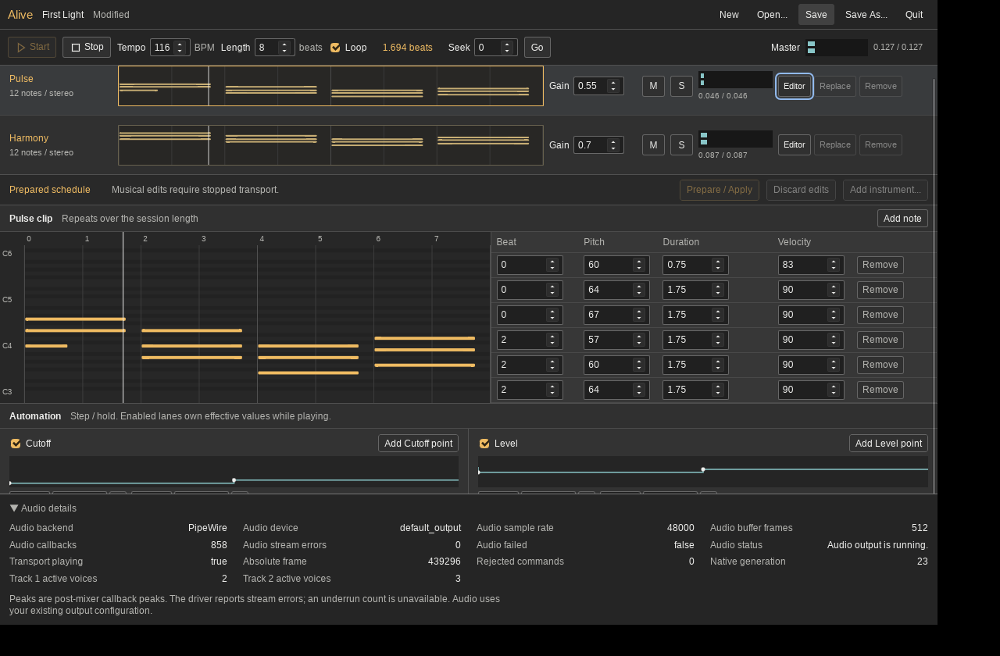
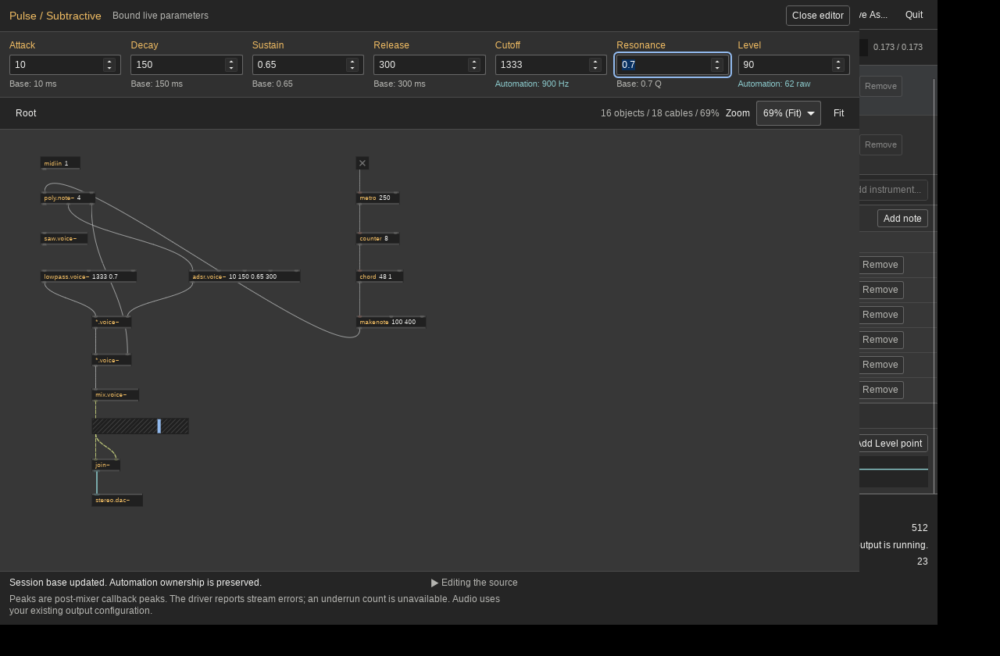

# Separate Alive Executable

Alive now builds a real `alive` executable alongside `ultra`, with separate
Tauri contexts and application identifiers. Both link the shared native library
and consume the same Rust host/editor code. The native journey asserts the
process executable paths and opens an independent Ultra patch window alongside
Alive. No DSP, scheduling or session-format code changes accompany this split.

Run from the repository root:

```sh
bash apps/alive/build.sh
bash apps/alive/run.sh
# Existing session:
bash apps/alive/run.sh apps/alive/examples/two-instruments.alive
```

The binary is `apps/ultra/src-tauri/target/release/alive`. The shared Cargo build
directory is an implementation detail; this is not an alias for `ultra --alive`.
The compatibility entry remains available. Existing installers retain their
Ultra product branding and carry both binaries. Linux companion lookup loads
the shared bundled example; a regression prepares both installed device
references without a repository source path. Each binary embeds one Tauri
context, avoiding duplicate macOS embedded-plist symbols.

Retained local checks:

- `headless-report.json`: real `alive --session-probe` via the launcher,
  independent saved devices, exact-frame events, partition comparisons and
  transport/ownership/mixer/round-trip assertions.
- `native-session-report.json`: actual `alive` process; separate Ultra window;
  two device loads, clip/automation/base/mixer edits, editor edit/close/reopen,
  save/reopen/play, dependency-failure preservation and Quit Cancel/Discard.
  The finite stereo software capture lasts 29.28 seconds, peak 0.372645; its
  hash is retained and raw PCM stays local.
- `editor-resources.json`: eight real hosted-editor close/reopen cycles plus
  an idle observation. Observed WebKit workers remain one throughout.
- `cpal-result.json`: corrected shared-library test target actually executes
  the existing private CPAL regression; 150528 finite stereo captured frames.
- Native callback guards and scoped Stop stress pass (43008 compared samples);
  151 Rust tests pass, two intentional ignores; 14 package/notice tests pass;
  distinct binary/CLI/launcher and atomic-library-install checks pass.

Hardware/backend: AMD Ryzen 9 5900HS, Linux 7.2.8-10-omarchy, release Rust/Tauri,
private Xvfb and software PipeWire/default_output, 48 kHz stereo, 512 frames.
The journey observes zero stream errors/native failures/rejected commands.
This is software loopback; CPAL does not expose an independent underrun count.
Private Xvfb logs retain nonfatal Mesa/GTK realization warnings. No physical
audio or hardware deadline qualification is inferred.

`build-identity.json` records source/binary hashes. The earlier ten-minute
acceptance run in `../alive-session-20261024/` remains tied to its recorded
`e841f6f` runtime; it is not a ten-minute run of this later entry point. The
draft PR records final pushed-commit CI separately from these local receipts.



