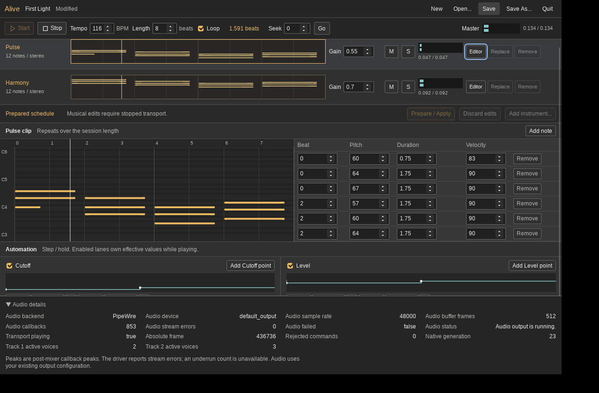
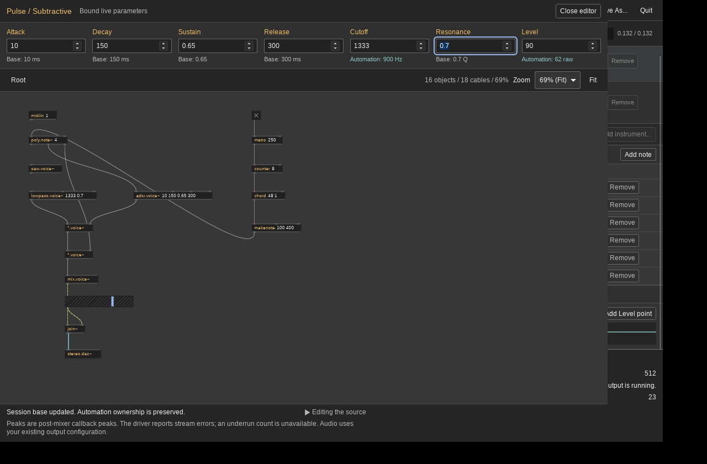

# First Alive Hosted Session: Acceptance Evidence

Foundation: `31033483eb3baf15edab1734b966cc6d55c4b8c7` on the fetched combined
release branch. This includes PR #4's saved instrument at `ab8b0e2`, PR #5's
integration at `bf4301e` and subsequent release fixes. Main remains `8217458`;
the feature branch depends on that integration. No release branch was edited
or merged.

## Actual Native Journey

`native-session-report.json` and screenshots come from the release Rust/Tauri
application on a private Xvfb display and software-only PipeWire server.
CPAL reports PipeWire/default_output, 48 kHz, stereo, 512 frames (10.67 ms).
Hardware is AMD Ryzen 9 5900HS; the report retains `uname`/`lscpu` observations.
This is software loopback, not physical audio/MIDI latency or hardware playback.

The harness created a new session, loaded the real saved subtractive device on
both tracks through native pickers, changed tempo/note duration/velocity, authored
cutoff and level lanes, applied while stopped, played, changed bases and mixer,
opened/edited/closed/reopened the actual Ultra graph editor, saved/reopened/played,
preserved playback on missing-device Open and removed a stopped device. It also
proved Quit Cancel preserves a working session and Quit Discard exits from
playback. The 25.461-second finite stereo capture has peak0.372645 and exactly
equal channels after monitor-link setup, matching the device's authored mono
duplication. Stops/reopen account for silent windows. Raw capture remains under
`/tmp/alive-native-portable-quick/`; its SHA256 is in the report. A four-second
PCM16 excerpt is retained as `native-walkthrough-excerpt.wav`, with conversion
and source identity in `excerpt.json`.




## Deterministic Host Proof

`headless-report.json` is emitted by the real display-free `--session-probe`
binary, loading the original `.ultra` file twice with independent roots.
It compares412452 frames per partition schedule, proves actual second-cycle
audio, wrap/seek generations, isolation, ownership, mixer and round-trip playback.
The saved-device boundary fixture schedules notes, cutoff and level on both
instances at0,1,31,63,64,127; all twelve effective-value observations are checked
on the exact scheduled sample and complete audio matches irregular partitions.

Separate native timing kernels measure native onsets0,1,31,63,64,127 and
legacy Clockwork onsets64,65,95,127,128,191. Native alignment delay is0; the
legacy adapter's64samples are deliberate buffering. Hosted v1 rejects legacy
Voice, so it does not silently combine different paths or claim the AOT Faust
kernels execute inside Clockwork. Mono joins and stereo descriptors are tested;
wider layouts are unsupported.

## Reproduce

Use `apps/alive/README.md` for build/run/host commands. The actual desktop gate:

```sh
ULTRA_TEST_ALIVE=1 ALIVE_ENDURANCE_SECONDS=600 \
  ULTRA_TEST_SCRIPT="$PWD/apps/ultra/tests/check_alive_desktop.py" \
  bash apps/ultra/tests/check_canvas_desktop.sh /tmp/alive-native-final
```

`endurance-report.json` records 602.551 conservatively counted playing seconds,
excluding stopped work, across 47 edit/transport cycles. Its 840.576-second
software capture is finite, peak 0.355037, with exactly matching stereo channels.
All 64 observations report zero CPAL stream errors, native failures and rejected
commands; each playing cycle is observed before Stop/possible Apply can reset
I/O counters. Stops assert zero active voices on both tracks. Seek, base/mixer
edits, stopped automation Apply and editor open/edit/close repeat throughout.
Final Quit Cancel preserves playback, and Quit Discard exits.

Seventeen process-tree samples span 837.527 seconds. PSS changes 489751 to 540315
KiB (+49.4 MiB), range 477717..544625 KiB; RSS 788944 to 817768 KiB (+28.1 MiB).
Descriptors change 202 to 164, range 164..202; threads 128 to 105, range 105..128.
Initial retired children disappear; all subsequent samples contain three
processes. `resource-summary.json` retains exact ranges. PSS depends on sharing
and allocator/GC state; a short portable-harness validation runs concurrently
for part of this observation. This workload does not establish a general
zero-growth or no-leak guarantee. Raw capture remains at
`/tmp/alive-native-accepted/endurance.f32`; its SHA256 is retained.

The earlier run exposed a pinned Wry IPC reference cycle in closed Linux
editors. `editor-resources-before-fix.json` shows eight reopenings retaining nine
WebKit workers, descriptors 145 to 642, PSS 431114 to 1005887 KiB. A reviewed GTK
destroy hook releases that cycle. The same probe after the fix retains one
worker throughout, descriptors 145 to 151, PSS 434920 to 473579 KiB. The dedicated
native regression runs in CI; detailed source/lifetime review is in
`../../.superpowers/sdd/PLAN/editor-lifecycle-review.md`.

CPAL stream-error observations are distinct from underruns, which CPAL does not
expose. No xrun count is inferred. This is software loopback; physical audio,
hardware deadlines and MIDI/analog latency remain unmeasured.

`build-identity.json` records the exact release binary/native-library digests
and runtime revision `e841f6f`. The long run uses that revision's harness; the
short journey also validates the subsequent WirePlumber 0.4/pw-cat compatibility
changes, without changing runtime code. `evidence-manifest.json` binds retained
receipts/assets and current runtime source identities. Verify with:

```sh
python3 experiments/alive-session-20261024/verify.py
```

The first remote native run after those compatibility changes exposed a fixture
gap: WirePlumber 0.4's policy-only profile loads the default-nodes API without
creating default-node metadata. The default CPAL output consequently reports
`StreamInvalidated: no target node available` before any callback, while an
explicit sink renders. This was reproduced with Ubuntu's isolated 0.4.17 policy
on the local private server. The shared software fixture now publishes typed
`default.audio.sink` metadata for its sole sink; the same diagnostic then renders
143872 frames on both routes with no error. The native desktop CI exercises the
default route, while the existing CPAL gate exercises explicit sink selection.
This correction changes test-server setup, not application or DSP runtime code.

The verifier checks retained receipt integrity and acceptance assertions; it
does not replay the desktop or recover the uncommitted raw captures.

Local gates already pass: native callback/allocation/free/mutex guards and
scoped Stop stress;150Rust tests with two intentional ignores;442UI/component
tests;103rendered Chromium tests; the full recorded-reference/contracts gate;
14package/notice tests. Pending-history edits, native Quit generation guards and
scoped Stop regressions remain covered. Final pushed-commit CI runs and their
current conclusions are linked from draft PR #6; handoff requires green results
on that final revision, including the real desktop and editor-resource gates.

## Requirement Audit

| Requirement | Evidence |
| --- | --- |
| Create two tracks and load the saved instrument independently | Native New plus two real file pickers; headless device paths/roots and isolation proof |
| Editable repeating chord progression, tempo, duration and velocity | Default C/Am/F/G clip, native authoring/save/reopen journey, deterministic loop proof |
| Cutoff/level automation and explicit panel/editor ownership | Exact saved-device frame observations; native/Rust ownership tests; visible base/effective controls |
| Gain/mute/solo, meters and stereo master | Headless mixer comparisons, mono-join/stereo routing regression and native screenshots |
| Termination on Stop, seek, loop and removal | Native boundary/overload tests, headless wrap/seek/removal and every endurance Stop |
| Optional editor lifetime and live parameter editing | Actual open/edit/close/reopen, generation guards and eight-reopen resource regression |
| Save/reopen and useful dependency failure | Native round trip and missing-device preservation; Rust incompatible/version/failed-save tests |
| One authoritative clock and measured execution paths | Native 0 versus legacy 64 sample onset measurement; hosted profile rejects legacy Voice |
| Explicit supported bundles and bounded callback work | Stereo device descriptor, explicit mono join; guarded allocation/free/mutex and event/voice/queue limits |
| Sustained native journey and honest audio/resource qualification | Completed ten-minute receipt, software capture hashes, resource samples and retained screenshots |
| Preserve foundation regressions and final CI | Pending-history/Quit/scoped Stop/package-notice gates plus draft PR #6 check runs |

Installed Live12.4.6 reference observations of Analog, Simpler, Sampler, Utility,
Auto Filter and Delay are retained separately in
`../alive-live-reference-20261024/README.md`. They establish UI/runtime evidence
and bounded static lifecycle observations, not recovered DSP implementations.
