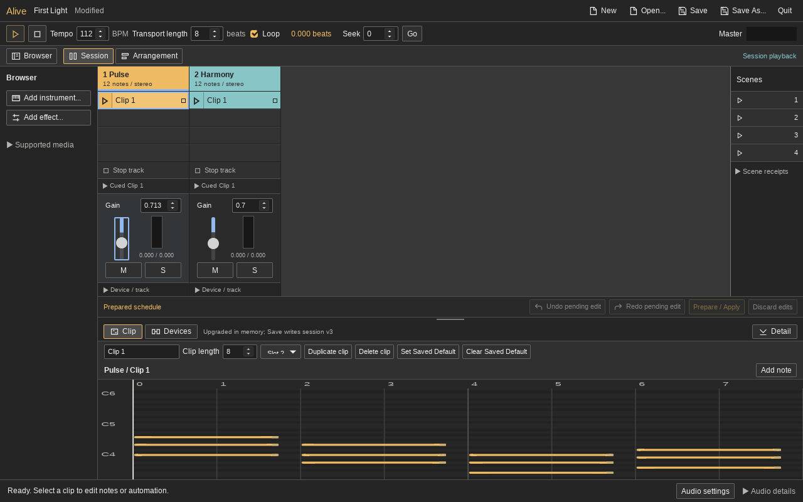

# Compact Alive Session revision, 2026-10-26

The owner chose a denser Live-style grid first. This revision retains four real
playable slots per track and the existing native host. Source:
`e38676ac5e54427631db3f14f17d11eef03a6c49`; prerequisite test-helper fix:
`cd9fdd17fdc29f3548d80b005a426b362fe75834`; baseline: `efa4280`.
Final reviewed source is `6a8f644b194a612af7bec268b4e2b49ea23fb73e`, including
scene-mode visibility correction `ad47d2a`.

## Result

- Four 28px flat clip rows, separate launch triangles, colored occupied bodies,
  neutral empty slots and fixed 146px track columns.
- Original SVG controls for supported actions; distinct selection/native launch
  states and complete runtime/scene receipts in inspectable disclosures.
- Vertical existing gain faders and native stereo peaks, numeric precise gain,
  mute/solo, and useful piano-roll space at both desktop sizes.
- Guarded empty-body double-click creates exactly one draft clip. Single click
  selects; separate launch controls retain prepared identity rules.

Actual release screenshots:



[1440x900](native-frames-fixed/native-session-1440x900.png),
[reopened/recovered session](native-frames-fixed/clips-recovered.png), and
[Live observations](../alive-session-ui-reference-20261026/README.md).
The UI uses original code/assets. Live's rendering and behavior are reference
observations, not copied DSP or an assertion of identical runtime semantics.

## Verification

`report.md` contains exact commands, source/binary pins and retained failures.
The principal commands are:

```sh
node --test apps/ultra/ui/alive*.test.mjs
apps/ultra/tests/ci/node_modules/.bin/playwright test \
  --config apps/ultra/tests/ci/playwright.config.mjs alive-chain.spec.mjs
python3 apps/ultra/tests/test_desktop_frames.py
bash apps/alive/build.sh
ULTRA_TEST_ALIVE=1 \
ULTRA_TEST_SCRIPT="$PWD/apps/ultra/tests/check_alive_session_ui.py" \
  bash experiments/alive-session-ui-revision-20261026/private-desktop.sh \
  /tmp/alive-session-ui-new-run
```

The retained private harness is pinned to this checkout and uses a larger owned
Xvfb root so both actual native window sizes fit. It does not target the user's
desktop. Choose a new output directory when reproducing it.

| Check | Observed result |
| --- | --- |
| Node Alive UI | 67/67 pass; final JavaScript/HTML behavior |
| Full focused Chromium | 17/17 pass before the final CSS bounds correction |
| Final CSS/layout/fader/resize checks | 6/6 pass on frozen final UI |
| Null accessibility child helper | Exact AttributeError RED, focused regression GREEN |
| Separate release build | Exit 0; UI/binary pins match committed source |
| Actual native run | Exit 0; fader input, viewport bounds, automation edit/undo, editor open/close, original clip/playback/save/reopen/Stop/Quit assertions |
| Launcher | Shell syntax, desktop entry validation and standalone `--help` exit 0 |

`native-frames-fixed/native-clips-report.json` records 48 kHz stereo software
PipeWire/CPAL, requested/observed 512-frame buffers, zero final audio stream
errors/rejected commands and zero final active voices. Parent verification of
the raw float capture finds 1,461,760 finite stereo frames, 30.453333 capture
seconds, peak 0.2225944548845291 and the report's exact SHA-256. Capture duration
is not proven continuous playing time, endurance, physical audio or a hardware
underrun measurement. Recorder supervision reports complete requested stop with
child returncode 1; the full native test exits 0. Hardware is the local Linux
AMD Ryzen 9 5900HS host, distinct from CI runners.

The initial native bounds check failed because mixer controls extended below
the viewport. Final definite board height and bounded mixer rows fix it;
Chromium and native checks exercise both sizes. The new fader test initially
found numeric-step quantization; `step=any` preserves exact numeric gain values.
After editor closure, the original native helper encountered a null AT-SPI child
while enumerating frames. Its narrow guard has a reproducing regression; no
original journey assertion was removed. Failed runs remain separately named.

The mechanical Impeccable detector reports 12 density/type findings and 36
advisories; it is not a clean lint result. `report.md` explains the compact
desktop exceptions. Logs retain existing unused v4 compiler warnings and
private-display/portal warnings. No further visual polish pass was performed.

## Attribution and limits

`parent-verification.json` records validation of all 144 raw manifest entries,
four committed UI blobs and all six source/binary pins. `raw-source-manifest.json`
also lists raw audio/browser traces kept under the recorded `/tmp` path; those
large files are not committed. The curated manifest covers files retained here.
`launcher-verification.json` retains the separate parent command results.

The local **Alive (Test)** launcher uses `apps/alive/run.sh` and the tested
release binary with SHA-256
`f9ae9e6e2e33f9ffc875f4438ba5b8c641df16a1ecee923e3e884e8917d7640a`.
Parent rechecks final `bash apps/alive/run.sh --help`: exit 0.
Close and reopen an already running Alive to load this build.

Independent [original review](review.md) found stale scene receipts when opening
supported legacy fallback sessions. The final [correction review](fix1/review.md)
approves compliance and quality with no blockers. `fix1/` retains isolated
DOM/browser RED/GREEN, 68/68 final Node checks, one rendered transition check,
10 timing and one frame-enumeration test, final build and actual native mode
transition. The old disclosure is absent from legacy accessibility; reopening
v3 clears old requests and shows fresh prepared identities/applied requests.
CI now explicitly includes the frame-enumeration regression.

The first targeted native attempt omitted restarting audio after Open and failed
with `Start Audio to launch a scene`. The corrected driver restarts audio, reads
the expanded old output explicitly, and passes. This is a driver correction,
not an audio lifecycle change. Both attempts are retained separately. The
full playback/save/reopen journey and screenshots above remain attributed to
`e38676a`; only the affected transition is rechecked natively on the final build.
`fix1/parent-verification.json` verifies all six final source/test/workflow blobs
and six UI/binary pins. Existing compiler, browser-color and private-display
warnings remain disclosed; no environment-setting changes were made.
Baseline `efa4280` has complete green CI and all four platform packages in
`baseline-ci.json` and `baseline-packages.json`. Those are not results for this
revision. Final pushed-commit CI status belongs to PR #6/workflow records.

No increase in slot capacity, Arrangement admission, audio-file tracks,
recording, pan/sends, native callback changes, copied proprietary assets or new
endurance qualification is included. The broader Arrangement/audio work remains
paused at this testing checkpoint.
