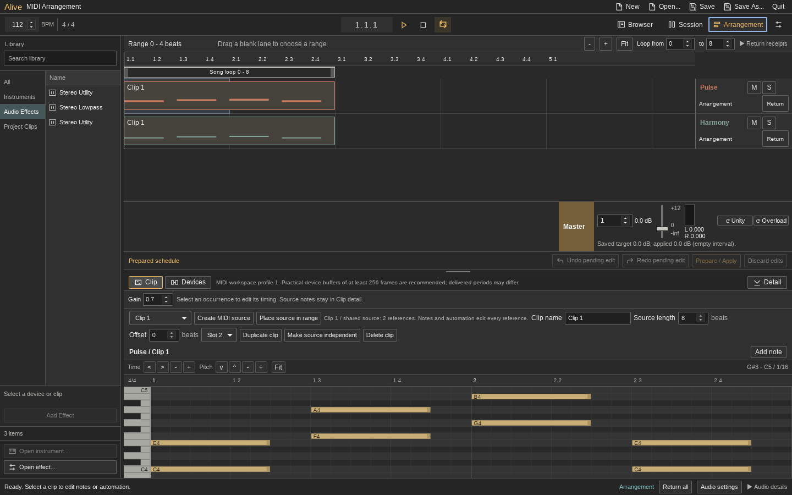

# Phase 2 UI Fidelity And Resizing

This pass implements the approved top bar, browser and MIDI piano editor changes
on `feat/phase2-ui-fidelity`, based on `56720e5`. The worktree is
`/home/venetanji/.codex/worktrees/phase2-ui/alive`. The user accepted the running
preview and authorized publishing this pass to existing draft PR #6, whose
remote branch is `feat/alive-session-host`. This pass does not replace the
baseline Phase 2 artifacts or its launcher.



## Result

- A 25px document bar and 40px musical toolbar with fixed 4/4 bar/beat/sixteenth
  position. Precise transport controls live in Transport and View options.
- A searchable two-pane library of bundled Ultra devices and project MIDI clips.
  Selection stays local; explicit activation uses the existing native commands.
- A piano keyboard, musical ruler, independent time/pitch navigation, Fit notes
  and velocity lane with original note ownership and atomic edit gestures.
- Browser/detail clamping and regional scrolling at small window sizes. A wide
  browser shrinks when necessary to retain usable workspace and Master controls.
- Stable Audio details geometry and fewer redundant accessibility text updates.

Unfinished fields survive browser navigation and closing Transport options.
Return to the field and press Tab to accept it before file actions. Accepted
session generation changes clear parked fields so they cannot affect a different
project. Overlapping chord velocity markers prioritize the selected note.

## Validation

| Check | Result | Receipt |
| --- | --- | --- |
| Alive Node suites and audio settings | 159 passed | `receipts/node.log` |
| Full Alive Chromium suite | 64 passed | `receipts/browser.log` |
| Rust library with existing native engine | 291 passed, 4 ignored | `receipts/rust-library.log` |
| Final normalized catalog paths | 5 passed | `receipts/rust-catalog.log` |
| Native UI and bundled catalog | Passed, both workspaces at four sizes | `receipts/native-ui.json` |
| Extended native Arrangement journey | Incomplete: expected Return-gap observation failed | `receipts/native-arrangement.json` |
| Desktop navigation helper | 2 passed | `python3 -m unittest test_alive_workspace_navigation.py` |
| Alive development build | Passed | `receipts/build.log` |

Native captures cover 1440x900, 1280x800, 1024x768 and 800x600 on a private X
display. Chromium additionally checks 1920x1080, live resizing, a wide browser,
unchanged scores/commands during navigation, note/velocity gestures and input
draft isolation. These are original Alive captures with example content.

The Impeccable detector ran once. Its retained report includes dense padding,
small text and palette advisories. Functional shell/browser labels were raised
to 11px, including compact controls. Compact padding and neutral tonal divisions
follow the pinned desktop reference. This is not a claim of an empty detector
report. Native resize and rendered interaction checks provide the direct evidence.

Independent review found and verified fixes for relative device paths, navigation
blur commits, disclosure commits, cross-session parked drafts and overlapping
chord velocity markers. No actionable review findings remained.

## Try The Build

Close other Alive windows before launching this development build, since the
existing application identity uses single-instance delivery:

```sh
/home/venetanji/.codex/worktrees/phase2-ui/alive/apps/ultra/src-tauri/target/debug/alive \
  /home/venetanji/.codex/worktrees/phase2-ui/alive/apps/alive/examples/midi-arrangement.alive
```

The build is an unoptimized development binary. Its adjacent native library links
to the existing, unchanged engine in the baseline worktree; build artifacts are
ignored. For a normal independent release build, use `bash apps/alive/build.sh`
from this worktree.

Reproduce the rendered checks from `apps/ultra/tests/ci`:

```sh
ALIVE_TEST_PORT=4187 ./node_modules/.bin/playwright test alive-chain.spec.mjs
```

Reproduce the private native UI checks from the worktree root:

```sh
ULTRA_TEST_ALIVE=1 ULTRA_TEST_SCREEN_SIZE=1920x1080 \
ULTRA_TEST_ALIVE_BINARY="$PWD/apps/ultra/src-tauri/target/debug/alive" \
ULTRA_TEST_ALIVE_SESSION="$PWD/apps/alive/examples/midi-arrangement.alive" \
ULTRA_TEST_SCRIPT="$PWD/apps/ultra/tests/check_alive_ui_fidelity.py" \
bash apps/ultra/tests/check_canvas_desktop.sh /tmp/alive-ui-fidelity-check
```

The separate existing `check_alive_arrangement.py` journey reached native create,
move/trim/resize, history, admission refusal, Save, Apply, playback of authored
MIDI, and pending Return navigation. It then failed its unchanged three-second
observation of a brief empty-source interval after Return. The failure screenshot
shows the gap, while the last accessibility read reported the original source.
The run did not reach its final restart checks. This result remains a failed
extended regression; its assertion and deadline were not relaxed. The native UI
resize result is recorded separately. The raw-beat accessible output preserves
the original precision for existing native transport checks despite the new
visible bar/beat notation.

## Limits

Before publishing, Node (159), Chromium (64) and Rust library (291 passed,
4 ignored) checks were repeated on the final source. Exact-head cloud runs for
the superseded `56720e5` checkpoint are retained and audited in
`cloud-56720e5/`. That checkpoint's Linux CI failure is the hosted Cutoff
automation-ownership assertion in the Master journey; it is distinct from the
local Return-gap failure recorded here. Neither is a full qualification pass.

This remains a bounded MIDI host, with native admission policies and unfinished
Phase 2 qualification. It does not claim full Live feature parity, physical audio
qualification, the Q1 endurance gate or WAV-track support. At 800x600, scroll the
detail region to move between clip controls, piano, velocity and numeric fields;
they cannot all remain visible beside the Session mixer at that height.

The invoked Omarchy app skill describes a C++/Qt Quick application template. This
pass retains Rust/Tauri and its existing GTK application identity, keyboard and
data-safety conventions. No Qt migration, live Omarchy theme/language watcher,
Arch packaging or launcher replacement is implemented. Those require separate
desktop integration work and do not improve Live visual fidelity by themselves.
